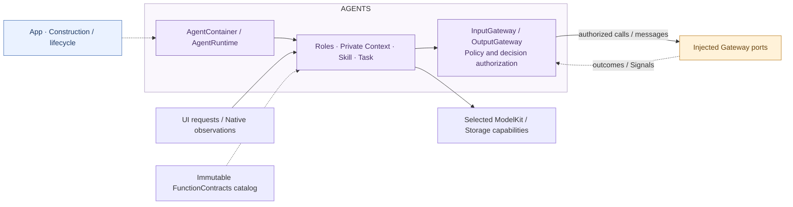

# Agents — Cognition, authorization and role coordination

## Responsibilities and boundaries

AgentContainer is the App-scoped cognitive root. It owns AgentManager, role lifecycle, private context, Skills, Tasks, decision snapshots, Action availability, communication permissions and explicit authorization revocation. App injects Gateway communication/scheduling capabilities and narrow host ports. Agents imports AgentCore, FunctionContracts, Gateway and selected foundation SDKs; it does not import Actions, CallRuntime or ExecutionRuntime.

UI requests and native observations reach their responsible roles directly. Roles subscribe and process typed input; foundations never call a role or construct business Signals. Each role receives only required capabilities, without requiring every foundation root. Models support cognition; deterministic input processing does not create inference unnecessarily. Business effects use the registered execution chain rather than direct native calls.

## Direct relationships

App binds camera/device/voice and maintenance collaboration through neutral ports. No adapter retains or searches an Actions/Gateway upstream container. The complete execution path is in the [overall design](../README.md); this diagram shows only direct neighbors.

## Roles and internal structure

| Owner | Inputs and collaboration |
| --- | --- |
| [Assistant](Assistant/README.md) | Home text, Chat and private decision context; receives speech finals, requests synthesis and delegates fixed Tasks; selects dynamic Skills. |
| [ApplicationControl](ApplicationControl/README.md) | Settings/resources/devices/diagnostics requests and device/artifact/failure observations; owns administrative and diagnostic policy. |
| [Memory](Memory/README.md) | History requests and private context; authorizes history calls and fixed Task results. |
| [Photographer](Photographer/README.md) | Camera/album requests, pose and tracking availability; owns capture/tracking intent and policy. Consumes PlatformKit position-update cadence; tracking dispatch retains only the newest pending intent. |
| [SpeechPerception](SpeechPerception/README.md) | Listening requests, native PCM, VAD/ASR and sound-source computation; owns consent/half-duplex policy and transcript messages. |
| [SpeechSynthesis](SpeechSynthesis/README.md) | Directed synthesis/cancel, TTS and owned cache production; does not issue playback calls itself. |
| [VisionPerception](VisionPerception/README.md) | Read-only camera frames, Pose inference and projection; publishes pose and requests protected presentation. |
| [Support](Support/README.md) | Cognitive Gateway adapters, policy, routing, coverage, Chat, Context and common lifecycle mechanisms. |

AgentContainer delegates sixteen exact canonical source bindings to AssistantStateBindings. App injects a local node read; loaded Skill.useStates controls exact paths and Assistant chooses Business fields. Ancestors/descendants are not implicitly read or disclosed. Generic Context/Chat remains independent of that policy. See [source mappings](Support/Context/README.md#container-context-read-path).

AgentRuntime assembles cognitive services and role hosts. Its preparation stage returns a neutral business request to App. App calls ActionsContainer configuration, passes the resulting host ports into the single-use Agent validation stage, configures Gateway from the resulting configuration, then calls AgentContainer.bindExecution. AgentRuntime does not invoke Actions/Gateway configuration callbacks. Preparation and binding handles consume their continuation before execution; failures require scope rollback rather than retrying a partially prepared scope. Role-specific resource takeover policy is authored here and injected as opaque endpoint values. Native stop callbacks belong to the execution owner.

## Native intake and semantic roles

Perception and cognition describe role responsibilities within Agents. SpeechPerception and VisionPerception consume constructor-injected native PCM/frame observations directly and produce meaningful speech/pose messages for other roles. These messages use Agents authorization and Gateway endpoint delivery; the raw stream is not an inter-role Signal. UI requests and device/model/container facts can reach their responsible role directly. Any authorized role can originate internal messages or execution requests without first passing through perception.

Perception does not require a second cognitive role for every reaction, and cognition does not require model inference for every input. A perception role may issue an authorized presentation/listening call; business effects still use Gateway and Actions. Read-only input subscriptions do not own capture startup or native control. The [overall input/Signal figure](../README.md#native-input-and-internal-signals) owns the complete source-to-effect and feedback view; local speech/vision READMEs own their algorithms and buffering.

## Authorization and communication

OutputGateway binds the actual producing role/incarnation and frozen decision catalog before forwarding canonical calls. Skill availability, Task grants, role communication and semantic receiver checks are entirely cognitive policy. Model-supplied parameters cannot forge producer identity. Fixed calls use their registered role descriptors. Registration does not imply authorization. Actions owns registration and authoritative business validation; Gateway owns endpoint/resource/scheduling validity. The [registration-to-completion matrix](../README.md#action-lifecycle-responsibilities) defines the full chain.

InputGateway binds each role to a generic SignalTransport endpoint. Agents checks publish/send contracts and target permissions; Gateway transports opaque payloads under endpoint/envelope/capacity/scope checks. Agent A and B use independent bound endpoints on the same Gateway root. Semantic interpretation remains in the receiving role.

After Gateway admission, Skill permissions are not queried again. Revocation explicitly cancels the affected execution scope. Agents projects neutral outcomes back to cognitive causality and decides history, Task advancement and continuation. Delivery acceptance is separate from business consumption. Reply/round barriers join the relevant execution and feedback before continuation.

## Lifetime, inputs and failures

App creates one AgentContainer and starts it after Gateway. Stable role subcontainers are internal cognitive components, not additional App roots. Startup installs declarations, context sources, coverage and typed hosts before role work begins. Root lifecycle coordinates role startup, invalidation, foreground transitions and joined stop independently of pages.

Each direct input source has a long-lived owning consumer rather than per-frame forwarding tasks. ProcessingContext carries request/session/generation/turn and causality, without granting authority. UI request/reply generations and native stream generations remain distinct. Roles own their decision, subscriptions and model producers; Actions owns actual voice/camera/device execution and interaction facades. Passive activity projection interprets Agent/Task evidence here and never executes callable effects.

Stop closes cognitive admission, cancels and joins role work, and retains original terminal/cleanup ports while Gateway and Actions drain. App releases bindings only afterward. Role shutdown does not globally stop borrowed scheduler/transport roots. Primary and cleanup failures remain explicit; a failed cleanup prevents replacing native owners. Conversation interruption can retain Task/Skill, while session closure releases them; neither automatically replays effects.

Public containers expose UI-owned state/control interfaces and narrow role capabilities, without exposing mutable registries, raw handlers or private role state. Capacity, algorithms and failure contracts live in the linked role and [Support](Support/README.md) READMEs.

## Reflexive state reads and disclosure

`AgentContainer.stateSnapshot() async throws` reads only root lifecycle/health and returns seven role path indices. stateReaders() binds independent weak-owner role readers using local AgentStateSnapshot, without reading private role context during discovery. Roles expose lifecycle, queue counters, installation/closure and private task/Skill counts or phases; no messages, goals, credentials or reasoning are copied into this inspection view. Root lifecycle failure is separate from normal suspension. Role State reads use Agent.residentContext() and the repository’s last initialized committed memory. They never restore persistence, wait for a pending write or trigger startup. Before initialization the context fields are unknown; Agent start retains restoration and failure ownership.

Sixteen canonical source bindings are registered. The effective loaded Skill useStates union selects exact nodes on each real request; registration does not disclose state. ExpressionInteraction selects ui.home.expression and RobotInteraction explicitly adds actions.robot.motion. There is no whole-tree health/diagnostic source, implicit descendant grant, model discovery, loadState, polling or new recovery authority.

Business contains actual task phases and admitted model-preparation activity. Role lifecycle, installation/closure, queue/processed-input metrics and private Skill/task-view counts belong to Runtime. Speech and vision worker existence is Runtime, independent of user-visible speaking/listening or perception results. Assistant filtering is confined to its own directory, never generic State/Chat infrastructure.

AgentContainer scene transitions stop or resume its own roles and perception work. Camera/device scene invalidation, idle joins and shutdown belong to ActionsContainer. Agent camera/device ports expose business operations rather than root lifecycle controls. AgentGatewayAssembly prepares cognitive communication adapters and a neutral GatewayConfiguration; App configures the Gateway root and returns public capabilities for final binding.

AgentContainer declares foregroundModelRequirements from its role needs and current camera intent. App requests corresponding preparation steps from ModelKit. SpeechPerception owns complete session presentation availability. The failure channel classifies model/platform lifecycle admission errors as suppressed evidence, preserving cleanup failures for publication; App supplies sinks without duplicating this policy.

ApplicationControl owns fixed UI window requests through Gateway, with four independent ordinary operations and one close control slot. Photographer retains camera/album requests, including the camera-window shutter. Assistant's Photography and ApplicationControl Skills select ui.windows and share Window.* aliases without expanding BasicSkill.

Background visual demand alone adds the vision model requirement. Photographer routes fixed photo and visual UI operations through distinct Capture/Perception Actions while retaining one request owner. Assistant selects Foundation camera State via the relevant loaded Skill; it does not infer actual device state from UI intent.

## Photo/video UI flow

Photographer consumes typed photo/video settings and recording controls through its existing single UI request path, emits fixed internal calls to Gateway and returns actual Action results. Assistant's Photography Skill governs conversational capture decisions and Task/window closure; it does not start background vision. Recording disables microphone listening, so the Skill uses a stop button or native duration limit rather than promising a voice stop. See [Photographer](Photographer/README.md) and [Assistant](Assistant/README.md).
