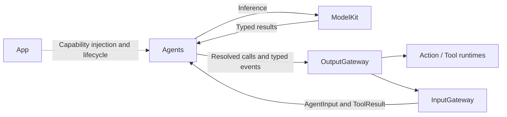
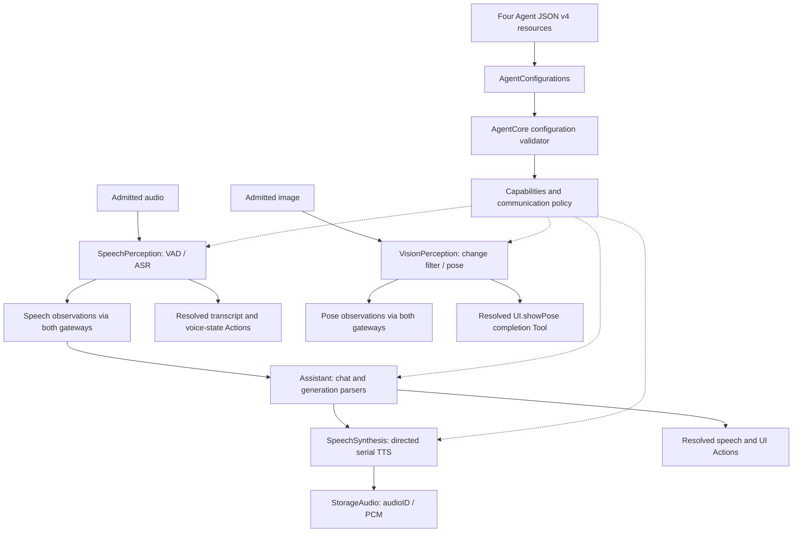

# Agents — Perception and Business Policy

Implements stateful actors that interpret input, request model capabilities and select outputs. The goal is independent roles with explicit permissions and bounded work. Agents depends on AgentCore, ModelKit and the shared StorageAudio cache; App injects capabilities and binds executable handlers.

## Directory structure

```text
Agents/
├── AgentConfigurations.swift  # Load versioned JSON from package resources
├── Assistant/                 # Chat, reply history and resolved speech/UI Actions
├── SpeechPerception/          # VAD, segmentation, ASR and speech observations
├── SpeechSynthesis/           # Directed serial synthesis into shared PCM handles
├── VisionPerception/          # Frame filtering, pose inference and skeleton ToolCalls
└── README.md                  # Shared Agent and configuration rules
```

Each implemented Agent has `<AgentName>.agent.json`, an actor implementation and a README. Helper files remain in that Agent's directory. Shared parsers belong in AgentCore/Generation. Add JSON resources to root Package.swift; the loader uses Bundle.module, not App bundle lookup.

## Upstream and downstream

Arrows show runtime data flow; Agents never call concrete Actions or Tools.



## Internal structure and data flow



SpeechPerception owns one utterance across ASR segments. Assistant consumes final speech and speech onset, maps generated text to configured Actions and retains bounded session history. VisionPerception performs one shared pose request per admitted frame and independently publishes pose state and displays skeletons. Photographer has no active implementation or packaged configuration.

Each actor documents its own capacity, overflow, pause, stop and cleanup rules: [Assistant](Assistant/README.md), [SpeechPerception](SpeechPerception/README.md), [SpeechSynthesis](SpeechSynthesis/README.md) and [VisionPerception](VisionPerception/README.md). Audio and discrete work fail on overflow; vision can replace its latest pending frame, observation and display state. Generation completion does not mean playback completion. Stop must close admission and join owned work before a replacement session starts.

## 输入输出文档约定

每个 Agent README 都要按下面四个方向描述当前实现，且以同目录 JSON v4 声明和 Swift 行为为准。JSON 的 `communication.inputs` 表示可接纳的 `contract / version / kind`；`subscriptions` 另限定广播消息的 `source / topic`。声明输入不自动创建订阅。定向消息由 Gateway 校验发送方、目标方和双方权限，不需要目标方订阅。

| 方向 | 数据标准至少写明 | 边界 |
| --- | --- | --- |
| 输入 | 接收方式、contract/version/kind、source/topic 或目标、payload 类型与字段、单位/上限、会话/序号/期限、拒绝条件 | 所有外部输入和 ToolResult 经 InputGateway；注入依赖与生命周期方法须标为非业务输入。 |
| 输出 | `OutputEnvelope` 中 ActionCall、ToolCall 或 control 的路径/参数/Channel、触发时机、完成语义和失败行为 | 输出流由 App 送 OutputGateway；调用接纳、Action 完成和最终播放是不同事件。 |
| publish | `communication.publications` 的 contract、typed `AgentMessage` payload、发送时机、消费者、可替换/丢失策略和接纳回执含义 | `AgentMessaging.publish(..., parent:)` 经 OutputGateway → InputGateway 广播；不是 Action/Tool 输出。 |
| send | `communication.sends` 的 contract/target、typed payload 字段、因果与所有权、接纳/取消/超时语义 | `AgentMessaging.send(..., parent:, to:)` 走同一双 Gateway 链路，但只定向一个 Agent。 |

公共 `AgentInput` 包含 `id: UUID`、`sessionID: UUID`、`turn: ConversationTurn?` 和 `InputMetadata(contract, version, topic, source, incarnation, capturedAt, sequence, rootID, parentID, hops, deadline)`。publish/send 的端口绑定发送方身份，以 `parent` 继承会话、轮次和因果关系；接收方不能从业务 payload 自行推断授权身份。`DeliveryReport.delivered / rejected` 只表示目标 Agent 的接纳或拒绝，不代表推理、合成、Action 或播放完成。`OutputEnvelope` 含 `source / inputID / sessionID / turn / sequence / output`；它与共享观测消息是两条不同的输出通路。某方向没有声明或实现时，明确写“无”，不要把缓存副作用或本地方法误记为 publish/send。

## Capability configuration v4 — JSON

Use UTF-8 `<AgentName>.agent.json`, parsed by Foundation JSONDecoder. JSON comments are not supported: use doc. Version 4 uses doc for usage guidance; the loader accepts JSON v4 only. Repackage configuration and code together.

All fields below are required except hidden, which defaults to false. Arrays must be present; constraints may be empty. Names are case-sensitive. Unknown fields, incorrect types and missing fields fail validation. Change schema semantics through explicit version migration.

| Top-level field | JSON type | Contract |
| --- | --- | --- |
| schemaVersion | Integer | Exactly 4 |
| agentID | String | Stable identity matching the Agent implementation |
| channels | Array of String | Additional allowed Channels, such as main; action defaults are also allowed |
| textActions | Array of String | Ordered unique aliases for natural-text mapping, at most 8; each must accept string text without other required parameters |
| actions | Array of Object | Actions this Agent may invoke |
| tools | Array of Object | Native tools this Agent may invoke |
| communication | Object | Required inputs, subscriptions, publications and sends arrays; see AgentCore/Communication |

Each Action entry uses this common registration format:

| Field | JSON type | Meaning |
| --- | --- | --- |
| alias | String | Agent-local model-visible name, such as say |
| path | Object | Exactly module and function strings, such as Speech / speak |
| defaultChannel | String | Channel used outside an explicit scope |
| doc | String | Function-derived instructions for the LLM: what it does and how to call it; describe a return value only if one exists |
| hidden | Boolean | Optional; false by default. True omits the capability from model-facing context without unregistering it |
| parameters | Array of Object | Ordered parameter documentation and required flags; the sole source of parameter names |
| examples | Array of String | 1–8 GhostShell/XML examples, optionally mixed with natural text, such as `<express emotion="smile"/> Hello.` |

Tools use the same fields except path is a String such as System.runtimeInfo and defaultChannel is forbidden. Their examples are native JSON call strings with exactly name and arguments, for example `{"name":"runtimeInfo","arguments":{}}`. Tools are not XML Actions.

Each parameter contains:

| Field | JSON type | Meaning |
| --- | --- | --- |
| name | String | Exact key the Action reads from the invocation |
| valueType | String | Intended parsed type: string, integer, number or boolean |
| required | Boolean | Whether the caller must supply the key |
| description | String | Meaning of the parameter, including units where relevant |
| constraints | String | Human-readable limits, accepted formats, normalization and omitted-value behavior; may be empty |

**Transport values remain strings**, including numeric and boolean examples: use `"speed": "0.5"` or `"enabled": "true"`, not JSON numbers/booleans. valueType and constraints document function semantics; they do not perform conversion, execute validation expressions or inject defaults. The Action itself owns parsing, semantic validation and optional-parameter defaults. Keep these descriptions synchronized with its implementation.

Action examples are strings in the actual model-output syntax. Use self-closing action tags, quote XML attribute values and escape XML entities. Natural text can appear before or after tags. The loader parses every example using FunctionTokenParser and resolves explicit actions against the Agent registry, including parameter names and Channels. An example must demonstrate its containing Action, either explicitly or through natural-text mapping for a textAction. This checks syntax and call structure, not execution-time value constraints.

Visible examples must not explicitly call hidden Actions. Write natural text instead of exposing hidden say/print tags. Configuration authors must also keep doc prose free of instructions to call hidden capabilities. hidden is a prompt-visibility flag, not an authorization or security boundary; internal resolution and existing explicit-call permissions remain unchanged.

### Limits and error behavior

- Configurations are at most 64 KiB and contain at most 128 Action/Tool entries combined. Each capability has at most 32 uniquely named parameters and 1–8 examples. Each doc, parameter description/constraints string and example is at most 2048 UTF-8 bytes; doc, parameter descriptions and examples must be nonblank.
- Agent IDs, aliases, path components, tool paths, Channels and parameter names match `[A-Za-z_][A-Za-z0-9_.-]*` and use at most 64 UTF-8 bytes. Paths are registry keys, not reflection or filesystem paths.
- Actions and Tools share the alias namespace within an Agent. Duplicate aliases or parameter names fail. Aliases cannot start with channel.; different Agents may bind the same alias differently.
- Channel and textActions arrays must be unique; at most 16 Channels are allowed after defaults are included. Text mapping accepts string text and no additional required parameters. Assistant requires a nonempty textActions list; other policies can leave it empty.
- Required/optional name sets are derived from parameters[].required. Do not also maintain requiredParameters or optionalParameters in JSON; these obsolete fields are rejected.
- Missing resources, malformed data, unsupported versions and invalid identity/structure propagate as errors. Do not use try!, swallow errors, fall back to hardcoded lists or broaden permissions. App remains unready on configuration failure.
- Configuration and descriptions are bundled author-controlled content, not an authorization source for physical devices. Runtime checks and platform permissions remain necessary.

## Registration and implementation rules

- JSON is the sole production list of Actions, Tools, Channels, text mappings and communication permissions. App separately binds explicit Swift handlers; do not duplicate permission lists in Agent Swift code or discover arbitrary handlers by reflection.
- `communication` requires inputs (contract/version/kind), subscriptions (contract/source/topic), publications (contract names) and sends (contract/target). Empty arrays grant no permission; source/topic matching is exact. Cross-Agent policy validation happens at App assembly.
- CapabilityContextBuilder exposes only Actions with hidden=false. Tools remain a separate protocol and never enter this system-prompt text. Current ChatCapability has no native Tool-call event stream. A completion-only Tool must describe completion in its JSON doc; App selects its Void handler.
- Resolve aliases inside the Agent with shared AgentCore parsers/registries. Emit resolved ActionCall or ToolCall through OutputGateway. Native Tool calls are not XML; recognized text and Tool results are data, not executable markup.
- External input and Tool results enter through InputGateway. Preserve session, input, turn and source context. Publish internal facts through the bound messaging port; no direct Agent-to-Agent call or UI callback is allowed.
- Mutable state belongs to the Agent actor. Bound inboxes, history, parser buffers and output; do not spawn unlimited per-input tasks. Cancel model sessions, suppress stale output and join cleanup. Current stop is terminal; restart and background persistence are not implied.
- Agent-selected presentation must use configured Actions or Tools. App event observers supervise runtime admission and errors; they cannot mutate business presentation. Model inference remains a capability request, not a device Action.
- Model failure and overflow must propagate. Production has no fixed-reply substitute; test doubles belong under root Tests.
- New Agents need a real implementation, JSON resource, App composition and focused tests for policy, lifecycle and failure boundaries. Update the owning README; run repository checks and update ADRs/roadmap when runtime contracts change.

## Feature status

- ✅ Assistant, SpeechPerception, SpeechSynthesis and VisionPerception actors with JSON v4 configuration.
- ✅ Strict resource loading, local aliases, visible Action context and static event permissions.
- ✅ Shared parsing, bounded processing, conversation-turn context and cancellation coverage.
- ❌ Photographer camera-motion policy, tracking, media/control Agents and robot behavior. The future concept lives in [docs](../../docs/Photographer-Proposal.md), not an empty source directory.
- ❌ Configuration hot reload, full executable value schemas, native Tool deltas and general request/reply.

See [Assistant.agent.json](Assistant/Assistant.agent.json) for a complete configuration. Expression names and guidance are kept there and in Actions/UI, rather than copied into this standard.

## Issue record

| Status | Issue / next step |
| --- | --- |
| Open | Sustained speech/camera operation and real-model output quality require physical-device acceptance. |
| Open | Configured value types are documentation, not runtime casts; each handler must validate semantic values. |

## Direct input admission contract

✅ Gateways directly call receive; Agent inboxes own all pending-message buffering. Ordinary receive must validate/admit or reject promptly, without awaiting inference or inbox space. Concurrent calls have no transport FIFO guarantee: Agents requiring stale-state rejection use session/source/sequence checks. State coalescing belongs to the Agent and must be explicit; discrete events and device actions cannot silently disappear. Lifecycle/control cancellation may join cleanup. Existing Assistant, SpeechPerception and VisionPerception buffering policies remain; see ADR 0048.


✅ SpeechSynthesisAgent is an independent JSON v4 directed service with one FIFO model worker. Agents may additionally depend on StorageAudio for the shared audio cache; they still cannot depend on Actions, Gateway, PlatformKit or concrete engines. Assistant binds a messaging port and sends text before emitting audioID playback. ❌ Hardware timing acceptance remains pending.
