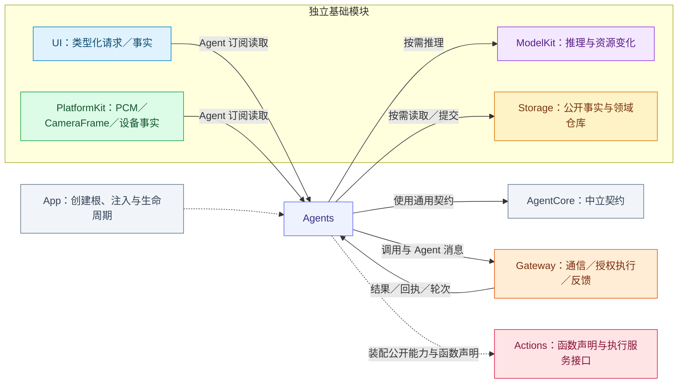
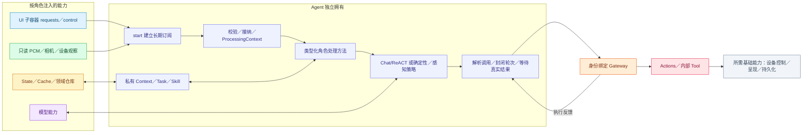

# Agents — 输入消费、业务决策与角色协作

## 职责与依赖边界

Agents 解释外部输入、维护私有业务状态、调用模型并选择操作。每个角色只构造注入所需的基础子容器、只读观察接口或领域仓库，**不要求每个 Agent 都依赖 UI、PlatformKit、ModelKit、Storage 四个根**。App 创建唯一基础根并提供能力，Agent 不全局查找容器。

UI、PlatformKit、ModelKit、Storage 不导入 Agents、Actions 或 Gateway。UI 页面只提交 UI 自有值到子容器；Agent 持有订阅并主动读取。本文中的“UI 请求”是带回执的数据契约，不是 UI 对 Agent 的方法调用、控制或路由。

## 外部关系

图只列本模块的一层邻接关系。完整 Gateway → Actions → 基础能力执行链见[总体设计](../README.md)；基础库不存在指回 Agents 的编译依赖。

## 通用内部设计

直接输入角色在 start 建立订阅，循环校验并调用类型化处理方法；一个输入源有一个长期消费任务，不逐帧创建转发 Task，不把原始输入包装为外部 Signal。pause 的行为由角色定义：对话取消当前决策，合成保留队列并允许活跃 producer 结束，直接输入角色关闭相应接纳；stop 取消并加入所拥有的工作。

ProcessingContext 保存请求、会话、代际、轮次及因果身份，只用于本地处理与构造 OutputEnvelope，不授予执行权。Gateway 另行校验真实实例、权限、任务授权、资源租约、取消及结果归属。设备开关、拍照、播放、业务查询和动画等业务效果由 Actions 执行。

## 角色能力与通信

| 角色 | 直接输入／计算能力 | 主要协作 |
| --- | --- | --- |
| [Assistant](Assistant/README.md) | UI.home 文本；Chat；公开 State／会话与任务仓库；照片读取与 JPEG 准备能力 | SpeechPerception 的 final/phase；向 SpeechSynthesis 定向请求；向三个固定角色委派 Task；动态 Skill → Actions |
| [ApplicationControl](ApplicationControl/README.md) | settings/modelResources/devices/diagnostics 请求；设备连接与模型资源变化；直接故障观察 | Assistant Task；系统、资源、设备和诊断呈现 Actions |
| [Memory](Memory/README.md) | history 请求与私有角色 Context；标题生成器独立注入 Chat | Assistant Task；历史查询／变更／呈现 Actions |
| [Photographer](Photographer/README.md) | camera 请求及低频事实；跟踪可用性；私有角色 Context | VisionPerception pose、Assistant Task；Camera／NexArm Actions |
| [SpeechPerception](SpeechPerception/README.md) | home.listeningRequests；只读 PCM；VAD／ASR | Assistant replyActivity；发布识别／阶段／声源；Listening 与呈现 Actions |
| [SpeechSynthesis](SpeechSynthesis/README.md) | 定向合成／取消；TTS；Cache.audio | Assistant 发起合成，Actions 播放读取缓存；自身无业务调用输出 |
| [VisionPerception](VisionPerception/README.md) | 只读 CameraFrame；Pose | 向 Photographer 发布 pose；骨架／眼睛内部 Tool |

表中列的是实际能力归属，不把通过 Actions 间接使用的基础库画成 Agent 构造依赖。具体注入类型、函数地址和 Signal 字段由各角色 README 说明。

## 模块根与具体装配

具体应用装配位于本模块根级，Support 保存跨角色机制。七个角色保持平级，角色专用输入值、策略、观察、执行会话与业务状态归各自目录。

| 文件 | 职责 |
| --- | --- |
| [AgentApplication.swift](AgentApplication.swift) | 模块根及按需角色功能接线，持有环境事实观察与会话的公开生命周期 |
| [AgentContracts.swift](AgentContracts.swift) | 显式角色身份与生产通信目录，不拥有角色私有载荷处理 |
| [AgentRepositories.swift](AgentRepositories.swift) | 构造注入的 Chat／Task／Media／Device 仓库切片 |
| [AgentResourceBindings.swift](AgentResourceBindings.swift) | 将相机所需资源端口接到 Gateway 公开租约保护，不消费媒体 |
| [AgentRuntime.swift](AgentRuntime.swift) | 构造角色、Gateway 与 Actions 窄端点，连接真实注册、权限、资源和结果反馈 |

AgentApplication 接收基础能力与仓库工厂，按需创建 AgentRuntime、相机与语音功能，并向 App 暴露状态和交互接口。AgentRuntime 创建角色、Gateway 与 Actions 的窄执行端点，连接注册、权限、资源和反馈。AgentContracts 注册应用角色身份和通信目录；跨角色值位于 Support/Communication，角色专用载荷由接收角色解释。AgentResourceBindings 适配相机资源保护，不消费原始媒体。

共享机制不通过具体角色类型表路由私有输入；固定任务的解码策略由实际执行角色提供，通用 Chat 的会话控制由角色 Context 提供。角色订阅不自动获得控制权，所有业务调用仍经过身份绑定的 Gateway。

AgentApplication 的原生功能与角色分开停止：stopNativeServices 先撤销原生接纳，取消并加入观察和准备任务，再清理相机、蓝牙及语音；多个清理错误合并为 NativeCleanupFailure。stopAgents 关闭环境输入与 AgentRuntime，最后释放公开 StateScope。App 负责调用这些生命周期入口。

## 公共机制与目录

| 目录 | 通用机制 |
| --- | --- |
| [Support](Support/README.md) | 跨角色 UI 订阅、执行关联、故障聚合和资源配置加载 |
| [Support/Chat](Support/Chat/README.md) | 模型请求、协议消费、反馈续轮及历史边界 |
| [Support/Context](Support/Context/README.md) | 私有 Context 事务、Task／Skill 状态与固定任务协调 |
| [Support/Communication](Support/Communication/README.md) | 跨角色业务值及通信契约；执行宿主由各角色目录拥有 |
| [Support/Core](Support/Core/README.md) | 独立 AgentCore 目标：仅依赖 Foundation，提供中立运行契约 |

## 生命周期、容量与完成

UI 普通请求每源最多 64 个未终态项；控制使用独立单槽。无消费者、重复消费者、满载、取消及代际失效显式结束回执。接纳与业务完成分开：Assistant 文本回执确认进入决策；设置保存、历史读取和摄影事务等待真实结果；聆听回执确认策略接纳。角色加入取消，旧 token 不能关闭新消费者。

原始 PCM 接纳只有原生 64 包有序缓冲，溢出显式失败；VAD 已提交的模型工作和冷初始化前缀由 SpeechRecognitionTurn 独立有界保留。视觉为最新帧替换及一个在途推理。媒体转换由消费角色负责，订阅不请求权限、不启动或切换设备。原生预览与模型推理分开；频谱等低频测量交给 Actions 呈现服务。

State 只保存有限公开事实，拥有者持唯一 Writer；完整 Context、Skill 所有权、PCM、帧及队列保持私有。会话／任务／消息领域事实按实际提交边界持久化，重启将未完成记录标为 interrupted，不重放副作用。

容器故障在 Support 聚合，ApplicationControl 直接观察并决定 Actions 展示，Assistant 被动保留诊断。根消费者独立于页面，停止先关闭接纳，再取消加入工作，最后释放基础根；启动前故障由 App 兜底。

## 待实现

❌ 通用生产后台任务的完整业务契约、跨场景前台 Task 的统一最终 checkpoint、活跃 worker 的持久化恢复。
