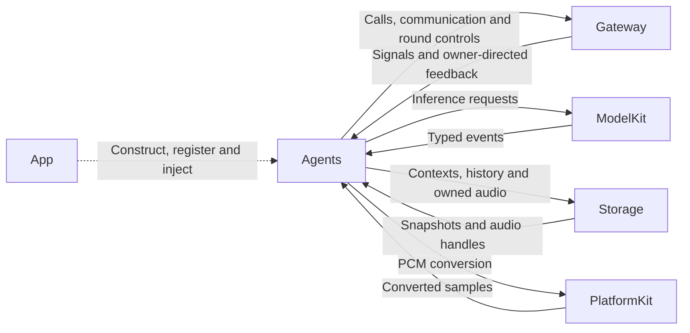
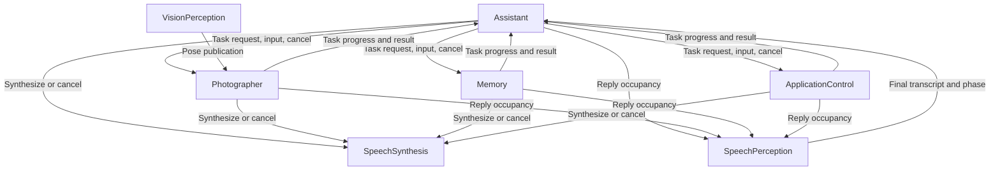
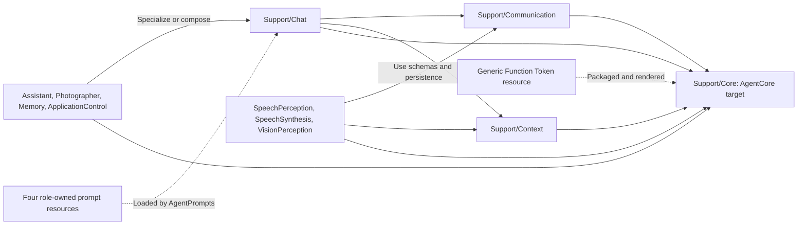

# Agents — Business Decisions and Signal Processing

## Summary

Independent business roles interpret admitted Signals, own durable decision/task state and emit authorized function or communication requests.

## Ownership and boundaries

Agents owns meaning, policy and task coordination. Gateway owns admission/execution transport; Actions implements business effects. UI, Storage, ModelKit and PlatformKit remain independent foundations. The Agents target depends on AgentCore, ModelKit, PlatformKit, Storage, StorageChat and StorageAudio; it imports no UI, concrete Actions or Gateway.

## External relationships and data flow

Runtime arrows show data or capability calls; dashed arrows show injection.

## Internal structure

Runtime communication below is routed by Gateway; arrows do not represent direct role calls.

Source composition and dependencies:

## Role ownership

| Role | Responsibility |
| --- | --- |
| Assistant | Default text/ASR entry, basic reply/expression/Robot Actions and explicit specialist delegation |
| Photographer | Camera reasoning/disposition, camera state context and deterministic tracking |
| Memory | History queries, confirmed mutations, archive/title sequence and private history reasoning |
| ApplicationControl | Provider/resources/navigation/device transactions and application environment facts |
| SpeechPerception | Resident listening authority, VAD/ASR and sound-source observations |
| SpeechSynthesis | Directed text synthesis into owner-scoped PCM; no playback |
| VisionPerception | Pose inference cadence, gaze and independent pose publication |

Actions may be registered by multiple roles; permission and feedback remain specific to the real executor. Typed UI data requests subscribe directly at their owner and do not create Assistant tasks. Conversational delegation uses authorized send Actions. Model content cannot supply trusted identity, confirmation or grants.

## Shared source and context contracts

Support/Core is the Foundation-only AgentCore target and is excluded from Agents compilation. Support/Communication defines application schemas/configuration; Support/Chat adapts model decisions; Support/Context adapts atomic persistence. Each role owns its State, SignalPreprocessor, ContextBuilder, prompt, permissions and completion policy.

`<Role>Agent.swift` owns the role interface, dependencies, registration, lifecycle, admission, outputs and observability. Assistant specializes the shared worker with a type alias; the other chat roles compose it alongside fixed workflows. `<Role>Processing.swift` owns state schemas, preprocessing, context builders and grants. Focused Workflow/Policy files own meaningful algorithms. Shared adapters do not choose concrete business priorities.

Context commit precedes dependent output. A selected immutable snapshot produces each exact model request; media bytes and credentials stay outside durable evidence. Restart marks interrupted work and never replays effects. Feedback belongs to the actual executor, not the task requester. Streaming roles retain 256 evidence/consumption summaries with counted eviction.

Prompt ownership: role-owned `<Role>.prompts.json` files contain system identity, response style, text-to-output guidance and workflow/user-message templates. Support/Chat loads and renders each role's templates without embedding role instructions. Core/Generation owns a separate FunctionToken.prompts.json for generic syntax, Channel/wait semantics and catalog formatting. Native Tools remain separate request declarations. Immutable JSON templates use strict single-pass named substitution; malformed resources, missing templates/variables and oversized output fail explicitly.

## Admission, reasoning and completion

Ordinary input, runtime feedback and controls use distinct admission paths. Shared Chat has one worker, FIFO inbox 32 plus one reserved continuation, output 256, four model requests, at most 120 generated calls/16 native calls, 64 KiB feedback/transcript, 30-second cumulative execution and 60-second queue expiry. Fixed transactions do not hold admission gates during inference/device work.

send receipt means admission only; TaskProgress/TaskResult report actual child state. publish returns no receipt. Round sealing joins Action and Tool execution; registered observation enables continuation. Roles publish revisioned reply occupancy; SpeechPerception alone turns occupancy and user consent into listening policy.

✅ Seven bounded roles, private contexts, explicit grants and shared decision mechanisms are implemented.

❌ Remote durable Agent transport and general automatic supervision/restart are not implemented.

## Related design

[Parent design](../README.md) · [ApplicationControl](ApplicationControl/README.md) · [Assistant](Assistant/README.md) · [Memory](Memory/README.md) · [Photographer](Photographer/README.md) · [SpeechPerception](SpeechPerception/README.md) · [SpeechSynthesis](SpeechSynthesis/README.md) · [Support](Support/README.md) · [VisionPerception](VisionPerception/README.md)
