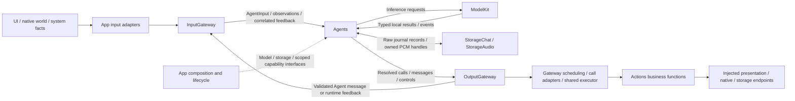

# Agents — Signal Processing and Business Decisions

## 函数注册 review 入口

✅ 七个 Agent 的 README 均以统一表格列出模型 Action、模型 Tool、代码固定流程的 InternalAction / InternalTool，以及 publish / send 通信输出权限；包含函数路径、模型名称、Channel、参数、说明和注册来源。修改 JSON 或代码权限时，同步更新所属 Agent 的清单。内部固定调用不会自动暴露给模型；通信 send 仅作为 Action call 暴露。

| Agent | 注册清单 |
| --- | --- |
| Assistant | [主入口与委派](Assistant/README.md#函数与通信注册清单) |
| Photographer | [摄影与确定性追踪](Photographer/README.md#函数与通信注册清单) |
| Memory | [历史查询与事务](Memory/README.md#函数与通信注册清单) |
| ApplicationControl | [设置、资源、导航与设备](ApplicationControl/README.md#函数与通信注册清单) |
| SpeechPerception | [字幕、语音状态与聆听](SpeechPerception/README.md#函数与通信注册清单) |
| SpeechSynthesis | [合成能力与无函数注册边界](SpeechSynthesis/README.md#函数与通信注册清单) |
| VisionPerception | [视线与姿态展示](VisionPerception/README.md#函数与通信注册清单) |

Agents interpret admitted Signals, own task state and business decisions, use injected model/storage capabilities and emit permitted communication or execution requests. Explicit user intent can be handled deterministically; LLM selection is another entry into the same registered business capabilities.

Design goals: independent AgentCore, domain-owned processing policy, explicit grants, bounded inbox/output state and effects through OutputGateway rather than direct UI/device mutation.

## Upstream and downstream

Arrows show runtime information/capability flow; dashed arrows show injection. Capability results stay local unless the Agent explicitly communicates them as Signals.

SignalOrigin distinguishes external, Agent and runtime producers within the same AgentInput envelope; trusted adapters/ports bind it rather than deriving authority from payload content.

Agents does not import concrete Actions, Gateway, UI or execution SDKs. The target depends on AgentCore, ModelKit, PlatformKit, Storage, StorageChat and StorageAudio. Perception callers adapt SDK media values; this does not grant permission to perform unregistered device effects.

## Internal structure

Support groups Core, Communication, Chat and Context by ownership; seven role directories own business decisions. Support/Core compiles independently as AgentCore. The Agents target excludes that subtree and compiles the other Support layers plus roles; target names and dependencies are unchanged.

## Canonical role ownership and naming

## Current responsibilities and file standard

✅ Assistant is the persistent default user entry: basic reply/expression and mechanical-arm Actions, capability overview and public task coordination. Photographer owns photography reasoning/capture/disposition and tracking. Memory owns history reasoning and confirmed deterministic history transactions. ApplicationControl owns settings/resources/providers/navigation and Bluetooth connections/fixed device operations. SpeechPerception, SpeechSynthesis and VisionPerception retain streaming responsibilities. Child results and private histories stay with the actual child; the parent receives explicit reports.

| Location/file | Responsibility |
| --- | --- |
| Support/Core | Foundation-only lifecycle, Signal, output, task/round/context mechanisms; no role identity or business policy |
| Support/Communication | Business Signal domains, typed task content, bundled configuration and catalog assembly |
| Support/Chat | Injected shared Chat worker/collection/request/context and communication adapters |
| Support/Context | Atomic context persistence and structured evidence adaptation |
| <Role>Agent.swift | Identity, injected dependencies, lifecycle, admission, owned workers and output |
| <Role>Processing.swift | Durable schema, preprocessor, builder, fixed grants and pure role policies |
| <Role><Workflow/Policy>.swift | An independently meaningful business algorithm/state machine/lifecycle |

Actor source uses MARK sections for Interface, State and dependencies, Registration, Lifecycle, Input processing, business workers, Output, Context and Observability. Processing source orders State, Signal preprocessing, Context building and pure policies. Use four-space formatting, English code comments and explicit limits/permissions. AssistantAgent is a canonical shared-worker specialization, so it has no duplicate actor template. Streaming roles remain streaming; deterministic workflows retain their state machines.

## Inputs, delegation and outputs

✅ External text/ASR enters Assistant. Typed backend requests subscribe directly at their owner without creating parent/child tasks; Action-call conversational delegation still uses CommunicationAction/TaskRequest. TaskRequest/Input/Progress/Result/Cancel carry trusted scopes. Gateway captures execution identity; ActionResult returns directly to the actual executor. Receipt means target admission, not task completion. Models cannot forge execution identity or trusted UI commands. No handoff runtime or global child speech subscription is introduced.

Assistant has one foreground question and bounded FIFO pending questions. The selected child receives fixed activation and displays/speaks its prepared question. User speech binds task/question/artifact at onset; text binds at admission. Assistant forwards a validated TaskInput; stale explicit identities reject. Photography retains the exact captured artifact and private model context. Memory starts after the parent decision/native-pair evidence is committed; confirmed history mutation remains a trusted UI workflow.

The four interactive roles explicitly register reply grants. Display/playback authorization validates the real producer and active root/task scope. App owns stable registration and output transport independently of microphone capture and page lifetime. Microphone stop does not cancel business tasks; background inference cancellation joins owned work without replay. Platform resource/safety controls remain independent of inference.

## Context and bounds

✅ Each role owns structured versioned Context, business preprocessing and context building. Support adapts atomic Storage and ModelKit requests without selecting role policy. Exact immutable model requests, call/result pairs, usage and failures are retained. Context is the only writable truth; Assistant legacy history is imported/projected through it. Legacy specialist business documents migrate once; partial/null/unsupported Chat schemas fail. Persistence failure prevents dependent output; restart interrupts unfinished work without replay. Raw audio/video and model/native sessions remain bounded memory resources.

Model roles: one worker; inbox32 plus one reserved continuation; output256; four requests/sixteen native calls;30 seconds cumulative execution;60 seconds queue expiry. Tasks retain256 identities/32 live. Communication has16 pending outputs/four deliveries. Photographer artifact ownership is bounded32; role deterministic queue and media bounds are specified in owning READMEs. Overflow and expiry are explicit failures.

## Detailed designs and acceptance

See the seven role READMEs, [Core](Support/Core/README.md), [Support](Support/README.md), [Communication](Support/Communication/README.md), [ADR0187](../../docs/adr/0187-agent-composition-and-react.md) and [ADR0188](../../docs/adr/0188-specialist-task-ownership.md). Existing independent perception, tracking, camera, history/title and application transaction files remain because they own distinct algorithms or state machines.

✅ Synthetic tests cover native/XML delegation, true child result routing, independent context, fixed UI without models, parent evidence barrier and photo follow-up/stale references. Validation evidence is in [Validation-History](../../docs/Validation-History.md). ❌ Real-model, native UI and physical acoustic/camera/device acceptance remain outstanding.

## Shared source hierarchy - ADR0189

✅ Source migration authorized by the user: Support/Core, Support/Communication, Support/Chat and Support/Context group shared components by ownership. Core retains its neutral framework role and independent AgentCore compilation. The Agents target excludes Support/Core and compiles the remaining Support subdirectories plus business roles. Configuration/catalog loading joins Communication; model communication adaptation joins Chat. No Util catch-all or role policy moves into shared code.

## Listening policy ownership

✅ SpeechPerception owns listening consent, endpoint gating and bounded recovery. Interactive Chat workers publish complete reply occupancy snapshots instead of listening Actions; Assistant includes delegated task holds until terminal/waiting-user output completion. Generic background/streaming busy is excluded. Actions and Gateway retain execution/transport ownership.

❌ True-device acoustic echo, tail, route/interruption and native UI acceptance remain pending.

✅ Fixed ApplicationControl/Memory/Photographer state admission serializes suspended commits through a Core FIFO gate with32 waiting callers; contention alone is not capacity exhaustion. Model task send declarations enumerate authorized kinds/targets. Invalid preflight calls/rejected admission receive bounded corrective observations, while successful admission remains record-only and post-validation uncertain effects are never automatically replayed.

✅ Shared Action registration: Action implementations support many-to-many Agent registration. ApplicationControl registers the 11 Robot Actions for Settings command tests. Assistant retains basic interaction registration; Photographer retains camera-only model permissions. Each role calls canonical functions under its own identity; no inter-Agent delegation is needed to reuse an Action.

✅ Frontend/backend separation: Typed data requests subscribe at their own business Agent; local UI interactions create no Agent work. Assistant receives conversation and explicit task interaction. UI Action functions remain reusable with actual executor ownership.

## Responses and Action-only Assistant migration

✅ Implemented: Assistant is Action-only for model calls: environment observation uses readEnvironment Action, task communication uses send Action; no runtimeInfo or automatically injected native send Tool. Other Agents retain their explicit native policies. Old Assistant native history is projected into inert textual execution evidence, without enabling past calls.

✅ Camera perception/context change (2026-10-10): Photographer subscribes to phone.camera camera.state, stores the latest bounded snapshot, and builds model-visible camera and task phase data. Task phases project existing work/task/report/artifact state, avoiding a second writable task state machine. Runtime lifecycle is not inferred from camera state.

✅ Send Action-only audit (2026-10-10): remove automatic Agent.send native Tool declarations and the per-role exposesNativeCommunicationTools switch. Every role keeps authorized send Action declarations, target/kind/parameter documentation and receipt/task ownership contracts. Existing business Tools and historical native call/result evidence remain unchanged. Reject an explicit communication Tool registration instead of silently exposing it. Regression tests check all seven effective model catalogs and task request/progress/input/result flows using Action-call send, including roles with business Tools.

✅ Duplicate model registration audit (2026-10-10): Per-Agent public model Action and Tool paths are disjoint. Many-to-many function registration across different Agents and code-owned internal fixed protocol grants remain supported; those grants are not a second model declaration.
