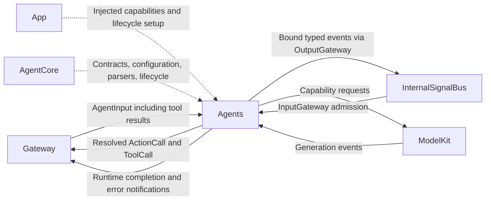

# Agents — Business Agents and Development Standards

Agents implements independent, stateful cognitive roles. Each Agent owns its business decisions and interprets model output into resolved calls. The [technical architecture](../README.md), especially sections 6–24 and 32, defines the target. This document is the implementation standard for developers and AI coding tools; the v4 JSON configuration rules are enforced by `AgentCore/Capability/AgentConfiguration.swift`.

## Direct relationships

Solid arrows show logical requests and results. Dashed arrows show injected dependencies or shared services. Agents do not call concrete Actions or Tools directly.



## Directory and ownership rules

```text
Agents/
├── README.md                       # This standard
├── AgentConfigurations.swift       # Shared package-resource loader
└── <AgentName>/
    ├── README.md                   # Purpose, state, status, validation scope
    ├── <AgentName>.agent.json      # Single capability declaration source
    ├── <AgentName>Agent.swift       # Actor, decisions, lifecycle
    └── <AgentName>State.swift       # Only when state warrants a separate file
```

- Each Agent has one UTF-8 JSON configuration. Foundation loads it without another configuration dependency.
- Use a unique `<AgentName>.agent.json` filename within the package. SwiftPM processes the resource and `Bundle.module` loads it; do not guess `Bundle.main` locations or use absolute source paths.
- Update the root Package.swift resource list and Xcode navigation references when adding resources. Do not duplicate them in the App target.
- AgentCore owns shared contracts, configuration validation, parsers, and lifecycle infrastructure. Agents owns business policy. Do not copy a parser into a concrete Agent.

## Capability configuration v4 — JSON

Use UTF-8 `<AgentName>.agent.json`, parsed by Foundation JSONDecoder. JSON comments are not supported: use doc. Version 4 uses doc for usage guidance; the loader accepts JSON v4 only. Repackage configuration and code together.

The Action/Tool fields below are retained from v3; the complete document also requires the communication object. All fields shown below are required except hidden, which defaults to false. Arrays must be present, and constraints may be empty. Unknown fields, incorrect types and missing fields are rejected. Names are case-sensitive. Changes to field semantics require coordinated validation, tests, documentation and version migration.

| Top-level field | JSON type | Contract |
| --- | --- | --- |
| schemaVersion | Integer | Exactly 4 |
| agentID | String | Stable identity matching the Agent implementation |
| channels | Array of String | Additional allowed Channels, such as main; action defaults are also allowed |
| textActions | Array of String | Ordered unique aliases for natural-text mapping, at most 8; each must accept string text without other required parameters |
| actions | Array of Object | Actions this Agent may invoke |
| tools | Array of Object | Native tools this Agent may invoke |
| communication | Object | Required inputs, subscriptions, publications and sends arrays; see AgentCore/Bus |

Each Action entry uses this common registration format:

| Field | JSON type | Meaning |
| --- | --- | --- |
| alias | String | Agent-local model-visible name, such as say |
| path | Object | Exactly module and function strings, such as Speech / speak |
| defaultChannel | String | Channel used outside an explicit scope |
| doc | String | Function-derived instructions for the LLM: what it does and how to call it; describe a return value only if one exists |
| hidden | Boolean | Optional; false by default. True omits the capability from model-facing context without unregistering it |
| parameters | Array of Object | Ordered parameter documentation and required flags; the sole source of parameter names |
| examples | Array of String | 1–8 GhostShell/XML examples, optionally mixed with natural text, such as `<express emotion="smile"/> Hello.` |

Tools use the same fields except path is a String such as System.runtimeInfo and defaultChannel is forbidden. Their examples are native JSON call strings with exactly name and arguments, for example `{"name":"runtimeInfo","arguments":{}}`. Tools are not XML actions. Their metadata is retained for the separate native Tool Call protocol; it must not be concatenated into the system prompt. A future provider-native tool schema path should honor hidden, but is not implemented by the current text-only ChatCapability. This shared documentation format does not merge the two execution protocols.

Each parameter contains:

| Field | JSON type | Meaning |
| --- | --- | --- |
| name | String | Exact key the Action reads from the invocation |
| valueType | String | Intended parsed type: string, integer, number or boolean |
| required | Boolean | Whether the caller must supply the key |
| description | String | Meaning of the parameter, including units where relevant |
| constraints | String | Human-readable limits, accepted formats, normalization and omitted-value behavior; may be empty |

**Transport values remain strings**, including numeric and boolean examples: use `"speed": "0.5"` or `"enabled": "true"`, not JSON numbers/booleans. valueType and constraints document function semantics; they do not perform conversion, execute validation expressions or inject defaults. The Action itself owns parsing, semantic validation and optional-parameter defaults. Keep these descriptions synchronized with its implementation.

Action examples are strings in the actual model-output syntax. Use self-closing action tags, quote XML attribute values and escape XML entities. Natural text can appear before or after tags. The loader parses every example using FunctionTokenParser and resolves explicit actions against the Agent registry, including parameter names and Channels. An example must demonstrate its containing Action, either explicitly or through natural-text mapping for a textAction. This checks syntax and call structure, not execution-time value constraints.

Visible examples must not explicitly call hidden Actions. Write natural text instead of exposing hidden say/print tags. Configuration authors must also keep doc prose free of instructions to call hidden capabilities. hidden is a prompt-visibility flag, not an authorization or security boundary; internal resolution and existing explicit-call permissions remain unchanged.

### Action example

```json
{
  "alias": "express",
  "path": {
    "module": "UI",
    "function": "express"
  },
  "defaultChannel": "Display",
  "parameters": [
    {
      "name": "emotion",
      "valueType": "string",
      "required": true,
      "description": "The facial expression to display in the voice circle.",
      "constraints": "Exactly one of: smile, happy, laugh, thinking, surprised, sad, love. Case-sensitive; no default."
    }
  ],
  "examples": [
    "<express emotion=\"smile\"/> Hello.",
    "<express emotion=\"happy\"/> That is wonderful!",
    "<express emotion=\"thinking\"/> Let me think."
  ],
  "doc": "Show a large facial expression in the center of the voice circle. Use sparingly when it suits the reply. Replaces the previous expression, without adding to captions or speech. Visible until replaced, the user speaks again, or the session stops. This controls UI only.",
  "hidden": false
}
```

See [Assistant.agent.json](Assistant/Assistant.agent.json) for the complete configuration. Its say and print entries have hidden=true because natural text is automatically mapped to them. Their examples can be ordinary text. express is visible and demonstrates mixed markup/text. Other actions default to hidden=false; hiding does not happen implicitly from membership in textActions.

### Limits and error behavior

- Configurations are at most 64 KiB and contain at most 128 Action/Tool entries combined. Each capability has at most 32 uniquely named parameters and 1–8 examples. Each doc, parameter description/constraints string and example is at most 2048 UTF-8 bytes; doc, parameter descriptions and examples must be nonblank.
- Agent IDs, aliases, path components, tool paths, Channels and parameter names match `[A-Za-z_][A-Za-z0-9_.-]*` and use at most 64 UTF-8 bytes. Paths are registry keys, not reflection or filesystem paths.
- Actions and Tools share the alias namespace within an Agent. Duplicate aliases or parameter names fail. Aliases cannot start with channel.; different Agents may bind the same alias differently.
- Channel and textActions arrays must be unique; at most 16 Channels are allowed after defaults are included. Text mapping accepts string text and no additional required parameters. Assistant requires a nonempty textActions list; other policies can leave it empty.
- Required/optional name sets are derived from parameters[].required. Do not also maintain requiredParameters or optionalParameters in JSON; these obsolete fields are rejected.
- Missing resources, malformed data, unsupported versions and invalid identity/structure propagate as errors. Do not use try!, swallow errors, fall back to hardcoded lists or broaden permissions. App remains unready on configuration failure.
- Configuration and descriptions are bundled author-controlled content, not an authorization source for physical devices. Runtime checks and platform permissions remain necessary.

### Loading, registration and prompt integration

AgentConfigurations loads the package resource through Bundle.module. AgentConfiguration produces an immutable CapabilityRegistry and textActions snapshot. CapabilityDocumentation retains doc, ordered parameter metadata and example strings on ActionRegistration/ToolRegistration. JSON-loaded registrations always carry this metadata; programmatic low-level registrations can omit it for existing tests and infrastructure use.

Configuration defines what an Agent may invoke. App registers actual Swift handlers and injected services, defining what the application implements. Do not duplicate production capability lists in Agent Swift code, remove the App allowlist or dynamically reflect arbitrary paths. Missing runtime handlers still fail during dispatch.

CapabilityContextBuilder includes doc, parameter guidance and examples only for Action registrations with hidden=false. Tool declarations, parameters, docs and examples never enter this system-prompt text, regardless of hidden. Hidden entries contribute neither their declaration nor their documentation/examples. Generic instructions explain automatic text mapping without exposing hidden aliases. Tool calls remain a separate native protocol; this change does not implement model-native tool streaming or full JSON Schema. Configuration size and per-field limits bound author-supplied prompt content; model-specific context limits still apply.

Changes require repackaging and a new Agent instance; no hot reload is implemented. Tests may inject data only through the same validator. Useful later extensions include machine-readable value constraints, explicit deprecation/version metadata and resource declarations, but they should not be added before their consumer and semantics are implemented.

## Agent implementation standards

1. **Dependencies:** implement Agents as actors, depending only on AgentCore and required ModelKit capability protocols. Do not import Actions, Gateway, PlatformKit, SwiftUI, concrete model SDKs, or other business Agent implementations. App injects providers.
2. **Identity and descriptor:** configuration identity must match the implementation. Descriptor and output-stream references use immutable nonisolated values. Declare only supported input/output kinds.
3. **Lifecycle and state:** define start/pause/resume/stop and failure behavior. Currently stop is terminal; pause suspends taking subsequent inputs. Do not claim restart or background persistence. Extract complex business state when needed.
4. **Concurrency and bounds:** isolate mutable state in the actor. Mailboxes, output streams, history, generated text/tokens, parsing buffers, and queued work need explicit bounds and overflow policies. Do not create unbounded Tasks per input or silently discard actions or tool results.
5. **Input and context:** route external inputs and tool results through InputGateway. Preserve inputID/sessionID and isolate history per session. Generate capability context from configuration instead of a parallel prompt-side list. Do not claim an operation completed before it did.
6. **Two output protocols:** use generation-local shared AgentGenerator/FunctionTokenParser state. Map text through configured textActions. Self-closing actions, paired Channels, and scope restoration follow the Generation README. Native Tool Calls use ToolCallParser, not XML or Channel queues.
7. **Resolution and trust:** resolve aliases to paths and select effective Channels inside the Agent. Emit ActionCall/ToolCall, not raw XML or unresolved aliases. Treat tool results and demo text as text, never as executable markup. Runtime attaches trusted source identity.
8. **Cancellation and completion:** cancellation must interrupt active work, release model sessions, suppress stale-generation outputs, and discard unfinished parsing fragments. Flush and retain history only after normal completion; report abnormal termination explicitly. Generation completion is not playback completion.
9. **Real capabilities:** do not directly perform UI, TTS, network, or device side effects inside an Agent. Adapters validate permissions and device availability. Configuration allowlists do not replace system permission, device limits, or emergency-stop enforcement. Clearly label test doubles and demonstrations.
10. **Errors and recovery:** report configuration errors during initialization. Missing capabilities, parsing failures, timeouts, and overflow must be observable. Do not crash as recovery or silently switch models. App coordinates user-facing error state.

## Delivery requirements

- Read this standard, the target architecture, and the destination README. Identify existing handlers; new implementations and registration belong in their respective modules and App.
- Add a minimal `<AgentName>.agent.json`, resource declaration, project reference, identity validation, and composition. Do not add unused empty modules.
- Test business decisions with capability doubles. Cover loading/errors, configuration-driven output changes, local alias isolation, Channel restoration, tool-result association, overflow, cancellation, failures, and absence of stale-session output.
- Extend shared protocol tests when changing XML or Tool Call semantics. Do not create an Agent-specific duplicate parser.
- Maintain a README for every actual directory with purpose, goals, ✅/❌ status, and validation scope. Parser, scheduler, registry, and loader modules also need Mermaid diagrams and design descriptions.
- Update affected architectural decisions and Roadmap when runtime contracts change. Run `./scripts/check.sh` and, with full Xcode, `./scripts/build-ios.sh`. Verify device-target compilation for device-specific composition. Distinguish compilation, tests with doubles, and actual device acceptance.
- Never store secrets, local signing settings, weights, or user data in configuration. Semantic changes require explicit version migration rather than implicit fallback.

## Implementation status

- ✅ [Assistant](Assistant/README.md) loads actions/tools/channels/textActions from its own JSON resource.
- ✅ AgentConfigurations loads package resources; AgentConfiguration strictly validates v4. Errors propagate to App.
- ✅ Shared parsers, parameter/Channel validation, bounded queues, and cancellation/completion regression coverage.
- ✅ `say` maps to `Speech.speak`; `print`/`express` map to `UI.print`/`UI.express`. Default `Speech`/`Display` Channels remain compatible; Channel and module names need not match.
- ❌ Configuration hot reload, remote configuration, full JSON Schema, dynamic handler discovery, and configuration-driven lifecycle budgets.
- ✅ SpeechPerception owns VAD/ASR; VisionPerception owns pose inference; Photographer consumes shared observations for display. ❌ Tracking/Media/Control roles and robot behaviors.
- ✅ InternalSignalBus event delivery and static v4 communication.
- ❌ Model-native tool deltas, general StateStore/AgentRuntime, restart and request/reply.

## Maintenance

Keep this standard synchronized with configuration validation and Agent changes. ✅ means implemented; ❌ means incomplete. Keep implementation limitations distinct from the target architecture and do not create placeholder files to imply completion.

✅ Assistant now requires an injected ChatCapability. Fixed replies and model doubles live only in Tests; production has no nil-model demo fallback.

✅ Assistant also exposes UI.express through JSON, with a required emotion string and documented finite values. Parameter type metadata and casting policy are unchanged.

✅ All facial expressions use one express Action with a required emotion parameter, including smile. Do not register separate per-emotion functions or compatibility aliases.

## Agent concurrency documentation

Each Agent README must follow the [concurrency documentation standard](../README.md#concurrency-documentation-standard). Document its inbox producer and drain worker, output consumer, capacities, pause/resume behavior, cancellation admission, failure propagation and completion semantics. A registry bound or actor mailbox is not a substitute for an explicit bounded application inbox. Include a Mermaid diagram and distinguish implemented behavior from planned scheduling features. The Assistant README provides the current concrete example.

✅ Photographer is the phase-one 摄像师 role: injected PoseCapability, one active/one latest pending image, JSON v4 showPose action and shared output parsing. Robot motion, composition and tracking remain unimplemented; see Photographer/README.md.

✅ Photographer accepts an App-injected image resolver for opaque native frame attachments. Capability declarations still come exclusively from Photographer.agent.json; the resolver is data adaptation, not a second Action/Tool registration list.

JSON v4 requires communication with inputs (contract/version/kind), subscriptions (contract/source/topic), publications (contract names), and sends (contract/target). Empty arrays grant no communication permission. Sources and topics are exact; no wildcards or request/reply declarations.
