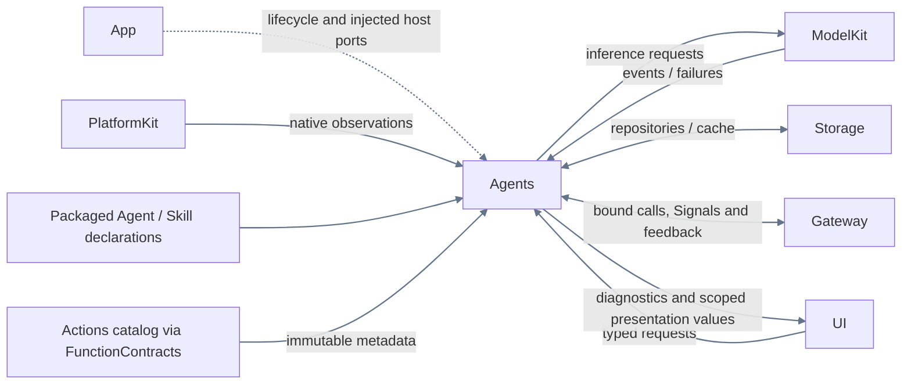
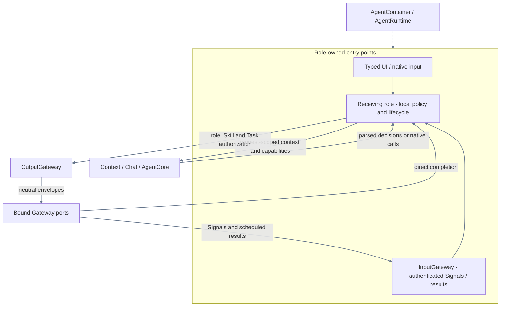

# Agents — Cognition, authorization and role coordination

## Responsibilities and boundaries

AgentContainer is the App-scoped cognitive root. It owns AgentManager, role lifecycle, private context, Skills, Tasks, decision snapshots, Action availability, communication permissions and explicit authorization revocation. App injects Gateway communication/scheduling capabilities and narrow host ports. Agents imports AgentCore, FunctionContracts, Gateway and selected foundation SDKs; it does not import Actions, CallRuntime or ExecutionRuntime.

UI requests and native observations reach their responsible roles directly. Roles subscribe and process typed input; foundations never call a role or construct business Signals. Each role receives only required capabilities, without requiring every foundation root. Models support cognition; deterministic input processing does not create inference unnecessarily. Business effects use the registered execution chain rather than direct native calls.

## Direct relationships

App binds camera/device/voice and maintenance collaboration through neutral ports. No adapter retains or searches an Actions/Gateway upstream container. The complete execution path is in the [overall design](../README.md); this diagram shows only direct neighbors.

## Agent categories

每个角色的 `Agent.json.category` 是生产分类的唯一声明，加载器严格验证后通过 AgentConfiguration 传入不可变的 `AgentDescriptor.category`。AgentCategory 定义在 [AgentCore 身份契约](Support/Core/AgentDescriptor.swift)，只包含 perception 与 cognition，无默认类别。

| category | 角色 |
| --- | --- |
| cognition | Assistant、Writer、Memory |
| perception | SpeechPerception、VisionPerception、Photographer、ApplicationControl |

cognition 表示认知职责；perception 包括感知预处理、快速响应及确定性执行。类别不等于是否调用模型，不授予权限，也不自动改变调度、队列、模型选择或持久化。通信收窄和轮次有效能力投影保留原类别。

## Roles and internal structure

| Owner | Inputs and collaboration |
| --- | --- |
| [Assistant](Assistant/README.md) | Home text, Chat and private decision context; receives speech finals, owns asynchronous synthesis and delegates peer work by addressed messages; selects dynamic Skills. |
| [ApplicationControl](ApplicationControl/README.md) | Settings/resources/devices/diagnostics requests and device/artifact/failure observations; owns administrative and diagnostic policy. |
| [Memory](Memory/README.md) | History requests and private context; authorizes history calls and fixed Task results. |
| [Writer](Writer/README.md) | Background authoring tasks, workspace-scoped Skills and native tool schemas, raw file streams, fixed model selections and recoverable artifacts. |
| [Photographer](Photographer/README.md) | Camera/album requests, pose and tracking availability; owns capture/tracking intent and policy. Consumes PlatformKit position-update cadence; tracking dispatch retains only the newest pending intent. |
| [SpeechPerception](SpeechPerception/README.md) | Listening requests, native PCM, VAD/ASR and sound-source computation; owns consent/half-duplex policy and transcript messages. |
| [VisionPerception](VisionPerception/README.md) | Read-only camera frames, Pose inference and projection; publishes pose and requests protected presentation. |
| [Support](Support/README.md) | Cognitive Gateway adapters, policy, routing, coverage, Chat, Context and common lifecycle mechanisms. |

AgentContainer installs one AssistantStateBindings resolver backed by App local node reads. Loaded Skill.useStates alone controls exact paths; the producer-owned complete Business dictionary is projected. Ancestors/descendants are not implicitly read or disclosed. Generic Context/Chat remains independent of that policy. See [source mappings](Support/Context/README.md#container-context-read-path).

AgentRuntime assembles cognitive services and role hosts. Its preparation stage returns a neutral business request to App. App calls ActionsContainer configuration, passes the resulting host ports into the single-use Agent validation stage, configures Gateway from the resulting configuration, then calls AgentContainer.bindExecution. AgentRuntime does not invoke Actions/Gateway configuration callbacks. Preparation and binding handles consume their continuation before execution; failures require scope rollback rather than retrying a partially prepared scope. Role-specific resource takeover policy is authored here and injected as opaque endpoint values. Native stop callbacks belong to the execution owner.

## Internal flow

## Native intake and semantic roles

Perception and cognition describe role responsibilities within Agents. SpeechPerception and VisionPerception consume constructor-injected native PCM/frame observations directly and produce meaningful speech/pose messages for other roles. These messages use Agents authorization and Gateway endpoint delivery; the raw stream is not an inter-role Signal. UI requests and device/model/container facts can reach their responsible role directly. Any authorized role can originate internal messages or execution requests without first passing through perception.

Perception does not require a second cognitive role for every reaction, and cognition does not require model inference for every input. A perception role may issue an authorized presentation/listening call; business effects still use Gateway and Actions. Read-only input subscriptions do not own capture startup or native control. The [overall input/Signal figure](../README.md#native-input-and-internal-signals) owns the complete source-to-effect and feedback view; local speech/vision READMEs own their algorithms and buffering.

## Authorization and communication

OutputGateway binds the actual producing role/incarnation and frozen decision catalog before forwarding canonical calls. Skill availability, Task grants, role communication and semantic receiver checks are entirely cognitive policy. Model-supplied parameters cannot forge producer identity. Fixed calls use their registered role descriptors. Registration does not imply authorization. Actions owns registration and authoritative business validation; Gateway owns endpoint/resource/scheduling validity. The [registration-to-completion matrix](../README.md#action-lifecycle-responsibilities) defines the full chain.

InputGateway binds each role to a generic SignalTransport endpoint. Agents checks publish/send contracts and target permissions; Gateway transports opaque payloads under endpoint/envelope/capacity/scope checks. Agent A and B use independent bound endpoints on the same Gateway root. Semantic interpretation remains in the receiving role.

After Gateway admission, Skill permissions are not queried again. Revocation explicitly cancels the affected execution scope. Agents projects neutral outcomes back to cognitive causality and decides history, Task advancement and continuation. Delivery acceptance is separate from business consumption. Reply/round barriers join the relevant execution and feedback before continuation.

### Assistant delegation and executor ownership

Assistant sends a persisted, authenticated message through scheduled `task.send(agent_id,text)`. The receiver decides whether to start, update or stop work and owns execution, cleanup and outcomes. Delivery only acknowledges the message. See [the cross-module sequence](../README.md#assistant-agent-delegation).

Writer is the current public creative executor. It owns its control/content model workflow, local task/workspace selection, input checkpoints, Island feedback and durable completion delivery. Ordinary progress stays in Writer presentation; Gateway direct calls reach Actions.Artifacts for deterministic file work. WriterContainer exposes records to UI and joins role-owned workers. Recovery, progress/reply policy, persistent terminal notifications and task-specific limits belong to [Writer](Writer/README.md), with shared consumers in [Chat](Support/Chat/README.md). They are not implicit capabilities of every Agent or Gateway transport.

Writer's admitted edits continue through an injected ArtifactStreaming port rather than per-chunk Gateway calls. Cancel/pause/stop revoke that continuation and join model, preview and Actions release before finishing or resuming the run. Gateway tool completion only acknowledges its finite operation; it does not end the creative task. The detailed contract belongs to [Writer](Writer/README.md) and its direct execution counterpart [Artifacts](../Actions/Artifacts/README.md#执行与续写生命周期).

## Lifetime, inputs and failures

App creates one AgentContainer and starts it after Gateway. Stable role subcontainers are internal cognitive components, not additional App roots. Startup installs declarations, context sources, coverage and typed hosts before role work begins. Root lifecycle coordinates role startup, invalidation, foreground transitions and joined stop independently of pages.

Each direct input source has a long-lived owning consumer rather than per-frame forwarding tasks. ProcessingContext carries request/session/generation/turn and causality, without granting authority. UI request/reply generations and native stream generations remain distinct. Roles own their decision, subscriptions and model producers; Actions owns actual voice/camera/device execution and interaction facades. Passive activity projection interprets Agent/Task evidence here and never executes callable effects.

Stop closes cognitive admission, cancels and joins role work, and retains original terminal/cleanup ports while Gateway and Actions drain. App releases bindings afterward. Borrowed scheduler and transport roots retain their own lifecycles. A failed cleanup prevents replacing native owners, and both primary and cleanup failures remain explicit. Conversation interruption can retain Task and Skill, while session closure releases them. SpeechPerception owns recognition lifecycle and consent. Actions restores restricted-route recognition after actual playback cleanup, subject to consent and capture identity.

Public containers expose UI-owned state/control interfaces and narrow role capabilities, without exposing mutable registries, raw handlers or private role state. Capacity, algorithms and failure contracts live in the linked role and [Support](Support/README.md) READMEs.

Ordinary `setSceneActive(false)` reports the scene fact, joins VisionPerception suspension and notifies Writer preview visibility; it retains SpeechPerception, Assistant/Writer inference, files and messages. It does not invoke Writer creative pause. Explicit root `setForeground(false)`/invalidation/stop retain full suspension and joined cleanup contracts. Scene restoration neither rebuilds the speech interaction nor renews revoked listening consent. See [Writer scene policy](Writer/README.md#窗口命名操作副标题与场景).

## Reflexive state reads and disclosure

`AgentContainer.stateSnapshot() async throws` reads only root lifecycle/health and returns eight role path indices. stateReaders() binds independent weak-owner role readers using local AgentStateSnapshot, without reading private role context during discovery. Roles expose lifecycle, queue counters, installation/closure and private task/Skill counts or phases; no messages, goals, credentials or reasoning are copied into this inspection view. Root lifecycle failure is separate from normal suspension. Role State reads use Agent.residentContext() and the repository’s last initialized committed memory. They never restore persistence, wait for a pending write or trigger startup. Before initialization the context fields are unknown; Agent start retains restoration and failure ownership.

One unified resolver is installed without a path allowlist. The effective loaded Skill useStates union selects exact nodes on each real request; registration does not disclose state. ExpressionInteraction selects ui.home.expression and RobotInteraction explicitly adds actions.robot.motion. There is no whole-tree health/diagnostic source, implicit descendant grant, model discovery, loadState, polling or new recovery authority.

Business contains actual task phases and admitted model-preparation activity. Role lifecycle, installation/closure, queue/processed-input metrics and private Skill/task-view counts belong to Runtime. Speech and vision worker existence is Runtime, independent of user-visible speaking/listening or perception results. Assistant filtering is confined to its own directory, never generic State/Chat infrastructure.

AgentContainer distinguishes scene visibility from explicit role suspension, as described in its lifetime contract above. Camera/device scene invalidation, idle joins and shutdown belong to ActionsContainer. Agent camera/device ports expose business operations rather than root lifecycle controls. AgentGatewayAssembly prepares cognitive communication adapters and a neutral GatewayConfiguration; App configures the Gateway root and returns public capabilities for final binding.

AgentContainer declares foregroundModelRequirements from its role needs and current camera intent. App requests corresponding preparation steps from ModelKit. SpeechPerception owns complete session presentation availability. The failure channel classifies model/platform lifecycle admission errors as suppressed evidence, preserving cleanup failures for publication; App supplies sinks without duplicating this policy.

ApplicationControl owns fixed UI window requests through Gateway, with four independent ordinary operations and one close control slot. Photographer retains camera/album requests, including the camera-window shutter. Assistant's Photography and ApplicationControl Skills select ui.windows and share Window.* aliases without expanding BasicSkill.

Background visual demand alone adds the vision model requirement. Photographer routes fixed photo and visual UI operations through distinct Capture/Perception Actions while retaining one request owner. Assistant selects Foundation camera State via the relevant loaded Skill; it does not infer actual device state from UI intent.

## Photo/video UI flow

Photographer consumes typed photo/video settings and recording controls through its existing single UI request path, emits fixed internal calls to Gateway and returns actual Action results. Assistant's Photography Skill governs conversational capture decisions and Task/window closure; it does not start background vision. Recording disables microphone listening, so the Skill uses a stop button or native duration limit rather than promising a voice stop. See [Photographer](Photographer/README.md) and [Assistant](Assistant/README.md).

Photography与ApplicationControl共享Island.setPresentation和ui.island，Basic常驻目录不变。setPresentation设置前台compact/expanded，展开要求详情声明；业务Task观察源保持独立。Widget链接返回既有App入口，Camera操作继续通过Photographer。

## Role-owned presentation and speech facts

Agent task presentation belongs to the executing role: Writer publishes its creative lifecycle and AssistantExecutionSession publishes its own foreground Skill task. Both use registered Gateway Island tools with code-owned permissions, outside model-visible catalogs. Terminal state ends only the owner's activity; passive task logs are history rather than UI authority. Shared latest-value transport is described in [Support](Support/README.md); UI arbitrates all producers without interpreting role identities. Writer titles/operation subtitles similarly reach Actions-owned presentation through producer-bound Gateway direct calls.

SpeechPerception owns recognition-caption onset. Full-duplex Assistant preserves its reply caption until a real new reply begins; final ASR alone enters Decision. Perception consent/capture lifecycle remains independent of LLM generation and output execution.

各角色均通过自己绑定的 Gateway consumer 调用内部灵动岛工具：SpeechPerception 拥有聆听/识别，Assistant 的语音子能力拥有合成/真实播放，Photographer 沿既有相机输入处理摄影，ApplicationControl 沿连接输入处理蓝牙提示；Assistant 同时管理自身任务、推理等待和语音输出。Actions 不设集中 UI 状态观察器代发。内部调用结果（含异常）由所属执行者处理，只有显式 LLM 调用反馈能触发 ReACT；共享机制见 [Support/Chat](Support/Chat/README.md)。

Skill-selected State can carry immutable images. Camera preview policy stays in Actions; shared Context/Chat handles scope reset, request assembly, budget protection and metadata-only audit. New user input retains images; a new dialog releases explicit selections through the owner callback.

Shared Chat combines typed State images with the original current user input and emits their identity/order/size metadata in system State. Roles do not generate a second image-only user message.

Shared output execution carries private resource-scope bindings outside model messages. Photographer captures the UI camera session before queuing photo operations; Actions validates it. New camera history references retain private scope metadata to prevent preview_N reuse from resolving another session.

Agent startup binds the shared communication repository to its output router before any role accepts work. Assistant owns foreground scopes and its conversation messages; Writer owns workspace tasks and its own messages. Cross-role control and completion travel through authenticated communication records, while HTTP transport evidence uses the shared deletable log. History presentation never reads another role's private task state to decide execution.

Assistant 通过 task.start/task.end 管理前台任务，通过 task.send 向 Writer 发出 agent.task.request。Writer 自主管理任务并回报 agent.task.response。固定任务执行方共用回报契约，按信封类型执行固定任务收尾。Writer 在作品库域按关键词分页查询，显式创建或进入后切到隔离的工作区域。纯查看使用只读呈现域。职责、延迟准备与完成边界见 [Writer](Writer/README.md#作品库与工作区分域)。

## Prompt ownership and discovery

The App supplies the default prompt language through the existing Agent root. The chat worker retains it in suspended and continued rounds, Writer retains it for the delegation, and Decision and title generation capture it when starting their requests. Request assembly selects matching natural-language instructions, examples and function descriptions. The model uses explicit requests and trusted user text to determine output language, with the application language as its fallback. Assistant recording and restoration share canonical source markers across both languages.

Each role owns its public description in Resources/Agents/<Role>/Agent.json and its private model instructions in its own resource directory. Support validates resource schema v10 and projects the v8 compiled contract. Assistant assembles System protocols, its own identity, Skill instructions and a public peer directory filtered by the actual instance communication policy and the shared executable delegation adapter. AgentCore renders the supplied output templates. Writer owns its content-format templates. See [resource contracts](../Resources/Agents/README.md).

Writer 运行以委托入口为身份，workspace 是可选编辑目标；前序与 workspace 消息保持同一请求链，界面分别查询。

Generation resolves Action and text-mapped output to registration-owned Channels. Camera UI inputs expose capture, saving and window controls; closing releases the photo session.

Assistant 的用户 final/input 采用短上下文 Decision→统一 Q。已认证同伴及 Action 业务返回值或异常直接进 Q。模型生成结束后继续缓冲。Gateway 结算本轮所有 Channel 和结果投递后，Assistant 冻结同会话待处理输入，通过带身份、来源和时间的 envelope 请求模型。Gateway 负责会话内的 Channel 顺序，其他 Agent 管理独立任务生命周期。

Assistant/Writer 的排队与请求准备不创建 message；模型实际开始时提交请求，真实失败保留。Assistant 会话为已丢弃及已完成打断发布限时灵动岛详情，Writer 委托生命周期由独立执行仓库保存。

Decision 使用独立于 Assistant 和 Writer 的已提交配置。每次分类从注入的配置读取本地模式及可选云端工厂，在同一次分类内使用该快照。Actions 负责按 Decision 绑定创建固定模型句柄。未配置或失败时保守入队，详情见 [Assistant](Assistant/README.md)。

AgentRuntime 通过 AgentBusinessBindings.readWebScreenshot 将 Actions 的当前网页图片注册为 actions.web.screenshot；WebBrowsing 选择后进入共享多模态 State。Agents 不拥有网页截图缓存、压缩或媒体回查，Assistant 不再从 Web feedback 附图。
