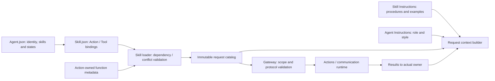

# Agent 配置与撰写规范

The six roles publish English and Simplified Chinese descriptions. Assistant and Writer load model Skills. Memory owns its title prompt. The three perception roles use internal tools for their workflows. Assistant selects interruption Decision text in the request language.

六个角色分别提供英文和简体中文公开简介。Assistant 和 Writer 加载模型 Skill，Memory 管理标题提示词，三个感知角色通过内部工具执行流程。Assistant 按请求语言选择打断判定提示词。

## 职责与边界

本目录保存随 App 打包的 Agent 身份、基础 Skill、通信声明及必要的运行时提示词。加载与组合由 [AgentConfigurations](../Support/AgentConfigurations.swift)、[AgentSkillLoader](../Support/AgentSkillLoader.swift) 负责，业务实现与生命周期由 [Agents](../README.md) 负责。

Assistant 是唯一面向用户的对话 Agent；摄影、历史查询、应用控制的对话流程通过 Skill 执行。VisionPerception、Memory、ApplicationControl 保留确定性事务，Memory 可在独立标题事务中调用模型。感知 Agent 不因此变成对话 Agent。

开发必须遵循本规范。各角色资源子目录不放 README；代码目录的 README 继续说明职责、状态、队列、取消、恢复及具体函数。资源中不得放 Swift、脚本、函数实现、凭据、模型权重或用户数据。

## 文件组织

Use the unsuffixed resource for English and a `.zh-Hans` sibling for Simplified Chinese. Public descriptions use Markdown. Structured state and tool translations remain with their owners.

| 文件 | 作用与要求 |
| --- | --- |
| `../Catalog.json` | 唯一显式资源索引。`version` 为 1；`agents` 的键为代码使用的配置名，如 `Assistant`，值为相对 Resources 的 `Agents/Assistant/Agent.json`；`skills` 由 [Skill 规范](SkillAuthoring.md) 定义。不得靠目录扫描或第二套配置生效。 |
| `Assistant/Input/InputProtocol.json` | Assistant 主模型的输入规则（`# INPUT FORMAT`）、时间线标签和排版、历史格式识别，以及 `## User (ASR)` 语音转写处理规则。 |
| `Shared/OutputProtocol.md` | 跨角色通用输出协议。 |
| `Shared/SkillCatalog.json`、`Shared/AgentCatalog.json`、`Shared/ActionCatalog.json` | 目录标题及条目排版。Swift 填入公开 Skill、获准委派的 Agent 和本轮有效 Action（`ActionCatalog` 只含 Action；参数行不含类型）。 |
| `Shared/ControlCatalog.json` | `# AGENT CONTROLS` 段：control 声明排版加所有者使用指南。仅有 control 的 Agent 渲染。 |
| `Shared/StateContext.json` | 状态 system 消息（`# STATE`）的模板：`frame`、`## CURRENT STATE`、`## CURRENT STATE IMAGES`、`## AGENT STATE`，以及系统提示中 `# STATE VARIABLES` 的声明排版。 |
| `<AgentName>/Agent.json` | 必需。v14 身份、通信权限和状态声明。只有 Assistant 和 Writer 声明基础 skills。 |
| `<AgentName>/Description.md`、`Description.zh-Hans.md` | 角色的英文与简体中文公开简介，供委派目录使用，每种语言最多 2048 UTF-8 字节。 |
| `<AgentName>/Agent.zh-Hans.json` | 有状态文案翻译时提供，以 `state.<name>` 对应状态声明。 |
| `Assistant/Instructions.md` | Assistant 自身的身份、用户沟通和如实汇报责任。业务流程归 Skill，共用协议提示词归 `Shared/`。 |
| `Assistant/Prompts.json` | Assistant 主请求的执行证据、任务历史摘要及 Writer 协作事实模板。 |
| `Assistant/Input/InputDecision.json` and its Simplified Chinese sibling | The context template quotes the Assistant reply and incoming user text. The question asks whether the user intends to interrupt. Both templates follow the request language and preserve quoted dialogue. |
| `SpeechPerception/ZipformerKeywords.json` | 生产关键词检测与设置诊断共用的双语词表，维护标签、短语、词元及独立词规则。 |
| `Assistant/Input/InterruptionKeywords.json` | Assistant 允许触发打断的关键词标签。新增声学关键词时，按业务需要在此配置允许打断的标签。 |
| `Writer/Instructions.md` | Writer 私有共用身份，仅供自己的控制请求。 |
| `Writer/Prompts.json` | Writer 作品库及编辑控制请求、补充输入和轮次模板。 |
| `Writer/ContentPrompts.json` | 无工具内容请求的输出规则、文件格式、编辑上下文与重试模板。 |
| `Writer/Recovery.json` | 失败修正、工具恢复与历史回放模板。 |
| `Writer/WorkspaceFeedback.json` | 工作区操作的模型反馈模板。 |
| `Memory/TitlePrompts.json` | 标题生成事务的专用模板，不生成普通历史记录。其他确定性 Agent 不添加普通对话模板。 |

关键词词表包含中英文数据，标签使用稳定 ID。两份关键词配置均按固定路径由现有 Bundle 资产加载器读取。

目录和固定资源文件采用 UpperCamelCase；配置名与 Swift 角色一致，运行时 `id` 使用既有 lowerCamelCase。重命名目录不能顺带修改身份、历史键或通信源。资源路径必须相对 Resources，不得含绝对路径、反斜杠或 `.` / `..` 路径段。加载器以 Bundle 中的 `Catalog.json` 定位资源根，不再次追加 Resources。

## Agent.json 字段

除可选的 skills 外，下列顶层字段应显式填写；空数组写 `[]`，空信道映射写 `{}`，不得用缺失或 null 表示。配置不接受 `actions` / `tools`、函数文档或未实现字段；加载器展开 skills，并从 Skill 函数绑定和 canonical 元数据生成目录；Agent.json 出现 functions/actions/tools 会明确拒绝。Agent.json 是角色初始化时加载的 skills、states、channels 与 feedback 的配置和校验入口；Skill 目录下的 Skill.json 由 Assistant 和 Writer 的模型上下文使用，其 `useStates` 只表示该 Skill 工作所需的状态。

| 字段 | 类型 | 作用 |
| --- | --- | --- |
| `version` | integer | 资源 Schema 版本，当前固定为 14；不是角色发布版本。加载器投影为 AgentCore v10 函数/通信契约。 |
| `id` | string | 实际 Agent 身份，用于执行所有权、通信和上下文隔离；必须与代码创建的身份一致且全局唯一。 |
| `category` | string | 必填的静态类别，只接受 `perception` 或 `cognition`；缺失、null、错误类型及未知值拒绝加载。加载后进入 AgentConfiguration 和 AgentDescriptor。 |
| `channels` | object | 以业务协议为键，声明实际信道名及收发方式。 |
| `feedback` | string array | 角色接收的执行反馈协议，由执行所有者适配器投递。 |
| `skills` | string array | Assistant 和 Writer 必填，声明模型使用的基础 Skill ID，无重复、最多 16 个。三个 Perception 角色和 Memory 省略此字段。 |
| `states` | object array | 角色预设的自身变量声明，最多 16 项，见下表；无预设变量写 `[]`。 |

### states 字段

每项声明一个预设变量；值在运行时均为字符串。`kind=typed` 表示 Swift 按 `type` 解析后用于逻辑判断，`kind=semantic` 表示自然语言（只能是 `type=text`）。模型自创的自由备注无需声明。

| 字段 | 作用与校验 |
| --- | --- |
| `name` | 小写字母开头，小写字母、数字、下划线，≤ 32 字节；同一角色内唯一。 |
| `kind` | `typed` 或 `semantic`。 |
| `access` | `readWrite`（模型可写）或 `readOnly`（仅 Agent 代码或宿主可写）。不在提示词中告知，模型写 `readOnly` 变量会被拒绝并继续 ReACT。 |
| `type` | `bool`、`enum`（需 `values`，≤ 16 项、唯一）或 `text`。 |
| `meaning` | 进入系统提示的英文说明，≤ 1 KiB；中文说明按 `state.<name>` 写入声明所在 Agent 的 `Agent.zh-Hans.json`，缺失回退英文。 |
| `trigger` | 可选，绑定的 Trigger 名（格式同变量名）。处理器由所属 Agent 注册，未注册的名字在 Agent 启动时报配置错误。 |

同名声明、未知字段、缺失必填字段拒绝加载。Assistant 要求存在绑定 `task` Trigger 的声明，否则启动失败。Assistant 当前声明 `task`（semantic、readWrite、绑定 `task`）与 `listening`（typed bool、readWrite、绑定 `listening`）。语义与实现见 [Assistant controls](../Assistant/Controls/README.md#state-writes) 和 [Context](../Support/Context/README.md#agent-state-variables)。

Assistant 的 `state.set` 控制声明提供 `wakeCondition`，仅供进入 quiet 时记录用户约定。中英文 `Input/QuietExit*.json` 各自拥有默认唤醒和按约定唤醒的独立提示。

### channels / 信道声明

The key identifies the versioned business signal. The caller supplies the transport name and kind to Gateway when binding its endpoint. Rename matching declarations together. Gateway does not load Agent resources.

键是稳定的业务协议，`name` 是信道名。`type` 为 `send` 或 `pubSub`。定向请求的接收方声明 `receive: true` 并绑定对应处理器，调用方使用自己的 `name` 投递。发布方声明 `publish: true`，订阅方声明 `sources`，可用 `events` 选择事件。信道改名时同步修改相关端的声明；协议、消息载荷和处理器保持原有身份。

The runtime.delivery.v1 key selects a directed host ingress for task termination and activity notifications. The envelope retains the original business signal protocol. 承担任务的角色使用 runtime.delivery.v1 配置宿主定向通知入口；任务停止通知保留原信号协议及所有者身份。

SpeechPerception 发布 VAD 的 `perception.speech.activity.v1`、ASR 的 `user.input.speech.v1` 和关键词的 `perception.speech.keyword.v1`。Assistant 订阅 VAD、ASR 的 final 和 `keywordMatched`。姿态和声源保持各自的频道。ApplicationControl 在独立的 `agent.interruption` 频道发布 `agent.interruption.v1`，由 Assistant 处理。

Writer、Memory、VisionPerception、ApplicationControl 启用 `agent.task.v1`，包含 submit/update/answer/status/cancel。代码目录声明正文能力；当前模型可见的文本适配器为 Writer，其他角色消费自身的类型化 scoped 正文。任务进度与终态通过 `agent.task.events.v1` 在 `agent.task` 频道按任务身份订阅，Assistant 从启动装配起静态订阅 Writer 的 agent.task 频道，按任务/session 跟踪返回；任务结束只清理跟踪，停止角色才关闭常驻频道。Writer 等任务执行角色通过 publish 声明 agent.task / agent.task.events.v1，实际按需发布，不能触发对方订阅。启动校验订阅来源配置及匹配的 publication，并验证双方真实代码能力；不要求双方在线，允许 publication 没有订阅者。任务恢复/消费失败由消费角色诊断。请求直接返回类型化 Reply；publish 只确认接纳。配置不包含发送者/接收者配对白名单。

未知字段、旧 signals/inputs/sends/communication、重复或重叠订阅、协议/频道不一致及未实现处理器都拒绝加载。角色目录只投影已启用协议和真实代码适配能力；公开介绍不创造权限。动作反馈按实际执行所有者返回，不能通过任意订阅获得。

## 函数注册来源

Agent.json 不注册函数。skills 指向 Catalog.json 中的 Skill ID；加载器按角色身份展开依赖、合并函数绑定、验证冲突和容量后生成角色基础目录。动态 Skill 使用同一组合器，每轮请求冻结目录。同名项（Skill、依赖、`useStates`、函数绑定）按名称合并，进入提示词只出现一次；同路径函数绑定内容冲突视为配置错误；Agent.json 内重复的变量声明拒绝加载。Writer 的 skills 指向作品库 Skill，进入编辑域后由 Writer 自动选择文件编辑 Skill。

Skill.json 声明 path、callType、alias，以及 Action 的 channel。具体字段与撰写规范见 [Skills](SkillAuthoring.md)。参数、doc 和完成语义由函数实现维护；通信函数由 Agents 的通信适配器维护协议声明。Assistant 在自己的 Controls.json 中声明 send；向同伴发送消息还须满足通信策略。

角色代码在描述符中声明内部 Tool。固定工作流和 Assistant 的等待动画、播放音量控制按内部绑定校验，无需加载 Skill。

## 提示词与模板字段

`Instructions.md` 是 UTF-8 的可信静态指令，说明自身身份、职责与交互约束。其他角色用途读取各自的 Description.md。用户目标、历史任务、设备状态和执行结果由 Context Builder 作为数据组装。共用协议和业务流程分别引用 Shared 与 Skill 的指令。

`Shared/OutputProtocol.md` 固定描述 XML Action、Channel 调度和 Skill 加载后的目录更新时机。`Shared/ActionCatalog.json` 定义有效目录中的 Channel 标题、Action 别名与参数行排版；`Shared/ControlCatalog.json` 定义 control 声明和拥有者指南的排版。`Assistant/Input/InputProtocol.json` 将模型读取规则与时间线的标签、排版及历史格式识别放在同一资源中。共享提示词随 Agents Bundle 分发。Agents 加载资源，AgentCore 读取输出协议并渲染当前 Action 目录。`Assistant/Instructions.md` 维护角色职责、回应风格与语音、字幕、表情呈现。Task、Skill 控制和执行反馈由 Assistant 目录的 `Controls.md`（与 `Controls.json` 同级，可有 `Controls.<language>.md`）维护；表情、聆听与窗口规则由 BasicInteraction 维护。每个 Agent 可自配 control 声明与指南，目前只有 Assistant。相机与视觉 Skill 维护拍摄、后台视觉与跟随的业务流程和分轮示例。

单段提示词使用 UTF-8 Markdown 或 TXT，加载为 `body`。多个具名模板共用一个 JSON 文件，包含 `version` 和 `templates`，版本为 1，最多 64 项，每项最多 16 KiB。三种格式都使用 `{{name}}` 插入变量，变量集合须与该模板完全一致。插入值按字面输出。资源、单段正文、单次渲染和 Assistant system 输出均最多 64 KiB。加载与卸载见 [AgentPrompts](../Support/Chat/README.md#templates-and-localization)。

Assistant 当前模板契约：

| 模板 | 用途 | 变量 |
| --- | --- | --- |
| `executionObservations` | 当前执行观察数据 | `data` |
| `historicalExecution` | 历史动作证据 | `name`、`state`、`arguments`、`result`、`error` |
| `replyInterruptedMarker` | 已截断历史正文与工具附件共用的 JSON 标记，两种语言的字段和值一致 | 无 |
| `toolFailure` | 真实执行错误及输出 | `error`、`output` |
| `taskHistory` | 已结算任务摘要的历史数据前缀 | 无 |

Assistant 系统提示依次为：`Instructions.md`（角色，含回复语言）、输入协议、输出协议、`# AGENT CONTROLS`、`# STATE VARIABLES`、可用 Skill、可委派 Agent、有效 Action 目录、已加载 Skill 指令（先讲可用 Action，再讲用法）。Swift 从索引、当前授权及本轮 Skill 快照取值，并按本轮有效 Action 生成目录。独立 system 消息 `# STATE` 由 `StateContext.json` 提供，包含 CURRENT STATE、图片、同伴问题与事件、AGENT STATE，`Assistant/Prompts.json` 提供 Writer 追问、近期事件与请求中的执行证据模板。Memory 模板 `title.system`、`title.excerpt` 和 `title.user` 供标题事务读取。

Assistant 的输入协议 `instructions` 注入同一 `replyInterruptedMarker`。解释区分成功 Action 的已保留正文和 Action Result 提供的返回值或异常。

## 新增与修改 Agent 的开发标准

1. 先确定 Agent 是否必要。用户对话流程优先作为 Skill；独立感知、设备状态机、事务或后台流程才由独立 Agent 承担。先更新代码目录设计，说明上下文所有权、输入预处理、容量、取消、清理、失败和重启行为。
2. 新目录必须按仓库规则取得批准。角色代码放 Agents，纯资源放本目录，索引登记到 Catalog；不新增顶层模块或第二套加载路径。
3. 创建 v14 Agent.json，在同目录的 Description.md 维护公开介绍，在 JSON 中声明已实现的通信契约和状态，Assistant 和 Writer 配置基础 Skill；不创建 Permissions.json，不复制 Skill 的业务函数。配置名、运行时 id、代码身份、通信 source / target 分别核对，不能混用。
4. 需要对话时遵守 Assistant + Skill 边界；确定性 Agent 不复制 Assistant Chat worker。需要标题等模型事务时使用事务专用模板，不创建普通历史记录。
5. 能力变更更新 canonical 元数据、拥有者代码 README 和对应 Skills；同一函数绑定保持一致。身份和协议不兼容变更必须设计迁移，不能用改文件名隐式迁移持久化数据。
6. 新增可委派角色需要实现接收、执行、取消和终态，并在通信中声明消息权限。投递接纳与终态分别确认。角色的私有上下文由自己持有。
7. 验证完整目录加载、身份匹配、通信授权、错误配置及必要行为回归；代码/配置行为变更运行 `./scripts/check.sh`，完整 Xcode 可用时运行 `./scripts/build-ios.sh`，并验证最终 App 资源打包。真实模型和设备另行验收。

## 当前约束与相关设计

Catalog 最多 32 个 Agent / 64 个 Skill；单资源最多 64 KiB；资产缓存最多 256 项。无远程下载或热更新，错误明确传播，不以空配置兜底。Skill / 目录快照与任务历史由 Agent Context 保存，资源文件不保存运行时状态。

[Resources 总览](README.md) · [Skill 规范](SkillAuthoring.md) · [Support](../Support/README.md) · [Task / Context](../Support/Context/README.md)

## Action-owned documentation and Skill instruction contract

Agent.json 保留身份、基础 Skill 与通信契约。App 安装各 Action 编译生成的中立目录后，加载器解析 canonical path 并生成模型目录。Assistant Instructions 不包含函数示例；其示例由加载 Skill 注入。Writer 私有工具操作教学归 Writer 自己。

## Assistant-owned controls / Assistant 自有控制

State、Skill 与消息控制是 Assistant 的固定 control（`send` 为 `peer`，其余为 `self`），由 Assistant 在发射时按输出顺序本地执行，不进入 Actions，不等待其他 Channel 的 Action。`state.get` 与 `skill.load` / `skill.unload` 返回值，`state.set` / `state.clear` / `send` 成功无返回值、失败抛出并作为 `controlFailed` 结果继续 ReACT。`skill.load` / `skill.unload` 返回的已提交业务状态在结果屏障后重建目录并 ReACT，清除 `task` 时按目标来源提交终态与摘要，Writer 通过 agent.task.v1 接收用户要求的转述，并解释正文。新目录仅影响后续请求，不允许加载轮提前调用新函数。可信固定调用（如新对话前清除目标）直接调用同一控制入口。

## Agent → Skill → Function registration

Assistant and Writer reference model Skills in `skills`. Each role declares `states`; Skill.json alone registers model Actions/Tools. Controls belong to the owning Agent (`Controls.json` declarations and `Controls.md` guide), never to Skills. BasicInteraction owns the scheduling `wait` registration and teaching, expression and listening Actions, window rules and automatic State selection. Role instructions retain identity/responsibility/style. Internal tools are declared by the owning workflow. Historical snapshots are preserved.

## 提示词职责与失败

角色与风格定义在 Instructions.md；Assistant Prompts.json 提供请求/结果/异常等模板，不包含 system 角色正文。

Assistant 的 Agent/Provider 异常终止当前 Decision 并保留历史/效果证据；真实业务失败通过 executionObservations 提供给后续推理。

每轮状态数据由 CURRENT STATE 统一注入，删除独立 activeTask/taskReports/taskReport 模板；保留执行观察、历史证据及 Tool 失败模板。

## 容器异常观察

Assistant 和 ApplicationControl 通过宿主注入的独立故障观察入口接收容器/运行时事实。配置不声明 container.failure/runtime.failure 的 Signal 订阅，不添加模型函数或 Skill 权限；异常呈现由角色代码拥有。

通信注册表描述 Agent 消息和执行反馈。本地 UI、媒体、环境及故障输入使用各自的类型化接口。

Writer 是面向作品的独立生成角色。Writer 接收 agent.task.v1，由私有工作流决定接纳、补充、停止或拒绝。agent.task.events.v1 将接纳、精选里程碑、追问、消息拒绝及终态送回 Assistant。普通进度由 Writer 自有灵动岛呈现。接纳、首次草稿保存、首次异常、追问和终态进入 Assistant 的统一 Q，由下一批模型选择性呈现，并保留后续对话事实。工作流与原生工具目录由 Writer 代码拥有。

Writer 的公开 description 说明独立执行、委托生命周期和回馈。

Writer 在明确创建工作区时分配 workspace_N。发送端生成消息 UUID，Writer 接纳新目标时使用该身份申请内部执行授权。追问关联由运行时附带。

Controls.md 区分自身目标 state.set 与向同伴委派的 send，不维护具体角色用途。Writer 自己的公开 description 拥有作品职责与委派条件。Catalog 不注册 writing，Assistant 无法加载作品库技能。Writer 工具与私有循环由 [Writer](../Writer/README.md) 实现。

## 公开目录装配与失败

AgentConfigurations 按 Catalog 读取 v14 资源并校验必填字段、身份、通信声明与容量；缺失、未知字段、错误类型、旧版本和超限均明确失败，不用旧介绍兜底。最多 32 个角色，每条介绍最多 2048 UTF-8 字节，最终目录最多 8192 字节，超限不截断。

Assistant 用已启用协议和 AgentTaskMessaging 的代码适配能力 组装公开目录。有效函数目录包含 `send` 时展示实际接收 agent.task.v1 的角色，目前为 Writer。

Writer 控制请求组合 Instructions.md 与 Prompts.json 的 control.library 或 control.workspace。内容请求读取 ContentPrompts.json 的 instructions、format 字段、编辑事实模板和可选 retry。Writer 根据实际文件路径选格式，并拥有请求顺序、工具参数 Schema、恢复和校验。公开目录按语言读取 Description.md。

语音合成属于 Assistant 的内部能力，没有独立角色资源或 speech.synthesize/speech.cancel 通信授权。Assistant 的实际播放与呈现继续使用其运行时内部 Action/Tool 声明。

BasicInteraction 的 Windows and baseline State 独占通用窗口生命周期教学：窗口独立于 Task/Skill，操作一个窗口不隐式关闭其他窗口，关闭/丢弃需要明确意图。Assistant 身份不承载窗口流程；相机与视觉、ApplicationControl、WebBrowsing 只说明各自操作与完成语义，不复制通用规则或嵌入跨业务场景。资源 revision 随教学更新。

## 目录与格式的所有权

`Shared/` 保存跨角色协议、目录排版和通用执行/通信框架，不能放入 Assistant 或 Writer 的业务政策。每个 cognition 角色目录拥有自己的模型请求内容。Agent.json.category 仍是 perception/cognition 分类唯一来源；perception 不配置提示词，cognition 按实际模型事务配置，分类本身不强制每个 cognition 角色运行 LLM。

独立的单段固定指令使用 `.md`。同一职责的多个具名字段放在一个 `.json` 中，固定规则正文也可作为其中一个字段，动态字段使用 `{{variable}}`。角色通用模板使用 `Prompts.json`，细分业务按职责命名，如 InputProtocol、InputDecision 和 ContentPrompts。角色标识、工具 Schema、执行限制和动态事实由各自运行时契约定义。

提示词资源只供 cognition Agent 使用。Actions 的函数契约与 ModelKit 的内部推理文本由各自代码拥有。

## 共享提示词与模板

[`Shared/`](Agents/Shared)

[OutputProtocol.md](Agents/Shared/OutputProtocol.md) 定义固定 Action 输出协议。[ActionCatalog.json](Agents/Shared/ActionCatalog.json)、[SkillCatalog.json](Agents/Shared/SkillCatalog.json) 和 [AgentCatalog.json](Agents/Shared/AgentCatalog.json) 定义目录排版。[StateContext.json](Agents/Shared/StateContext.json) 提供状态消息模板，[ControlCatalog.json](Agents/Shared/ControlCatalog.json) 提供 control 段，[ExecutionFeedback.json](Agents/Shared/ExecutionFeedback.json) 和 [CommunicationContext.json](Agents/Shared/CommunicationContext.json) 定义回馈及通信模板。加载器按本轮协议、权限及实际数据选择资源。角色身份、输入策略和任务流程由各自配置拥有。

Assistant/Input/InputDecision.json 和简体中文版均提供 context、question 两个模板。context 引用正在播报的回复和用户输入；question 以请求语言询问用户是否有打断意图。引用原文保留原语言。
