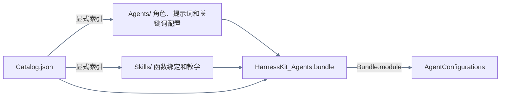

# Agents/Resources — Agent and Skill assets

## 职责与边界

Agents 自有的随包静态资源：[Catalog.json](Catalog.json) 显式索引、[Agents](Agents/README.md) 的角色身份、提示词与关键词配置、[Skills](Skills/README.md) 的函数绑定与流程教学。Agents 定义 schema、加载、目录投影和授权；本目录只保存静态文件，不含 Swift、脚本、凭据、模型权重或用户数据。

## 打包契约

Agents SwiftPM target 的路径为 `MobileHarness/Agents`，以 `.copy("Resources/Agents")`、`.copy("Resources/Skills")` 和 `.copy("Resources/Catalog.json")` 把这些资源放入 `HarnessKit_Agents.bundle` 的根部（`Agents/`、`Skills/`、`Catalog.json`）。运行时只由 `AgentConfigurations` 通过 `Bundle.module` 的 Bundle API 定位 `Catalog.json`，不拼接 `Resources` 到 resourceURL。本 README 经 target `exclude` 不进入 bundle。

Agent 提示词的 `.zh-Hans` sibling 与英文回退规则见 [Agents](Agents/README.md)；最终 App 资源验证见 [scripts](../../../scripts/README.md)，逐字节核对 bundle 中的缺失与陈旧资源。Action 翻译属于 [Actions/Resources](../../Actions/Resources/README.md)，不在此打包。
