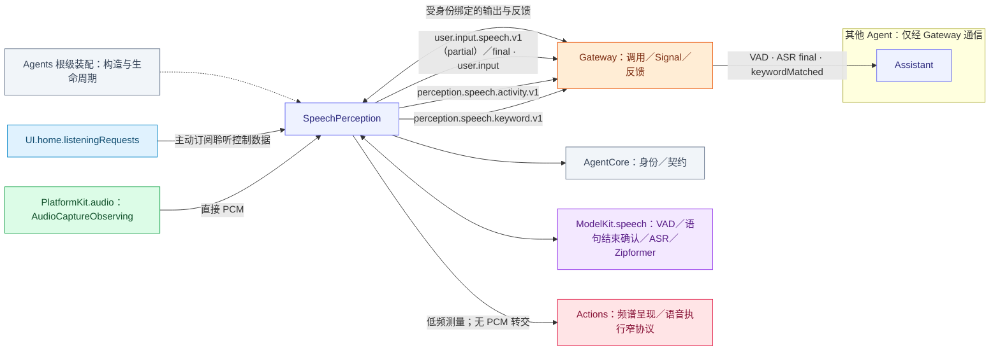
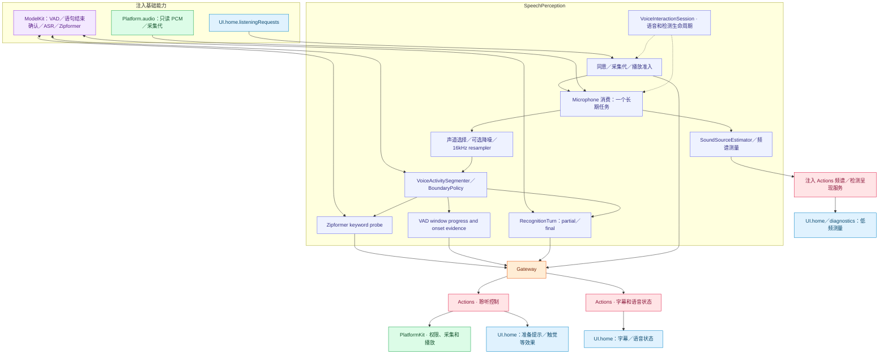
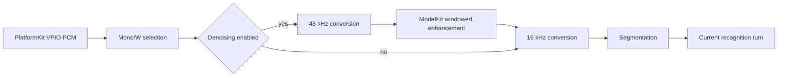

# SpeechPerception — PCM 消费、语音识别与聆听政策

本角色的静态类别由资源 Agent.json 声明并传入 Descriptor，归类与语义见 [Agents 分类](../README.md#agent-categories)。

## 角色容器

[SpeechPerceptionContainer.swift](SpeechPerceptionContainer.swift) 是 AgentContainer 的稳定子能力。独立持有感知角色注册、输出任务及内部 VoiceInteractionSession。向 App 公开 ready、状态、请求和诊断投影，不公开内部会话；VoiceAgentSession 连接感知容器、Assistant 语音子能力与 Actions 执行端口，不注册合成角色或停止共享 runtime。结束当前会话清理该代注册，根停止终结容器并加入交互／检测清理。

生命周期由[模块根](../README.md#agent-container)统一编排；子容器能力不授予执行权。

## 职责与注入能力

构造注入 PlatformKit `AudioCaptureObserving`、ModelKit `SpeechRecognitionCapability`／`VoiceActivityCapability`／可选 `SpeechEndpointCapability`／`SpeechEnhancementCapability`、可选 `UIHomeContainer`、FunctionContracts `SpectrumPresenting`、低频测量回调和私有 Context。角色直接取得 PCM，负责声道／采样率／序号／连续性、VAD、ASR、声源和半双工政策；不直接开启麦克风或启动动画。

UI.home.listeningRequests 是本角色单独订阅的控制源，提供 enabled/toggle/press 数据。UI 不调用角色；订阅本身不请求权限或开启设备。soundSourceOnly 模式不获得识别呈现权限。

## 文件与职责

| 文件 | 职责 |
| --- | --- |
| [AudioDetectionAgentSession.swift](AudioDetectionAgentSession.swift) | Isolated diagnostic role, result pump and neutral detection connection type specializations; no native capture ownership |
| [SoundSourceEstimator.swift](Workflow/SoundSourceEstimator.swift) | 声道测量到有限方向估计的算法 |
| [SpeechBoundaryPolicy.swift](Workflow/SpeechBoundaryPolicy.swift) | 语音分段、起声门槛和播放让声的能量档位；`SpeechOnsetPolicy` 由基础设置和播放事实得出单个窗口的起声概率、起声窗口数与维持概率 |
| [PlatformKit 播放快照](../../PlatformKit/Audio/README.md) | 通过原生只读端口查询最近 32 段播放区间 |
| [AudioFrameFloat32.swift](Input/AudioFrameFloat32.swift) | 本目录共享的 Float32 PCM 读写与帧电平（dBFS）扩展，不改变 ModelKit 契约 |
| [SpeechListeningInputs.swift](Input/SpeechListeningInputs.swift) | 聆听手势／策略输入和采集结束事实 |
| [SpeechPerceptionAgent.swift](SpeechPerceptionAgent.swift) | 聆听策略、输入代际、VAD／ASR 协调与角色消息 |
| [SpeechPerceptionMicrophone.swift](Input/SpeechPerceptionMicrophone.swift) | 只读 PCM 的唯一角色订阅、布局校验与模型输入转换 |
| [SpeechPerceptionSoundSource.swift](Output/SpeechPerceptionSoundSource.swift) | 声源观测的最新值发布：单发布任务、500 ms 新鲜度、替换与拒绝计数；与识别链路无共享队列 |
| [SpeechPerceptionProcessing.swift](Workflow/SpeechPerceptionProcessing.swift) | 感知角色私有 Context、预处理和聆听策略 |
| [SpeechPCMPreparation.swift](Workflow/SpeechPCMPreparation.swift) | Capture-scoped optional enhancement and 48/16 kHz resampling; clears history at full-utterance boundaries |
| [SpeechRecognitionTurn.swift](Workflow/SpeechRecognitionTurn.swift) | 已提交片段、冷启动前缀和转写聚合的有界工作 |
| [VoiceActivitySegmenter.swift](Workflow/VoiceActivitySegmenter.swift) | VAD 分段、尾静音及实际片段结束判定 |
| [VoiceAgentSession.swift](VoiceAgentSession.swift) | 感知容器、Assistant 语音子能力与 Actions 语音执行的连接适配器 |
| [VoiceInteractionSession.swift](VoiceInteractionSession.swift) | 容器内部的语音／诊断组合与生命周期，不向 App 暴露 |

## 外部关系（一层）

角色间消息经 Gateway 递送；基础能力通过构造注入，输入订阅由角色持有。角色、Skill 与 Task 授权归 Agents；Actions 来源的协作接口由 App 以中立窄端口绑定，Agents 不导入 Actions、CallRuntime 或 ExecutionRuntime。

SpeechPerception 在交互会话发布 VAD、ASR 和关键词三类事实。Assistant 订阅 VAD、ASR 终稿和关键词命中。局部转写由显式订阅者观察。声源保持自己的频道。

## 内部结构与执行链

低频频谱／检测测量走注入的 Actions 呈现服务；字幕、聆听和语音状态走受保护调用。原始 PCM 始终留在角色消费路径，Actions 原生执行服务只控制采集与屏障。

## PCM 与模型输入

原生源单消费者，64 包有序 FIFO 加当前处理包；一个长期任务完成当前包后才取下一包，包括冷模型获取期间，不增加第二个原生积压 FIFO，不逐包创建处理 Task。保留 Float 存储及原生序号，8–192 kHz，mono 或 ACN/SN3D FOA；半双工门控不重新编号。每包至多 64,000 字节。通用 AgentInput 不接纳 PCM，不存在程序化媒体兼容入口或额外积压队列。

选择 mono/W，每次转换至多 8192 samples；按设置经 48 kHz 降噪窗口或直接转换，最后状态化重采样为 16 kHz ModelKit.AudioFrame。ASR turn 最多 2048 事件、480,000 排队 mono samples；12 秒为内部段边界。缓冲满显式失败，不扩大容量等待模型。采集代重绑重置格式、声源与 DSP，旧代 PCM 不可进入新会话。

若一轮一直没有非空转写，`SpeechRecognitionTurn` 在成功送达识别器的 PCM 达到 32,768 样本（64 × 512、2.048 秒）且检查完识别器已经产生的事件后允许主动结束。SpeechPerception 结束同轮关键词探测，封口等待终稿最多 500 ms，随后取消并加入旧识别任务。ASR 通过同一个最终事件发布文本或空结果。发生主动端点后重置 DSP、VAD 状态与识别轮，连续 160 ms 没有同时满足基础 VAD 阈值和维持声量门槛才重新接纳起声。出现过非空转写的一轮使用常规 VAD 端点。

## 分段算法

`VoiceActivitySegmenter` validates contiguous scores over 16 kHz mono Float32: at most 16000 samples per frame, 32000 pending samples and 64 scores per process call. Default probability threshold is 0.65, valid 0.05…0.95. Overlap rejects inputBusy; failure closes/cancels the VAD session and clears damaged state.

`SpeechBoundaryPolicy` uses sample counts: configurable onset 1…16 windows of 512 samples (default 8 / 256 ms), pre-roll budget max(4096, onset windows × 512), endpoint padding 3072 (192 ms), and model-sized segment 192000 (12 s). Consecutive windows below the combined VAD and continuation-level gate determine the endpoint. Native playback at the PCM capture time uses 16 windows (512 ms); the ordinary endpoint uses 25 windows (800 ms). Silence is held back, then preserved in full if speech resumes; only endpoint padding is forwarded at utterance end. Prefix/suffix operations preserve whole frames, so padding is quantized to VAD windows. Maximum-duration boundaries keep speaking/hysteresis and stable utterance identity; there is no sixty-second complete-turn cutoff. Finish includes pending speaking tail and an explicit inputFinished event. An utterance reset clears segmentation and retains the current capture calibration.

每代 VAD 保留最近 64 个完整的 512 样本窗，每累计至多四窗发布进度。每个起声保存首个候选之前最近 64 窗的最早采集时刻。这一事实随起声和 ASR 终稿发布，供 Assistant 处理跨频道到达顺序。发布起声前先冲刷此前窗口的进度，再计入该起声所在窗。停采集和识别恢复会结束旧代。

### ASR 声量准入

起声与句内维持分别要求 VAD 分数达标，且同一预处理窗口的 RMS 达到声量门槛。起声使用较严格的声量门槛；维持门槛较低，弱尾音和句内暂停沿用分段的保留及补边策略。空闲、无候选、无播放或播放尾部且 VAD 分数低于 0.30 与基础阈值中的较小者，按样本数平滑更新噪声底。噪声底初值 −70 dBFS，观测值限制在 −78…−32 dBFS。

起声门槛取 −58 dBFS、噪声底加 8 dB（上限 −32）及说话参考电平减 12 dB（上限 −44）中的最大值。维持门槛分别取 −66 dBFS、噪声底加 3 dB（上限 −40）及参考电平减 20 dB（上限 −54）的最大值。参考电平未建立时只用绝对门槛与噪声底。正常静音端点且收到非空 ASR 终稿后，使用至多 32 个合格窗口的中位电平校准参考；需要至少 8 个窗口，VAD 分数至少 0.8、电平至少 −48 dBFS 且高于噪声底至少 12 dB，整句无播放重叠。后续每句按差值的四分之一向新电平移动，最大 2 dB。失败、新采集代、原生布局或采样率变化清除校准。校准仅在当前采集内存活，语音让声继续由确认起声后的实际电平驱动。

### 语句结束确认

VAD 达到静音端点时，同一 PCM 消费任务等待可选 `SpeechEndpointCapability`，每段连续停顿询问一次。分段器保留当前语句最近 128,000 个 16 kHz 单声道样本，包括该停顿。概率大于 0.5 时结束。低分保持说话状态与 ASR 轮次，语音恢复时把停顿一并交给原识别器，并允许再次确认。静音累计达 32,000 个样本即结束。关闭、未就绪或推理失败时按 VAD 原端点结束，失败写入语音端点日志。重置或取消时清空缓存。空转写主动结束、显式停采集和 ASR 内部分段仍按各自的契约执行。

## 输出契约

| Contract / function | Payload and semantics |
| --- | --- |
| user.input.speech.v1（partial） | Latest transcript preview ≤16 KiB encoded, two-second validity |
| user.input.speech.v1（final） | Nonempty final text ≤4096 UTF-8 bytes; published once per nonempty turn, with lifecycle-owned completion |
| sound.source | Native direction/quality/RMS and active/inactive/uncertain/unavailable; ≤10 Hz and 500 ms freshness |
| UI.Caption.setTranscript / finishTranscript | Internal completion-only calls; final text precedes sealing, including explicit empty result |
| UI.VoiceState.setVoiceState | Internal hearing/processing/listening display, no device control |
| Speech.Listening.update | Independent internal Tool that applies the resident producer's listening policy to the root recording session |

| 频道协议 | 事实 |
| --- | --- |
| `perception.speech.activity.v1` | 采集开始和结束、候选起声开始／清除／确认、VAD 进度。采集代和序号供观察者校验连续性。 |
| `user.input.speech.v1` | `partial` 与 `final`，包含语句和采集身份。最终结果承载正文、空内容或失败。 |
| `perception.speech.keyword.v1` | `keywordMatched`，包含标签、文字、采集代、语句 ID 和起声及命中时刻。 |

输出保留最先入队的 32 项，溢出报告失败。常规信号的证据保留最近 256 条，VAD 进度和 ASR 片段经有界内存队列发布。感知输出任务关闭时最多等待两秒发布剩余事实。订阅方按自身业务接纳信号。声源继续走独立发布端。

## 聆听、取消与完成

同意只在本会话有效。撤销或暂停推进接纳 epoch，异步提交后重验 UI 代际。原生 stopListening(sessionID:) 撤销许可，公开启停 Action 用 setListening(enabled:sessionID:) 更新同一许可并返回单调 revision。执行方应用策略并加入原生完成。

最终文本发布后，感知重置识别器并结束本轮。全双工路线持续接纳音频，并按播放状态调整起声门槛；受限路线由实际播放准入暂停识别，播放完成或取消后通过执行端恢复。重置校验采集会话和代际，新播放准入可阻止旧恢复开放识别。

startInput 只订阅当前已开启采集代。回复半双工暂停保留该订阅并丢弃未获准入的帧；设备关闭时取消空闲取帧、加入当前包，完整 close/stop 先取消识别，再加入原生任务、获取模型和发布者。恢复最多 32 个可取消当前包等待者，只等待已接纳工作，不承载 PCM。UI 回执确认策略接纳；原生停机和播放终态由执行服务单独确认。

## 物理双工与聆听许可

本角色拥有麦克风许可及采集内的语音边界。原生采集的 `supportsFullDuplex` 决定当前路由能否在播放时继续识别。受限路由由原生播放准入暂停后恢复。收到的 PCM 以实际采集时刻查询 [PlatformKit](../../PlatformKit/Audio/README.md) 播放区间，聆听 UI 由采集和识别阶段驱动。

## 声源算法

SoundSourceEstimator retains scalar statistics for one 100 ms native-rate window (fractional rate rounding permits at most 101 ms). Correlate W with Y/Z/X: captured-field X front, Y left, Z up; azimuth/elevation are radians. RMS threshold is −50 dBFS and correlation quality threshold 0.6, a heuristic rather than probability. Quiet windows clear direction immediately and become inactive after 200 ms. No distance, identity, robot-frame or camera-mirror mapping is inferred.

Mono publishes unavailable once per format/listening epoch and still supports ASR. Format/resume resets DSP; reply pause clears FOA direction. One publisher and one latest pending sound observation retain 500 ms window-end freshness. The publisher saves observation evidence before submitting it and reports persistence failure. No subscribers is allowed loss. Stop joins publisher and processing without self-joining a failure path.

## 失败与限制

`reportError` 未校验输出 yield，32 槽满载／关闭时诊断可能丢失；普通输出失败会显式抛错。

通信见 [Agent.json](../Resources/Agents/SpeechPerception/Agent.json)，原生执行见 [Actions/Speech](../../Actions/Speech/README.md#speech-shared-contracts)。

AudioDetectionAgentSession 只注册检测角色、构造模型 Context 并绑定结果泵；Actions 中的 AudioDetectionSession 经中立连接端口组合该角色与 AudioDetectionExecution，不消费或转交原始 PCM。播放失败文案由 [Assistant](../Assistant/README.md#presentation-speech-and-cleanup) 拥有，感知角色只处理识别与聆听政策。

## App-owned diagnostic transport

AudioDetectionAgentSession borrows one isolated observation session through GatewayObservationAccess supplied by AgentRuntime. It creates only its diagnostic SpeechPerception actor and output pump; GatewayContainer creates and retains the communication facilities. Diagnostic capture remains owned by Actions. Root admission and stop include the borrowed session; release does not stop normal voice registration or the application Gateway. The session has observation-only catalogs, reports acquisition/cleanup failures explicitly and never invokes business functions.

## Execution ownership and lifecycle

AudioDetectionAgentSession also declares the neutral connection/observation type specializations. Actual native detection/voice sessions live in Actions. VoiceInteractionSession owns cognitive role preparation and connects narrow voice/detection interfaces; root cleanup is retained until downstream Actions joins. SpectrumPresenting is a neutral UUID-based port.

## Passive container state

stateSnapshot projects local installation/closure and existing work or Agent lifecycle/queue counters directly from memory. Reading starts no role, persistence restoration or inference. Initialization remains in the existing owner lifecycle. The root catalog binds independent readers without sampling roles or maintaining another mutable role-state registry.

SpeechPerceptionContainer.presentation returns one complete SpeechSessionPresentation for an installed interaction. It includes typed conversation/activity/detection state, request interfaces and diagnostics; App does not combine optional child fields. Identity remains stable for that interaction. Stop invalidates the debug validation entry and releases the projection after joining shutdown; stale validation requests fail explicitly.

ASR 创建、输入或结果失败时保留原始 agent.error，取消并加入该轮 ASR/VAD，校验采集代、会话与运行态后重建下一轮。失败字幕由 finishTranscript 封口，transition(.empty) 记录本地阶段，并在准入仍有效时呈现 listening。

根语音许可跨场景可见性保留。全双工路线保持原生采播，播报期间使用较严格的起声门槛，已确认的双讲语句继续。受限路线等当前语句收尾后取得播放准入，播放期间暂停识别。实际关闭或中断会取消并等待原生采集、识别和发布工作退出。Actions 持有原生权限与播放屏障，感知在恢复时校验用户许可、会话和采集代。

## 新人声字幕生命周期

processFrame 在 VAD 确认新轮并创建 AgentTurn 后先用 UI.Caption.setTranscript 空文本打开本轮字幕。片段和最终文本更新本轮字幕，finishTranscript 封口。识别阶段保存在本地 Context 并驱动感知灵动岛和语音状态。

SpeechListening 日志记录许可、采集开启、识别暂停、原生包处理、识别阶段及恢复时的等待和重置边界。日志内容限于状态和检查点。

## 自有灵动岛

SpeechPerception 在采集、聆听许可、识别阶段和播放准入变化时更新自有活动。可接纳输入时显示聆听或人声，ASR 收尾显示识别，受限路线播放或关闭采集时撤下。连续聆听和人声共用计时起点。容器为感知绑定有界发布端，展示失败通过 presentationFailure 及容器状态公开，停止时先完成最终 end，再撤销身份。识别定稿后独立重置，下一句采集按本地准入处理。

半双工恢复完成 ASR/VAD 重置后记录单调接纳时刻；原生帧以 capturedAt 判断，播放期间录到但在恢复后才出队的旧包仍被拒绝。新采集代清除门限。手机与蓝牙耳机的 Voice Processing 路线均返回全双工；播放期间保持底层采播；半双工恢复围栏独立于下述全双工短时语音接纳策略。

Speech detection preferences are injected through a throwing read-only closure and snapshotted before VAD session creation. The capture keeps the same base settings; `SpeechOnsetPolicy` derives each window's gates: playback adds 0.15 to the onset probability and two onset windows, capped at 0.95/16, while confirmed speech uses the base probability and continuation level for continuation/endpoint detection. No per-packet persistence reads occur. When a new utterance begins, the `SpeechOnset` log category records playback state, onset probability/threshold/window count, the window level, applicable level gates and noise floor in dBFS, and the duplex route — numbers only, no audio or text — as the evidence needed to analyze false triggers on device. The Voice Processing graph and optional denoiser filter PCM before the admission checks. An enabled denoiser failure uses the perception recovery path.

## Optional speech enhancement

`SpeechPCMPreparation` owns capture-scoped resamplers and an optional `WindowedSpeechEnhancement` supplied through the ModelKit speech port. StartInput snapshots the durable denoising preference. Native VPIO echo processing remains in PlatformKit; mono/W audio then goes through 48 kHz conversion, optional denoising, 16 kHz conversion and the existing shared VAD/ASR path. Native spatial measurements remain unchanged. The same route applies to AirPods and phone capture. Prepared PCM uses original capture time to select playback-dependent onset thresholds.

Each native input is processed inline; there is no second native FIFO. The window adapter adds 400 ms initial buffering and has no recurrent-state/real-time equivalence claim. On full utterance completion with confirmed onset, utterance completion clears preprocessing context/lookahead along with segmentation; maximum-duration model chunks preserve the same utterance. Subsequent prepared packets resolve the current turn. Explicit discard, failed recognition recovery, new capture generation or changed native format resets all preprocessing buffers and timestamps. Enhanced PCM errors use the existing visible perception failure/recovery path; an enabled failing model never silently forwards original audio. Settings changes take effect on the next capture subscription; model removal joins listening cleanup before releasing model resources.

## 播放状态与连续接纳

PlatformKit 通过 `AudioCaptureObserving.playbackSnapshot()` 提供最近 32 段原生播放区间。SpeechPerception 按原始采集时间选取门槛。播放和结束后 200 ms 使用较严格的起声门槛，只有实际播放区间使用短静音端点。

有效采集确认起声后，语音让声读取之后每个已处理 PCM 窗的 RMS。静音端点与 ASR 终稿独立结算，能量仍为中档或高档时继续观察；识别已结束、能量为低档且未累计升档时结束观察。后续确认起声可沿用仍在进行的声学观察及其原始语句身份。中、高档进入阈值分别为 −34、−20 dBFS，离开阈值分别为 −39、−25 dBFS。连续两个窗口可进入中档，连续六个高能量窗口才进入高档。中档连续处于 −39 dBFS 或以下累计 600 ms 后恢复原音量。高档连续达到退出线 −25 dBFS 或以下累计 1,000 ms 后按届时电平恢复，中档与低档之间的电平变化可继续累计。电平回到当前档保持范围时清零累计。时间按 16 kHz PCM 的已处理样本数计算。仅发布档位变化。识别失败和采集结束以对应采集代的 `captureStopped` 清除让声，采集代替换隔离旧事件。ASR 收尾期间 PCM 仍沿现有采集 FIFO 等待消费。

采集开始、起声、能量变化、恢复与采集结束按生成顺序进入 VAD 信道。VAD、ASR、关键词命中与声音定位各用自己的有界 FIFO，每个信道串行提交，不同信道并行。语音信号先入队再记录诊断证据；关闭或替换后的旧采集结果停止发布。

ASR完整语句结束后重置识别和预处理历史，允许下一片音频立即进入VAD。ASR收尾中的现有识别状态机、半双工播放暂停、会话与采集代隔离仍由原有生命周期控制。

SpeechPerceptionAgent按至多32ms原始片段和512样本DSP输出处理音频。每个DSP切片获得采集代内严格递增的独立序号，frame.timestamp与原始audio.timestamp的偏移映射回capturedAt，用于播放期间起声阈值选择；不因起播或ASR完成时刻丢弃片段。没有额外PCM队列。

## 流式关键词探测

[SpeechKeywordProbe](Workflow/SpeechKeywordProbe.swift) 从 VAD 首个起声候选接收 16 kHz PCM，
保留最多 1,600 个预卷采样。每个候选最多排队 8 包，满时关闭本轮探测，ASR 继续。
设置选择关键词模型且模型已就绪时，从候选窗口开始累积关键词缓存，关闭或模型未就绪则跳过。
一轮最多发布一个符合 160 ms 尾部静音门限的首次命中。词表包含独立的 `stop` 和「停下」以及中英文长口令。命中必须关联到确认起声后的语句，并仍属于当前采集代。起声撤销、端点和采集关闭使候选失效。原生采集支持全双工且关键词检测已启用时，空闲中和播放中都可产生观察。Assistant 独立决定业务动作。

命中观察携带起声时刻、产生命中的 PCM 包末端时刻和检测完成时刻。检测完成在静音及语句确认通过、即将发布观察时采样，使用同一进程单调时钟。探测任务透传 ModelKit 的模型身份与累计推理耗时；设置诊断仍使用命中标签与尾部静音结果。

声学词表位于 [ZipformerKeywords.json](../Resources/Agents/SpeechPerception/ZipformerKeywords.json)，包含稳定标签、短语、词元与独立词规则。设置中的关键词测试使用独立 `AudioDetectionAgentSession` 与一条已就绪的关键词会话。测试使用生产词表和当前降噪配置，将预处理后的 16 kHz 音频直接送入关键词会话。首次命中将短语和生产尾部静音判定作为诊断观测。测试的采集不进入 VAD、ASR、Assistant Signal 或停播链路。

同一次设置测试内，连续 600 ms 低电平之后的下一次有声输入开启新关键词会话，带入至多 100 ms 预卷。成功交给模型的采样数与处理后电平通过有界频率投影至 UI。

正式采集和关键词测试在开始时读取已保存的关键词置信度，并为该次采集固定词表和阈值。设置测试中的会话重开使用相同词表参数。

## 目录职责

- [Input](Input/) 接收聆听意图和原生麦克风帧，转换输入样本。
- [Workflow](Workflow/) 拥有语音边界、识别轮次、关键词探测和声源估计。
- [Output](Output/) 发布最新声源观察并保留发布失败和替换计数。
