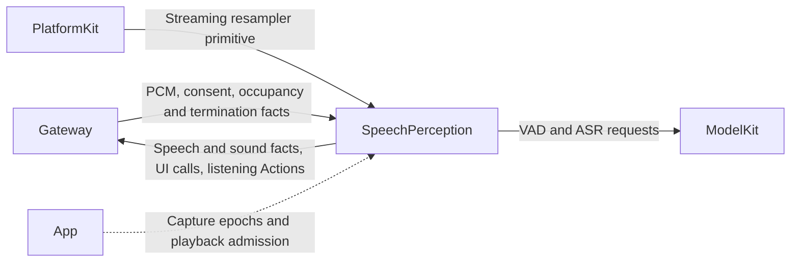
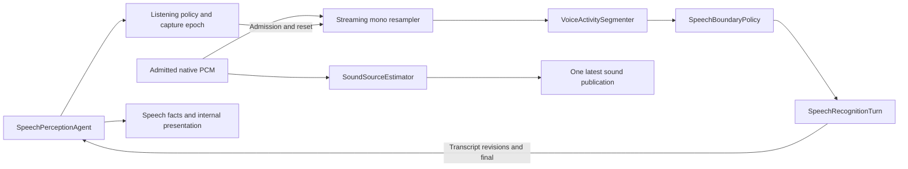

# Speech Perception and Listening Authority

## Summary

Resident listening policy, streaming VAD/ASR and native sound-source observations under one bounded audio-processing owner.

## Ownership and boundaries

User consent and revisioned reply occupancy are interpreted here. App executes physical capture, confirmed-utterance/playback barriers. ModelKit supplies VAD/ASR; PlatformKit supplies generic PCM conversion. The diagnostic soundSourceOnly mode has no recognition/presentation grants.

## External relationships and data flow

Runtime arrows show data or capability calls; dashed arrows show injection.

## Internal components

This role uses typed media requests and deterministic policy, with no Chat system prompt or role prompt asset.

## Input and processing

Native interleaved Float32 AudioInput retains rate 8–192 kHz, mono or ACN/SN3D FOA, sequence, timestamp and monotonic capture instant. Validate capture epoch, increasing sequence/nondecreasing time and expiry. Inputs retain 128 packets/64,000 scalar samples; each packet is at most 64,000 bytes. FOA accounting includes all channels. Controls bypass audio capacity.

Select mono/W and process at most 8192 samples per conversion chunk through a stateful StreamingMonoPCMResampler to 16 kHz ModelKit.AudioFrame. VAD boundary policy owns onset/pre-roll/silence/padding and maximum segment length. SpeechRecognitionTurn owns ASR events, segment revisions and final sealing: 128 events/64,000 queued mono samples, with no utterance duration cap or finish watchdog. Internal 12-second ASR segment boundaries do not end the user utterance. Rejected updates do not mutate transcript state.

## Segmentation algorithm

`VoiceActivitySegmenter` validates contiguous scores over 16 kHz mono Float32: at most 16000 samples per frame, 32000 pending samples and 64 scores per process call. Default probability threshold is 0.5, valid 0.05…0.95. Overlap rejects inputBusy; failure closes/cancels the VAD session and clears damaged state.

`SpeechBoundaryPolicy` uses sample counts: confirmed onset 1536 (96 ms), pre-roll budget 4096 (256 ms), endpoint silence 12800 (800 ms), endpoint padding 3072 (192 ms), and model-sized segment 192000 (12 s). Silence is held back, then preserved in full if speech resumes; only endpoint padding is forwarded at utterance end. Prefix/suffix operations preserve whole frames, so padding is quantized to VAD windows. Maximum-duration boundaries keep speaking/hysteresis and stable utterance identity; there is no sixty-second complete-turn cutoff. Finish includes pending speaking tail and an explicit inputFinished event. Reset clears DSP/segmentation state without choosing a new device.

## Output contracts

| Contract / function | Payload and semantics |
| --- | --- |
| speech.partial | Latest transcript preview ≤16 KiB encoded, two-second validity |
| speech.final | Nonempty final text ≤4096 UTF-8 bytes; published once per nonempty turn, with lifecycle-owned completion |
| speech.phase | Discrete listening/speaking/processing/empty transitions; lifecycle-owned completion |
| sound.source | Native direction/quality/RMS and active/inactive/uncertain/unavailable; ≤10 Hz and 500 ms freshness |
| UI.Caption.setTranscript / finishTranscript | Internal completion-only calls; final text precedes sealing, including explicit empty result |
| UI.VoiceState.setVoiceState | Internal hearing/processing/listening display, no device control |
| Speech.Listening.update | Internal policy Action for the actual resident producer/root session |

Publication is one-way. A subscriber rejection cannot stop inference; output protocol/context failures remain local errors. Internal presentation completion is state acceptance, not screen rendering. Output capacity is 32 with oldest-buffer retention; normal output yield failure throws queueFull. Audio FIFO overflow rejects the new packet before advancing sequence/time. Evidence retains 256 summaries with counted eviction. Final/phase use the stable interaction scope; raw/partial recognition retains capture generation.

## Listening state and recovery

speech.listening controls session-only consent. Up to four source/incarnation/revision-fenced interaction.replyActivity snapshots and one pending final root suppress new utterance admission. Final ASR closes admission before publication; matching Assistant acknowledgment transfers the hold to occupancy. Occupancy ends on explicit terminal/activity or lifecycle facts; there is no lease timer. Generic busy is not reply occupancy.

Native speech.captureEnded clears consent only for the current revision. User-off stops physical capture; policy pause closes recognition admission and App stops native capture after confirmed utterance completion while retaining logical consent. App additionally joins confirmed utterance completion and playback drain/audio cleanup; capture resumes immediately when policy and these barriers permit. Policy is not restored after process restart. openCapture/closeCapture cancel/join a capture epoch without stopping the resident Agent; full stop also joins recovery/publisher and closes output.

## Sound-source algorithm

SoundSourceEstimator retains scalar statistics for one 100 ms native-rate window (fractional rate rounding permits at most 101 ms). Correlate W with Y/Z/X: captured-field X front, Y left, Z up; azimuth/elevation are radians. RMS threshold is −50 dBFS and correlation quality threshold 0.6, a heuristic rather than probability. Quiet windows clear direction immediately and become inactive after 200 ms. No distance, identity, robot-frame or camera-mirror mapping is inferred.

Mono publishes unavailable once per format/listening epoch and still supports ASR. Format/resume resets DSP; reply pause clears FOA direction. One publisher and one latest pending sound observation retain 500 ms window-end freshness. No subscribers is allowed loss. Stop joins publisher and processing without self-joining a failure path.

## Registration and authority

[Agent.json](../../Resources/Agents/SpeechPerception/Agent.json) admits native audio, user listening consent, Assistant reply occupancy and matching capture-ended facts. Only Assistant currently publishes authorized reply occupancy. Internal caption/voice-state Tools and Speech.Listening.update are code-bound; there are no model-callable functions. App owns physical microphone/playback and confirmed-utterance barriers; the Agent owns consent/occupancy and revisioned listening policy. Consent is explicit/idempotent when enabled is supplied; otherwise the input toggles consent. Reply termination never restores revoked consent.

Input/request identity is retained in ModelKit requests; scopeID is opaque to the SDK. Final-ASR admission rejection or recognition/publication failure releases this input's pending-final hold and publishes current policy; it does not forge another Agent's terminal fact. No fixed post-reply wait, occupancy lease timer or whole-utterance watchdog is used.

## 待实现

- Barge-in and background listening are not implemented.
- `reportError` ignores the output stream's yield result. When its 32-slot buffer is full or closed, an `agent.error` diagnostic can be lost. Normal output emission checks yield failure; reliable diagnostic delivery is not guaranteed by this implementation.

[Agents](../README.md) · [Communication](../Support/Communication/README.md)
