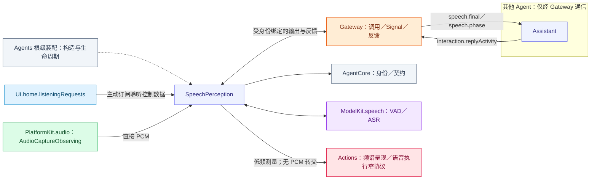
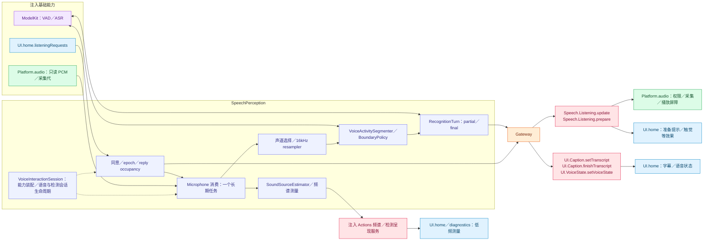

# SpeechPerception — PCM 消费、语音识别与聆听政策

本角色的静态类别由资源 Agent.json 声明并传入 Descriptor，归类与语义见 [Agents 分类](../README.md#agent-categories)。

## 角色容器

[SpeechPerceptionContainer.swift](SpeechPerceptionContainer.swift) 是 AgentContainer 的稳定子能力。独立持有感知角色注册、输出任务及内部 VoiceInteractionSession。向 App 公开 ready、状态、请求和诊断投影，不公开内部会话；VoiceAgentSession 连接感知容器、Assistant 语音子能力与 Actions 执行端口，不注册合成角色或停止共享 runtime。结束当前会话清理该代注册，根停止终结容器并加入交互／检测清理。

生命周期由[模块根](../README.md#agent-container)统一编排；子容器能力不授予执行权。

## 职责与注入能力

构造注入 PlatformKit `AudioCaptureObserving`、ModelKit `SpeechRecognitionCapability`／`VoiceActivityCapability`、可选 `UIHomeContainer`、FunctionContracts `SpectrumPresenting`、低频测量回调和私有 Context。角色直接取得 PCM，负责声道／采样率／序号／连续性、VAD、ASR、声源和半双工政策；不直接开启麦克风或启动动画。

UI.home.listeningRequests 是本角色单独订阅的控制源，提供 enabled/toggle/press 数据。UI 不调用角色；订阅本身不请求权限或开启设备。soundSourceOnly 模式不获得识别呈现权限。

## 文件与职责

| 文件 | 职责 |
| --- | --- |
| [AudioDetectionAgentSession.swift](AudioDetectionAgentSession.swift) | Isolated diagnostic role, result pump and neutral detection connection type specializations; no native capture ownership |
| [SoundSourceEstimator.swift](SoundSourceEstimator.swift) | 声道测量到有限方向估计的算法 |
| [SpeechBoundaryPolicy.swift](SpeechBoundaryPolicy.swift) | 边界、结束与恢复的纯策略 |
| [SpeechListeningInputs.swift](SpeechListeningInputs.swift) | 聆听手势／策略输入和采集结束事实 |
| [SpeechPerceptionAgent.swift](SpeechPerceptionAgent.swift) | 聆听策略、输入代际、VAD／ASR 协调与角色消息 |
| [SpeechPerceptionMicrophone.swift](SpeechPerceptionMicrophone.swift) | 只读 PCM 的唯一角色订阅、布局校验与模型输入转换 |
| [SpeechPerceptionProcessing.swift](SpeechPerceptionProcessing.swift) | 感知角色私有 Context、预处理和聆听策略 |
| [SpeechRecognitionTurn.swift](SpeechRecognitionTurn.swift) | 已提交片段、冷启动前缀和转写聚合的有界工作 |
| [VoiceActivitySegmenter.swift](VoiceActivitySegmenter.swift) | VAD 分段、尾静音及实际片段结束判定 |
| [VoiceAgentSession.swift](VoiceAgentSession.swift) | 感知容器、Assistant 语音子能力与 Actions 语音执行的连接适配器 |
| [VoiceInteractionSession.swift](VoiceInteractionSession.swift) | 容器内部的语音／诊断组合与生命周期，不向 App 暴露 |

## 外部关系（一层）

角色间消息经 Gateway 递送；基础能力通过构造注入，输入订阅由角色持有。角色、Skill 与 Task 授权归 Agents；Actions 来源的协作接口由 App 以中立窄端口绑定，Agents 不导入 Actions、CallRuntime 或 ExecutionRuntime。

`speech.partial`、`sound.source` 也被发布，目前静态配置没有订阅角色；不能把已声明可发布等同于已有消费者。

## 内部结构与执行链

低频频谱／检测测量走注入的 Actions 呈现服务；字幕、聆听和语音状态走受保护调用。原始 PCM 始终留在角色消费路径，Actions 原生执行服务只控制采集与屏障。

## PCM 与模型输入

原生源单消费者，64 包有序 FIFO 加当前处理包；一个长期任务完成当前包后才取下一包，包括冷模型获取期间，不增加第二个原生积压 FIFO，不逐包创建处理 Task。保留 Float 存储及原生序号，8–192 kHz，mono 或 ACN/SN3D FOA；半双工门控不重新编号。每包至多 64,000 字节。通用 AgentInput 不接纳 PCM，不存在程序化媒体兼容入口或额外积压队列。

选择 mono/W，每次转换至多 8192 samples，状态化重采样为 16 kHz ModelKit.AudioFrame。ASR turn 最多 2048 事件、480,000 排队 mono samples；12 秒仅为内部段边界，没有整句时长截止。缓冲满显式失败，不扩大容量等待模型。采集代重绑重置格式、声源与 DSP，旧代 PCM 不可进入新会话。

## 分段算法

`VoiceActivitySegmenter` validates contiguous scores over 16 kHz mono Float32: at most 16000 samples per frame, 32000 pending samples and 64 scores per process call. Default probability threshold is 0.5, valid 0.05…0.95. Overlap rejects inputBusy; failure closes/cancels the VAD session and clears damaged state.

`SpeechBoundaryPolicy` uses sample counts: confirmed onset 1536 (96 ms), pre-roll budget 4096 (256 ms), endpoint silence 12800 (800 ms), endpoint padding 3072 (192 ms), and model-sized segment 192000 (12 s). Silence is held back, then preserved in full if speech resumes; only endpoint padding is forwarded at utterance end. Prefix/suffix operations preserve whole frames, so padding is quantized to VAD windows. Maximum-duration boundaries keep speaking/hysteresis and stable utterance identity; there is no sixty-second complete-turn cutoff. Finish includes pending speaking tail and an explicit inputFinished event. Reset clears DSP/segmentation state without choosing a new device.

## 输出契约

| Contract / function | Payload and semantics |
| --- | --- |
| speech.partial | Latest transcript preview ≤16 KiB encoded, two-second validity |
| speech.final | Nonempty final text ≤4096 UTF-8 bytes; published once per nonempty turn, with lifecycle-owned completion |
| speech.phase | Discrete listening/speaking/processing/empty transitions; lifecycle-owned completion |
| sound.source | Native direction/quality/RMS and active/inactive/uncertain/unavailable; ≤10 Hz and 500 ms freshness |
| UI.Caption.setTranscript / finishTranscript | Internal completion-only calls; final text precedes sealing, including explicit empty result |
| UI.VoiceState.setVoiceState | Internal hearing/processing/listening display, no device control |
| Speech.Listening.update | Internal policy Action for the actual resident producer/root session |

Publication is one-way. A subscriber rejection cannot stop inference; output protocol/context failures remain local errors. Internal presentation completion is state acceptance, not screen rendering. Output capacity is 32 with oldest-buffer retention; normal output yield failure throws queueFull. Audio FIFO overflow rejects the new packet before advancing sequence/time. Evidence retains 256 summaries with counted eviction. Final/phase use the stable interaction scope; raw/partial recognition retains capture generation.

## 聆听、取消与完成

同意只在本会话有效；撤销／暂停推进接纳 epoch，并在异步提交后重验 UI 代际，拒绝迟到启用。原生 owner 的 `stopListening(sessionID:)` 只撤销并发布内部策略，不能重新同意。公开启停 Action 通过 `setListening(enabled:sessionID:)` 更新同一许可：校验 resident/root 会话与运行态（paused 时仅允许关闭），推进 admission epoch 并返回单调 revision 的中立 ListeningPolicy；关闭同时清空 pendingFinal 并关闭新句接纳。此调用不发布第二个 Action，由原执行方直接应用返回策略并确认原生完成。回复占用只改变 paused；物理停止不依赖 UI 队列可用。

最多四个 source/incarnation/revision 围栏的 replyActivity 快照及一个 pending final root 抑制新句接纳。最终识别先关接纳再发布，Assistant 匹配回复事实接管 occupancy；释放依赖真实终态／生命周期，没有占用定时器。半双工暂停保留逻辑同意，Actions 加入已确认语句、播放 drain 和音频清理后才恢复；用户撤销推进单调时间围栏，早于撤销开始的汇报不能重新启听。新的汇报在撤销后实际开始并成功播毕时可按汇报政策启听。

startInput 只订阅当前已开启采集代。回复半双工暂停保留该订阅并丢弃未获准入的帧；设备关闭时取消空闲取帧、加入当前包，完整 close/stop 先取消识别，再加入原生任务、获取模型和发布者。恢复最多 32 个可取消当前包等待者，只等待已接纳工作，不承载 PCM。UI 回执确认策略接纳；原生停机和播放终态由执行服务单独确认。

## 声源算法

SoundSourceEstimator retains scalar statistics for one 100 ms native-rate window (fractional rate rounding permits at most 101 ms). Correlate W with Y/Z/X: captured-field X front, Y left, Z up; azimuth/elevation are radians. RMS threshold is −50 dBFS and correlation quality threshold 0.6, a heuristic rather than probability. Quiet windows clear direction immediately and become inactive after 200 ms. No distance, identity, robot-frame or camera-mirror mapping is inferred.

Mono publishes unavailable once per format/listening epoch and still supports ASR. Format/resume resets DSP; reply pause clears FOA direction. One publisher and one latest pending sound observation retain 500 ms window-end freshness. No subscribers is allowed loss. Stop joins publisher and processing without self-joining a failure path.

## 失败与限制

`reportError` 未校验输出 yield，32 槽满载／关闭时诊断可能丢失；普通输出失败会显式抛错。

通信见 [Agent.json](../../Resources/Agents/SpeechPerception/Agent.json)，原生执行见 [Actions/Speech](../../Actions/Speech/Support/README.md)。

AudioDetectionAgentSession 只注册检测角色、构造模型 Context 并绑定结果泵；Actions 中的 AudioDetectionSession 经中立连接端口组合该角色与 AudioDetectionExecution，不消费或转交原始 PCM。播放失败文案由 [Assistant](../Assistant/README.md#语音生产与播放) 拥有，感知角色只处理识别与聆听政策。

## App-owned diagnostic transport

AudioDetectionAgentSession borrows one isolated observation session through GatewayObservationAccess supplied by AgentRuntime. It creates only its diagnostic SpeechPerception actor and output pump; GatewayContainer creates and retains the communication facilities. Diagnostic capture remains owned by Actions. Root admission and stop include the borrowed session; release does not stop normal voice registration or the application Gateway. The session has observation-only catalogs, reports acquisition/cleanup failures explicitly and never invokes business functions.

## Execution ownership and lifecycle

AudioDetectionAgentSession also declares the neutral connection/observation type specializations. Actual native detection/voice sessions live in Actions. VoiceInteractionSession owns cognitive role preparation and connects narrow voice/detection interfaces; root cleanup is retained until downstream Actions joins. SpectrumPresenting is a neutral UUID-based port.

## Passive container state

stateSnapshot projects local installation/closure and existing work or Agent lifecycle/queue counters directly from memory. Reading starts no role, persistence restoration or inference. Initialization remains in the existing owner lifecycle. The root catalog binds independent readers without sampling roles or maintaining another mutable role-state registry.

SpeechPerceptionContainer.presentation returns one complete SpeechSessionPresentation for an installed interaction. It includes typed conversation/activity/detection state, request interfaces and diagnostics; App does not combine optional child fields. Identity remains stable for that interaction. Stop invalidates the debug validation entry and releases the projection after joining shutdown; stale validation requests fail explicitly.

ASR创建、输入或结果失败属于当前识别轮次终态：保留原始agent.error，取消并加入该轮ASR/VAD，校验采集代/会话/运行态后重建下一轮。失败保留本轮已有字幕并finishTranscript封口，使用统一transition(.empty)写Context/listening、结束识别绑定，并在采集开启且聆听许可未撤销/未暂停时提交listening呈现；不能只改内部phase。processing是等待ASR收尾，不等于已提交LLM。恢复不发布speech.final、不重开麦克风、不改变用户同意；关闭/换代的迟到清理不复活旧会话。UI工具/通信失败继续报告，UI保持既有会话/序号/采集与回复占用围栏。

ReplyActivity以来源revision/incarnation验证占用及成功汇报事实，接纳时必须推进来源围栏并处理pendingFinal确认；只有已启听时合并paused改变，或成功汇报使enabled改变，才提交Speech.Listening.update。关闭聆听时单纯占用改变不提交关闭Action，避免反向取消主动播报。相同空闲、同态忙碌、另一个来源仍占用时的单方结束不会重复调用设备策略。此规则切断关闭→取消回复→空闲回执→再次关闭的反馈环；显式用户开关和原生采集结束仍走既有执行路径，不采用节流或日志过滤。

场景隐藏不撤销根语音许可或取消识别。回复占用期间原生输入订阅继续排空帧，admitsMicrophone为false时直接丢弃，不调用VAD/ASR或生成输入；实际关闭/中断仍取消加入。此半双工准入与设备持续录音分离，避免把播放声音识别为下一句。

汇报完成事实携带回复开始的进程单调时间；明确停止、原生采集结束、暂停及根关闭推进本地撤销围栏。来源incarnation/revision丢弃乱序快照，完成事实可独立于更早的占用快照接纳；较新停止之后的旧完成及重复完成不得重新启听。policy不直接操作设备，实际启动、权限和播放屏障继续归Actions；失败/取消回复没有成功完成事实。

## 新人声字幕生命周期

processFrame在VAD确认新轮并创建AgentTurn后、发送语音阶段或ASR首段文本前，显式调用UI.Caption.setTranscript空文本开启本轮字幕。麦克风启用／恢复不创建这个字幕边界。speech.phase(speaking)同时是给Assistant的新输入开始控制事实；同一识别轮内的阶段变化不重复清转写。partial/final只更新自己的槽，finishTranscript封口但不清空；失败恢复只封口已有文本并恢复许可，不抹掉已有转写。下一轮确认人声才替换上轮字幕。最终非空speech.final仍是唯一进入Assistant正式输入FIFO的识别文本，开始事实不要求Assistant推理。

SpeechListening日志只记录策略与生命周期检查点：enabled/paused、pending-final是否存在、占用来源
数量、capture/awaiting/nativeProcessing与phase，以及恢复的join/reset边界。不记录原始语音、图片
或模型正文。它与原有私有内容日志分开，用于区分策略未释放、恢复未到达和DSP重建停滞。

## 自有灵动岛

SpeechPerception在capture、聆听许可、识别phase和播放准入边界直接更新自有活动：可接纳输入时显示聆听/人声，ASR收尾显示识别；等待回复、关闭采集或停止撤下。连续聆听/人声保留elapsed起点，退出后重新计时，不依赖UI.voicePhase。容器绑定本角色consumer，复用共享有界发布，展示失败通过presentationFailure及容器runtime公开；停止在身份退休前加入最终end。不调用Assistant代发；字幕边界保持独立。
