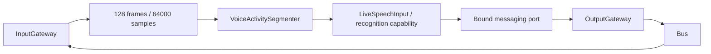

# Speech Perception

Purpose: convert bounded microphone PCM into shared speech observations. Owns VAD, segmentation, streaming ASR and transcript merging; never owns microphone hardware or UI.

✅ JSON v4 declarations; sequential raw audio admission; existing 128-event/64000-sample ASR queue and 60-second turn limit; partial/final separation; final publication once per nonempty turn. Empty turns resume capture. App resumes after Assistant actions finish.

✅ Endpoint recognition suppresses queued capture after the endpoint while replies play. This is explicit conversational capture gating, not an audio overflow policy. Overflow fails; no unbounded tasks. Stop cancels and joins ASR/VAD/worker before completing. Models remain resident.

❌ Barge-in, background listening and physical sustained speech acceptance of this migration.
