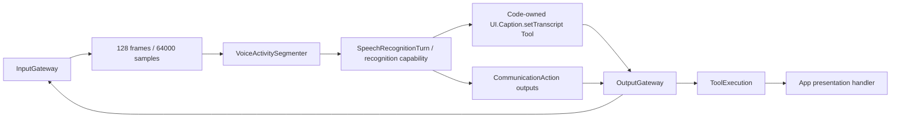
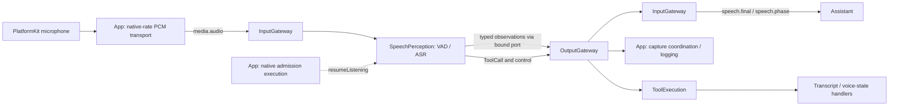
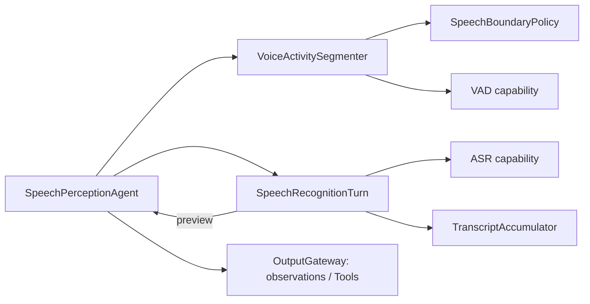
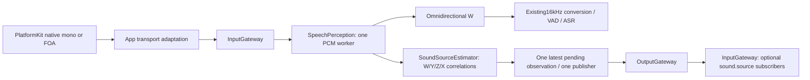

# Speech Perception

## 函数与通信注册清单

✅ 以下为当前实现的完整注册清单。模型权限来源：[配置文件](SpeechPerception.agent.json)；内部权限来源见各行链接。参数后缀 `?` 表示可选，`—` 表示无参数或无 Channel。

模型 Action 通过 Action call 调度；模型 Tool 通过原生函数调用取得结果。InternalAction / InternalTool 是代码固定流程的权限，不会自动进入模型函数目录。同一函数跨 Agent 注册，或在同一 Agent 同时提供模型入口与内部入口，属于授权复用；模型 Action 和模型 Tool 不重复注册同一路径。

### 模型可调用函数

无模型 Action 或模型 Tool。

### 代码固定流程的内部函数

| 类型 | 函数路径 | Channel | 参数 | 函数说明 | 注册来源 |
| --- | --- | --- | --- | --- | --- |
| InternalTool | `UI.Caption.setTranscript` | — | `text` | 更新当前识别语句字幕。 | [SpeechPerceptionAgent.swift](SpeechPerceptionAgent.swift) |
| InternalTool | `UI.VoiceState.setVoiceState` | — | `state` | 更新 listening/hearing/processing 等语音展示状态。 | [SpeechPerceptionAgent.swift](SpeechPerceptionAgent.swift) |
| InternalTool | `UI.Caption.finishTranscript` | — | — | 结束当前用户字幕阶段。 | [SpeechPerceptionAgent.swift](SpeechPerceptionAgent.swift) |
| InternalAction | `Speech.Listening.update` | Listening | `enabled`, `paused`, `revision` | 提交用户开启意愿、暂停状态和单调 revision；App 执行录音硬件状态变更。 | [SpeechPerceptionAgent.swift](SpeechPerceptionAgent.swift) |


上述内部权限仅在 speechAndSoundSource 模式加入；soundSourceOnly 模式不注册字幕、语音状态或 Listening 函数。识别/VAD Capability 为注入依赖，不是模型 Tool。

### 通信输出权限

这些是 CommunicationAction 的授权契约，不是额外的原生 Tool。publish 单向广播，不等待接收方回包，不因接收方拒绝/错误影响发送方；send 返回接纳回执，接纳与任务完成分别记录。模型 send 仅暴露上述 task.* 权限；语音合成、取消及事实广播由代码固定流程发出。

| 方式 | 契约 | 目标 | 用途 |
| --- | --- | --- | --- |
| publish | `speech.partial` | 订阅者 | 广播语句的临时识别文本。 |
| publish | `speech.final` | 订阅者 | 广播语句的最终识别文本。 |
| publish | `speech.phase` | 订阅者 | 广播识别语句阶段。 |
| publish | `sound.source` | 订阅者 | 广播声源方向等感知事实。 |


Purpose: own session listening policy and convert bounded microphone PCM into shared speech and sound-source observations. Owns VAD, segmentation, streaming ASR, transcript merging and dominant sound direction; never owns microphone hardware or UI implementation; it selects recognition-caption behavior through code-owned internal Tools.



✅ JSON v6 declarations; sequential raw audio admission; existing 128-event/64000-sample ASR queue and 60-second turn limit; partial/final separation; final publication once per nonempty turn. Empty turns resume capture. Final ASR closes new-utterance admission before one-way publication; SpeechPerception releases it after explicit reply occupancy clears and native playback/tail admission completes.

✅ Endpoint recognition suppresses queued capture after the endpoint while replies play. This is explicit conversational capture gating, not an audio overflow policy. Queue/ASR/VAD errors report agent.error and reset only the damaged utterance; capture and Agent remain running. Stop cancels and joins ASR/VAD/worker before completing. Models remain resident.

❌ Barge-in, background listening and physical sustained speech acceptance of this migration.

✅ Accepted input kinds derive from the JSON v6 communication snapshot; Swift retains handlers, not a duplicate production input registry.

✅ Code declares UI.Caption.setTranscript as an internal Tool without a Channel. Each preview publishes its shared observation and emits a resolved caption ToolCall containing the last 320 characters. Recognition completion emits the final bounded setTranscript (explicitly empty for empty recognition), then finishTranscript before publishing final. App retains nonempty sealed text until the next turn. No XML parsing of recognized text is needed: typed InternalTool calls carry the code-owned permission. App awaits each completion-only Tool handler before consuming the following agent.finished control; these UI updates never enter Action scheduling.

✅ The output stream holds at most 32 envelopes; overflow reports an error and resets the damaged utterance; it does not terminate the Agent. App drains ordered function outputs and an independent bounded communication branch through OutputGateway. Stop cancels perception work, closes/drains output, cancels session Actions, and the App rejects stale-session presentation. Partial/final observations remain available to subscribers independently of UI Tools.
❌ Sustained device caption timing and overload acceptance remain unverified.

✅ UI.VoiceState.setVoiceState is code-declared for hearing/processing/listening presentation. Phase Signals only communicate facts: App uses them for capture admission, Assistant chooses its atomic beginReplyTurn Action on first onset. Resume emits a listening Tool; completion acknowledges accepted presentation state. No UI changes occur in Signal observers.

✅ AgentTurn is allocated at the first confirmed onset/audio event and remains stable across maximum-duration segments and short VAD transitions. It propagates through shared observations and output envelopes. Reply occupancy clearance or empty recognition arms a new utterance; ordinals increase within the capture session. Previews carry bounded text, finishTranscript seals it, and output sequences are monotonic.


## 输入、订阅与输出契约

以 [SpeechPerception.agent.json](SpeechPerception.agent.json) 和 [SpeechPerceptionAgent.swift](SpeechPerceptionAgent.swift) 为准。公共信封见 [Agents 输入输出约定](../README.md#输入输出文档约定)。

| 接收方式 | contract / version / kind | source / topic | 数据与约束 |
| --- | --- | --- | --- |
| 静态订阅 | `media.audio / 1 / audio` | `phone.microphone / media.audio` | `AgentInput.payload = .audio(AudioInput)`；匹配本采集 session，sequence 严格递增、timestamp 不倒退；过期、满队列或等待回复时拒绝接纳。 |
| 静态订阅 | `speech.listening / 1 / observation` | `user / speech.listening` | 用户意愿；控制不等待音频队列空间。 |
| 静态订阅 | `interaction.replyActivity / 1 / observation` | 四个交互 Agent / 同名 topic | 完整、版本化回复占用，校验真实发布身份与 incarnation。 |
| 静态订阅 | `speech.captureEnded / 1 / observation` | `phone.microphone / speech.captureEnded` | 当前策略版本的原生终止，旧版本忽略。 |
| 运行时方法，不是消息订阅 | `resumeListening()` | App 在回复执行结束后调用 | 无 payload / 返回值；等待当前 worker，重置 VAD/ASR 并允许下一轮输入。它是采集流程控制，不是 Tool 或可由模型调用的 Action。 |
| 生命周期，不是业务输入 | `start / pause / resume / stop` | App / AgentManager | 注入发布端口及管理任务；不扩展 communication.inputs。 |

```swift
// 结构摘要；真实定义在 Agents/Support/Core/Input/AudioInput.swift 与 Agents/Support/Communication/AgentContracts.swift。
AudioInput {
    samples: Data       // 原生速率、交错 Float32 PCM
    sampleRate: Int    // 8000...192000 Hz
    layout: AudioChannelLayout // mono 或四声道 ACN/SN3D
    capturedAt: ContinuousClock.Instant // 首个采样的单调采集时刻
    sequence: UInt64
    timestamp: TimeInterval // 秒；采集时钟
}
```

AudioInput 保留真实 sampleRate；SpeechPerception 选择 16 kHz，使用 PlatformKit 的通用有状态转换器重采样，再构造 ModelKit.AudioFrame。App 只包装采集数据与入站元数据。单帧非空、字节数为 4 的倍数且最多 64000 字节（16000 样本）。Agent 待处理队列另外限制 128 帧 / 64000 样本；不能把字节上限与队列样本上限混同。FOA 输入上限按全部声道的标量样本计数；ASR 内部另有 128 项 / 64000 单声道样本队列，一轮累计最多 60 秒。



### 共享观测输出

将已验证事实封装为 outputs 中的 `CommunicationAction`，经过独立消费者 → OutputGateway → InputGateway；业务 payload 保持 typed contract。发布继承会话、轮次和因果信息；publish 单向发送，没有订阅方接纳回执。

| contract / version | 类型与内容 | 发布时机 / 消费者 |
| --- | --- | --- |
| `speech.partial / 1` | `.transcript(text: String, final: false)`；文本最多 16300 UTF-8 字节且完整编码不超过 16 KiB | ASR 合并预览；可替换的最新状态。当前没有业务 Agent 订阅，App 注册观察端点；UI 字幕单独通过 Tool 更新。 |
| `speech.final / 1` | `.transcript(text: String, final: true)`；非空、最多 4096 UTF-8 字节，编码仍受 16 KiB 限制 | 每个非空识别轮次一次，Assistant 订阅；单向 publish，不等待接纳或拒绝；无订阅者允许丢失。空识别不发布 final。 |
| `sound.source / 1` | `.soundSource(SoundSourceObservation)`；active/inactive/uncertain/unavailable，采集声场方向、相关质量和 RMS | 明显声音的100ms分析窗，最多10Hz；仅最新待发布状态，500ms采集期限，无业务订阅者也继续。非语音声音不依赖 VAD。 |
| `speech.phase / 1` | `.speechPhase(SpeechPhase)`，枚举 `listening / speaking / processing / empty` | VAD 阶段变化、端点处理、空识别等；Assistant 订阅并只对 speaking 做展示决策。App 观察用于采集协调。phase 是离散事件，不按 latest-state 合并。 |

观测的 source 由绑定端口确定为 `speechPerception`，topic 为相同 contract。默认 partial 接纳期限 2 秒，final/phase 为 10 秒，子事件不能超出父输入期限。`resumeListening()` 当前直接发 listening 展示 Tool，没有额外发布 listening 观测；订阅者不能假设每次恢复都有一个 phase 消息。

### Tool 与控制输出

| 内部 Tool 路径（无 Channel） | 参数结构 | 触发与语义 |
| --- | --- | --- |
| `UI.Caption.setTranscript` | `["text": String]`；handler 上限 4096 UTF-8 字节 | 预览先发布 partial，再发 ToolCall；当前投影保留最后 320 个字符。空串清空预览，但不封闭轮次。 |
| `UI.Caption.finishTranscript` | `[:]` | 识别结束（包括空结果）封闭本轮识别字幕；此前 setTranscript 已替换为最终文本，非空字幕保留到下一轮，拒绝迟到的旧 partial；随后才发布非空 final。 |
| `UI.VoiceState.setVoiceState` | `["state": "hearing"或"processing"或"listening"]` | speaking 映射 hearing，processing 同名，listening/empty 映射 listening；只改展示，不启动/停止设备。 |
| control | `agent.finished` | 每次上述展示更新后发出，保留输入完成协议；前面的 Tool handler 已由串行输出处理等待完成，不创建 UI Action。 |
| control | `agent.error: speech perception failed: …` | 可恢复感知错误尝试上报后重置语句并继续；输出缓冲满时错误消息也可能无法入队，Gateway 诊断仍独立存在。 |

Tool/控制携带 `OutputEnvelope(source, inputID, sessionID, turn, sequence, output)`；首次起音分配 `AgentTurn(id: UUID, ordinal: UInt64)`，长语音切段不换轮。Tool 完成后发送 control不意味着另一条观测通路的接收者已经处理完毕，两个通路没有全局完成顺序。

### Publish / send 边界

`communication.publications` 包含上表三个 `speech.*` contract 和 `sound.source`，typed payload、长度、触发时机和消费者均按“共享观测输出”表；它们不携带 PCM，以通信 Action 进入 Agent `outputs` 流。`communication.sends = []`：SpeechPerception 不发送定向 Agent 消息；Assistant 接收 final/phase 是订阅广播，不是 send。JSON `actions / tools` 均为空；内部展示与 Speech.Listening.update 权限由代码声明，无 ToolResult 输入；不负责回复表情、回复字幕或摄像头。❌ 抢话和后台聆听未实现。

✅ `runtimeCapabilities(_:)` now supplies the same model-plus-internal capability snapshot to the Agent initializer and App startup validation. It does not duplicate or broaden grants, call Actions directly, or change JSON v6. ❌ Activity/resource ownership is not introduced.

## File ownership and state transitions

| File | Owned responsibilities |
| --- | --- |
| SpeechPerceptionProcessing.swift | Durable State, SignalPreprocessor, ContextBuilder and small pure role policies |
| SpeechPerceptionAgent.swift | Agent admission/lifecycle, one utterance identity, input/output bounds, observations, internal presentation requests and reply gating. processAudio, finishUtterance, resetListening and recover keep these steps explicit in one actor. |
| VoiceActivitySegmenter.swift | VAD session, contiguous score/PCM validation, pending samples and conversion to segmentation events. |
| SpeechBoundaryPolicy.swift | Pure sample-count onset, pre-roll, silence, padding and maximum-duration policy. No model session or presentation. |
| SpeechRecognitionTurn.swift | Internal per-utterance ASR sessions, bounded event queue, cross-chunk text, finish timeout and joined cancellation; co-located TranscriptAccumulator owns segment/revision order, final sealing and bounded previews without changing state on rejection. |
| SoundSourceEstimator.swift | 原生 FOA 的样本计数与伪声强相关统计；无模型、Gateway、UI 或硬件依赖。 |
| SpeechPerception.agent.json | Versioned communication and model-callable declarations; internal Tools remain code-owned. |



✅ transition owns phase assignment and presentation, with explicit observation publication. Normal onset/listening, endpoint processing and empty recognition publish phase facts. Policy-authorized resume and bounded orphan-final recovery retain presentation-only transitions; no additional phase broadcast is introduced. SpeechPhase.empty is an emitted outcome; retained phase and UI normalize to listening, preserving the next-input transition behavior. Input gating remains awaitingReply, independently of presentation.

✅ Boundary durations use named sample limits. Endpoint padding and next pre-roll select whole windows within 3072/4096 samples, rather than assuming six/eight 512-sample windows. Standard 512-sample VAD behavior is preserved; larger windows cannot exceed these padding budgets. SpeechRecognitionTurn and TranscriptAccumulator are internal implementation details; public segmentation types remain available to existing consumers.

✅ action.result validates runtime source and owner/session, stores bounded ActionResultInbox history and returns without inference. Publication has no receipt. Agent/ASR errors are recoverable; a final published without any Assistant response has a bounded120-second perception-owned safety recovery. SpeechPhase belongs to Agents/Support/Communication/SpeechValues.swift.

❌ Result-driven retry/replanning, activity/resource ownership, barge-in and background listening remain unimplemented. Sustained physical-device caption timing and overload acceptance remain outstanding.

✅ 本 Agent 所有模型输入适配：按原生速率解码 Float32 并选取单声道或全向 W，逐段最多 8192 个样本进入 caller-configured StreamingMonoPCMResampler，输出 16 kHz ModelKit.AudioFrame；不增加异步队列。现有 128 项／64000 原生样本入站上限保持显式拒绝。恢复聆听时清空转换器状态，取消／停止仍加入唯一处理 worker。❌ 采集与硬件播放不属于 Agent。

## Sound source perception



✅ SoundSourceEstimator is independent of speech VAD and retains only scalar statistics for at most one 100 ms window. Native sample counts round upward when rate/10 is fractional; maximum observation duration is 101 ms, never above 10 Hz. RMS threshold is −50 dBFS; correlation quality threshold is 0.6. Quality is a heuristic, not probability. Quiet windows clear direction to uncertain immediately, then inactive after 200 ms. W/Y/Z/X ACN/SN3D maps to X front, Y left, Z up in the captured sound field; azimuth/elevation are radians. No distance, person identity, robot transform or camera mirror mapping is implied.

✅ SpeechPerception feeds W into existing mono ASR/VAD conversion while calculating direction from all four native channels. Mono emits unavailable once per listening/format epoch and still runs ASR. Layout/rate changes and listening resume reset DSP; processing/reply closes admission and enqueues inactive to clear FOA direction. No UI/Tool/Action output is added. Sound observations retain the original capture input causality; arbitrary sounds do not create speech turns.

✅ Pending sound state has capacity 1 with latest replacement and a single publisher task. Raw audio remains 128 packets/64,000 scalar samples with explicit rejection, including all four channels. Freshness is 500 ms from analysis-window end, with the parent deadline capped before publication; queued stale states are skipped. Sender identity/topic/session come from the output consumer bound to the actual producer. No subscribers is an ordinary result; receiver rejection does not stop either perception branch. Local context-write or output-protocol failure reports an error and resets the damaged utterance; the publisher failure path never joins itself. Stop/failure cancels and joins the publisher, and pause clears its pending state.

❌ Physical angle calibration, microphone route behavior, real acoustic precision, reverberant/multiple simultaneous sound sources, camera coexistence and sustained power/latency acceptance remain pending. This is one dominant acoustic direction, not separated sound-source tracking. Photographer has no subscription or turning behavior yet.

## Host-selected diagnostic mode

✅ `Mode.soundSourceOnly` shares the same bounded input worker, estimator, latest-state publisher and sound.source Gateway contract. It does not open VAD/ASR sessions, extract/resample W for a model, emit speech observations or grant transcript/voice-state Tools. The default `speechAndSoundSource` retains conversational behavior. Mode is a host lifecycle choice, not a model-callable Tool or duplicated JSON registry. Mono still publishes direction unavailable.

❌ This diagnostic mode measures dominant direction only; it does not test ASR accuracy or establish physical axis calibration.

✅ ADR0149: the scoped sound-source parent preserves explicit Signal origin while narrowing its deadline; capture origin is not reclassified by payload kind. ❌ New native/system business Signal contracts remain separate migration work.

✅ ADR0156: canonical execution addresses use domain/module/function; Agent v6 bindings resolve native names separately. Existing serialization/resource and output permissions are preserved.


✅ ADR0157: canonical executable definitions and shared outcomes replace duplicate protocol metadata; consumers import Actions/FunctionContracts. Protocol request views remain adapters, and production permission/resource boundaries are preserved.

❌ Physical acceptance and additional business capability exposure are not established by this migration.

✅ Interaction refinement: finishUtterance emits the final bounded transcript (including explicit empty text) before finishTranscript seals it. App retains nonempty finalized text through the reply; next turn clears it. No shared transcript payload or output capacity changes.

## Agent composition — ADR0187

✅ Agent 自有预处理、版本化结构化 Context 和 Builder 已接入；共享机制在现有 Agents/Support/Core 与 Agents 目录中。业务职责保持当前分界。函数结果按运行时捕获的执行所有者定向返回，通信投递回执只表示接纳；模型续轮不订阅自身广播。

✅ 上下文采用有界原子提交，重启将未完成工作标为中断，不重放设备动作。普通输入、反馈和控制分别接纳；所有容量或持久化失败显式返回。音视频和原生会话保持有界临时状态。

✅ 第二阶段已实现独立摄影 LLM、正式任务委派及任务定向后续输入。❌ 真实模型、原生 UI、真机语音验收仍待完成。

开发契约（输入/输出权限仍以本目录 JSON v6 和 InternalAction/InternalTool 注册为准）：

- 预处理与隔离：音频按 capture sequence/timestamp 接纳；128帧/64000样本内存队列，VAD/ASR 保留原有有界语句流程；反馈与回执旁路。
- Context Schema：SpeechPerceptionContextState：phase、utteranceCount；持久化阶段转换、已生成事实与通信回执，PCM/DSP/ASR 会话不落盘。
- Builder 与决策：SpeechPerceptionContextBuilder 从选定帧/状态快照形成流式处理输入；VAD/ASR 能力保持专用流程，不调用 Chat。
- 容量、取消、失败与恢复：识别结束并投递最终文本后即可准备下一句，不等待 Assistant 任务结束。播放边界由 acquirePlaybackAdmission 原子取得；已确认语句先完成。发布/停止加入 worker；失败停止识别并显式报错。

设计与阶段边界见 [ADR0187](../../../docs/adr/0187-agent-composition-and-react.md)；验证见 [Validation-History](../../../docs/Validation-History.md)。

✅ ADR0187 流式感知只保留最近256条证据/消费摘要，淘汰计数可查询；原始媒体不存盘，业务边界保存状态/序号摘要。长期运行不因连续感知事实累计填满普通业务档案。

Implemented source organization: follow the [business source standard](../README.md#business-source-organization-standard). Agent.swift groups interface/declarations, registration, lifecycle, admission/workers, output, context and observability; Processing.swift groups State/Preprocessor/Builder and pure role policies. Shared recordSignal persists role-classified evidence atomically; the Agent still selects consumption timing, retention and business mutations.
TranscriptAccumulator is co-located in SpeechRecognitionTurn.swift; VAD boundaries and sound estimation remain independent algorithms.

## Phase two interaction scope

✅ Implemented: optional injected interactionSessionID remaps final recognition and speech-phase communication to the persistent user-entry scope. Audio admission, partial transcript and recognition UI retain capture generation. Registration is unbound; the actor validates capture internally. Publication identity retains the actual emitted session.


## One-way publication and listening admission correction

✅ Implemented: Queue, ASR and VAD errors emit agent.error and reset the damaged utterance while the Agent/capture remain running. Final recognition closes new-utterance admission before publishing speech.final. No publication receipt is accepted or awaited. Policy-authorized resume opens admission; generic Agent busy is not a gate. Real-device echo/tail acceptance remains pending.

✅ Implemented: pausing before the first microphone frame must resume without requiring an active utterance/input. The empty capture boundary clears only the reply gate; native session and prepared ASR remain valid.

## Listening policy ownership

✅ SpeechPerceptionAgent can run as the resident listening authority with lazy recognition initialization. speech.listening/1 from user toggles consent; interaction.replyActivity/1 from Assistant/Photographer/Memory/ApplicationControl updates complete occupancy snapshots; speech.captureEnded/1 from phone.microphone clears consent only for the current revision. These controls bypass audio capacity. SpeechPerceptionProcessing.swift owns the pure policy: session-only consent, up to4 source/incarnation/revision-fenced snapshots and one pending final root. Final ASR gates admission before publication; matching Assistant acknowledgment transfers the pending hold to reply occupancy. One owned120-second deadline task expires lost terminal facts and reports agent.error. Generic busy is excluded. Internal Speech.Listening.update Actions retain the real SpeechPerception identity and root session. openCapture/closeCapture cancel and join one microphone epoch without stopping the resident Agent; full stop also joins recovery and closes outputs. Standalone sound diagnostics remain model/presentation-free. Native playback admission and tail are executed by App; pause keeps physical capture, user-off stops it. Live policy is intentionally not restored after process restart.

❌ True-device acoustic echo, tail, route/interruption and native UI acceptance remain pending.
