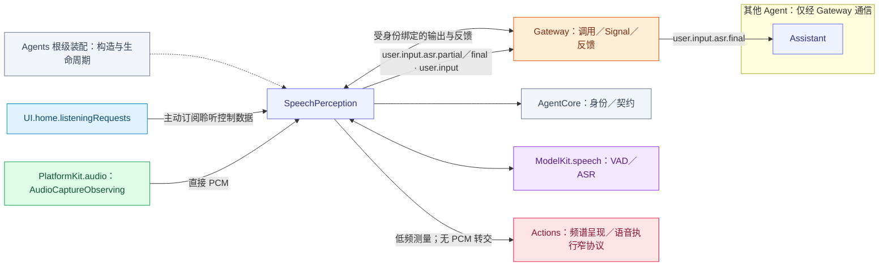
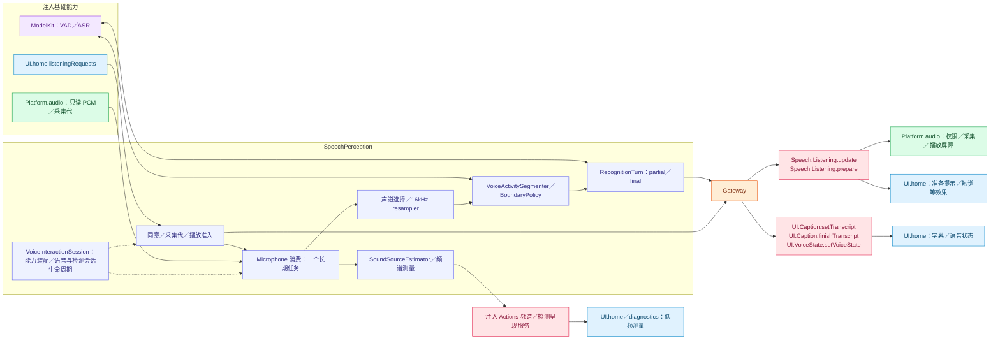

# SpeechPerception — PCM 消费、语音识别与聆听政策

本角色的静态类别由资源 Agent.json 声明并传入 Descriptor，归类与语义见 [Agents 分类](../README.md#agent-categories)。

## 角色容器

[SpeechPerceptionContainer.swift](SpeechPerceptionContainer.swift) 是 AgentContainer 的稳定子能力。独立持有感知角色注册、输出任务及内部 VoiceInteractionSession。向 App 公开 ready、状态、请求和诊断投影，不公开内部会话；VoiceAgentSession 连接感知容器、Assistant 语音子能力与 Actions 执行端口，不注册合成角色或停止共享 runtime。结束当前会话清理该代注册，根停止终结容器并加入交互／检测清理。

生命周期由[模块根](../README.md#agent-container)统一编排；子容器能力不授予执行权。

## 职责与注入能力

构造注入 PlatformKit `AudioCaptureObserving`、ModelKit `SpeechRecognitionCapability`／`VoiceActivityCapability`、可选 `UIHomeContainer`、FunctionContracts `SpectrumPresenting`、低频测量回调和私有 Context。角色直接取得 PCM，负责声道／采样率／序号／连续性、VAD、ASR、声源和半双工政策；不直接开启麦克风或启动动画。

UI.home.listeningRequests 是本角色单独订阅的控制源，提供 enabled/toggle/press 数据。UI 不调用角色；订阅本身不请求权限或开启设备。soundSourceOnly 模式不获得识别呈现权限。

## 文件与职责

| 文件 | 职责 |
| --- | --- |
| [AudioDetectionAgentSession.swift](AudioDetectionAgentSession.swift) | Isolated diagnostic role, result pump and neutral detection connection type specializations; no native capture ownership |
| [SoundSourceEstimator.swift](SoundSourceEstimator.swift) | 声道测量到有限方向估计的算法 |
| [SpeechBoundaryPolicy.swift](SpeechBoundaryPolicy.swift) | 边界、结束与恢复的纯策略 |
| [SpeechListeningInputs.swift](SpeechListeningInputs.swift) | 聆听手势／策略输入和采集结束事实 |
| [SpeechPerceptionAgent.swift](SpeechPerceptionAgent.swift) | 聆听策略、输入代际、VAD／ASR 协调与角色消息 |
| [SpeechPerceptionMicrophone.swift](SpeechPerceptionMicrophone.swift) | 只读 PCM 的唯一角色订阅、布局校验与模型输入转换 |
| [SpeechPerceptionProcessing.swift](SpeechPerceptionProcessing.swift) | 感知角色私有 Context、预处理和聆听策略 |
| [SpeechRecognitionTurn.swift](SpeechRecognitionTurn.swift) | 已提交片段、冷启动前缀和转写聚合的有界工作 |
| [VoiceActivitySegmenter.swift](VoiceActivitySegmenter.swift) | VAD 分段、尾静音及实际片段结束判定 |
| [VoiceAgentSession.swift](VoiceAgentSession.swift) | 感知容器、Assistant 语音子能力与 Actions 语音执行的连接适配器 |
| [VoiceInteractionSession.swift](VoiceInteractionSession.swift) | 容器内部的语音／诊断组合与生命周期，不向 App 暴露 |

## 外部关系（一层）

角色间消息经 Gateway 递送；基础能力通过构造注入，输入订阅由角色持有。角色、Skill 与 Task 授权归 Agents；Actions 来源的协作接口由 App 以中立窄端口绑定，Agents 不导入 Actions、CallRuntime 或 ExecutionRuntime。

SpeechPerception 在 user.input 主题发布 user.input.asr.partial 和 user.input.asr.final。Assistant 订阅最终文本，片段可由诊断或显式订阅者观察。声源诊断观察 sound.source。

## 内部结构与执行链

低频频谱／检测测量走注入的 Actions 呈现服务；字幕、聆听和语音状态走受保护调用。原始 PCM 始终留在角色消费路径，Actions 原生执行服务只控制采集与屏障。

## PCM 与模型输入

原生源单消费者，64 包有序 FIFO 加当前处理包；一个长期任务完成当前包后才取下一包，包括冷模型获取期间，不增加第二个原生积压 FIFO，不逐包创建处理 Task。保留 Float 存储及原生序号，8–192 kHz，mono 或 ACN/SN3D FOA；半双工门控不重新编号。每包至多 64,000 字节。通用 AgentInput 不接纳 PCM，不存在程序化媒体兼容入口或额外积压队列。

选择 mono/W，每次转换至多 8192 samples，状态化重采样为 16 kHz ModelKit.AudioFrame。ASR turn 最多 2048 事件、480,000 排队 mono samples；12 秒仅为内部段边界，没有整句时长截止。缓冲满显式失败，不扩大容量等待模型。采集代重绑重置格式、声源与 DSP，旧代 PCM 不可进入新会话。

## 分段算法

`VoiceActivitySegmenter` validates contiguous scores over 16 kHz mono Float32: at most 16000 samples per frame, 32000 pending samples and 64 scores per process call. Default probability threshold is 0.5, valid 0.05…0.95. Overlap rejects inputBusy; failure closes/cancels the VAD session and clears damaged state.

`SpeechBoundaryPolicy` uses sample counts: confirmed onset 1536 (96 ms), pre-roll budget 4096 (256 ms), endpoint silence 12800 (800 ms), endpoint padding 3072 (192 ms), and model-sized segment 192000 (12 s). Silence is held back, then preserved in full if speech resumes; only endpoint padding is forwarded at utterance end. Prefix/suffix operations preserve whole frames, so padding is quantized to VAD windows. Maximum-duration boundaries keep speaking/hysteresis and stable utterance identity; there is no sixty-second complete-turn cutoff. Finish includes pending speaking tail and an explicit inputFinished event. Reset clears DSP/segmentation state without choosing a new device.

## 输出契约

| Contract / function | Payload and semantics |
| --- | --- |
| user.input.asr.partial | Latest transcript preview ≤16 KiB encoded, two-second validity |
| user.input.asr.final | Nonempty final text ≤4096 UTF-8 bytes; published once per nonempty turn, with lifecycle-owned completion |
| sound.source | Native direction/quality/RMS and active/inactive/uncertain/unavailable; ≤10 Hz and 500 ms freshness |
| UI.Caption.setTranscript / finishTranscript | Internal completion-only calls; final text precedes sealing, including explicit empty result |
| UI.VoiceState.setVoiceState | Internal hearing/processing/listening display, no device control |
| Speech.Listening.update | Internal policy Action for the actual resident producer/root session |

Publication is one-way. Subscriber rejection is isolated from inference. Output protocol and context failures remain local errors. Internal presentation completion confirms state acceptance. The output buffer retains the oldest 32 items and throws queueFull on overflow. The audio FIFO rejects the new packet on overflow before advancing sequence or time. Evidence retains 256 summaries with counted eviction. Final text uses the interaction session. Audio and partial transcripts retain the capture session.

## 聆听、取消与完成

同意只在本会话有效。撤销或暂停推进接纳 epoch，异步提交后重验 UI 代际。原生 stopListening(sessionID:) 撤销许可，公开启停 Action 用 setListening(enabled:sessionID:) 更新同一许可并返回单调 revision。执行方应用策略并加入原生完成。

最终文本发布后，感知重置识别器并结束本轮。全双工路线可在播放期间接纳音频；受限路线由实际播放准入暂停识别，播放完成或取消后通过执行端恢复。重置校验采集会话和代际，新播放准入可阻止旧恢复开放识别。

startInput 只订阅当前已开启采集代。回复半双工暂停保留该订阅并丢弃未获准入的帧；设备关闭时取消空闲取帧、加入当前包，完整 close/stop 先取消识别，再加入原生任务、获取模型和发布者。恢复最多 32 个可取消当前包等待者，只等待已接纳工作，不承载 PCM。UI 回执确认策略接纳；原生停机和播放终态由执行服务单独确认。

## 声源算法

SoundSourceEstimator retains scalar statistics for one 100 ms native-rate window (fractional rate rounding permits at most 101 ms). Correlate W with Y/Z/X: captured-field X front, Y left, Z up; azimuth/elevation are radians. RMS threshold is −50 dBFS and correlation quality threshold 0.6, a heuristic rather than probability. Quiet windows clear direction immediately and become inactive after 200 ms. No distance, identity, robot-frame or camera-mirror mapping is inferred.

Mono publishes unavailable once per format/listening epoch and still supports ASR. Format/resume resets DSP; reply pause clears FOA direction. One publisher and one latest pending sound observation retain 500 ms window-end freshness. No subscribers is allowed loss. Stop joins publisher and processing without self-joining a failure path.

## 失败与限制

`reportError` 未校验输出 yield，32 槽满载／关闭时诊断可能丢失；普通输出失败会显式抛错。

通信见 [Agent.json](../../Resources/Agents/SpeechPerception/Agent.json)，原生执行见 [Actions/Speech](../../Actions/Speech/Support/README.md)。

AudioDetectionAgentSession 只注册检测角色、构造模型 Context 并绑定结果泵；Actions 中的 AudioDetectionSession 经中立连接端口组合该角色与 AudioDetectionExecution，不消费或转交原始 PCM。播放失败文案由 [Assistant](../Assistant/README.md#语音生产与播放) 拥有，感知角色只处理识别与聆听政策。

## App-owned diagnostic transport

AudioDetectionAgentSession borrows one isolated observation session through GatewayObservationAccess supplied by AgentRuntime. It creates only its diagnostic SpeechPerception actor and output pump; GatewayContainer creates and retains the communication facilities. Diagnostic capture remains owned by Actions. Root admission and stop include the borrowed session; release does not stop normal voice registration or the application Gateway. The session has observation-only catalogs, reports acquisition/cleanup failures explicitly and never invokes business functions.

## Execution ownership and lifecycle

AudioDetectionAgentSession also declares the neutral connection/observation type specializations. Actual native detection/voice sessions live in Actions. VoiceInteractionSession owns cognitive role preparation and connects narrow voice/detection interfaces; root cleanup is retained until downstream Actions joins. SpectrumPresenting is a neutral UUID-based port.

## Passive container state

stateSnapshot projects local installation/closure and existing work or Agent lifecycle/queue counters directly from memory. Reading starts no role, persistence restoration or inference. Initialization remains in the existing owner lifecycle. The root catalog binds independent readers without sampling roles or maintaining another mutable role-state registry.

SpeechPerceptionContainer.presentation returns one complete SpeechSessionPresentation for an installed interaction. It includes typed conversation/activity/detection state, request interfaces and diagnostics; App does not combine optional child fields. Identity remains stable for that interaction. Stop invalidates the debug validation entry and releases the projection after joining shutdown; stale validation requests fail explicitly.

ASR 创建、输入或结果失败时保留原始 agent.error，取消并加入该轮 ASR/VAD，校验采集代、会话与运行态后重建下一轮。失败字幕由 finishTranscript 封口，transition(.empty) 记录本地阶段，并在准入仍有效时呈现 listening。

根语音许可跨场景可见性保留。全双工路线在播放时继续 VAD 和 ASR。受限路线等当前语句收尾后取得播放准入，播放期间暂停识别。实际关闭或中断会取消并等待原生采集、识别和发布工作退出。Actions 持有原生权限与播放屏障，感知在恢复时校验用户许可、会话和采集代。

## 新人声字幕生命周期

processFrame 在 VAD 确认新轮并创建 AgentTurn 后先用 UI.Caption.setTranscript 空文本打开本轮字幕。片段和最终文本更新本轮字幕，finishTranscript 封口。识别阶段保存在本地 Context 并驱动感知灵动岛和语音状态。

SpeechListening 日志记录许可、采集开启、识别暂停、原生包处理、识别阶段及恢复时的等待和重置边界。日志内容限于状态和检查点。

## 自有灵动岛

SpeechPerception 在采集、聆听许可、识别阶段和播放准入变化时更新自有活动。可接纳输入时显示聆听或人声，ASR 收尾显示识别，受限路线播放或关闭采集时撤下。连续聆听和人声共用计时起点。容器为感知绑定有界发布端，展示失败通过 presentationFailure 及容器状态公开，停止时先完成最终 end，再撤销身份。识别定稿后独立重置，下一句采集按本地准入处理。
