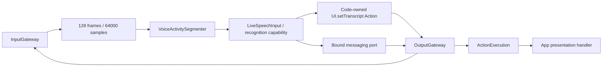
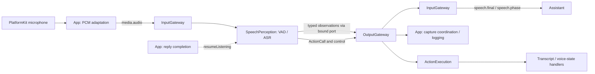

# Speech Perception

Purpose: convert bounded microphone PCM into shared speech observations. Owns VAD, segmentation, streaming ASR and transcript merging; never owns microphone hardware or UI implementation; it selects recognition-caption behavior through configured Actions.



✅ JSON v5 declarations; sequential raw audio admission; existing 128-event/64000-sample ASR queue and 60-second turn limit; partial/final separation; final publication once per nonempty turn. Empty turns resume capture. App resumes after Assistant actions finish.

✅ Endpoint recognition suppresses queued capture after the endpoint while replies play. This is explicit conversational capture gating, not an audio overflow policy. Overflow fails; no unbounded tasks. Stop cancels and joins ASR/VAD/worker before completing. Models remain resident.

❌ Barge-in, background listening and physical sustained speech acceptance of this migration.

✅ Accepted input kinds derive from the JSON v5 communication snapshot; Swift retains handlers, not a duplicate production input registry.

✅ Code declares UI.setTranscript on Transcript. Each preview publishes its shared observation and emits a resolved caption Action containing the last 320 characters. Recognition completion emits UI.finishTranscript before publishing final (also clears empty turns). No XML parsing of recognized text is needed: typed InternalAction calls carry the code-owned permission. Each update emits agent.finished to join its Action and release scheduler tracking.

✅ The output stream holds at most 32 envelopes; overflow fails the session rather than silently dropping Actions. App drains it serially through OutputGateway, including completion barriers. Stop cancels perception work, closes/drains output, cancels session Actions, and the App rejects stale-session presentation. Partial/final observations remain available to subscribers independently of UI Actions.
❌ Sustained device caption timing and overload acceptance remain unverified.

✅ UI.setVoiceState is code-declared for hearing/processing/listening presentation. Phase Signals only communicate facts: App uses them for capture admission, Assistant chooses its atomic beginReplyTurn Action on first onset. Resume emits a listening Action; each display update has a completion barrier. No UI changes occur in Signal observers.

✅ ConversationTurn is allocated at the first confirmed onset/audio event and remains stable across maximum-duration segments and short VAD transitions. It propagates through shared observations and Action envelopes. Resume after reply (or empty recognition) arms a new utterance; ordinals increase within the capture session. Previews carry bounded text, finishTranscript seals it, and output sequences are monotonic.


## 输入、订阅与输出契约

以 [SpeechPerception.agent.json](SpeechPerception.agent.json) 和 [SpeechPerceptionAgent.swift](SpeechPerceptionAgent.swift) 为准。公共信封见 [Agents 输入输出约定](../README.md#输入输出文档约定)。

| 接收方式 | contract / version / kind | source / topic | 数据与约束 |
| --- | --- | --- | --- |
| 静态订阅 | `media.audio / 1 / audio` | `phone.microphone / media.audio` | `AgentInput.payload = .audio(AudioInput)`；匹配本采集 session，sequence 严格递增、timestamp 不倒退；过期、满队列或等待回复时拒绝接纳。 |
| 运行时方法，不是消息订阅 | `resumeListening()` | App 在回复执行结束后调用 | 无 payload / 返回值；等待当前 worker，重置 VAD/ASR 并允许下一轮输入。它是采集流程控制，不是 Tool 或可由模型调用的 Action。 |
| 生命周期，不是业务输入 | `bind / start / pause / resume / stop` | App / AgentManager | 注入发布端口及管理任务；不扩展 communication.inputs。 |

```swift
// 结构摘要；真实定义在 Agents/Core/Communication/PerceptionInput.swift。
AudioInput {
    samples: Data       // 当前 App 输入为 16 kHz、单声道 Float32 PCM
    sequence: UInt64
    timestamp: TimeInterval // 秒；采集时钟
}
```

AudioInput 不携带格式字段；上述格式由 App 适配与 Agent 中的 AudioFrame 构造约定。单帧非空、字节数为 4 的倍数且最多 64000 字节（16000 样本）。Agent 待处理队列另外限制 128 帧 / 64000 样本；不能把字节上限与队列样本上限混同。ASR 内部另有 128 项 / 64000 样本队列，一轮累计最多 60 秒。



### 共享观测输出

调用 `AgentMessaging.publish(observation, parent: input)`，经过 OutputGateway → InputGateway；不是往 outputs 流塞原始 JSON，也不是 Action/Tool。发布继承会话、轮次和因果信息，等待的是投递接纳回执，不是 Assistant 回答完成。

| contract / version | 类型与内容 | 发布时机 / 消费者 |
| --- | --- | --- |
| `speech.partial / 1` | `.transcript(text: String, final: false)`；文本最多 16300 UTF-8 字节且完整编码不超过 16 KiB | ASR 合并预览；可替换的最新状态。当前没有业务 Agent 订阅，App 注册观察端点；UI 字幕单独通过 Action 更新。 |
| `speech.final / 1` | `.transcript(text: String, final: true)`；非空、最多 4096 UTF-8 字节，编码仍受 16 KiB 限制 | 每个非空识别轮次一次，Assistant 订阅；要求至少一个 Agent 接纳且没有拒绝。空识别不发布 final。 |
| `speech.phase / 1` | `.speechPhase(SpeechPhase)`，枚举 `listening / speaking / processing / empty` | VAD 阶段变化、端点处理、空识别等；Assistant 订阅并只对 speaking 做展示决策。App 观察用于采集协调。phase 是离散事件，不按 latest-state 合并。 |

观测的 source 由绑定端口确定为 `speechPerception`，topic 为相同 contract。默认 partial 接纳期限 2 秒，final/phase 为 10 秒，子事件不能超出父输入期限。`resumeListening()` 当前直接发 listening 展示 Action，没有额外发布 listening 观测；订阅者不能假设每次恢复都有一个 phase 消息。

### Action 与控制输出

| 内部路径 / 默认 Channel | 参数结构 | 触发与语义 |
| --- | --- | --- |
| `setTranscript → UI.setTranscript / Transcript` | `["text": String]`；handler 上限 4096 UTF-8 字节 | 预览先发布 partial，再发 Action；当前投影保留最后 320 个字符。空串清空预览，但不封闭轮次。 |
| `finishTranscript → UI.finishTranscript / Transcript` | `[:]` | 识别结束（包括空结果）清空并封闭本轮识别字幕，拒绝迟到的旧 partial；随后才发布非空 final。 |
| `setVoiceState → UI.setVoiceState / Display` | `["state": "hearing"或"processing"或"listening"]` | speaking 映射 hearing，processing 同名，listening/empty 映射 listening；只改展示，不启动/停止设备。 |
| control | `agent.finished` | 每次上述展示更新后发出，供输出处理等待该输入的动作并释放跟踪记录。 |
| control | `agent.error: speech perception failed: …` | 感知失败尝试发出并关闭流；32 项输出缓冲满时不能保证错误消息入队，failed 状态仍可查询。 |

Action/控制携带 `OutputEnvelope(source, inputID, sessionID, turn, sequence, output)`；首次起音分配 `ConversationTurn(id: UUID, ordinal: UInt64)`，长语音切段不换轮。调用 Action 后发屏障不意味着另一条观测通路的接收者已经处理完毕，两个通路没有全局完成顺序。

### Publish / send 边界

`communication.publications` 仅包含上表三个 `speech.*` contract，typed payload、长度、触发时机和消费者均按“共享观测输出”表；它们不携带 PCM，也不作为 Agent `outputs` 流的 Action。`communication.sends = []`：SpeechPerception 不发送定向 Agent 消息；Assistant 接收 final/phase 是订阅广播，不是 send。JSON `actions / tools` 均为空；内部展示权限由代码声明，无 ToolResult 输入；不负责回复表情、回复字幕或摄像头。❌ 抢话和后台聆听未实现。

✅ `runtimeCapabilities(_:)` now supplies the same model-plus-internal capability snapshot to the Agent initializer and App startup validation. It does not duplicate or broaden grants, call Actions directly, or change JSON v5. ❌ Activity/resource ownership is not introduced.

## Action runtime stage 2

✅ The versioned configuration accepts action.result. receive validates runtime source and owner/session, stores in ActionResultInbox and returns without inference or output emission. actionResults() exposes bounded retained history. ❌ Automatic retry/replanning based on a result is not implemented.
