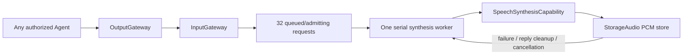
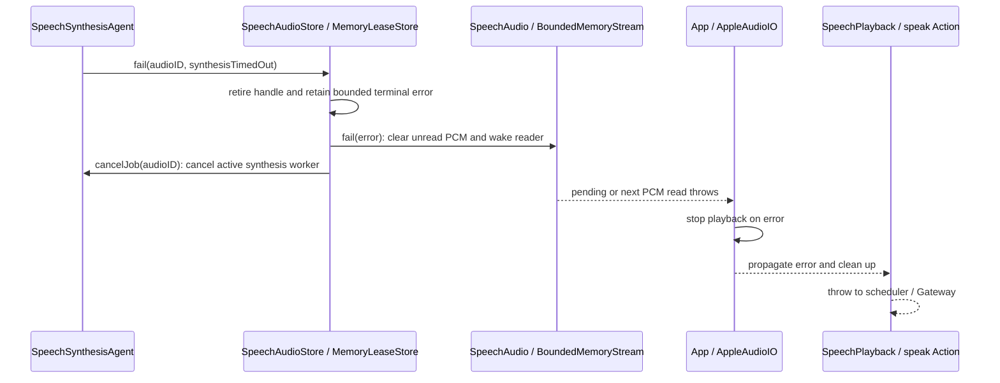

# SpeechSynthesis

Purpose: a shared text-to-audio Agent, independent of Assistant and playback Channels. Owns a FIFO request queue and one serial ModelKit synthesis worker. Configuration and directed permissions use JSON v6.

## 输入、订阅与输出契约

以 [SpeechSynthesis.agent.json](SpeechSynthesis.agent.json) 和 [SpeechSynthesisAgent.swift](SpeechSynthesisAgent.swift) 为准；公共信封、回执含义见 [Agents 输入输出约定](../README.md#输入输出文档约定)。`communication.subscriptions = []`：只接收明确指定目标为 `speechSynthesis` 的定向消息。任何获准发送的 Agent 都可提供文本，服务不依赖 Assistant 身份。

| 接收方式 | contract / version / kind | payload 数据标准 | 接纳与处理 |
| --- | --- | --- | --- |
| 定向 send | `speech.synthesize / 1 / observation` | `.observation(.speechSynthesis(SpeechSynthesisInput(audioID: UUID, text: String, locale: String)))`；audioID 是请求方生成的唯一句柄；text 去空白后须非空、最多 2000 UTF-8 字节；locale 为 `auto / zh-CN / en-US`。完整消息编码最多 16 KiB。 | 校验未过期、类型与内容、队列容量和句柄唯一性；先在 StorageAudio 注册句柄，再返回接纳回执。按实际接纳顺序串行合成。 |
| 定向 send | `speech.cancel / 1 / observation` | `.observation(.cancelSpeech(audioID: UUID))`；只含待取消句柄，完整消息编码最多 16 KiB。 | 句柄所有者必须匹配绑定发送方、session 和原父输入。取消队列或活动任务；不占合成队列。 |

输入 `AgentInput` 带 sessionID、turn 和 InputMetadata。发送方用 `parent` 建立因果关系；StorageAudio 的所有权键为 `source + sessionID + (parentID ?? input.id)`。队列最多 32 个等待/接纳中的合成请求，满时明确拒绝；每项从 worker 开始执行起限时 60 秒，不包含 FIFO 排队时间，也不是从 speak 开始等待起计时。生产 PCM 空读没有独立超时。共享缓存另限制最多 32 个存活句柄（含排队、合成中、待播和播放中）；达到任一容量限制即明确拒绝。`DeliveryReport.delivered` 只表示上述接纳成功，不表示 PCM 已产生。

### 输出、publish 与 send

| 方向 | 当前数据标准与消费者 |
| --- | --- |
| Agent 输出流 | 无业务 `OutputEnvelope`、ActionCall、ToolCall 或 control 输出；`outputs` 流仅为统一 Agent 生命周期接口，停止时结束。JSON 的 `actions` 为空对象，`tools` 为空数组。 |
| publish | `communication.publications = []`；不广播合成结果或进度。 |
| send | `communication.sends = []`；不向其他 Agent 定向发消息。 |
| 本地存储结果 | 用同一 audioID 在 StorageAudio 的 `SpeechAudioStore` 中写入单声道 Float32 PCM 帧，成功后标记完成，失败/超时/取消则标记错误；这不是 publish/send。SpeechPlayback 在 Action 到达时用 audioID 等待并消费，播放结果不由本 Agent 回传。 |

PCM 格式在一项请求内保持一致，帧 sequence 严格递增，流必须有 `finished` 且非空，总输出最多 8 MiB。模型或缓存错误写入对应句柄，不产生一条“成功”消息；请求方若需获知最终结果，应在消费该句柄时处理存储错误。当前不提供跨 Agent 的完成通知或持久化文件。

✅ `speech.synthesize / 1 / observation` carries `SpeechSynthesisInput(audioID,text,locale)`. Nonblank text ≤2000 UTF-8 bytes; locale auto/zh-CN/en-US. The original Agent selects semantic segments. Model adapters retain language/length adaptation under the same audioID. `PerceptionMessage` defines typed business cases, carried by Core’s generic AgentMessage without a compatibility alias.

✅ `speech.cancel / 1 / observation` carries a UUID; ownership is checked against the directed sender, session and parent input. No subscriptions and no Assistant-specific source assumptions. Reception validates and reserves the handle before returning admission; it never awaits inference or capacity.

✅ Synthesis is serial in actual reception/admission order, regardless of Channel eligibility. The 60-second execution deadline starts in produce, excludes queue time and ends when synthesis completes or fails; mono Float32, stable format, increasing sequence, explicit EOS, nonempty audio and 8 MiB total output are validated. The worker advances after synthesis completion/failure without waiting for playback; later text requests can queue while an earlier Action waits or plays. Cache overflow fails that request and the worker continues. Pause retains bounded work, stop cancels/joins owned work; cancellation never drops another source's request.

✅ App registers the Agent alongside Assistant; shared cache ownership is injected. No Actions, model SDK imports, playback callback or direct Agent-to-Agent calls.

❌ File output, retry, priority, replay and hardware performance acceptance remain outside this implementation.

✅ Producer failures use SpeechSynthesisError; cache/PCM failures use StorageAudio.SpeechAudioError. Scheduled consumption belongs to SpeechPlayback.

✅ Pending and completed-unclaimed audio uses reply-owned lifetime without queue/ready TTL. App clears remaining source/input handles after reply completion/cancellation, and session handles on interruption. A reply is one originating source/input within a voice session, not the entire multi-turn session. Consumed frames leave the cache immediately and each played handle is released after hardware drain; only unconsumed audio remains until owner cleanup. The synthesis execution deadline is not a cache expiry or a total playback-wait deadline. ❌ Long-sequence physical-device acceptance remains pending.

## 合成执行超时与播放 Action 的错误传递

✅ 超时由 `SpeechSynthesisAgent.produce` 内的独立 Task 实现：请求从 FIFO 出队并开始执行时启动，默认 `executionTimeout = 60 秒`。收到 PCM 不会重置计时；合成正常完成或失败退出时，由 `defer` 取消计时任务。排队时间不计入此期限，已经合成成功的音频也不会因为后续等待播放而触发合成超时。

到期后调用 `store.fail(audioID, error: SpeechSynthesisError.timedOut)`。Agent 不直接调用播放 Action，也不发送一条超时 Agent 消息；合成与播放通过同一 audioID 对应的共享缓存传递失败状态。

| 播放状态 | 收到超时后的行为 |
| --- | --- |
| 正等待首块或下一块 PCM | 缓存立即以 `synthesisTimedOut` 恢复挂起的读取，播放端停止当前播放并抛错。 |
| 正播放已提交的缓冲 | 失败不会直接回调播放器；下一次读取 PCM 时发现错误，再停止尚未播完的缓冲。已经出声的部分无法撤回。 |
| Action 尚未执行 | 后续 checkout 在终态错误记录仍保留时抛出同一错误；记录过期或被容量淘汰后报告 missingAudio。终态记录最多 128 条、默认保留 30 秒，不保留 PCM。 |

错误经 AppleAudioIO → SpeechPlayback → Speech.Playback.speak 向调度器/Gateway 传播，由既有 Action 失败和 App 回复清理流程处理。清理不会自动重新合成或重播；同一缓存句柄的首次失败会保留，后续取消不会覆盖已记录的超时。

✅ `SpeechPlaybackTests.synthesisExecutionDeadlineIsIndependentOfPlaybackDeadline` 验证 Agent 执行期限能让等待 PCM 的读取收到 `synthesisTimedOut`；延迟 PCM、显式读取期限和取消有各自回归测试。PCM 空读默认没有独立期限，硬件播放完成超时是另一项 PlatformKit 保护。

❌ 取消是协作式的：底层推理若未及时响应，worker 退出和下一项合成仍可能延迟；这不是强制终止底层计算或保证精确到 60 秒的实时机制。测试不等于真机超时听感验收。

✅ SpeechSynthesis passes the trusted directed sender string into StorageAudio; audio storage does not import AgentCore. Ownership still includes the originating session and parent input.

✅ SpeechSynthesisInput is owned by Agents/Communication/SpeechValues.swift with unchanged text/locale contract and queue policy. Domain value validation is independent of AgentCore; message admission maps errors to the existing transport rejection.

✅ Synthesis owns the ModelKit.AudioFrame → StorageAudio.SpeechPCMFrame conversion, preserving bytes, format, sequence and timestamp after existing format/order validation. Storage owns its PCM types; it does not import ModelKit or Types. ❌ No playback/device preparation belongs to synthesis.

## Current error ownership

✅ SpeechSynthesisError owns timedOut and invalidOutput. Context identity, mono Float32/stable format, sequence, EOS, nonempty output and synthesis byte policy remain Agent-owned; StorageAudio validates its PCM contract separately. Producer errors pass through the store to playback unchanged. App owns localized messages.

❌ Automatic producer retry and real-device performance acceptance remain outstanding.
