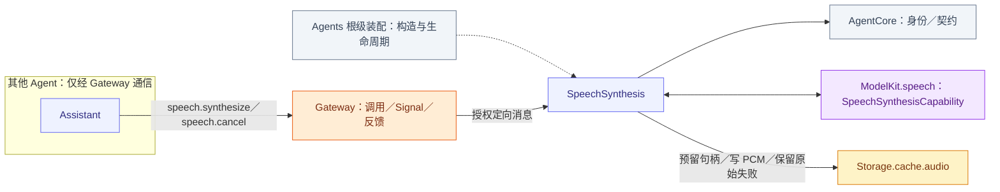
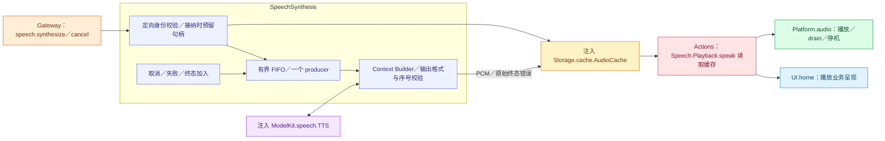

# SpeechSynthesis — 定向文本合成与有界音频生产

## 角色容器

[SpeechSynthesisContainer.swift](SpeechSynthesisContainer.swift) 是 AgentContainer 的稳定子能力。独立持有合成角色注册，与感知容器分别管理生命周期。endSession 仅移除当前合成角色，允许后续私有语音会话；根 stop 永久关闭容器。TTS 与 AudioCache 属于角色，播放归 Actions。

生命周期由[模块根](../README.md#agent-container)统一编排；子容器能力不授予执行权。

## 职责与注入能力

构造注入 ModelKit `SpeechSynthesisCapability`、StorageCache `AudioCache`、私有 Context 与通信配置。只接收授权定向合成／取消消息，不需要 UI 或 PlatformKit 容器，不开启麦克风、不播放音频，不运行普通 Chat。

## 文件与职责

| 文件 | 职责 |
| --- | --- |
| [SpeechSynthesisAgent.swift](SpeechSynthesisAgent.swift) | 定向 TTS FIFO、音频缓存所有权及 producer 失败 |
| [SpeechSynthesisProcessing.swift](SpeechSynthesisProcessing.swift) | 合成角色 Context、输入预处理与请求验证 |

## 外部关系（一层）

角色间消息经 Gateway 递送；基础能力通过构造注入，输入订阅由角色持有。角色、Skill 与 Task 授权归 Agents；Actions 来源的协作接口由 App 以中立窄端口绑定，Agents 不导入 Actions、CallRuntime 或 ExecutionRuntime。

这里 Gateway 仅递送定向消息；本角色 descriptor.outputs 为空，无业务 Action／Tool／发布／send 输出。播放由请求方的执行链控制，不应画成本角色发出 Playback Action。

## 内部结构与播放衔接

图中缓存之后是下游播放链，非本角色调用；PCM 生产终态不等于扬声器 drain。Assistant 的 caption/synthesis/playback 分段与 Channel 屏障决定播放顺序。

## Admission and ownership

speech.synthesize carries audioID, nonblank text ≤2000 UTF-8 bytes and locale auto/zh-CN/en-US, with ≤16 KiB encoded input. Reserve the unique handle before returning admission. Ownership is trusted sender + session + original parent input; cancel validates the same tuple and bypasses FIFO capacity.

One serial synthesis worker has at most 32 queued/in-flight admissions in addition to the active producer, subject to the shared handle limit. The shared audio store independently permits 32 live handles including queued, producing and playing audio. Overflow rejects; admission is not proof that PCM exists. Semantic text segments belong to the requesting role; model adapters handle provider language/length constraints.

## Production and failure propagation

Build the request from role context and validate request identity, mono Float32, stable format, increasing sequence, explicit finished event, nonempty audio and ≤8 MiB total output. Convert ModelKit.AudioFrame into StorageCache.AudioFrame without a dependency from Storage to ModelKit. Invalid producer output throws SpeechSynthesisError.invalidOutput; provider and storage errors retain their original types.

Synthesis waits for provider completion, failure or owner cancellation without an Agent timer. Cancellation fails the audio handle, wakes readers and joins the producer. Failed handles retain the original error until scope cleanup or bounded metadata eviction; no audio/cache TTL or reader timeout exists. Already audible samples cannot be retracted.

The worker advances after synthesis terminal state without waiting for playback. Pause retains queued requests and lets an already active producer finish; resume drains the FIFO. Stop joins work and closes/fails owned handles. Cancellation cannot discard another source's request. Context write failure prevents dependent synthesis; recent evidence retains 256 summaries. Restart does not restore audio or replay speech.

## 错误呈现与接口

播放清理后的文案适配由 [SpeechPerception/SpeechPlaybackFailure](../SpeechPerception/SpeechPlaybackFailure.swift) 拥有，合成角色保留 producer 原始失败，不依赖 UI 或原生播放。通信见 [Agent.json](../../Resources/Agents/SpeechSynthesis/Agent.json)。

## Passive container state

stateSnapshot projects local installation/closure and existing work or Agent lifecycle/queue counters directly from memory. Reading starts no role, persistence restoration or inference. Initialization remains in the existing owner lifecycle. The root catalog binds independent readers without sampling roles or maintaining another mutable role-state registry.
