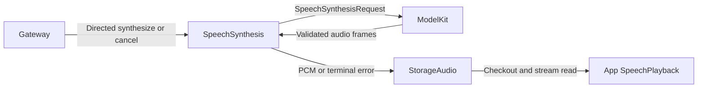
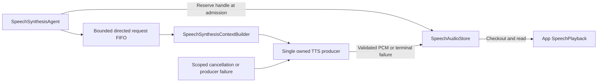

# Directed Speech Synthesis

## Summary

Converts authorized directed text requests into owner-scoped bounded PCM streams, independently of playback scheduling.

## Ownership and boundaries

This role owns synthesis, validation and producer failures. StorageAudio owns audio handles/PCM; App SpeechPlayback consumes them; ModelKit supplies TTS. There are no subscriptions, business output envelopes, publications or outgoing sends.

## External relationships and data flow

Runtime arrows show data or capability calls; dashed arrows show injection.

## Internal components

This role uses typed media requests and deterministic policy, with no Chat system prompt or role prompt asset.

## Admission and ownership

speech.synthesize carries audioID, nonblank text ≤2000 UTF-8 bytes and locale auto/zh-CN/en-US, with ≤16 KiB encoded input. Reserve the unique handle before returning admission. Ownership is trusted sender + session + original parent input; cancel validates the same tuple and bypasses FIFO capacity.

One serial synthesis worker has at most 32 queued/in-flight admissions in addition to the active producer, subject to the shared handle limit. The shared audio store independently permits 32 live handles including queued, producing and playing audio. Overflow rejects; admission is not proof that PCM exists. Semantic text segments belong to the requesting role; model adapters handle provider language/length constraints.

## Production and failure propagation

Build the request from role context and validate request identity, mono Float32, stable format, increasing sequence, explicit finished event, nonempty audio and ≤8 MiB total output. Convert ModelKit.AudioFrame into StorageAudio.SpeechPCMFrame without a dependency from Storage to ModelKit. Producer errors are SpeechSynthesisError; storage errors remain SpeechAudioError.

Synthesis waits for provider completion, failure or owner cancellation without an Agent timer. Cancellation fails the audio handle, wakes readers and joins the producer. Failed handles retain the original error until scope cleanup or bounded metadata eviction; no audio/cache TTL or reader timeout exists. Already audible samples cannot be retracted.

The worker advances after synthesis terminal state without waiting for playback. Pause retains queued requests and lets an already active producer finish; resume drains the FIFO. Stop joins work and closes/fails owned handles. Cancellation cannot discard another source's request. Context write failure prevents dependent synthesis; recent evidence retains 256 summaries. Restart does not restore audio or replay speech.

✅ Directed admission, serial bounded production and explicit audio failure propagation are implemented.

## Function and communication registration

Model exposure comes from [../../Resources/Agents/SpeechSynthesis/Agent.json](../../Resources/Agents/SpeechSynthesis/Agent.json); code-owned internal permissions are separate. Empty Channel groups declare Channels without exposing a function.

### Model functions

| Protocol / Channel | Model name | Canonical function | Parameters and constraints | Behavior |
| --- | --- | --- | --- | --- |
| — | — | — | — | No model-callable functions. |

### Internal fixed functions

| Protocol | Canonical function | Channel | Parameters | Registration source |
| --- | --- | --- | --- | --- |
| — | — | — | — | No internal callable functions. |

### Declared input schemas

| Contract | Version | Kind |
| --- | --- | --- |
| `speech.synthesize` | 1 | `observation` |
| `speech.cancel` | 1 | `observation` |

Directed input schemas and static subscriptions are distinct; admission also validates the runtime sender and scope.

### Input subscriptions and communication grants

Publication is one-way and has no recipient acknowledgment. Directed send returns admission; explicit task results report completion.

| Input contract | Source | Topic |
| --- | --- | --- |
| — | — | Directed inputs only. |

| Output | Contract | Destination |
| --- | --- | --- |
| — | — | No communication output. |

## Related design

[Parent design](../README.md)

## 固定函数与 Skill

✅ 资源不再包含 Permissions.json，Agent.json 的 baseSkills 引用 Skill，Skill.json 声明函数。业务模型函数由已加载 Skill 提供；固定调用与模型轮次分别验证，详见 [资源规范](../../Resources/Agents/README.md)。

## Lifecycle-owned conversation and audio (2026-10-12)

✅ 已移除对话生成、ReACT、收件箱排队、结果屏障、ASR 收尾、TTS 合成及回复占用租约的计时终止。Signal 默认无过期时间，框架不再按通信契约附加 TTL。保留显式实时感知数据的新鲜度和网络传输自身超时；它们不作为对话/语音缓存生命周期。Action 自身超时通过原始执行者的 ActionResult 返回。请求/调用数及队列/PCM 容量仍有界，不以计时自动删除已接纳输入。语音句柄无读等待或错误记录 TTL，按播放完成、输入/会话正常结束、异常或显式取消清理；取消加入生成和播放工作。

✅ ModelKit requests retain input/request identity and pass the Agent-owned session as opaque InferenceContext.scopeID. Conversation/session validation and policy stay in this calling Agent; no business scope semantics are delegated to ModelKit.

## SQLite records and runtime identity

✅ Implemented: technical identities are opaque UUID strings; committed business entities use dialog/message/task/media/device SQLite IDs. Consumers use Storage repositories while preserving ownership, cancellation and independent foundation boundaries. Complete messages, including each ReACT message, persist at termination; delta fragments do not persist. The custom allocator and replaced file/index implementation are removed. See the project SQLite business-record plan.
