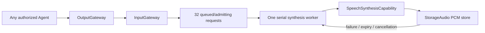

# SpeechSynthesis

Purpose: a shared text-to-audio Agent, independent of Assistant and playback Channels. Owns a FIFO request queue and one serial ModelKit synthesis worker. Configuration and directed permissions use JSON v4.

## 输入、订阅与输出契约

以 [SpeechSynthesis.agent.json](SpeechSynthesis.agent.json) 和 [SpeechSynthesisAgent.swift](SpeechSynthesisAgent.swift) 为准；公共信封、回执含义见 [Agents 输入输出约定](../README.md#输入输出文档约定)。`communication.subscriptions = []`：只接收明确指定目标为 `speechSynthesis` 的定向消息。任何获准发送的 Agent 都可提供文本，服务不依赖 Assistant 身份。

| 接收方式 | contract / version / kind | payload 数据标准 | 接纳与处理 |
| --- | --- | --- | --- |
| 定向 send | `speech.synthesize / 1 / observation` | `.observation(.speechSynthesis(SpeechSynthesisInput(audioID: UUID, text: String, locale: String)))`；audioID 是请求方生成的唯一句柄；text 去空白后须非空、最多 2000 UTF-8 字节；locale 为 `auto / zh-CN / en-US`。完整消息编码最多 16 KiB。 | 校验未过期、类型与内容、队列容量和句柄唯一性；先在 StorageAudio 注册句柄，再返回接纳回执。按实际接纳顺序串行合成。 |
| 定向 send | `speech.cancel / 1 / observation` | `.observation(.cancelSpeech(audioID: UUID))`；只含待取消句柄，完整消息编码最多 16 KiB。 | 句柄所有者必须匹配绑定发送方、session 和原父输入。取消队列或活动任务；不占合成队列。 |

输入 `AgentInput` 带 sessionID、turn 和 InputMetadata。发送方用 `parent` 建立因果关系；StorageAudio 的所有权键为 `source + sessionID + (parentID ?? input.id)`。队列最多 32 个等待/接纳中的合成请求，满时明确拒绝；每项执行超时 60 秒。`DeliveryReport.delivered` 只表示上述接纳成功，不表示 PCM 已产生。

### 输出、publish 与 send

| 方向 | 当前数据标准与消费者 |
| --- | --- |
| Agent 输出流 | 无业务 `OutputEnvelope`、ActionCall、ToolCall 或 control 输出；`outputs` 流仅为统一 Agent 生命周期接口，停止时结束。JSON 的 `actions / tools / channels / textActions` 均为空。 |
| publish | `communication.publications = []`；不广播合成结果或进度。 |
| send | `communication.sends = []`；不向其他 Agent 定向发消息。 |
| 本地存储结果 | 用同一 audioID 在 StorageAudio 的 `SpeechAudioStore` 中写入单声道 Float32 PCM 帧，成功后标记完成，失败/超时/取消则标记错误；这不是 publish/send。SpeechPlayback 在 Action 到达时用 audioID 等待并消费，播放结果不由本 Agent 回传。 |

PCM 格式在一项请求内保持一致，帧 sequence 严格递增，流必须有 `finished` 且非空，总输出最多 8 MiB。模型或缓存错误写入对应句柄，不产生一条“成功”消息；请求方若需获知最终结果，应在消费该句柄时处理存储错误。当前不提供跨 Agent 的完成通知或持久化文件。

✅ `speech.synthesize / 1 / observation` carries `SpeechSynthesisInput(audioID,text,locale)`. Nonblank text ≤2000 UTF-8 bytes; locale auto/zh-CN/en-US. The original Agent selects semantic segments. Model adapters retain language/length adaptation under the same audioID. `AgentMessage` generalizes the historical PerceptionObservation transport (source-compatible alias).

✅ `speech.cancel / 1 / observation` carries a UUID; ownership is checked against the directed sender, session and parent input. No subscriptions and no Assistant-specific source assumptions. Reception validates and reserves the handle before returning admission; it never awaits inference or capacity.

✅ Synthesis is serial in actual reception/admission order, regardless of Channel eligibility. Per-request execution deadline is 60 seconds; mono Float32, stable format, increasing sequence, explicit EOS, nonempty audio and 8 MiB total output are validated. Cache overflow fails that request and the worker continues. Pause retains bounded work, stop cancels/joins owned work; cancellation never drops another source's request.

✅ App registers the Agent alongside Assistant; shared cache ownership is injected. No Actions, model SDK imports, playback callback or direct Agent-to-Agent calls.

❌ File output, retry, priority, replay and hardware performance acceptance remain outside this implementation.

✅ Synthesis and cache failures use the shared SpeechAudioError type; scheduled consumption belongs to SpeechPlayback.
