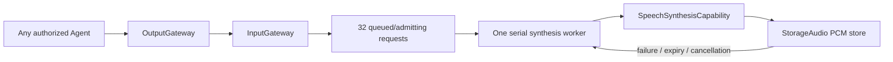

# SpeechSynthesis

Purpose: a shared text-to-audio Agent, independent of Assistant and playback Channels. Owns a FIFO request queue and one serial ModelKit synthesis worker. Configuration and directed permissions use JSON v4.

✅ `speech.synthesize / 1 / observation` carries `SpeechSynthesisInput(audioID,text,locale)`. Nonblank text ≤2000 UTF-8 bytes; locale auto/zh-CN/en-US. The original Agent selects semantic segments. Model adapters retain language/length adaptation under the same audioID. `AgentMessage` generalizes the historical PerceptionObservation transport (source-compatible alias).

✅ `speech.cancel / 1 / observation` carries a UUID; ownership is checked against the directed sender, session and parent input. No subscriptions and no Assistant-specific source assumptions. Reception validates and reserves the handle before returning admission; it never awaits inference or capacity.

✅ Synthesis is serial in actual reception/admission order, regardless of Channel eligibility. Per-request execution deadline is 60 seconds; mono Float32, stable format, increasing sequence, explicit EOS, nonempty audio and 8 MiB total output are validated. Cache overflow fails that request and the worker continues. Pause retains bounded work, stop cancels/joins owned work; cancellation never drops another source's request.

✅ App registers the Agent alongside Assistant; shared cache ownership is injected. No Actions, model SDK imports, playback callback or direct Agent-to-Agent calls.

❌ File output, retry, priority, replay and hardware performance acceptance remain outside this implementation.

✅ Synthesis and cache failures use the shared SpeechAudioError type; scheduled consumption belongs to SpeechPlayback.
