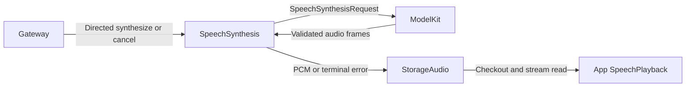

# Directed Speech Synthesis

## Summary

Converts authorized directed text requests into owner-scoped bounded PCM streams, independently of playback scheduling.

## Ownership and boundaries

This role owns synthesis, validation and producer failures. StorageAudio owns audio handles/PCM; App SpeechPlayback consumes them; ModelKit supplies TTS. There are no subscriptions, business output envelopes, publications or outgoing sends.

## External relationships and data flow

Runtime arrows show data or capability calls; dashed arrows show injection.

## Internal components

This role uses typed media requests and deterministic policy, with no Chat system prompt or role prompt asset.

## Admission and ownership

speech.synthesize carries audioID, nonblank text ≤2000 UTF-8 bytes and locale auto/zh-CN/en-US, with ≤16 KiB encoded input. Reserve the unique handle before returning admission. Ownership is trusted sender + session + original parent input; cancel validates the same tuple and bypasses FIFO capacity.

One serial synthesis worker has at most 32 queued/in-flight admissions in addition to the active producer, subject to the shared handle limit. The shared audio store independently permits 32 live handles including queued, producing and playing audio. Overflow rejects; admission is not proof that PCM exists. Semantic text segments belong to the requesting role; model adapters handle provider language/length constraints.

## Production and failure propagation

Build the request from role context and validate request identity, mono Float32, stable format, increasing sequence, explicit finished event, nonempty audio and ≤8 MiB total output. Convert ModelKit.AudioFrame into StorageAudio.SpeechPCMFrame without a dependency from Storage to ModelKit. Producer errors are SpeechSynthesisError; storage errors remain SpeechAudioError.

A per-request execution timeout defaults to 60 seconds (injected values must be positive); it starts at FIFO dequeue, excludes queue/playback waiting and never resets on PCM. On timeout, fail the audio handle with timedOut, clear unread PCM, wake blocked readers and cancel/join the producer. The first failure survives later cancellation. Store terminal errors retain at most 128 records for 30 seconds; later checkout may report missingAudio after expiry/eviction. Already audible samples cannot be retracted. There is no independent empty-PCM read timeout.

The worker advances after synthesis terminal state without waiting for playback. Pause retains queued requests and lets an already active producer finish; resume drains the FIFO. Stop joins work and closes/fails owned handles. Cancellation cannot discard another source's request. Context write failure prevents dependent synthesis; recent evidence retains 256 summaries. Restart does not restore audio or replay speech.

✅ Directed admission, serial bounded production and explicit audio failure propagation are implemented.

## Function and communication registration

Model exposure comes from [SpeechSynthesis.agent.json](SpeechSynthesis.agent.json); code-owned internal permissions are separate. Empty Channel groups declare Channels without exposing a function.

### Model functions

| Protocol / Channel | Model name | Canonical function | Parameters and constraints | Behavior |
| --- | --- | --- | --- | --- |
| — | — | — | — | No model-callable functions. |

### Internal fixed functions

| Protocol | Canonical function | Channel | Parameters | Registration source |
| --- | --- | --- | --- | --- |
| — | — | — | — | No internal callable functions. |

### Declared input schemas

| Contract | Version | Kind |
| --- | --- | --- |
| `speech.synthesize` | 1 | `observation` |
| `speech.cancel` | 1 | `observation` |

Directed input schemas and static subscriptions are distinct; admission also validates the runtime sender and scope.

### Input subscriptions and communication grants

Publication is one-way and has no recipient acknowledgment. Directed send returns admission; explicit task results report completion.

| Input contract | Source | Topic |
| --- | --- | --- |
| — | — | Directed inputs only. |

| Output | Contract | Destination |
| --- | --- | --- |
| — | — | No communication output. |

## Related design

[Parent design](../README.md)
