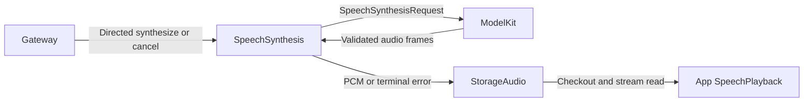
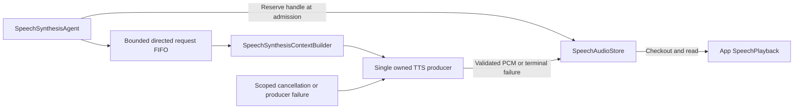

# Directed Speech Synthesis

## Summary

Converts authorized directed text requests into owner-scoped bounded PCM streams, independently of playback scheduling.

## Ownership and boundaries

This role owns synthesis, validation and producer failures. StorageAudio owns audio handles/PCM; App SpeechPlayback consumes them; ModelKit supplies TTS. There are no subscriptions, business output envelopes, publications or outgoing sends.

## External relationships and data flow

Runtime arrows show data or capability calls; dashed arrows show injection.

## Internal components

This role uses typed media requests and deterministic policy, with no Chat system prompt or role prompt asset.

## Admission and ownership

speech.synthesize carries audioID, nonblank text ≤2000 UTF-8 bytes and locale auto/zh-CN/en-US, with ≤16 KiB encoded input. Reserve the unique handle before returning admission. Ownership is trusted sender + session + original parent input; cancel validates the same tuple and bypasses FIFO capacity.

One serial synthesis worker has at most 32 queued/in-flight admissions in addition to the active producer, subject to the shared handle limit. The shared audio store independently permits 32 live handles including queued, producing and playing audio. Overflow rejects; admission is not proof that PCM exists. Semantic text segments belong to the requesting role; model adapters handle provider language/length constraints.

## Production and failure propagation

Build the request from role context and validate request identity, mono Float32, stable format, increasing sequence, explicit finished event, nonempty audio and ≤8 MiB total output. Convert ModelKit.AudioFrame into StorageAudio.SpeechPCMFrame without a dependency from Storage to ModelKit. Producer errors are SpeechSynthesisError; storage errors remain SpeechAudioError.

Synthesis waits for provider completion, failure or owner cancellation without an Agent timer. Cancellation fails the audio handle, wakes readers and joins the producer. Failed handles retain the original error until scope cleanup or bounded metadata eviction; no audio/cache TTL or reader timeout exists. Already audible samples cannot be retracted.

The worker advances after synthesis terminal state without waiting for playback. Pause retains queued requests and lets an already active producer finish; resume drains the FIFO. Stop joins work and closes/fails owned handles. Cancellation cannot discard another source's request. Context write failure prevents dependent synthesis; recent evidence retains 256 summaries. Restart does not restore audio or replay speech.

Directed admission, serial bounded production and explicit audio failure propagation are implemented.

## Registration and authority

[Agent.json](../../Resources/Agents/SpeechSynthesis/Agent.json) admits directed speech.synthesize/cancel only; baseSkills, subscriptions and outgoing sends are empty. No ordinary Chat or model-callable functions exist. Sender/session/original input ownership is validated independently of opaque ModelKit request/scope identity.

## 待实现

- Real-provider synthesis, native playback competition and sustained-device acceptance.

[Agents](../README.md) · [Communication](../Support/Communication/README.md)
