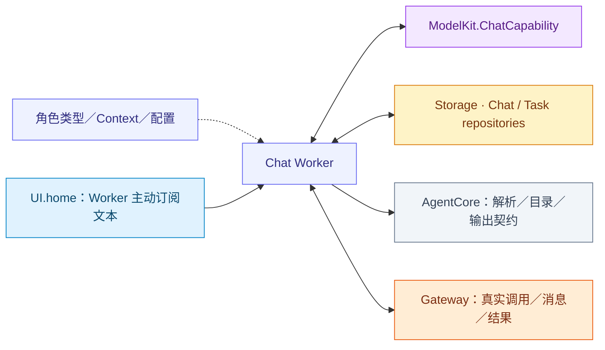
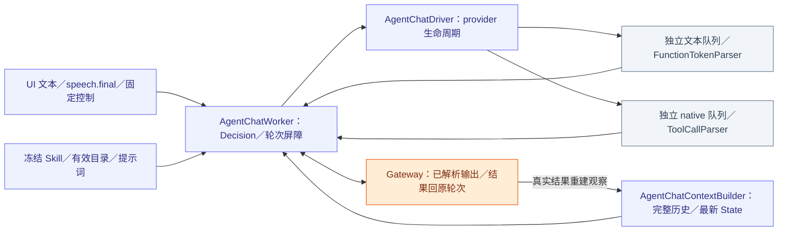

# Chat — 通用模型决策与执行反馈续轮

## 职责与直接接口

AgentChatWorker 将注入 ChatCapability、UIHomeContainer、AgentStateContext、领域历史仓库和角色 Context 组合为有界 Decision／ReACT。角色提供类型、systemPrompt、业务预处理及照片观察策略；共享层拥有模型请求、文本／native 消费、调用结果屏障与历史投影。当前普通 Chat 角色是 Assistant；确定性角色使用固定任务协调。

## 文件与职责

| 文件 | 职责 |
| --- | --- |
| [AgentChatContext.swift](AgentChatContext.swift) | 角色 Context 协议、通用会话控制意图与历史事务适配 |
| [AgentChatContextBuilder.swift](AgentChatContextBuilder.swift) | 历史／执行观察投影、请求预算及公开 State 消息选择 |
| [AgentChatDriver.swift](AgentChatDriver.swift) | Provider 会话、文本与 native 事件消费和取消加入 |
| [AgentChatWorker.swift](AgentChatWorker.swift) | Decision／ReACT、UI 接纳、Task／Skill 控制、输出与结果屏障 |
| [AgentCommunicationAdapter.swift](AgentCommunicationAdapter.swift) | 定向消息内容和因果元数据校验 |
| [AgentPrompts.swift](AgentPrompts.swift) | 按显式配置读取和校验 Chat 模板 |

## 外部关系（一层）

## 内部组件与数据流

各角色有独立仓库、权限及可写历史，不因复用 Worker 而共享状态。

UI 文本处理只接纳 Decision，回执不等待模型／播放终态；start 订阅、pause/stop 关闭加入、resume 重订阅。turn 由角色赋予，保留 UI 请求／代际／因果身份。聆听不是本 Worker 的转发职责。

## 角色接口

AgentChatContextState 提供预处理、systemPrompt、历史消息构造、通信验证和观察策略。sessionControl 是本地会话控制的解释入口，默认返回 nil；角色可返回 AgentChatSessionControl.interrupt 或 close。Worker 校验消息契约、版本及 local／runtime／无 incarnation 的本地来源后执行生命周期屏障，不解释具体角色协议。

commitDependentTargets 声明需要父历史提交确认的目标；Worker 在真实提交后通知这些目标。实际角色协议、相机业务值和照片预算由角色目录拥有。

## 请求、提示词与快照

Worker 在选择 provider 前登记原始 Decision，内部 ReACT 复用该输入/使用集合。每次从角色仓库选择快照，按加载 Skill 组合不可变目录与 system；加载/释放仅影响下一请求。具体 system 章节由 [Assistant](../../Assistant/README.md#system-提示词结构与来源) 拥有，公共层不解释相机业务事实。

AgentPrompts 通过显式资源 Catalog 读取模板，要求 executionObservations/historicalExecution/toolFailure。标题模板由 Memory 独立读取。渲染规则见 [Generation](../Core/Generation/README.md#prompt-resources-and-rendering)：单次替换、精确变量、缺失/超限明确失败，无资源热更新。

### Request state assembly

AgentChatWorker.executeRound is the final assembly boundary for skills-enabled requests. AgentChatContextBuilder owns history/result projection and request-budget fitting; it does not discover containers or mutate their state.

1. Read a committed AgentContextRepository snapshot. Freeze its loaded Skill IDs and compose the immutable capability catalog under the role's communication policy. Keep that catalog for this round's parsing/output authorization.
2. Resolve the loaded Skills' useStates union and call the injected AgentStateContext for the current session. Its callbacks read actual owners; failures stop request construction. Business collection is separate from the private actor snapshot and is not a global atomic observation.
3. Encode the same private snapshot's minimal Task/Skill projection. Construct one system data message containing AGENT CONTEXT, then CURRENT STATE with the explicit facts-only boundary. Limit this combined block to 16 KiB.
4. Rebuild State.systemPrompt from the same catalog and Skill snapshot. Remove old system messages and insert the instruction/catalog prefix at index zero. Insert the fresh data message immediately before a trailing latest user message; otherwise append it after the complete native call/result group. Never split native result pairing.
5. Apply retainingRecent to complete message groups, preserving system messages, current intent and the required continuation suffix. The final request is bounded to 64 messages, 64 KiB of counted text/call fields and four images; inability to fit protected content is an error. Native definitions are supplied separately in ChatRequest.tools when supported.
6. Persist the actual request messages and decision metadata before collecting provider output. A continuation repeats this assembly, refreshing facts and the effective catalog rather than accumulating old State messages.

The prefix contains role/protocol instructions, Skill overview, current loaded teaching and the effective catalog. It remains stable while those inputs remain unchanged; load/release changes the next request's prefix. CURRENT STATE is owner-sampled business/presentation data. AGENT CONTEXT contains only the matching active Task goal/status and effective loaded Skill IDs. The entire private task registry, delegated views, authorization records and idle counters stay out of that projection. Owner/source mappings belong in [Context](../Context/README.md#container-context-read-path).

The usual message order is instruction/catalog system → selected history → fresh Agent/business system data → latest user input/observation. Native feedback instead preserves assistant-call and tool-result messages contiguously and places the data block afterward. Historical requests are reconstructed from input/response/actual call evidence; their old system facts are not reinjected as current facts. Terminal Task summaries remain historical data, separately from the current Task projection. Provider token fitting and prompt-cache behavior remain ModelKit responsibilities.

Roles without dynamic Skills do not automatically receive this public-state collection pipeline; the production Chat role using it is Assistant. Deterministic roles maintain their own private Context and typed observations without creating a model request merely to read State.

## Task/Skill 控制与执行边界

BasicSkill 的五个控制是 Control Channel Actions。startTask/loadSkills/releaseSkills 提交事务值后经结果屏障重建目录；finish/cancel 先标记 finishing/cancelling，加入回复/清理后才进入终态。finishTask 通常结束决策，continueDecision=true 仅继续同一输入剩余新目标；cancelTask 结束决策。开始、等待和收尾中的 Task 均不能被覆盖。

Action/native Tool 仅在合法解析且输出已接纳后记录 Skill 使用；执行失败算使用，解析/参数拒绝不算。Task 屏障与完整用户 Decision 结算分离，系统观察不扣闲置次数。取消清理在途集合；无关输入失败不得终止其他 Task，迟到 ASR 不改投新目标。状态算法由 [Context](../Context/README.md) 拥有。

可信固定 Task 控制只在 worker/队列/接纳均空闲时执行，验证 root session 与来源；模型控制验证当前 input/session/round。固定控制不启动模型。未运行时的输入返回 notRunning，业务/执行/提交失败按原链路显式报告。

## 结果驱动与观察格式

一轮封闭并加入所有 Action/Tool 结果后，显式 value（包括空值）或真实调用失败允许继续；成功报告/活动句柄/投递接纳是完成证据。纯取消结束，不制造恢复请求。Provider、流、XML、观察构建或 Agent 自身异常封闭并清理已接纳工作后结束决策，不自动重试；未知 alias/参数拒绝是未执行调用结果，模型可检查当前目录选择合法步骤，不能重放其他效果。

Action 正文含原轮次 call 序号、当前 action 别名、真实 status 与结构化 value，不含内部 callID 或二次 JSON 字符串。拒绝带 executed=false；失败保留 effect、错误及全部 report 叶子，省略缺失/空的报告字段。业务 null、纯文本/scalar、空值和业务引用保持原值；同名调用分别编号。Native 成功正文保持业务值，失败/报告采用紧凑结构，provider tool_call_id 保留。内部 journal 仍保存完整关联、协议、结果与执行证据；投影不决定是否续轮。

## 多轮历史与持久化

历史按单调 historyOrder 排序，完整 native 配对一起保留；failed/interrupted/unresolved 请求只作为文本历史证据。终态 Task 在首个来源位置替换为摘要，运行 Task/普通背景仍在窗口内，原记录可查询。选取最近十个投影块，再应用消息/字节/图片限制。

用户文本接纳在历史仓库单次原子操作中选择当前会话并建立 awaitingModel 记录；模型请求校验精确快照 token。Task 创建先验证候选、提交业务身份，再绑定运行时上下文，绑定失败显式关闭该身份。完整模型消息、观察和终态按各自边界 checkpoint；delta 和队列在内存。持久化失败阻止依赖后续步骤，不把本地投影当作已落盘。真实数据库访问通过注入 Chat/Task 仓库，重启不重放效果。

## Bounds and overflow

| Owned state or queue | Bound and full-capacity behavior |
| --- | --- |
| Worker admission / output | Defaults: 32 queued inputs plus one reserved continuation; 256 output envelopes. Excess admission rejects; failed output yield marks the worker failed, clears its inbox, cancels inference and closes output. |
| Driver text queue | 8192 fragments; cumulative text also limited to 8192 fragments and 65536 UTF-8 bytes per request. Failed yield terminates the round. |
| Driver native queue | 128 complete calls; failed yield terminates the round. Each generation permits 120 calls; the cumulative decision has no native-call cap. |
| Decision lifetime | Completion/cancellation/error-owned, no cumulative requests/native calls/time limit. Generated calls (120) and feedback bytes (64 KiB) reset each round. |
| Queue lifetime | Owner cancellation/terminal state; no elapsed-time expiry |
| Private task views | 256 identities, at most 32 live; only terminal views may be retired. These runtime correlation/report views are not serialized wholesale into AGENT CONTEXT. The current conversational Task projection contains only the matching active goal/status. |

The driver's secondary queues use synchronous checked yields. They do not suspend the provider producer; ModelKit adapters define the upstream ChatEvent queue policy. Cancellation or failure cancels the provider session, finishes both queues and joins all consumers. Only normal provider completion flushes the Action parser; partial failed/cancelled syntax is not finished or replayed.

## 生命周期、时序与错误

worker 独立于 UI 页面；结果必须匹配 call/round/task/session/incarnation 与封闭屏障。pause／interrupt 取消并加入当前 Decision，保留 Task／Skill 与公开状态作用域，目标回到 waitingUser，被中断 Decision 不扣闲置次数；close 关闭匹配会话，stop 关闭全部。输出传输失败也必须清理。Reply occupancy 是有界完整 revision 快照，证据提交先于占用移交；终态事实释放占用，不使用租约定时器，聆听政策仍由SpeechPerception解释。

ChatTiming 由支持的 provider 在请求发出及首个非空文本或已校验身份的原生工具参数增量时取单调样本；取先到者，排除私有推理和工具执行时间。不支持计时或没有有效增量时不产生 TTFT；driver 沿用同一快照持久化链路。消费、ASR、TTS 与 UI 耗时不是模型首 token 时延。网络传输自身超时和实时感知 freshness 不作为整个决策时限。

错误保留原生产者语义：provider HTTP/transport/response 错误、GenerationError、CapabilityError 与提交错误分别传播，并保留原始清理错误。取消输出 agent.cancelled，不产生失败 Toast；被动容器故障不触发模型或自动硬件恢复。执行者超时通过真实 ActionResult 返回。

## Continuation outcome matrix

| Actual condition | ReACT / recovery behavior |
| --- | --- |
| Successful `.value`, including `""` | Business output; continue after the full barrier. Empty string is an explicit value, not absence of a value. |
| Successful `.report`, empty or nonempty | Execution evidence only; keep all steps/details/history and join the barrier, without requesting ReACT. A report is not a business value. |
| Successful `.activityStarted` / `.activityStopped` | Lifecycle acknowledgment only; the identity does not independently request ReACT. Business data must be returned explicitly as `.value`. Later activity events have no generic automatic continuation integration. |
| Native ToolResult with `value` and no `completion` | Preserve value semantics and continue, including an empty value. ActionResult without completion is normalized to `.completed`. |
| Failed/partially failed Action invocation | Preserve actual failures/effects and continue while the input owner remains live. |
| Cancelled Action/Tool invocation | Preserve cancelled evidence; no incident or ReACT. Independent real failures in a mixed report remain failures. |
| Tool `isError`, nonnil non-cancellation `failureCode`, failed report | Real failure takes precedence over absence of business output; continue. |
| Unknown Action/Tool alias or invalid parameters | Parser-local rejection becomes a correlated error result (`invalidInvocation` or `communicationRejected`), without executing the call. Forbidden Channel/malformed markup ends the generation as a real Agent failure. |
| Handler exception, Action timeout, resource/permission/admission rejection with reliable terminal feedback | Continue from the real failure. A closed scheduling tree alone does not authorize continuation: call results and the round receipt must remain reliable. |
| Failed model communication | Continue from the error. Successful send/publish admission is a `.completed` acknowledgment. Other background progress/results update control state; Writer business facts follow the domain FIFO contract below. |
| Chat request/stream/consumer failure within `collect` | Record the failed attempt, join admitted effects and terminate the decision. Includes HTTP/network/provider errors, output parsing, unsupported output and per-request limits. No automatic Agent retry. |
| Observation/image enrichment construction failure | Terminate the decision with the real error and retained execution evidence; never fabricate an image or repeat capture. |
| Round closure failure with a prior generation error and every call result already present | Retain both causes and terminate the input; round closure/delivery uncertainty never authorizes a retry. |

一轮中有一项符合条件即可续推，但所有已接纳调用及可靠结果必须先 join。模型 stop/toolCalls/lengthLimit 只记录生成结束，不独立触发 ReACT；不完整标记导致生成失败。活跃 Task、被动相机/环境事实和等待用户不能创建轮询循环。新用户输入才创建新 Decision；原输入内续轮保留 provider、输入/会话身份并重新选择完整上下文。

## Reply text segmentation

AgentChatWorker 默认 TextSegmentationPolicy 为首段 Han/其他字符 20/60，后续 60/120，保留安全单词/句子边界；Channel/wait/XML 边界触发 flush，没有计时 flush。SentenceFunctionBuffer 的首段状态跨这些边界保留，细节见 [Generation](../Core/Generation/README.md#streaming-tts-latency)。段落形成后才提交对应 caption/synthesis/playback 输出。

## Request projection and feedback bounds

| Owned boundary | Current contract |
| --- | --- |
| Context selection | 先选最近十个完整投影块，再按消息、文本/native 字节与图片预算裁剪；保留 system、当前输入和最新完整调用/结果组。 |
| Round calls | 120，含文本映射、拒绝及内部 reply-start；每轮重新计数。 |
| Round feedback | 按 observationText 计算的结果正文总计 65,536 UTF-8 字节；超限显式失败，不重放效果。 |
| Request validity | 保持完整唯一 native call/result 配对；不可表示的当前 payload 明确失败。原始历史不因投影裁剪丢失。 |
| Decision usage | 同一用户 Decision 内计数累计供证据使用，生产不传 maximumRequests/maximumNativeCalls 上限；新用户输入拥有独立预算。 |

请求值本身的消息/图片/定义/配对限制由 [ChatRequest](../../../ModelKit/Language/LLM/README.md#request-validation-bounds) 拥有；解析器和 provider 队列分别见所属目录。

[Support](../README.md) · [Context](../Context/README.md) · [Generation](../Core/Generation/README.md) · [Capability](../Core/Capability/README.md)

## Progressive reflexive State

The request still derives capabilities, teaching and useStates from the same committed effective Skill set. Canonical domain sources are selected only by their explicit Skill paths; there is no Assistant whole-tree health or diagnostics source. There is no loadState or model-visible internal tree. Owner state reads do not change Skill retention or Task ownership; missing/read-failed observations become unknown with a bounded path/code diagnostic; cancellation, closure and capacity still abort request construction.

residentContext() exposes only the repository’s initialized committed in-memory Context for Container State reflection. It performs no initialization or persistence I/O; operational contextSnapshot() keeps its existing private-context contract.

Task 控制的默认 XML Action startTask 通过 execution=foreground/background 分流；后台 executor=writer 支持单任务委托，sendMessage 仅补充输入，cancelTask(taskID) 请求取消。前台只接受 goal/skills/execution，后台不经过前台 Skill 状态转移。委托不创建前台 Task，独立任务没有前台 parent；短目标与当前真实输入进入 Writer。通知不能修改不属于它的前台 Task，也不进入该 Task 的历史压缩来源。

Writer started/progress events update durable control facts and one latest pending summary. Only admitted summaries, userInput and terminal reports enter the common 32-item FIFO with final speech/text. Duplicate sequences do not trigger another reply. Summary admission waits for current playback and peer replies; terminal reports keep their independent persistent delivery. Reports never import private source-dialog context or restart Writer.

Writer 的 task.result 仅关闭控制身份，不进入回复队列，也不作为通知开始模型处理的屏障。writer.completion 独立经过认证角色通信，核对 SQLite 的任务、执行、终态和不可变通知；通知确认或跨对话的已存输入身份防止重复回复。续作后旧 run 的终态仅确认接收，不改变新执行或触发模型。新根中的回复使用当前交互身份。委托、取消替代和消息发送前读取可信执行状态关闭过期私有 Task/view，不等待通知。进程重启只恢复待送达通知；已接纳输入仍遵循 Chat interrupted 恢复，不自动重放语音或创作。

模型历史 read-token/begin 短事务与 Assistant 输入接纳共用 admission gate，避免并发接纳使请求历史令牌失效；模型生成和工具执行不占此锁。

后台委托注册失败和递送失败均进入清理；内存任务失败/终态与 SQLite 任务关闭分别执行，任一步失败仍尝试另一项并汇总清理错误。通信通过独立于轮次屏障的输出消费链路递送，模型仍使用 XML Action 调度。

Writer 事件输入只授权向用户汇报或提问，不授权 startTask/finishTask/cancelTask 生命周期操作。委托只从当前真实文本/最终语音输入获取原文；每项输入只可尝试一次实际委托，拒绝后须新的用户输入才能重试。busy/参数校验拒绝未尝试实际委托，可在同项输入内按用户已确认的替代意图修正。Writer 通知不伪装用户输入，也不能退化为 goal 作为原文。

Writer 失败输入包含生产者提供的分类、阶段、网络/HTTP原因、模型及耗时事实；Assistant向用户汇报这些事实，不把 transport/http阶段推测成某个HTTP状态或服务端报错，不自动重试。

详细Writer失败投影沿用4KiB观察输入边界，优先保留身份和分类/关键网络事实；过长文本按UTF-8有效边界投影并明确标记截断，原始事件及Writer请求诊断不受投影删减。

Writer事实仅在当前Decision、真实round/playback屏障及前台委托回复占用清空后开始；foreground结果/等待用户播放收尾解除占用时立即drain，仍遵守已接纳输入FIFO。Writer回复的处理起点使用单调时间，只有成功Decision在真实屏障后发布completedReportID/reportStartedAt；保留最近一次成功事实随完整ReplyActivity快照重复携带，避免并发通信消费者先递送新版快照而漏掉完成。取消/失败不发布新的成功事实。SpeechPerception据用户停止/生命周期围栏决定播毕启听，模型不调用startListening完成该衔接。

ReplyActivity发布端只在占用进入/退出、会话变化、新的最终语音root确认或新的成功Writer汇报时发送完整快照。同态排队文本/Writer输入仅更新本地集合，不逐项发布，避免32项接纳突发挤满16项通信消费队列；最终语音确认不能被合并。模型输入、SQLite证据和FIFO仍逐项保留，通信队列容量不变。

## Writer普通进度合并

认证started/progress先作为control事实持久更新任务视图，最新普通摘要仅一项，不占32项正式输入容量。独立摘要worker等待当前模型/播放/peer屏障和既有FIFO排空，普通回复开始间隔至少10秒；接纳时使用独立输入身份，预留容量、持久化work后进入共用队列，一旦接纳不替换或重排。userInput及终态保持原FIFO/持久重投并清除未接纳普通摘要；暂停/停止加入worker。摘要失败保留最新待处理事实并显式记录，不能重跑Writer创作。

The ordinary-progress worker rechecks the pending event identity after asynchronous state reads, so a replaced or terminal-cleared summary is never consumed as the latest one. Formal FIFO admission and playback completion remain the gates for beginning an ordinary reply.

Writer普通进度是完成步骤的事实；请求开始不会进入Assistant摘要队列。全局窗口摘要由BasicSkill选择ui.windows，其他页面能力按Skill目录渐进加载；公共容器State与创建窗口的Agent身份无关。

ChatDriver scopes request consumption with InferenceSession.withCleanup, joining the SDK request worker on normal/error/cancellation exits. It owns no model-instance lease and does not unload shared clients.
