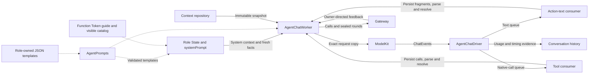

# Shared Chat Decision Worker

## Summary

Adapts an injected ChatCapability into bounded role-specific model decisions and observation continuations. Assistant specializes this worker; Photographer, Memory and ApplicationControl compose it with deterministic workflows.

## Ownership and boundaries

Roles own identity, preprocessing, schemas, system/style templates, grants, context selection and completion policy. This directory owns request construction, model-event consumption, output interpretation and round coordination. Gateway executes resolved output; ModelKit owns provider transport.

## External relationships and data flow

Runtime flow; dashed arrows supply immutable resources or configuration.

The two consumers run independently within the driver's task group. Each request creates its own AgentGenerator and ToolCallParser use; parser implementations are shared, while parser state, history and permissions remain local to the executing worker.

## Components and requests

| Source | Responsibility |
| --- | --- |
| AgentChatWorker.swift | Admission, text/native interpretation, task routing, feedback/barriers, continuation, occupancy and cancellation |
| AgentChatDriver.swift | Provider session ownership, event demultiplexing, timing/evidence callbacks and joined consumer cleanup |
| AgentChatContext.swift | Role State hooks, selected request values and private history adaptation |
| AgentChatContextBuilder.swift | Completed request-block projection and provider call/result pairing |
| AgentCommunicationAdapter.swift | Visible send Action metadata and typed task-message validation |
| AgentPrompts.swift | Bundle discovery, immutable template/error caching and required-key validation |

Each provider invocation selects fresh role-owned `decisionContextMessages` from a repository snapshot, appends them to an immutable request copy and stores that exact request. Initial delegated requests identify the active task, requester and executor. Continuations retain the decision's Chat binding.

History selects the latest ten completed request blocks by date, excluding blocks with unresolved native calls. One conversation turn can contain several blocks. Assistant projects historical native calls/results as inert text; other chat roles retain provider call/result pairing. The builder requires role templates explicitly and propagates rendering errors.

Unknown/invalid invocations may produce bounded observation continuation. Successful send admission is record-only. Persistence failure or uncertain delivery after validation ends the decision without re-delegating. A sealed round joins Action and Tool results before a registered observation starts another request.

## Prompt ownership and rendering

`AgentPrompts.load(named:)` discovers at most 32 unique `.prompts.json` sets in the Agents `Bundle.module`, selected by `State.configurationName`. It caches immutable resources and load errors. Every role asset must contain `system`, `activeTask`, `taskReports`, `taskReport`, `executionObservations`, `historicalExecution` and `toolFailure`; role hooks select any additional templates.

`State.systemPrompt` combines its own system template with the AgentCore Function Token guide and current visible Action catalog. Role assets own identity, expression style and speech/action examples. Worker code renders task summaries, active-task context and execution observations; the context builder renders history projections. Native Tool definitions are separate `ChatRequest.tools` values. Internal grants are never model-callable aliases.

The shared [PromptTemplates renderer](../Core/Generation/README.md#prompt-resources-and-rendering) uses exact named variables and single-pass substitution. Input values are not reparsed or automatically escaped. Missing resources, invalid documents, missing templates/variables and oversized output fail explicitly. Assets have no hot reload or fallback prose.

`AgentCommunicationAdapter.catalog` derives send metadata from allowed task target/contract pairs. Its illustrative example uses an actual permitted pair. `action` validates the exact pair and existing task scope, constructs trusted typed content and never broadcasts task ownership. Explicit native communication Tool registration rejects.

## Bounds and overflow

| Owned state or queue | Bound and full-capacity behavior |
| --- | --- |
| Worker admission / output | Defaults: 32 queued inputs plus one reserved continuation; 256 output envelopes. Excess admission rejects; failed output yield marks the worker failed, clears its inbox, cancels inference and closes output. |
| Driver text queue | 8192 fragments; cumulative text also limited to 8192 fragments and 65536 UTF-8 bytes per request. Failed yield terminates the round. |
| Driver native queue | 16 complete calls; failed yield terminates the round. The decision budget independently limits total native calls to 16. |
| Decision budget | Four requests, 120 generated calls, 64 KiB aggregate feedback/transcript and 30 seconds cumulative execution |
| Queue expiry | 60 seconds; expired queued work receives terminal accounting |
| Task views / prompt reports | 256 identities, at most 32 live; only terminal views may be retired. Prompts include live views and eight terminal excerpts. |

The driver's secondary queues use synchronous checked yields. They do not suspend the provider producer; ModelKit adapters define the upstream ChatEvent queue policy. Cancellation or failure cancels the provider session, finishes both queues and joins all consumers. Only normal provider completion flushes the Action parser; partial failed/cancelled syntax is not finished or replayed.

## Lifecycle and occupancy

One worker owns inference and dispatch independently of UI pages. Round results must match call, round, task and session identities plus sealed barriers. Pause/stop cancel and join owned work, including when cancellation delivery fails. Restart never replays effects.

Reply occupancy is an optional complete revisioned publication of bounded reply inputs/tasks. Evidence commits precede delegation holds; failed commits cannot create orphan holds. Stop clears occupancy after joined cleanup. This worker has no consent/listening grant.

## Provider timing

The driver adds a per-request ChatTiming sampler. Supporting adapters sample monotonic request start and first nonempty text before consumer persistence; the driver persists supplied evidence. Native-only replies and unsupported providers leave TTFT absent. ASR/TTS/UI timing is excluded; historical consumer timestamps remain distinctly labeled.

✅ Shared bounded decisions, independent protocol consumers, role-owned prompt rendering and Action-only communication adaptation are implemented.

## Related design

[Parent design](../README.md) · [Generation](../Core/Generation/README.md) · [Capability](../Core/Capability/README.md) · [Communication schemas](../Communication/README.md) · [Context persistence](../Context/README.md)
