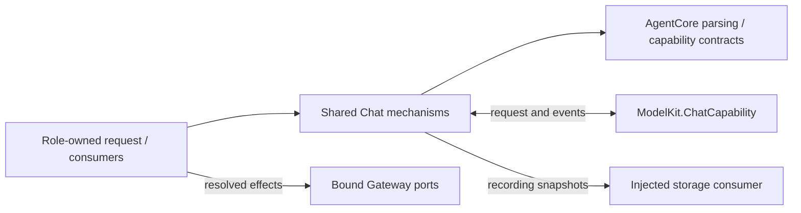
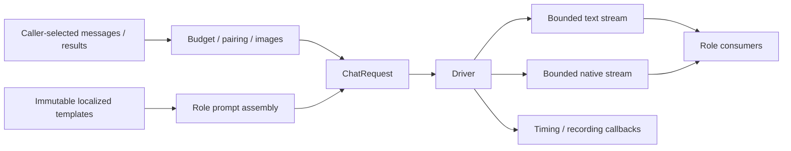

# Chat — Reusable model-request mechanisms

## Responsibilities and boundaries

Shared Chat adapts ModelKit requests/events, records request evidence, renders immutable templates, validates communication projections and transforms neutral messages/results. It owns no Assistant conversation state, Decision policy, foreground Task, Writer notifications, role speech producer or role lifecycle. Those belong to [Assistant](../../Assistant/README.md) and other role owners.

| File | Responsibility |
| --- | --- |
| [AgentChatDriver.swift](AgentChatDriver.swift) | Provider-session consumption, bounded text/native streams, timing and joined cleanup. |
| [AgentChatContextBuilder.swift](AgentChatContextBuilder.swift) | Stateless message budgeting, complete native call/result groups, State image projection and execution-result serialization. |
| [AgentCommunicationAdapter.swift](AgentCommunicationAdapter.swift) | Model communication declarations and authenticated Task-message argument projection. |
| [AgentModelRequestRecording.swift](AgentModelRequestRecording.swift) | Neutral request/event and HTTP transport evidence passed to an injected recorder. |
| [AgentPrompts.swift](AgentPrompts.swift) | Locale-aware bundled template loading, rendering, caching and release. |

## Request projection and feedback bounds

AgentChatContextBuilder retains complete native call/result groups. Orphan, duplicate or incomplete native results fail. It removes oldest unprotected groups until the request fits 64 messages, 65,536 counted UTF-8 bytes and five images, including caller-specified reservations. System messages, current user intent, the protected suffix and protected image identities remain intact. Protected content that cannot fit fails explicitly. This changes only the model projection, not durable history. Provider token fitting belongs to ModelKit.

State images attach to the matching current user message without changing its text or existing attachments. Duplicate image identities and excessive image count fail. The system manifest carries ID/source/MIME/dimensions/byte count and one-based image positions; an unsupported model receives an unsupported-delivery manifest without image bytes. The caller owns source selection, resource scopes, current-input matching and ephemeral-history filtering.

Execution observations preserve explicit empty/scalar values, structured business values, partial reports, failure codes, uncertainty and rejection evidence. Successful native values remain exact. Rejections include executed=false; report detail is serialized without discarding failed leaves. Projection does not choose continuation or infer model origin from a function path. [Assistant](../../Assistant/README.md#results-history-and-continuation) owns its per-round reasoning rules.

## Driver lifecycle and capacity

AgentChatDriver receives a ChatCapability and explicit text, native, evidence, timing and recording consumers. Each collect call owns its provider session and child consumers. It uses InferenceSession.withCleanup to join normal completion, failure and cancellation; it owns no model-instance lease and never unloads a shared client.

The text stream holds at most 8,192 fragments, with a cumulative 8,192-fragment / 65,536-byte limit per request. The native stream holds at most 128 complete calls. Checked synchronous yield rejects overflow; it does not backpressure the provider. ModelKit owns its upstream event queue policy. Missing terminal completion or events after completion fail. Failure/cancellation cancels the session, closes both streams and joins every child. Only successful completion permits the caller to flush complete parser output.

Timing is a provider-owned monotonic snapshot from actual dispatch to the first nonempty text or validated native argument delta, whichever comes first. Private reasoning and execution latency are excluded. Unsupported providers produce no invented timing. The driver passes snapshots through the same recording boundary.

## Model request recording

AgentModelRequestRecording serializes neutral request messages, tool schemas, model output/events and images. Its transport callback emits ModelRequestLogUpdate values for actual HTTP requests, response headers/status, body/SSE bytes and termination. HTTP capture replaces the parallel local event recording. Capture persistence failure is retained; final evidence failure preserves the primary error as well as recording failure.

Callers own journal creation, dispatch checkpoints, persistence and deletion. Storage's update-only late-callback behavior prevents cleared logs from being recreated. Business inputs/replies/tool results remain separate from model logs. See [Storage](../../../Storage/Database/README.md).

## Templates and localization

AgentPrompts loads immutable resources through an injected reader. JSON holds named templates; Markdown/text use body. The cache has at most 256 entries. Invalid paths/formats, missing required templates and rendering errors propagate. English is the canonical source; zh-Hans selects the translated sibling with the documented missing-file fallback. TaskLocal language scopes request assembly without changing canonical protocol identities.

Shared convenience methods own shared output, catalog and request-context resources. AssistantInputBatch owns Assistant input guidance and canonical historical markers; ConversationTitleGenerator owns Memory title templates. The role supplies its own prompt assembly and locale. No shared helper embeds private role instructions or interprets a role's history schema.

## Communication projection

AgentCommunicationAdapter projects declared send permissions into model guidance and validates target/kind/content and optional Task/artifact identity. Existing Task scopes retain authenticated requester/executor/session identity. Broadcast Task ownership is rejected; admission receipts do not prove business completion. Runtime execution and role admission remain separate owners. See [communication contracts](../Communication/README.md).
