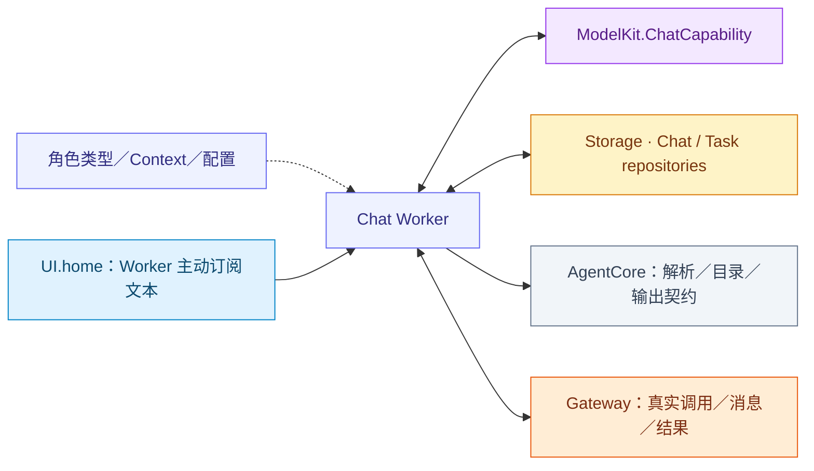

# Chat — 通用模型决策与执行反馈续轮

## 职责与直接接口

AgentChatWorker 将注入 ChatCapability、UIHomeContainer、AgentStateContext、领域历史仓库和角色 Context 组合为有界 Decision／ReACT。角色提供类型、systemPrompt、业务预处理及照片观察策略；共享层拥有模型请求、文本／native 消费、调用结果屏障与历史投影。当前普通 Chat 角色是 Assistant；确定性角色使用固定任务协调。

## 文件与职责

| 文件 | 职责 |
| --- | --- |
| [AgentChatContext.swift](AgentChatContext.swift) | 角色 Context 协议、通用会话控制意图与历史事务适配 |
| [AgentChatContextBuilder.swift](AgentChatContextBuilder.swift) | 历史／执行观察投影、请求预算及公开 State 消息选择 |
| [AgentChatDriver.swift](AgentChatDriver.swift) | Provider 会话、文本与 native 事件消费和取消加入 |
| [AgentSpeechOutput.swift](AgentSpeechOutput.swift) | 调用者注入的语音句柄生产、按输入取消与停止接口；不拥有具体合成实现 |
| [AgentChatWorker.swift](AgentChatWorker.swift) | Decision／ReACT、UI 接纳、Task／Skill 控制、输出与结果屏障 |
| [AgentCommunicationAdapter.swift](AgentCommunicationAdapter.swift) | 定向消息内容和因果元数据校验 |
| [AgentPrompts.swift](AgentPrompts.swift) | 加载、渲染、缓存和卸载 Agents Bundle 的提示词模板 |

## 外部关系（一层）

## 内部组件与数据流

各角色有独立仓库、权限及可写历史，不因复用 Worker 而共享状态。

UI 文本处理只接纳 Decision，回执不等待模型／播放终态；start 订阅、pause/stop 关闭加入、resume 重订阅。turn 由角色赋予，保留 UI 请求／代际／因果身份。聆听不是本 Worker 的转发职责。

## 角色接口

AgentChatContextState 提供预处理、systemPrompt、历史消息构造、通信验证和观察策略。sessionControl 是本地会话控制的解释入口，默认返回 nil；角色可返回 AgentChatSessionControl.interrupt 或 close。Worker 校验消息契约、版本及 local／runtime／无 incarnation 的本地来源后执行生命周期屏障，不解释具体角色协议。

commitDependentTargets 声明需要父历史提交确认的目标；Worker 在真实提交后通知这些目标。实际角色协议、相机业务值和照片预算由角色目录拥有。

## 请求、提示词与快照

Worker 在选择 provider 前登记原始 Decision，内部 ReACT 复用该输入/使用集合。每次从角色仓库选择快照，按加载 Skill 组合不可变目录与 system；加载/释放仅影响下一请求。具体 system 章节由 [Assistant](../../Assistant/README.md#system-提示词结构与来源) 拥有，公共层不解释相机业务事实。

[AgentPrompts](AgentPrompts.swift) 负责 Agents Bundle 提示词资源的 `load`、`render` 和 `unload`。加载按路径缓存最多 256 份成功编译的不可变模板，文件读取与缓存变更串行化。卸载移除指定路径的缓存，后续读取会重新加载，已取得的模板继续供当前请求使用。读取和编译失败显式传播。AgentConfigurations 按 Catalog 定位角色与 Skill 资产，AgentPrompts 提供 共享协议、Action 目录、角色指令和证据、Skill 教学及 Memory 标题模板。Assistant 的证据模板要求 executionObservations、historicalExecution 和 toolFailure。渲染规则见 [Generation](../Core/Generation/README.md#prompt-resources-and-rendering)。

Assistant 请求装配与 Skill 预算使用同一组已加载的 OutputProtocol 和 ActionCatalog 模板。SkillCatalog 和 AgentCatalog 提供目录标题和条目排版。RequestContext 渲染独立 system 消息的事实和图片清单，Assistant 的角色模板渲染 Writer 追问与事件。Swift 选择并序列化当前数据，维护容量和插入位置。AgentCommunicationAdapter 按本轮权限为已声明的低层 send 生成实际目标与消息种类配对。

### Request state assembly

AgentChatWorker.executeRound is the final assembly boundary for skills-enabled requests. AgentChatContextBuilder owns history/result projection and request-budget fitting; it does not discover containers or mutate their state.

1. Read a committed AgentContextRepository snapshot. Freeze its loaded Skill IDs and compose the immutable capability catalog under the role's communication policy. Keep that catalog for this round's parsing/output authorization.
2. Resolve the loaded Skills' useStates union and call the injected AgentStateContext for the current session. Its callbacks read actual owners; failures stop request construction. Business collection is separate from the private actor snapshot and is not a global atomic observation.
3. Encode the same private snapshot's minimal Task/Skill projection. Construct one system data message containing AGENT CONTEXT, then CURRENT STATE with the explicit facts-only boundary. Limit this combined block to 16 KiB.
4. Rebuild State.systemPrompt from the same catalog and Skill snapshot. Remove old system messages and insert the instruction/catalog prefix at index zero. Insert the fresh data message immediately before a trailing latest user message; otherwise append it after the complete native call/result group. Never split native result pairing.
5. Apply retainingRecent to complete message groups, preserving system messages, current intent and the required continuation suffix. The final request is bounded to 64 messages, 64 KiB of counted text/call fields and five images; inability to fit protected content is an error. Native definitions are supplied separately in ChatRequest.tools when supported.
6. Persist the actual request messages and decision metadata before collecting provider output. A continuation repeats this assembly, refreshing facts and the effective catalog rather than accumulating old State messages.

The prefix contains role/protocol instructions, Skill overview, current loaded teaching and the effective catalog. It remains stable while those inputs remain unchanged; load/release changes the next request's prefix. CURRENT STATE is owner-sampled business/presentation data. AGENT CONTEXT contains only the matching active Task goal/status and effective loaded Skill IDs. The entire private task registry, delegated views, authorization records and idle counters stay out of that projection. Owner/source mappings belong in [Context](../Context/README.md#container-context-read-path).

The usual message order is instruction/catalog system → selected history → fresh Agent/business system data → latest user input/observation. Native feedback instead preserves assistant-call and tool-result messages contiguously and places the data block afterward. Historical requests are reconstructed from input/response/actual call evidence; their old system facts are not reinjected as current facts. Terminal Task summaries remain historical data, separately from the current Task projection. Provider token fitting and prompt-cache behavior remain ModelKit responsibilities.

Roles without dynamic Skills do not automatically receive this public-state collection pipeline; the production Chat role using it is Assistant. Deterministic roles maintain their own private Context and typed observations without creating a model request merely to read State.

## Task/Skill 控制与执行边界

BasicSkill 的五个控制是 Control Channel Actions。startTask/loadSkills/releaseSkills 提交事务值后经结果屏障重建目录；finish/cancel 先标记 finishing/cancelling，加入回复/清理后才进入终态。finishTask 通常结束决策，continueDecision=true 仅继续同一输入剩余新目标；cancelTask 结束决策。开始、等待和收尾中的 Task 均不能被覆盖。

Action/native Tool 仅在合法解析且输出已接纳后记录 Skill 使用；执行失败算使用，解析/参数拒绝不算。Task 屏障与完整用户 Decision 结算分离，系统观察不扣闲置次数。取消清理在途集合；无关输入失败不得终止其他 Task，迟到 ASR 不改投新目标。状态算法由 [Context](../Context/README.md) 拥有。

可信固定 Task 控制只在 worker/队列/接纳均空闲时执行，验证 root session 与来源；模型控制验证当前 input/session/round。固定控制不启动模型。未运行时的输入返回 notRunning，业务/执行/提交失败按原链路显式报告。

## 结果驱动与观察格式

同步轮次模式在一轮封闭并加入所有 Action/Tool 结果后继续；全双工模式的普通 Action 独立发布、native 组配对发布。显式 value（包括空值）或真实调用失败允许继续；成功报告/活动句柄/投递接纳是完成证据。纯取消结束，不制造恢复请求。Provider、流、XML、观察构建或 Agent 自身异常封闭并清理已接纳工作后结束决策，不自动重试；未知 alias/参数拒绝是未执行调用结果，模型可检查当前目录选择合法步骤，不能重放其他效果。

Action 正文含原轮次 call 序号、当前 action 别名、真实 status 与结构化 value，不含内部 callID 或二次 JSON 字符串。拒绝带 executed=false；失败保留 effect、错误及全部 report 叶子，省略缺失/空的报告字段。业务 null、纯文本/scalar、空值和业务引用保持原值；同名调用分别编号。Native 成功正文保持业务值，失败/报告采用紧凑结构，provider tool_call_id 保留。内部 journal 仍保存完整关联、协议、结果与执行证据；投影不决定是否续轮。

## 多轮历史与持久化

历史按单调 historyOrder 排序，完整 native 配对一起保留；failed/interrupted/unresolved 请求只作为文本历史证据。终态 Task 在首个来源位置替换为摘要，运行 Task/普通背景仍在窗口内，原记录可查询。选取最近十个投影块，再应用消息/字节/图片限制。

用户文本接纳在历史仓库单次原子操作中选择当前会话并建立 awaitingModel 记录；模型请求校验精确快照 token。Task 创建先验证候选、提交业务身份，再绑定运行时上下文，绑定失败显式关闭该身份。完整模型消息、观察和终态按各自边界 checkpoint；delta 和队列在内存。持久化失败阻止依赖后续步骤，不把本地投影当作已落盘。真实数据库访问通过注入 AssistantHistoryStore、前台任务仓库与独立通信端口，重启不重放效果。

## Bounds and overflow

| Owned state or queue | Bound and full-capacity behavior |
| --- | --- |
| Worker admission / output | Defaults: 32 queued inputs plus one reserved continuation; 256 output envelopes. Excess admission rejects; failed output yield marks the worker failed, clears its inbox, cancels inference and closes output. |
| Driver text queue | 8192 fragments; cumulative text also limited to 8192 fragments and 65536 UTF-8 bytes per request. Failed yield terminates the round. |
| Driver native queue | 128 complete calls; failed yield terminates the round. Each generation permits 120 calls; the cumulative decision has no native-call cap. |
| Decision lifetime | Completion/cancellation/error-owned, no cumulative requests/native calls/time limit. Generated calls (120) and feedback bytes (64 KiB) reset each round. |
| Queue lifetime | Owner cancellation/terminal state; no elapsed-time expiry |
| Private task views | 256 identities, at most 32 live; only terminal views may be retired. These runtime correlation/report views are not serialized wholesale into AGENT CONTEXT. The current conversational Task projection contains only the matching active goal/status. |

The driver's secondary queues use synchronous checked yields. They do not suspend the provider producer; ModelKit adapters define the upstream ChatEvent queue policy. Cancellation or failure cancels the provider session, finishes both queues and joins all consumers. Only normal provider completion flushes the Action parser; partial failed/cancelled syntax is not finished or replayed.

## 生命周期、时序与错误

worker 独立于 UI 页面。结果必须匹配 call、round、task、session、incarnation 与完成屏障。pause 和 interrupt 取消并等待当前 Decision 退出，保留 Task、Skill 与公开状态作用域，目标回到 waitingUser，被中断 Decision 保留原闲置次数。close 关闭匹配会话，stop 关闭全部。回复占用由 worker 为本地 Decision 管理，输入终态释放对应记录。输出传输失败也会清理。

ChatTiming 由支持的 provider 在请求发出及首个非空文本或已校验身份的原生工具参数增量时取单调样本；取先到者，排除私有推理和工具执行时间。不支持计时或没有有效增量时不产生 TTFT；driver 沿用同一快照持久化链路。消费、ASR、TTS 与 UI 耗时不是模型首 token 时延。网络传输自身超时和实时感知 freshness 不作为整个决策时限。

错误保留原生产者语义：provider HTTP/transport/response 错误、GenerationError、CapabilityError 与提交错误分别传播，并保留原始清理错误。取消输出 agent.cancelled，不产生失败 Toast；被动容器故障不触发模型或自动硬件恢复。执行者超时通过真实 ActionResult 返回。

## Non-duplex continuation outcome matrix

| Actual condition | ReACT / recovery behavior |
| --- | --- |
| Successful `.value`, including `""` | Business output; continue after the full barrier. Empty string is an explicit value, not absence of a value. |
| Successful `.report`, empty or nonempty | Execution evidence only; keep all steps/details/history and join the barrier, without requesting ReACT. A report is not a business value. |
| Successful `.activityStarted` / `.activityStopped` | Lifecycle acknowledgment only; the identity does not independently request ReACT. Business data must be returned explicitly as `.value`. Later activity events have no generic automatic continuation integration. |
| Native ToolResult with `value` and no `completion` | Preserve value semantics and continue, including an empty value. ActionResult without completion is normalized to `.completed`. |
| Failed/partially failed Action invocation | Preserve actual failures/effects and continue while the input owner remains live. |
| Cancelled Action/Tool invocation | Preserve cancelled evidence; no incident or ReACT. Independent real failures in a mixed report remain failures. |
| Tool `isError`, nonnil non-cancellation `failureCode`, failed report | Real failure takes precedence over absence of business output; continue. |
| Unknown Action/Tool alias or invalid parameters | Parser-local rejection becomes a correlated error result (`invalidInvocation` or `communicationRejected`), without executing the call. Malformed markup ends the generation as a real Agent failure. |
| Handler exception, Action timeout, resource/permission/admission rejection with reliable terminal feedback | Continue from the real failure. A closed scheduling tree alone does not authorize continuation: call results and the round receipt must remain reliable. |
| Failed model communication | Continue from the error. Successful send/publish admission is a `.completed` acknowledgment. Other background progress/results update control state; Writer facts update the task view without a decision. |
| Chat request/stream/consumer failure within `collect` | Record the failed attempt, join admitted effects and terminate the decision. Includes HTTP/network/provider errors, output parsing, unsupported output and per-request limits. No automatic Agent retry. |
| Observation/image enrichment construction failure | Terminate the decision with the real error and retained execution evidence; never fabricate an image or repeat capture. |
| Round closure failure with a prior generation error and every call result already present | Retain both causes and terminate the input; round closure/delivery uncertainty never authorizes a retry. |

一轮中有一项符合条件即可续推，但所有已接纳调用及可靠结果必须先 join。模型 stop/toolCalls/lengthLimit 只记录生成结束，不独立触发 ReACT；不完整标记导致生成失败。活跃 Task、被动相机/环境事实和等待用户不能创建轮询循环。新用户输入才创建新 Decision；原输入内续轮保留 provider、输入/会话身份并重新选择完整上下文。

## Reply text segmentation

AgentChatWorker 默认 TextSegmentationPolicy 为首段 Han/其他字符 20/60，后续 60/120，保留安全单词/句子边界；wait/XML 边界触发 flush，没有计时 flush。SentenceFunctionBuffer 的首段状态跨这些边界保留，细节见 [Generation](../Core/Generation/README.md#streaming-tts-latency)。段落形成后才提交对应 caption/synthesis/playback 输出。

## Request projection and feedback bounds

| Owned boundary | Current contract |
| --- | --- |
| Context selection | 先选最近十个完整投影块，再按消息、文本/native 字节与图片预算裁剪；保留 system、当前输入和最新完整调用/结果组。 |
| Round calls | 120，含文本映射、拒绝及内部 reply-start；每轮重新计数。 |
| Round feedback | 按 observationText 计算的结果正文总计 65,536 UTF-8 字节；超限显式失败，不重放效果。 |
| Request validity | 保持完整唯一 native call/result 配对；不可表示的当前 payload 明确失败。原始历史不因投影裁剪丢失。 |
| Decision usage | 同一用户 Decision 内计数累计供证据使用，生产不传 maximumRequests/maximumNativeCalls 上限；新用户输入拥有独立预算。 |

请求值本身的消息/图片/定义/配对限制由 [ChatRequest](../../../ModelKit/Language/LLM/README.md#request-validation-bounds) 拥有；解析器和 provider 队列分别见所属目录。

[Support](../README.md) · [Context](../Context/README.md) · [Generation](../Core/Generation/README.md) · [Capability](../Core/Capability/README.md)

## Progressive reflexive State

The request still derives capabilities, teaching and useStates from the same committed effective Skill set. Canonical domain sources are selected only by their explicit Skill paths; there is no Assistant whole-tree health or diagnostics source. There is no loadState or model-visible internal tree. Owner state reads do not change Skill retention or Task ownership; missing/read-failed observations become unknown with a bounded path/code diagnostic; cancellation, closure and capacity still abort request construction.

residentContext() exposes only the repository’s initialized committed in-memory Context for Container State reflection. It performs no initialization or persistence I/O; operational contextSnapshot() keeps its existing private-context contract.

Task 控制通过 task.start/end 管理 Assistant 前台 scope，task.delegate(agent_id,description) 发送独立请求；task.send/cancel 带 agent_id 时发送消息，不带时作用于前台。目标自主选择 task/workspace，外部不提供 taskID。连续 start 排空旧 scope 副作用并取消旧任务后建立新任务；等待用户仍保留活跃 scope。

全双工的 `task.end` 在 Control Action 内验证原模型请求及任务绑定，串行提交 SQLite 终态、摘要和来源后发布私有 Context，释放任务 Skill。普通成功回执留在原轮 journal，`continueDecision=true` 产生供下一个目标使用的结果。生成结束保存模型回复，执行收尾仍补写原 Message 的 journal；这两个边界独立于任务关闭。

Writer 的 started、draftUpdated、recovering 和 userInput 作为认证控制事实更新任务视图。按委派和事件序号去重。终态由 writer.completion 提供，核对 SQLite 不可变通知并标记消费。运行时独立清理并退休执行授权。旧委派的终态只结算原视图，创作不因投递重试而重放。

Assistant 全双工模式下，Writer 与其他经过身份验证的语义通知进入 Decision；任务事实先提交，可靠终态和交互问题受保留保护。原 task/interaction 绑定用于后续补充校验。非全双工绑定保留原确定性播报适配。

模型历史 read-token/begin 短事务与 Assistant 输入接纳共用 admission gate。模型生成和工具执行在锁外。输入和回复占用是 Decision 的本地事实，播放由 Speech.Playback 处理。

ChatDriver scopes request consumption with InferenceSession.withCleanup, joining the SDK request worker on normal/error/cancellation exits. It owns no model-instance lease and does not unload shared clients.

Assistant 按完整语音文本接纳时的会话及任务上下文分类并归属。识别字幕和阶段展示由 SpeechPerception 管理。

Background task.delegate persists a request in agent_messages without creating a target task. Assistant reconciles authenticated communication facts; Writer owns its private task and workspace. Task send/cancel resolve agent_id to the active communication, with pending-question matching for answers. No caller-supplied task/workspace selection is accepted.

## Model request recording

Agents 的 AgentModelRequestRecording 将 ModelKit 中立 HTTP 采集回调桥接到共享 model_request_log，记录实际请求、响应/SSE、图片和 generation meta。非 HTTP 调用标 local。业务输入、回复和工具结果分别在 assistant_messages / writer_messages；清日志不会删除业务消息，图片与生成信息随日志删除。后续采集仅 UPDATE，不重建已清除日志。

内部执行与模型观察按每次调用的modelGenerated来源分开，不能根据internalActions/internalTools目录或路径推测。AgentGenerator将代码的自然文本展开标记为runtimeAction；显式模型Action、Tool及解析拒绝保持模型来源。字幕/播放/等待态可加入本轮执行屏障和历史留证，但内部值、失败、异常不进入ReACT观察，也不触发续轮；内部执行失败保留实际记录；同轮存在显式模型调用的可推理业务观察时继续交付该观察，不能被字幕/播放失败阻断；没有业务观察时由 worker 按运行失败处理。未关联的Tool反馈拒绝，不作为新输入启动推理。共享Chat提供等待事实回调，角色决定展示文案和调用。

## Request-only State images

Each executeRound reads a fresh typed snapshot selected by effective Skills. AgentChatContextBuilder merges selected images into the original current user input, preserving its text and any existing attachments, including XML Action and native Tool continuations. No image-only user message is added. The system State image manifest maps one-based image positions in that input to ID/source/MIME/dimensions/byte count; image data remains untrusted. Unsupported delivery is explicit in that system manifest and adds no image bytes. Missing current input, ambiguous identities or an oversized current attachment set fail explicitly. Native call/result groups remain contiguous. Attachments do not enter the retained ReACT/history base, preventing accumulation. Current intent/results/images are protected during trimming. Driver records actual submitted images in the independent full log; retained conversation context stays lightweight. WebBrowsing selects actions.web.screenshot through this same mechanism, without feedback image enrichment.

The request-only system State message extends the protected suffix before context trimming, preserving the current complete Action/tool result group and the current user intent alongside selected images. If these protected values alone exceed the request budget, assembly fails explicitly.

Private resourceBindings from each typed snapshot accompany OutputEnvelope and ActionExecutionContext; they are not serialized into model State. ContextImage.resourceScope also travels through separate imageScopes into initial lightweight references. Provider ChatImage/manifest keeps only short IDs; new full-history reads use logged bytes independently of cache scope. Each round replaces bindings rather than retaining another session.

Database 根目录拥有连接、schema 装配与生命周期；Shared 只保存编码、ID 与分页机制。Assistant 和 Writer 分别拥有消息/任务接口、历史 DTO、窗口及 SQL 实现。日志和 Agent 通信通过独立共享端口注入，不经统一 Chat/Task 门面。详见 [Database](../../../Storage/Database/README.md)。
每轮 Assistant 模型请求记录实际传给 multimodalSnapshot 的 State 路径到 AssistantDecisionMetadata.states，与请求时的 Task/Skill/Catalog 快照一起保存。状态内容仍只进入完整请求日志，不把图片或事实副本放入业务元数据；历史展示不读取当前 State 来重建旧选择。

## 公开能力目录与实例权限

AgentChatContextState 的 systemPrompt(capabilities,skills,communication) 接收当前实例 communicationPolicy；初始请求与 executeRound 每轮重建两处装配路径都显式传入。Assistant 通过该入口组合自己的身份、共享协议、Skill 目录/教学、有效函数及权限过滤后的 Agent 自有公开介绍。默认协议实现兼容不使用该目录的状态类型。两参数便利入口使用角色默认配置；真实请求不通过该入口绕过权限收窄。

## 语音输出注入

Worker 通过 AgentSpeechOutput.prepare 预留音频句柄，再发出 Speech.Playback.speak；具体能力由拥有角色构造。未配置时显式 unavailable，不转发合成 Signal。播放提交前检查取消；提交失败加入句柄清理并保留两类错误。输入取消/生成异常清理其生产，停止加入语音子能力；正常结果与 ReACT 仍依赖原有执行屏障。接口绑定一次且不能替换正在工作的生产者。Assistant 的具体队列、缓存与呈现见 [语音生产](../../Assistant/README.md#语音生产与播放)。

Worker 从注入或加载的 AgentConfiguration 复制 category 到 Descriptor，不根据 State.agentID 或模型依赖推断类别。

## Assistant 全双工调度

fullDuplex 为角色装配选择；其他 Chat Worker 可继续使用同步轮次协议。Assistant 的生成任务结束后将目录、原始请求、调用/结果、预算和媒体绑定保存在最多32个 PendingRound 中，反馈校验原 input/round/session/root/turn。effectiveCapabilities 在挂起期间仍提供原目录；已取消轮次不再授权新效果。控制操作还验证原任务快照未失效。

待处理输入至多32、后台候选至多16、单条16 KiB、待处理文本512 KiB、来源32、活跃输入64。执行结算另有保留槽。满载明确拒绝。模型流封口后，drain 只取已收到 Gateway 终态回执的原轮次结算入口。等待期间语义输入持续入队。结算开始时冻结同会话已在接纳和分类的身份，这批身份处理完后再原子取同会话已就绪输入。联合请求保留每个 native call/result 块一次。批次窗口压缩只移除可省历史，超限明确报告准备失败并保留内存批次。

interrupt 保留未处理 Q，取消已生成各轮及当前生成；执行 owner join 后补记未确认结果为取消/效果未知，不能重放。各批次成员在完成、取消、失败时一并结算。AssistantInputCoordination 在内存保存分类路径、来源与主批次关联，仅随实际发起请求落盘；批次成员不单独建行。discard 释放输入后回报已确认决定，同代 interrupt 完成旧执行结算后回报打断。角色会话消费这两个回调，enqueue 不发布。根停止加入分类/模型任务，关闭挂起上下文。

暂停取消分类消费者、当前与挂起请求以及整批成员，关闭旧轮授权；恢复只接纳新输入，不续跑旧批次。绑定模型/发出前准备失败保留批次并阻塞该会话；新用户输入解除阻塞并合并重试，不自动热循环。取消后的缺失原生工具结果显式落盘为取消且效果未知。

历史请求输入按本次冻结批次和续轮观察留证，合并原生结果时也保留当前批次正文；各原始输入保持独立。存储拥有持久化与完整读取，主输入原文不能替代该次模型的完整输入。

请求描述在内存准备，awaitingDispatch 期间不持久化；onDispatch 才提交 message，真实模型事件兼容非 HTTP 生产者。HTTP 请求失败仍结算同一请求。来源、时间和选中决策随整批请求留证。

可信用户入口（本地 text、SpeechPerception final）才调用快决策。经过 task 身份校验的同伴消息由 private semantic adapter 标为 agent；执行反馈验证原 owner/session/round/call 后标为 action，两者绕过 Decision。不能凭载荷 text 或正文自称获得用户角色。用户的可靠回答保护不应用于其他来源。

普通 Action 的业务值或异常逐条创建语义项，forwarded 与 publishing 防止重复入队。原生组在配对齐备后进入等待队列，保留完整的 assistant tool_calls/tool 块。Gateway 等待所有 Channel 的完成、失败或取消及可靠结果投递。Assistant 结算原轮 journal 后，将待处理 Action、原生工具结果和已接纳用户输入纳入同一请求。成功 Void、内部完成和纯取消只结算原轮。通用观察扩展的待处理附件总上限 32 MiB，请求仍受五张图片、64 条消息和 64 KiB 文本约束，超限明确拒绝。

元数据和图片由 Worker 持有，生命周期与队列/批次一致；排队容量计算展开准备失败保留批次，防止折叠成员绕过 32 条/512 KiB 上限。seq 在准入时分配，不受异步分类耗时影响。AssistantInputBatch 使用完整事件时间及 seq 排序，单条和整批均输出正文在前、来源和秒级本地时间在后的时间线。因果身份留在运行时和协调证据中。整批和协议附件一起受保护，可省历史整组裁剪。未 dispatch 的准备记录不投影为已发生对话历史。

语义消息直接入 Q 与准备失败重入队都刷新既有 inputQueueStatus 回调，UI 队列计数不依赖是否调用 Decision。

## 共享与角色文案

AgentPrompts.text 以角色/职责路径和模板键加载资源；Shared 是没有具体角色所有权的协议、目录和通用反馈目录。Assistant 时间线与配对工具提示读取 InputProtocol.json，任务历史摘要前缀与执行证据读取 Prompts.json，任务控制回执读取 TaskFeedback.json。Writer 私有恢复从自身目录读取。模型请求组装使用严格、单次变量插入，不将插入内容再次作为模板解释。Action 描述保持 canonical 代码声明；Action 原始错误和结果仍由执行模块管理。
