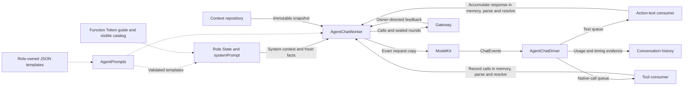

# Shared Chat Decision Worker

✅ 仅报告前台回复活动的 Worker 在 collect 前提交请求等待，首个非空文本／原生工具或终态清除；请求 ID 围栏与现有轮次授权共同拒绝迟到清理。不将装饰呈现计为模型有效回复，不改变模型、音频和分段策略。

## 职责与边界

把注入的 ChatCapability 适配为有界决策、执行反馈和观察续轮。Assistant 使用动态 Skill；确定性角色使用固定任务协调器，不拥有普通 Chat worker。角色拥有身份、预处理、业务状态和请求选择；本目录拥有请求组装、协议消费、屏障、取消与历史投影。Gateway 执行调用，ModelKit 管 provider 传输。

## 直接关系与数据流

| 文件 | 职责 |
| --- | --- |
| AgentChatWorker.swift | 接纳、文本/native 调用、Task/Skill 控制、结果屏障、取消及终态 |
| AgentChatDriver.swift | provider session、独立 text/native 消费、时序与完成清理 |
| AgentChatContext.swift | 角色状态钩子、被动观察及历史仓库适配 |
| AgentChatContextBuilder.swift | 有界历史投影、native 配对与紧凑模型观察 |
| AgentCommunicationAdapter.swift | 定向 send 的元数据与业务消息校验 |
| AgentPrompts.swift | Bundle 模板、缓存与必需键校验 |

每次请求独立构造解析状态；文本和 native 消费者在 driver 的同一 task group 中独立运行。共享实现不共享角色仓库、权限或可写历史。

## 请求、提示词与快照

Worker 在选择 provider 前登记原始 Decision，内部 ReACT 复用该输入/使用集合。每次从角色仓库选择快照，按加载 Skill 组合不可变目录与 system；加载/释放仅影响下一请求。具体 system 章节由 [Assistant](../../Assistant/README.md#system-提示词结构与来源) 拥有，公共层不解释相机业务事实。

AgentPrompts 通过显式资源 Catalog 读取模板，要求 executionObservations/historicalExecution/toolFailure。标题模板由 Memory 独立读取。渲染规则见 [Generation](../Core/Generation/README.md#prompt-resources-and-rendering)：单次替换、精确变量、缺失/超限明确失败，无资源热更新。

每次实际模型请求按已加载 Skill 的 useState 读取同一公开快照；首条 system 保留稳定指令/目录，独立 system 消息承载唯一 CURRENT STATE，放在历史后、最新 user 输入/观察前；末尾为 native Tool 结果时追加在完整结果组之后。旧 State 不带入续轮，不通过 user 消息注入私有 Task/Skill 管理状态。Native Tool 定义位于 ChatRequest.tools。缓存命中由 provider 决定，本层不假定服务端边界或价格。

## Task/Skill 控制与执行边界

BasicSkill 的五个控制是 Control Channel Actions。startTask/loadSkills/releaseSkills 提交事务值后经结果屏障重建目录；finish/cancel 先标记 finishing/cancelling，加入回复/清理后才进入终态。finishTask 通常结束决策，continueDecision=true 仅继续同一输入剩余新目标；cancelTask 结束决策。开始、等待和收尾中的 Task 均不能被覆盖。

Action/native Tool 仅在合法解析且输出已接纳后记录 Skill 使用；执行失败算使用，解析/参数拒绝不算。Task 屏障与完整用户 Decision 结算分离，系统观察不扣闲置次数。取消清理在途集合；无关输入失败不得终止其他 Task，迟到 ASR 不改投新目标。状态算法由 [Context](../Context/README.md) 拥有。

可信固定 Task 控制只在 worker/队列/接纳均空闲时执行，验证 root session 与来源；模型控制验证当前 input/session/round。固定控制不启动模型。未运行时的输入返回 notRunning，业务/执行/提交失败按原链路显式报告。

## 结果驱动与观察格式

一轮封闭并加入所有 Action/Tool 结果后，显式 value（包括空值）或真实调用失败允许继续；成功报告/活动句柄/投递接纳是完成证据。纯取消结束，不制造恢复请求。Provider、流、XML、观察构建或 Agent 自身异常封闭并清理已接纳工作后结束决策，不自动重试；未知 alias/参数拒绝是未执行调用结果，模型可检查当前目录选择合法步骤，不能重放其他效果。

Action 正文含原轮次 call 序号、当前 action 别名、真实 status 与结构化 value，不含内部 callID 或二次 JSON 字符串。拒绝带 executed=false；失败保留 effect、错误及全部 report 叶子，省略缺失/空的报告字段。业务 null、纯文本/scalar、空值和业务引用保持原值；同名调用分别编号。Native 成功正文保持业务值，失败/报告采用紧凑结构，provider tool_call_id 保留。内部 journal 仍保存完整关联、协议、结果与执行证据；投影不决定是否续轮。

## 多轮历史与持久化

历史按单调 historyOrder 排序，完整 native 配对一起保留；failed/interrupted/unresolved 请求只作为文本历史证据。终态 Task 在首个来源位置替换为摘要，运行 Task/普通背景仍在窗口内，原记录可查询。选取最近十个投影块，再应用消息/字节/图片限制。

Task 创建先验证候选、提交业务身份，再绑定运行时上下文，绑定失败显式关闭该身份。完整模型消息、观察和终态按各自边界 checkpoint；delta 和队列在内存。持久化失败阻止依赖后续步骤，不把本地投影当作已落盘。真实数据库访问通过注入 Chat/Task 仓库，重启不重放效果。

## Bounds and overflow

| Owned state or queue | Bound and full-capacity behavior |
| --- | --- |
| Worker admission / output | Defaults: 32 queued inputs plus one reserved continuation; 256 output envelopes. Excess admission rejects; failed output yield marks the worker failed, clears its inbox, cancels inference and closes output. |
| Driver text queue | 8192 fragments; cumulative text also limited to 8192 fragments and 65536 UTF-8 bytes per request. Failed yield terminates the round. |
| Driver native queue | 128 complete calls; failed yield terminates the round. Each generation permits 120 calls; the cumulative decision has no native-call cap. |
| Decision lifetime | Completion/cancellation/error-owned, no cumulative requests/native calls/time limit. Generated calls (120) and feedback bytes (64 KiB) reset each round. |
| Queue lifetime | Owner cancellation/terminal state; no elapsed-time expiry |
| Task views / prompt reports | 256 identities, at most 32 live; only terminal views may be retired. Data messages include only same-session active background tasks or the current directed task (maximum 17); legacy terminal views remain history only. |

The driver's secondary queues use synchronous checked yields. They do not suspend the provider producer; ModelKit adapters define the upstream ChatEvent queue policy. Cancellation or failure cancels the provider session, finishes both queues and joins all consumers. Only normal provider completion flushes the Action parser; partial failed/cancelled syntax is not finished or replayed.

## 生命周期、时序与错误

worker 独立于 UI 页面；结果必须匹配 call/round/task/session/incarnation 与封闭屏障。Pause/stop 取消并加入拥有的工作，输出传输失败也必须清理。Reply occupancy 是有界完整 revision 快照，证据提交先于占用移交；终态事实释放占用，不使用租约定时器，也不授予麦克风权。

✅ ChatTiming 由支持的 provider 在请求发出及首个非空文本或已校验身份的原生工具参数增量时取单调样本；取先到者，排除私有推理和工具执行时间。不支持计时或没有有效增量时不产生 TTFT；driver 沿用同一快照持久化链路。消费、ASR、TTS 与 UI 耗时不是模型首 token 时延。网络传输自身超时和实时感知 freshness 不作为整个决策时限。

错误保留原生产者语义：provider HTTP/transport/response 错误、GenerationError、CapabilityError 与提交错误分别传播；不伪造空值成功或不确定副作用的重试。执行者超时通过真实 ActionResult 返回。

## Continuation outcome matrix

| Actual condition | ReACT / recovery behavior |
| --- | --- |
| Successful `.value`, including `""` | Business output; continue after the full barrier. Empty string is an explicit value, not absence of a value. |
| Successful `.report`, empty or nonempty | Execution evidence only; keep all steps/details/history and join the barrier, without requesting ReACT. A report is not a business value. |
| Successful `.activityStarted` / `.activityStopped` | Lifecycle acknowledgment only; the identity does not independently request ReACT. Business data must be returned explicitly as `.value`. Later activity events have no generic automatic continuation integration. |
| Legacy native ToolResult with `value` and no `completion` | Preserve value semantics and continue, including an empty value. Legacy ActionResult without completion is normalized to `.completed`. |
| Failed/partially failed Action invocation | Preserve actual failures/effects and continue while the input owner remains live. |
| Cancelled Action/Tool invocation | Preserve cancelled evidence; no incident or ReACT. Independent real failures in a mixed report remain failures. |
| Tool `isError`, nonnil non-cancellation `failureCode`, failed report | Real failure takes precedence over absence of business output; continue. |
| Unknown Action/Tool alias or invalid parameters | Parser-local rejection becomes a correlated error result (`invalidInvocation` or `communicationRejected`), without executing the call. Forbidden Channel/malformed markup ends the generation as a real Agent failure. |
| Handler exception, Action timeout, resource/permission/admission rejection with reliable terminal feedback | Continue from the real failure. A closed scheduling tree alone does not authorize continuation: call results and the round receipt must remain reliable. |
| Failed model communication | Continue from the error. Successful send/publish admission is a `.completed` acknowledgment. Background progress/results update state without independently invoking Chat. |
| Chat request/stream/consumer failure within `collect` | Record the failed attempt, join admitted effects and terminate the decision. Includes HTTP/network/provider errors, output parsing, unsupported output and per-request limits. No automatic Agent retry. |
| Observation/image enrichment construction failure | Terminate the decision with the real error and retained execution evidence; never fabricate an image or repeat capture. |
| Round closure failure with a prior generation error and every call result already present | Retain both causes and terminate the input; round closure/delivery uncertainty never authorizes a retry. |

一轮中有一项符合条件即可续推，但所有已接纳调用及可靠结果必须先 join。模型 stop/toolCalls/lengthLimit 只记录生成结束，不独立触发 ReACT；不完整标记导致生成失败。活跃 Task、被动相机/环境事实和等待用户不能创建轮询循环。新用户输入才创建新 Decision；原输入内续轮保留 provider、输入/会话身份并重新选择完整上下文。

## Reply text segmentation

AgentChatWorker 默认 TextSegmentationPolicy 为首段 Han/其他字符 20/60，后续 60/120，保留安全单词/句子边界；Channel/wait/XML 边界触发 flush，没有计时 flush。SentenceFunctionBuffer 的首段状态跨这些边界保留，细节见 [Generation](../Core/Generation/README.md#streaming-tts-latency)。段落形成后才提交对应 caption/synthesis/playback 输出。

## Request projection and feedback bounds

| Owned boundary | Current contract |
| --- | --- |
| Context selection | 先选最近十个完整投影块，再按消息、文本/native 字节与图片预算裁剪；保留 system、当前输入和最新完整调用/结果组。 |
| Round calls | 120，含文本映射、拒绝及内部 reply-start；每轮重新计数。 |
| Round feedback | 按 observationText 计算的结果正文总计 65,536 UTF-8 字节；超限显式失败，不重放效果。 |
| Request validity | 保持完整唯一 native call/result 配对；不可表示的当前 payload 明确失败。原始历史不因投影裁剪丢失。 |
| Decision usage | 同一用户 Decision 内计数累计供证据使用，生产不传 maximumRequests/maximumNativeCalls 上限；新用户输入拥有独立预算。 |

请求值本身的消息/图片/定义/配对限制由 [ChatRequest](../../../ModelKit/Language/LLM/README.md#request-validation-bounds) 拥有；解析器和 provider 队列分别见所属目录。

## 待实现

- 暂停/中断的 Task 状态投影与 per-input 提交仍无统一最终 flush；现有提交边界分别保留错误，不伪造统一 checkpoint。
- 活跃 worker 的持久化恢复、跨进程传输与真实模型/原生交互验收。

[Support](../README.md) · [Context](../Context/README.md) · [Generation](../Core/Generation/README.md) · [Capability](../Core/Capability/README.md)

## Storage 依赖

✅ 存储访问使用独立的 State、Cache、Database 和 Files 接口；App 注册根实例，消费者通过构造器获得所需能力。存储容器不接管本目录的业务验证、执行和完成语义。

## 公开 State 边界

✅ AgentStateContext 拥有按 Agent/会话隔离的 task 注册代际和只读快照能力。每轮 executeRound 固定 Skill/目录/useState 集合，文本 Action 与 native Tool 解析共用该次冻结目录，读取最新公开快照并重建唯一 CURRENT STATE 系统数据块；预算包含该块，历史保存实际请求。中断加入后保留会话；显式 cancelSession 才关闭会话，stop 关闭全部注册。observe 不触发模型。标题请求不经过此 Skill 链路。

[公开 State 契约](../../../Storage/State/README.md)

Task 关闭后的历史重建复用真实 Action executionObservations，不再额外生成 mode/activeTaskID/skills 等 Task 转换状态摘要；当前任务事实只从 CURRENT STATE 读取。

✅ pause 与可信 interruptSession 复用当前取消/join 屏障，但保留 Task/Skill 和 AgentStateContext 作用域；被中断 Decision 不结算闲置次数，运行目标回到 waitingUser。cancelSession 才关闭公开端口并释放会话 Skill。处理中的显式 finish/cancel 仍按真实屏障结算终态。

✅ State 单独系统消息按每请求刷新，放在最新 user 消息之前或完整 native 结果组之后；历史选择保留 system 与配对，预算包含 State。缓存用量透传到真实请求证据。

## 分类异常诊断

✅ 模型失败使用类型化诊断生成 AgentFailureDiagnostic；分类代码、可读细节随现有 agent.error 输出。清理附带错误继续保留，原始模型失败不被降为普通运行错误；取消继续使用 agent.cancelled，不产生错误 toast。

## 统一容器异常通道

✅ AgentChatWorker 在普通决策前接收已授权的 container.failure，维护最多128条被动诊断，按事件 ID 更新次数，超限计数淘汰。仅内存，不写可能故障的 Storage、不启动模型/Task/自动重试；拒绝错误来源、伪造授权和失效会话。

✅ 取消已封闭的 round 不再注册清理 Action；退出由既有回复占用清空／UI 生命周期完成，请求身份在 Worker 内同步释放。
