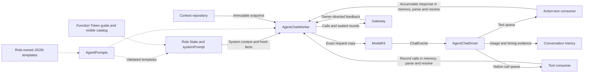

# Shared Chat Decision Worker

## Summary

Adapts an injected ChatCapability into bounded role-specific model decisions and observation continuations. Assistant specializes this worker with dynamic Skills; deterministic roles use AgentFixedTaskCoordinator and have no conversational worker.

## Ownership and boundaries

Roles own identity, preprocessing, schemas, system/style templates, grants, context selection and completion policy. This directory owns request construction, model-event consumption, output interpretation and round coordination. Gateway executes resolved output; ModelKit owns provider transport.

## External relationships and data flow

Runtime flow; dashed arrows supply immutable resources or configuration.

The two consumers run independently within the driver's task group. Each request creates its own AgentGenerator and ToolCallParser use; parser implementations are shared, while parser state, history and permissions remain local to the executing worker.

## Components and requests

| Source | Responsibility |
| --- | --- |
| AgentChatWorker.swift | Admission, text/native interpretation, task routing, feedback/barriers, continuation, occupancy and cancellation |
| AgentChatDriver.swift | Provider session ownership, event demultiplexing, timing/evidence callbacks and joined consumer cleanup |
| AgentChatContext.swift | Role State hooks, selected request values and private history adaptation |
| AgentChatContextBuilder.swift | Completed request-block projection and provider call/result pairing |
| AgentCommunicationAdapter.swift | Visible send Action metadata and typed task-message validation |
| AgentPrompts.swift | Bundle discovery, immutable template/error caching and required-key validation |

Each provider invocation selects fresh role-owned `decisionContextMessages` from a repository snapshot, appends them to an immutable request copy and stores that exact request. Initial delegated requests identify the active task, requester and executor. Continuations retain the decision's Chat binding.

History orders request blocks by monotonic historyOrder and replaces indexed terminal Task sources at their first position. It then selects the latest ten projected blocks (ordinary requests or Task summaries). Complete native pairs stay intact; failed/interrupted/unresolved requests use textual historical evidence rather than executable native pairs. Active Task entry/process and ordinary background survive within request capacity. The builder requires explicit role templates and propagates errors.

Unknown/invalid invocations may produce bounded observation continuation. Successful send admission is completion evidence without business output. Persistence failure or uncertain delivery after validation ends the decision without re-delegating. A sealed round joins Action and Tool results before actual business output or failure starts another request.

✅ Implemented camera-call rejection correction: AgentChatWorker returns explicit pre-execution rejection evidence for XML Actions and native Tools, including the rejected alias/reason, the fact that this call did not execute, and guidance to consult the current catalog and Skill-loading procedure. It does not resolve historical aliases, load Skills automatically or replay other calls. The existing immutable request catalog and result barrier remain authoritative.

## Prompt ownership and rendering

`AgentPrompts.load(named:)` reads Assistant templates through the explicit Resources catalog. Specialists have no ordinary conversation templates. Memory title templates are loaded separately. It caches immutable resources and load errors. The Assistant template set must contain `activeTask`, `taskReports`, `taskReport`, `executionObservations`, `historicalExecution`, `toolFailure`; role hooks select any additional templates.

`State.systemPrompt` combines its own system template with the AgentCore Function Token guide and current visible Action catalog. Role assets own identity, expression style and speech/action examples. Worker code renders task summaries, active-task context and execution observations; the context builder renders history projections. Native Tool definitions are separate `ChatRequest.tools` values. Internal grants are never model-callable aliases.

The shared [PromptTemplates renderer](../Core/Generation/README.md#prompt-resources-and-rendering) uses exact named variables and single-pass substitution. Input values are not reparsed or automatically escaped. Missing resources, invalid documents, missing templates/variables and oversized output fail explicitly. Assets have no hot reload or fallback prose.

`AgentCommunicationAdapter.catalog` derives send metadata from allowed task target/contract pairs. Its illustrative example uses an actual permitted pair. `action` validates the exact pair and existing task scope, constructs trusted typed content and never broadcasts task ownership. Explicit native communication Tool registration rejects.

## Bounds and overflow

| Owned state or queue | Bound and full-capacity behavior |
| --- | --- |
| Worker admission / output | Defaults: 32 queued inputs plus one reserved continuation; 256 output envelopes. Excess admission rejects; failed output yield marks the worker failed, clears its inbox, cancels inference and closes output. |
| Driver text queue | 8192 fragments; cumulative text also limited to 8192 fragments and 65536 UTF-8 bytes per request. Failed yield terminates the round. |
| Driver native queue | 128 complete calls; failed yield terminates the round. Each generation permits 120 calls; the cumulative decision has no native-call cap. |
| Decision lifetime | Completion/cancellation/error-owned, no cumulative requests/native calls/time limit. Generated calls (120) and feedback bytes (64 KiB) reset each round. |
| Queue lifetime | Owner cancellation/terminal state; no elapsed-time expiry |
| Task views / prompt reports | 256 identities, at most 32 live; only terminal views may be retired. Data messages include only same-session active background tasks or the current directed task (maximum 17); legacy terminal views remain history only. |

The driver's secondary queues use synchronous checked yields. They do not suspend the provider producer; ModelKit adapters define the upstream ChatEvent queue policy. Cancellation or failure cancels the provider session, finishes both queues and joins all consumers. Only normal provider completion flushes the Action parser; partial failed/cancelled syntax is not finished or replayed.

## Lifecycle and occupancy

One worker owns inference and dispatch independently of UI pages. Round results must match call, round, task and session identities plus sealed barriers. Pause/stop cancel and join owned work, including when cancellation delivery fails. Restart never replays effects.

Reply occupancy is an optional complete revisioned publication of bounded reply inputs/tasks. Evidence commits precede delegation holds; failed commits cannot create orphan holds. Stop clears occupancy after joined cleanup. This worker has no consent/listening grant.

## Provider timing

The driver adds a per-request ChatTiming sampler. Supporting adapters sample monotonic request start and first nonempty text before consumer persistence; the driver persists supplied evidence. Native-only replies and unsupported providers leave TTFT absent. ASR/TTS/UI timing is excluded; historical consumer timestamps remain distinctly labeled.

✅ Shared bounded decisions, independent protocol consumers, role-owned prompt rendering and Action-only communication adaptation are implemented.

## Related design

[Parent design](../README.md) · [Generation](../Core/Generation/README.md) · [Capability](../Core/Capability/README.md) · [Communication schemas](../Communication/README.md) · [Context persistence](../Context/README.md)

## 动态目录和提示词

✅ 请求顺序：Core 协议 → Assistant 身份/交互 → Skill 概述 → 独立 Agent 能力/合法 send → 通用 Task 生命周期规则 → 已加载 Skill 指令 → 有效 Action 目录。原生 Tool declarations 由同一目录生成。运行事实、任务状态、结果和用户内容在数据消息中。执行前读取快照，每个 round 冻结目录，Gateway 通过 Agent.effectiveCapabilities(roundID) 二次验证。

AgentTaskSkillState 控制经过真实 Agent.Task Actions 和原子 repository transaction；finish/cancel 先标记 finishing/cancelling，结果屏障后恢复默认。未结束任务保持 waitingUser。Skill/Mode 不取消已接纳 Channel 回复。✅ 已移除照片保存/忽略的 Task/photo owner 额外校验。起音捕获任务，迟到 ASR 对已关闭任务明确拒绝，不能改投；empty phase 清理无文本识别关联。

历史 request 保存 decisionMetadata(taskID/mode/Skill revisions/catalogJSON)，旧版缺失元数据视为预览失败。恢复中断未结束任务和清除过期相机事实；无设备动作重放。

✅ 输入接纳后若跨过模式切换且未绑定新任务，执行前明确拒绝；无关输入失败不能结束别的前台任务。任务收尾始终验证当前输入的任务归属。

✅ 固定 Task 控制复用同一 Action：App 验证 Assistant/root-session；worker 仅在没有当前 worker、队列和接纳操作时接受无 decisionID 的可信控制。模型控制仍要求当前 input/session/round。固定终态在空闲清理条件下提交，不启动模型。

## 泛化 Task 与独立 Skill

✅ Each Agent injects base Skills from its resource. The worker retains temporary Skills through ReACT, transfers same-chain loads to a new Task, and releases scopes after the reply/result barrier. Background reports update evidence without starting Chat or foreground interaction. Request metadata stores exact taskGoal, execution and Skill/catalog snapshots.
✅ 后台补充输入：send 保留 content 摘要，新增 businessContract/payload 可选参数（必须配对）。后台 input 使用已声明类型化业务契约，后台取消继续通过 scoped send；不能因等待状态隐式捕获前台语音。

✅ 2026-10-11 correction: TaskControl functions are finite committed transactions returning a bounded value, not state/completed-only operations. Regression executes each through FunctionExecutor. Task reports move out of system instructions into data messages; include only same-session live declared background tasks or the exact current directed task, not legacy terminal delegation records. Completed local outcomes are selected only for the current input. Persistent/UI task history is retained.

✅ Audit correction: shared Chat worker must not cast AssistantContextState or interpret camera business facts. Role hooks select/apply passive context observations; Assistant owns provenance/sequence validation and camera/task data-message construction through its own Context Builder. Existing lifecycle, persistence and request snapshot semantics remain unchanged.

## Skill 函数目录

✅ Chat worker 用已加载 Skill 生成不可变请求目录；固定 descriptor 不再包含所有业务函数。独立 host 同样按真实业务结果或失败继续，不从 Skill 目录取得反馈策略。

## Action-owned documentation and Skill instruction contract

✅ 通信适配器按真实允许的目标和消息种类生成 send 说明，不注册示例。共享 Chat 驱动仍使用本轮不可变目录；业务工作流教学从 Skill Instructions.md 来。

## Task controls through Action Calls

✅ BasicSkill 的五个 Task/Skill 控制函数使用 Control Channel Action Call；App 通过 ChannelScheduler 返回已提交状态。startTask/loadSkills/releaseSkills 返回的已提交业务状态在结果屏障后重建目录并 ReACT，finishTask/cancelTask 加入回复及清理屏障后恢复默认。新目录仅影响后续请求，不允许加载轮提前调用新函数。可信固定调用复用同一实现。

## Agent → Skill → Function registration

✅ Implemented: Agent.json references baseSkills; Skill.json alone registers model Actions/Tools. BasicSkill owns task orchestration and environment reading; ExpressionInteraction owns expression Actions. Role instructions retain identity/responsibility/style. Business roles reuse existing Skills; internal trusted bindings remain separate. Historical snapshots are preserved.

## Startup publication and foreground task regression

✅ receive 遇到生命周期未就绪的 notRunning 仍返回拒绝，但不产生 agent.error 输出。业务验证、持久化和真实执行失败仍按原链路报告。生命周期检查用于广播启动/停止竞争，不能当成 Agent 崩溃。

## Task/history regression correction

✅ 本次修复：模型继续依据真实业务输出或失败，生产目录仍需包含真实函数；保持结果屏障和请求预算。空闲时开始新对话先通过固定 cancelTask 结束前台任务，忙时返回明确 busy。

✅ 未注册 Action 的拒绝属于真实调用失败，进入有界 ReACT 续轮。未知 alias 无 canonical 路径；已执行结果与此类未执行拒绝分开记录，不放宽函数权限，不自动重放副作用。

## Agent request failure continuation

✅ executeRound 保留失败请求及部分输出，封闭并加入已接纳调用后结束决策；HTTP/provider/流/解析/观察构建异常不进入 continuation。删除 decisionFailure 模板、错误续轮元数据和重复错误重试分支；真实业务调用失败仍按 ToolResult 续推。

✅ 不再有生成计时器或时间预算记账。

异常范围：HTTP 非 2xx 为 OpenAIChatError.httpStatus，网络故障在当前适配器归一为 transport；响应格式/不支持事件/流截断/超大响应分别为 invalidResponse、unsupportedOutput、truncatedStream、responseTooLarge。XML 格式/编码/实体/截断文档使用 GenerationError；未知调用、错误参数或禁止的 channel 也可作为拒绝结果继续。Chat 无完成事件/无可执行回复使用 CapabilityError.unavailable；反馈素材构造异常封装为 invalidRequest("Observation construction: …")。这些发生在 collect 或 observations 恢复边界时可进入下一请求。当前 SSE 错误事件可保留有界合法 providerCode；HTTP 不保留响应体，transport 不保留底层网络原因。

取消、关闭及 Agent 自身异常不重试；不按累计模型轮数或原生调用次数终止正常业务链。生成调用120次和反馈64KiB为单轮容量边界；持久化、结果屏障和准入失败明确结束，不伪造继续。

## Lifecycle-owned conversation and audio (2026-10-12)

✅ 已移除对话生成、ReACT、收件箱排队、结果屏障、ASR 收尾、TTS 合成及回复占用租约的计时终止。Signal 默认无过期时间，框架不再按通信契约附加 TTL。保留显式实时感知数据的新鲜度和网络传输自身超时；它们不作为对话/语音缓存生命周期。Action 自身超时通过原始执行者的 ActionResult 返回。请求/调用数及队列/PCM 容量仍有界，不以计时自动删除已接纳输入。语音句柄无读等待或错误记录 TTL，按播放完成、输入/会话正常结束、异常或显式取消清理；取消加入生成和播放工作。

✅ 最终 ASR 入队拒绝时仍发布本 Agent 的真实空闲/占用事实并关联 root，结束该输入的聆听等待；该事实不作为 publish 传输回执，也不改变发送方投递语义。

## Result-driven ReACT (ADR0214)

✅ ADR0214：RoundCall 不再持有反馈 policy，删除 GenerationPolicies 构造/注入；acceptResult 把真实 ToolResult 交给 Core coordinator，按 requiresReasoning 决定继续及 Action 观察/图片 enrichment。Action 无 completion 的旧终态只作为完成回执；旧 ToolResult 有 value 无 completion 继续按显式值兼容。成功通信回执归为 completed，失败始终可 ReACT；finishTask 完成屏障并恢复默认目录后可继续同一输入的剩余目标，cancelTask 收尾后退出决策链。新 journal 记录由结果推导的 requiresReasoning，旧 feedback JSON 留作历史。

✅ 本次修复：决策失败收尾把真实异常传给任务上下文，和失败状态一并提交；不重放 Action、不添加计时器。

✅ 本次组装核对：运行事实以 user-role 数据放在当前输入/结果之前，末尾保留本轮原始输入或配对 Tool 结果；不让状态数据冒充当前用户请求。

✅ 原生协议约束：如果请求末尾为 Tool 结果，事实插入其完整 assistant-call/tool-result 组之前，不能插入配对消息中间。

✅ 提示词精简已实现：AgentPrompts不再要求system风格模板；通信教学仅渲染真实授权kind。保持配对、历史原文、控制与续轮规则，清理闲置注入路径。

✅ ModelKit requests retain input/request identity and pass the Agent-owned session as opaque InferenceContext.scopeID. Conversation/session validation and policy stay in this calling Agent; no business scope semantics are delegated to ModelKit.

✅ 本次修正：finishTask默认结束决策，显式continueDecision=true才使用已恢复默认的快照继续当前输入中的新目标；cancelTask仍结束该决策链。已有Task包括finishing期间不允许startTask覆盖。

系统级触发矩阵、预算作用域、各层 limit、时间所有权及恢复缺口统一见 [总体设计第三部分](../../../README.md#react-continuation-and-agent-recovery)。预算按 input 的 decision chain 累计，不是整个多轮 Goal Task 的全程次数；ChatRequest 的整体边界独立于结果计数器。

✅ Task 上下文收缩时机已修正：startTask 成功后保留进入前的普通对话、启动轮输出及完整调用/结果，只刷新当前 Skill/函数目录；后续任务输入继续携带普通对话背景和当前任务过程。仅旧 Task 关闭后收缩其原始过程为有界终态摘要；摘要在新 Task 中仍可作为历史背景，不能变成当前产物。完整持久化历史与不可变 taskID 保持不变；照片操作不再通过 Task 归属额外鉴权；同输入换任务先收缩已结束旧任务，再完整保留新任务入口。压缩替换后统一选择最近10个历史块，64消息/64KiB/4图片容量保护独立生效。

✅ 边界收尾补充：旧任务最后一轮也可能混有照片结果或原生调用；旧Task结束时整块移除这些旧执行/图像消息，仅投影最后一条真实Task控制回执。原生调用/结果共同移除；同Task续轮仍完整保留协议配对。

✅ Implemented: cancelSession captures active input/round and queued matching inputs before cancellation, joins the worker, emits a reliable agent.cancelled terminal for those identities, releases reply occupancy, and leaves other-session work admitted. This control uses the existing bounded output stream; output rejection is explicit.

✅ Implemented: one host cancellation control owns the cancel/join barrier; concurrent controls reject invalidTransition. Drain is held until active and queued cancellation terminals are emitted, preventing a retained other-session round from overtaking them.

✅ Implemented: cancellation also fences in-flight matching input admissions across asynchronous context commits. At most capacity pending input identities and their rejected subset are retained until their callers join and committed matching work becomes cancelled; new matching inputs reject while host cancellation owns the barrier. Other-session admissions remain valid.

✅ Implemented: host cancellation cancels the active inference task before asynchronous context cleanup, then joins it. Drain stays closed through all terminals so native completion cannot cause another model request during interruption.

✅ Task关闭续轮修正：finishTask默认在收尾后结束当前决策，不重新提交已处理用户输入。仅显式continueDecision=true允许同一输入中尚未执行的新目标续轮；cancelTask始终结束。该可选参数在Action声明和Task状态中严格验证，默认false。跨边界模型回执使用实际终态/default目录，保留原始执行回执为历史证据。

✅ Removed ordinal<3 and cumulative native<16 guards; generated call/result-byte counters are per round. Driver native queue is 128 (finite generation cap remains 120). Continuations use bounded FIFO context projection of whole complete native blocks, preserving system/original user/latest results. A repeated identical generation error with no successful business output ends with the real error; successful business continuations have no count cap.

✅ Agent generation/provider/parser/observation failures end the decision after joined effects; successful maintenance acknowledgments cannot turn an Agent error into a retry.

✅ 2026-10-13 已实现：仅业务 value 或真实失败进入 Action observation/image enrichment 与续轮。成功报告/活动 ID 继续参与完整屏障和持久化；混合轮由其他值/失败续轮时仍保留全部 native call/result 配对。Agent 异常恢复与 Task 关闭契约不变。

## 历史记录收敛（2026-10-13）

✅ 已实现：AgentChatHistoryContext 只投影 repository 事务；删除历史导入与 historyImported。AgentTaskContextState 只定义任务状态/恢复，AgentChatContextState 另定义聊天历史。请求选择与 ContextBuilder 仅使用真实 modelRequests，不从 turn 汇总合成模型请求。

❌ 历史记录页面板块重新设计及原生 UI/真机验收。

✅ 照片专用校验移除后，validateAction 已无业务实现；删除这一空协议挂钩及每次输出前为它读取 repository 的调用，函数合法性继续由当前请求目录解析与 Gateway 执行。

## Streaming TTS latency

✅ AgentChatWorker.textSegmentation selects 20/60 Characters for the first emitted speech/caption segment and 60/120 thereafter. Synthesis admission still precedes audio-ID playback scheduling without awaiting full PCM.

✅ Host cancellation fences input admissions, joins the worker and matching directed routing/delegated Tasks, cancels active/waiting foreground state, then emits original active/queued cancellation terminals before resuming other work. Pause preserves the captured round identity and publishes agent.cancelled. Agent-internal errors never enter continuation; business result continuation remains independent.

## Task history indexing and in-place compression

✅ Implemented: Replace whole-turn Task filtering and tail Ended tasks injection with chronological per-request replacement. Startup request is assigned to the new Task atomically without changing decisionMetadata. Fresh and boundary-continuation contexts share projection; ordinary/active requests retain native pairs; terminal compressions occupy their first source position. Apply ten-block/64-message/64KiB limits after replacement.

✅ Ordering: each admitted model request receives a monotonic historyOrder from the archive revision. Order the flattened timeline and compression sources by this value, not parent turn order or wall-clock timestamps; a continuation can interleave with later user inputs. History facade refreshes authoritative revisions and rejects stale commits.

## SQLite records and runtime identity

✅ Implemented: technical identities are opaque UUID strings; committed business entities use dialog/message/task/media/device SQLite IDs. Consumers use Storage repositories while preserving ownership, cancellation and independent foundation boundaries. Complete messages, including each ReACT message, persist at termination; delta fragments do not persist. The custom allocator and replaced file/index implementation are removed. See the project SQLite business-record plan.

✅ Implemented performance refinement: checkpoint only dirty input records and changed terminal summaries; persisted current context reloads ten recent projected blocks, not the complete dialog. Full Task source indexes are joined from committed SQL relationships; a bounded context window is not deletion. Detail/UI pages stay separate from authoritative context projection.

✅ Task activation validates the copied transition, commits its SQL running row and then binds context. A failed binding closes the row explicitly. Background rows retain requester/executor/execution/parent facts. Complete model messages checkpoint before continuation; complete observation messages checkpoint on next-request admission. Dirty-input tracking avoids encoding previous inputs, and completed decisions contract the memory window without deleting SQL records.

✅ Storage repository refactor: AgentChatWorker uses injected TaskRepository for committed Task creation/completion; concrete backend access is removed. Preserve activation-after-commit, binding failure cleanup and no action replay.

✅ Implemented: model-request admission obtains an Assistant message ID before generation; observation IDs link ReACT input to the response. State mutations/deltas only change bounded memory. Generation completion, execution evidence and terminal Task handling keep separate checkpoints.

❌ Identified lifecycle gap (2026-10-15): scene background currently invokes pause and voice cancelSession independently. pause terminates even a waiting-user foreground Task and creates terminal compression after the per-input checkpoints, without a unified final Task/checkpoint flush. Goal preservation across scene suspension and complete host-terminal persistence need a separate fix; the SQL-paged UI Task folding correction does not change these semantics.
