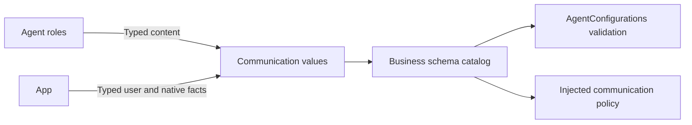

# Application Signal Schemas and Configuration

## Summary

Immutable application Signal values, schema catalogs and bundled role configuration loading.

## Ownership and boundaries

Compiles in Agents with Foundation/AgentCore. Generic identity/admission contracts belong to Core/Communication. Gateway binds trusted provenance; roles process content. This directory owns no queue, model session, retry or effect.

## External relationships and data flow

Runtime arrows show data or capability calls; dashed arrows show injection.

## Schema ownership

| Source | Contract group |
| --- | --- |
| AgentConfigurations.swift | Bounded JSON v6 Bundle.module loading and catalog validation |
| AgentContracts.swift | Built-in identities, typed factories/access and schema assembly |
| AgentTasks.swift | Public task content/views, trusted fixed-task unwrapping and scoped user input |
| ApplicationSignals.swift | App environment/device/navigation, listening consent, reply activity and native termination |
| ModelResourceSignals.swift / ProviderIntents.swift | Resource requests/state/host failures and private provider intent IDs |
| PhotographerCameraIntent.swift | Camera operation/facing/artifact intent and passive camera.state |
| SpeechValues.swift | Speech phases and directed synthesis input |
| PoseObservation.swift / SoundSourceObservation.swift | Validated bounded perception facts |

Assistant delegation guidance belongs to Assistant.prompts.json; shared code retains no role capability-summary prose. Typed task schemas remain here; shared send usage metadata is rendered from the Function Token protocol resource by Support/Chat.

## Validation and causality

Factories preserve session, source, root/parent and turn; payloads cannot supply runtime authority. Unknown types, malformed identities, forbidden fields and oversized encoded values reject. TaskRequest/Input/Progress/Result/Cancel are directed scoped values; TaskInput user text is ≤4096 bytes. Fixed UI confirmation requires trusted provenance.

Sound freshness is 500 ms, pose one second and partial transcript two seconds. Camera/history/provider intents retain declared 512-byte schema limits; application interaction and model-resource intents permit 2048 bytes. Camera-state snapshots permit 2048 bytes. ReplyActivity carries up to 128 input and task IDs each, source-local revision and causal acknowledgment. camera.state carries monotonic sequence/sample time, native permission/busy/lens state, displayed/saved photo IDs and bounded errors; root session stays in the envelope. Passive facts create neither task nor receipt.

Configuration declares model exposure separately from internal functions. Many-to-many Action registration does not alter schemas or share role histories. New task send uses kind=request without taskID; follow-up/cancellation requires existing scoped task identity.

✅ Typed business catalog, strict configuration loading and passive fact schemas are implemented.

## Related design

[Parent design](../README.md)
