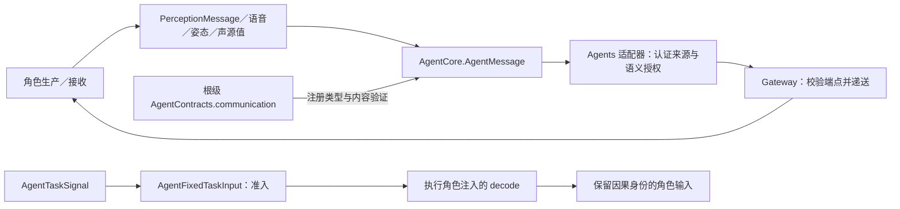

# Communication — 跨角色业务值与任务准入

## 职责与边界

本目录定义跨角色不可变业务值、AgentMessage 的类型化构造／读取与固定任务准入。通用身份、通信权限和任务信封由 [AgentCore/Communication](../Core/Communication/README.md) 定义；实际通信目录由 [AgentContracts](../../AgentContracts.swift) 组装；Agents 适配器拥有角色来源认证和语义权限；Gateway 拥有中立端点信封校验与递送。UI、PCM、CameraFrame、环境事实和容器故障由角色直接消费，不进入生产通信目录。

## 文件与接口

| 文件 | 职责 |
| --- | --- |
| [PerceptionMessage.swift](PerceptionMessage.swift) | 感知业务枚举，AgentMessage 工厂与类型化读取，按消息类型验证内容和字节上限 |
| [SpeechActivityMessage.swift](SpeechActivityMessage.swift) | `perception.speech.activity.v1` 的采集代、起声、语句关联、VAD 进度与能量档位变化。 |
| [SpeechRecognitionMessage.swift](SpeechRecognitionMessage.swift) | `user.input.speech.v1` 的片段和终稿，终稿包含正文、空或失败。 |
| [SpeechKeywordMessage.swift](SpeechKeywordMessage.swift) | `perception.speech.keyword.v1` 的关键词标签、文本、采集时刻与检测元数据。 |
| [PoseObservation.swift](PoseObservation.swift) | COCO-17 姿态、几何／置信度与观测新鲜度 |
| [SoundSourceObservation.swift](SoundSourceObservation.swift) | 声源方向、质量、格式及有效状态 |
| [AgentTasks.swift](AgentTasks.swift) | Task 内容／视图、用户回复、公开委派许可、固定任务准入和通信函数声明 |
| [AgentImplementations.swift](AgentImplementations.swift) | 通用的请求／事件实现注册包装，按角色类型擦除处理器；具体角色注册表与启动校验留在根级 AgentContracts |

## 消息内容与约束

PerceptionMessage 包含 user.input.speech.v1（partial）、user.input.speech.v1（final）、perception.audio.source.v1 和 perception.vision.pose.v1。语音片段与最终文本共用 user.input.speech 频道，订阅按契约、主题和来源匹配。AgentMessage 持有类型化内容及验证闭包。编码上限通常为 16 KiB，姿态为 256 KiB；最终文本非空且最多 4096 UTF-8 字节，片段最多 16300 字节。

三类语音事实由 SpeechPerception 单向发布到各自频道。Assistant 订阅 VAD、ASR 终稿和关键词命中。采集代、语句和进程单调时钟用于相关性校验。起声和 ASR 终稿携带起声前 64 窗的最早采集时刻，供 Assistant 确定第 64 窗的接纳边界。参见 [Assistant 输入](../../Assistant/Input/README.md#speech-activity-and-listening-signals)。

`energyChanged` 携带 `low`、`medium` 或 `high`、已确认语句 ID 和采集代。档位变化与起声、采集终态和 VAD 进度在同一个频道发布，各自可以独立消费。VAD 进度携带采集时刻证明，窗口计数可用于观测。发送端按注册频道分配独立 FIFO，频道内按业务生成顺序串行提交。语音活动、ASR、关键词和声音定位频道独立并行。Gateway 按各频道管理投递，订阅端以采集代和语句身份处理收到的独立事实。

关键词观察保留 PCM 末端时刻，另携带可选的检测完成时刻、模型身份和非负的累计推理耗时。名称和模型 ID 各限制在 128 UTF-8 字节内，整个观察最多 1,024 字节。旧消息可省略检测元数据。

AgentTaskContent 保存最多 4096 字节的业务文本与 running／waitingUser／completed 阶段；waitingUser 要求 interactionID。AgentTaskInputIntent 显式指向既有 taskID 与 interactionID，标识各最多 128 字节；运行时所有权由可信上下文提供。固定任务用 AgentTaskSignal.request 传输业务载荷。后台 Writer 通过 AgentTaskRequest 接收文本，任务级进度与终态继续使用执行范围。

## 固定任务准入

AgentFixedTaskInput.unwrap 只接受 request／input，核对已认证来源为 scope.requester、executor 为接收角色、输入 taskScope 与信封一致，并要求 agent 来源、scope.requester source 和非空 incarnation。实际实例身份已由 Gateway 认证；此处不凭载荷创建或授予身份。

准入检查成功后才调用执行角色提供的 decode，再验证返回消息的内容和大小。生成的角色输入使用原 rootID 作为处理身份，保留 session、source、incarnation、capturedAt、sequence、root／parent、hops、deadline、turn 与 taskScope。具体契约选择、私有取消／retire 的来源限制由所属角色负责，公共机制不建立角色载荷分派表。

本目录的值不拥有消费任务、队列或原生资源。消息投递接纳与 Task 终态分别建模；注册、输出消费和停止加入由各角色 ExecutionSession 拥有。当前边界不包含远程传输或持久化投递；Agent 之间的发布只发送一次，不补发、不重试、无回退。Writer在域内持有有界投递worker，终态只保存在 WriterExecutionRepository；AgentMessageRepository 只保存供追踪的通信记录，业务处理不读取它来决定是否处理。

## Native inputs and internal messages

Native CameraFrame/PCM and typed UI/container observations reach their owning roles directly. This directory owns derived semantic messages and role-originated coordination, not a universal external-media Signal format. Perception and cognition use the same Agent communication boundary; neither denotes a new module or container. Execution requests are separate from role messages and share Gateway only for their respective transport/scheduling facilities. The cross-module view is maintained in the [overall input and Signal design](../../../README.md#native-input-and-internal-signals).

Assistant 通过 `task.send(agent_id,text)` 发送 `agent.task.v1`，载荷为 AgentTaskRequest。新目标、补充、答复和停止请求共用该正文契约。Writer 校验已持久化的消息后接收入队；决定开启新任务时，以原消息 ID 作为委托 ID 申请执行授权。Writer 统一发送 `agent.task.events.v1`，包含接纳、进度、追问、答复接纳、消息拒绝及任务终态。

AgentTaskEvent 只携带事件身份、顺序、kind、目标、窗口与失败事实；产物引用（如 workspace_N）由 AgentTaskContent.artifactID 携带，执行身份即 scope.id，接收端认证 scope 并校验事件顺序。当前委托的补充和追问答复沿用原 scope；任务终态后再次委托，即使复用同一个工作区，也使用新消息 ID 建立新 scope。历史请求保存稳定身份，实时传输/去重使用执行身份。

AgentTaskEvent.failure 是可选 AgentTaskFailure：分类、错误码、阶段、摘要、诊断字段和关联原因均为业务事实。通信值不依赖 Storage；执行方拥有到持久化 DTO 的转换。失败消息通过认证、去重后更新 Assistant 任务视图；Writer 灵动岛展示任务摘要。

AgentTaskResponse 携带 Writer 的原消息拒绝或已接纳任务的事实。Writer 的进度回报需要活跃执行授权。终态保存后只发布一次，随后回收授权一次。Assistant 核对拒绝或终态的原消息、事件身份和正文。固定任务共用 `agent.task.events.v1`，以 AgentTaskSignal 的 progress/result 区分进度与终态。Agents 的输出适配器验证执行授权，在终态发布前协调 Gateway 完成在途工作；发布不补发，授权回收不以送达为前提。固定任务通过同一 `agent.task.v1` 的 submit/update/answer/status/cancel 操作接收类型化请求。

普通运行步骤及请求编号由 Writer 自有展示和请求历史保留。跨角色消息承载接纳、首次草稿保存、首次恢复或渲染异常、追问和终态。Assistant 先验证并更新关联视图。全双工模式下，符合条件且属于当前来源对话的回报直接进入语义队列，由后续模型请求选择如何汇报；同步模式使用通知播报。

The sender creates a message UUID. The receiver uses it as the execution identity when admitting new work. Replies may carry a captured task and question address. Writer validates the address against its current assignment.

AgentTaskEvent version 1 carries the event identity, sequence, kind, current goal, optional window and failure. Assistant treats every executor listed by `AgentTaskMessaging.isPeer` uniformly: notices, questions and facts are rendered from generic `task*` prompt templates with the peer agent ID, never with executor-specific branches.

## 公开委派适配

AgentTaskMessaging 供角色目录与发送端校验已实现的后台消息路由。目标须启用 agent.task.v1 并具备真实文本适配器；当前文本适配器由 Writer 实现，不以发送者/目标配对授权。Gateway 校验实际身份，Writer 决定业务准入。
