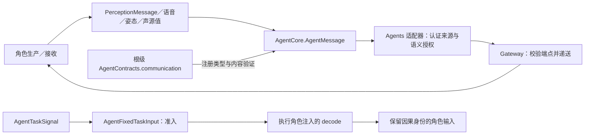

# Communication — 跨角色业务值与任务准入

## 职责与边界

本目录定义跨角色不可变业务值、AgentMessage 的类型化构造／读取与固定任务准入。通用身份、通信权限和任务信封由 [AgentCore/Communication](../Core/Communication/README.md) 定义；实际通信目录由 [AgentContracts](../../AgentContracts.swift) 组装；Agents 适配器拥有角色来源认证和语义权限；Gateway 拥有中立端点信封校验与递送。UI、PCM、CameraFrame、环境事实和容器故障由角色直接消费，不进入生产通信目录。

## 文件与接口

| 文件 | 职责 |
| --- | --- |
| [PerceptionMessage.swift](PerceptionMessage.swift) | 感知业务枚举，AgentMessage 工厂与类型化读取，按消息类型验证内容和字节上限 |
| [PoseObservation.swift](PoseObservation.swift) | COCO-17 姿态、几何／置信度与观测新鲜度 |
| [SoundSourceObservation.swift](SoundSourceObservation.swift) | 声源方向、质量、格式及有效状态 |
| [AgentTasks.swift](AgentTasks.swift) | Task 内容／视图、用户回复、公开委派许可、固定任务准入和通信函数声明 |

## 消息内容与约束

PerceptionMessage 包含 user.input.asr.partial、user.input.asr.final、sound.source 和 vision.pose。语音片段与最终文本共用 user.input 主题，订阅按契约、主题和来源匹配。AgentMessage 持有类型化内容及验证闭包。编码上限通常为 16 KiB，姿态为 256 KiB；最终文本非空且最多 4096 UTF-8 字节，片段最多 16300 字节。

姿态、声源和识别阶段由对应角色拥有。见 [VisionPerception](../../VisionPerception/README.md) 与 [SpeechPerception](../../SpeechPerception/README.md)。

AgentTaskContent 保存最多 4096 字节的业务文本与 running／waitingUser／completed 阶段；waitingUser 要求 interactionID。AgentTaskInputIntent 显式指向既有 taskID 与 interactionID，标识各最多 128 字节；运行时所有权由可信上下文提供。固定任务用 AgentTaskSignal.request 传输业务载荷。后台 Writer 通过 AgentTaskRequest 接收文本，任务级进度与终态继续使用执行范围。

## 固定任务准入

AgentFixedTaskInput.unwrap 只接受 request／input，核对 requester 为 Assistant、executor 为接收角色、输入 taskScope 与信封一致，并要求 agent 来源、Assistant source 和非空 incarnation。实际实例身份已由 Gateway 认证；此处不凭载荷创建或授予身份。

准入检查成功后才调用执行角色提供的 decode，再验证返回消息的内容和大小。生成的角色输入使用原 rootID 作为处理身份，保留 session、source、incarnation、capturedAt、sequence、root／parent、hops、deadline、turn 与 taskScope。具体契约选择、私有取消／retire 的来源限制由所属角色负责，公共机制不建立角色载荷分派表。

本目录的值不拥有消费任务、队列或原生资源。消息投递接纳与 Task 终态分别建模；注册、输出消费和停止加入由各角色 ExecutionSession 拥有。当前边界不包含远程传输或通用持久化投递；Writer在域内持有有界投递worker，并通过 WriterExecutionRepository 原子保存终态与通信 outbox，AgentMessageRepository 提供独立通信读取/投递接口。

## Native inputs and internal messages

Native CameraFrame/PCM and typed UI/container observations reach their owning roles directly. This directory owns derived semantic messages and role-originated coordination, not a universal external-media Signal format. Perception and cognition use the same Agent communication boundary; neither denotes a new module or container. Execution requests are separate from role messages and share Gateway only for their respective transport/scheduling facilities. The cross-module view is maintained in the [overall input and Signal design](../../../README.md#native-input-and-internal-signals).

Assistant 通过 `task.send(agent_id,text)` 发送 `agent.task.request`，载荷为 AgentTaskRequest。新目标、补充、答复和停止请求共用该正文契约。Writer 校验已持久化的消息后接收入队；决定开启新任务时，以原消息 ID 作为委托 ID 申请执行授权。Writer 统一发送 `agent.task.response`，包含接纳、进度、追问、答复接纳、消息拒绝及任务终态。

WriterDelegationEvent 携带可选 workspace_N 和独立 delegateID，接收端认证 scope 并校验事件顺序。当前委托的补充和追问答复沿用原 scope；任务终态后再次委托，即使复用同一个工作区，也使用新消息 ID 建立新 scope。历史请求保存稳定身份，实时传输/去重使用执行身份。

WriterDelegationEvent.failure 是可选 WriterFailureDiagnostic：分类、错误码、阶段、摘要、诊断字段和关联原因均为业务事实。通信值不依赖 Storage；Writer 拥有到持久化 DTO 的转换。失败消息通过认证、去重后更新 Assistant 任务视图；Writer 灵动岛展示任务摘要。

AgentTaskResponse 携带 Writer 的原消息拒绝或已接纳任务的事实。Writer 的进度回报需要活跃执行授权。终态持久投递与授权回收由独立的 worker 处理。Assistant 核对持久拒绝或终态的原消息、事件身份和正文。固定任务共用 `agent.task.response`，以 AgentTaskSignal 的 progress/result 区分进度与终态。Agents 的输出适配器验证执行授权，在终态投递前协调 Gateway 完成在途工作，成功递送后回收授权。固定任务使用独立的 `task.request`、`task.input` 和 `task.cancel` 控制契约。

普通运行步骤及请求编号由 Writer 自有展示和请求历史保留。跨角色消息承载接纳、首次草稿保存、首次恢复或渲染异常、追问和终态。Assistant 先验证并更新关联视图。全双工模式下，符合条件且属于当前来源对话的回报直接进入语义队列，由后续模型请求选择如何汇报；同步模式使用通知播报。

The sender creates a message UUID. The receiver uses it as the execution identity when admitting new work. Replies may carry a captured task and question address. Writer validates the address against its current assignment.

WriterDelegationEvent version 3 carries one optional workspaceID, the current goal and window evidence alongside the delegation and event identity.

## 公开委派适配

AgentTaskMessaging 供角色目录与发送端校验已实现的后台消息路由。当前允许 assistant→writer，须具备 agent.task.request 权限。Gateway 校验实际身份，Writer 决定业务准入。
