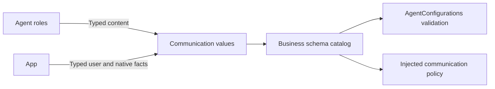

# Application Signal Schemas and Configuration

## Summary

Immutable application Signal values and business message schema catalogs.

## Ownership and boundaries

Compiles in Agents with Foundation/AgentCore. Generic identity/admission contracts belong to Core/Communication. Gateway binds trusted provenance; roles process content. This directory owns only immutable business messages and contract assembly. Resource/catalog loading belongs to parent Support; task state and fixed-task coordination belong to Context. It owns no repository, model session, lifecycle or native effect.

## External relationships and data flow

Runtime arrows show data or capability calls; dashed arrows show injection.

## Schema ownership

| Source | Contract group |
| --- | --- |
| AgentContracts.swift | Built-in identities, typed factories/access and schema assembly |
| AgentTasks.swift | Public task content/views, trusted fixed-task unwrapping and scoped user input |
| ApplicationSignals.swift | App environment/device/navigation, listening consent, reply activity and native termination |
| ModelResourceSignals.swift / ProviderIntents.swift | Resource requests/state/host failures and private provider intent IDs |
| PhotographerCameraIntent.swift | Camera operation/facing/artifact intent and passive camera.state |
| SpeechValues.swift | Speech phases and directed synthesis input |
| PoseObservation.swift / SoundSourceObservation.swift | Validated bounded perception facts |

Assistant delegation guidance belongs to Resources/Agents/Assistant/Prompts.json; shared code retains no role capability-summary prose. Typed task schemas remain here; shared send usage metadata is rendered from the Function Token protocol resource by Support/Chat.

## Validation and causality

Factories preserve session, source, root/parent and turn; payloads cannot supply runtime authority. Unknown types, malformed identities, forbidden fields and oversized encoded values reject. TaskRequest/Input/Progress/Result/Cancel are directed scoped values; TaskInput user text is ≤4096 bytes. Fixed UI confirmation requires trusted provenance.

Sound freshness is 500 ms, pose one second and partial transcript two seconds. Camera/history/provider intents retain declared 512-byte schema limits; application interaction and model-resource intents permit 2048 bytes. Camera-state snapshots permit 2048 bytes. ReplyActivity carries up to 128 input and task IDs each, source-local revision and causal acknowledgment. camera.state carries monotonic sequence/sample time, native permission/busy/lens state, displayed/saved photo IDs and bounded errors; root session stays in the envelope. Passive facts create neither task nor receipt.

Configuration declares model exposure separately from internal functions. Many-to-many Action registration does not alter schemas or share role histories. New task send uses kind=request without taskID; follow-up/cancellation requires existing scoped task identity.

✅ Typed business catalog and passive fact schemas are implemented.

## Related design

[Parent design](../README.md)

## Task message contracts

AgentBackgroundTaskRequest validates bounded target/contract/payload and constructs existing TaskRequest envelopes. AgentTaskView is display/report evidence, not authoritative lifecycle state. Generic AgentTaskRegistry status belongs to Core. State transitions and fixed-task workflow coordination are described in [Context](../Context/README.md); resource validation and Skill composition are described in [Support](../README.md).

AgentTaskSkillIDs decodes the bounded Skill ID array in task/control input. It is content validation only; it does not read Skill assets or call Context. Context reuses this decoder, so message contracts never depend on task lifecycle implementations.

✅ AgentTasks.swift owns the neutral send function declaration alongside task message contracts. BasicSkill selects model exposure; Chat adapter only refines documentation to permitted targets and kinds. No automatic model registration is derived from communication rights.

✅ ActionFunction 基础默认执行超时为 30 秒，dynamicTimeout 优先于静态 timeout；未声明也有默认预算。Speech.Playback 使用显式 300 秒。超时取消并加入清理，保留真实效果，以 ActionResult 返回；工具复用同一函数契约。通信转发不制造 TTL，队列和整个对话不附加默认时限。

✅ Implemented: ListeningIntent accepts optional explicit enabled consent; absence retains the existing toggle contract. Host user-off uses enabled=false and next hold uses enabled=true, preventing stale reply occupancy from changing user consent. The v1 payload remains bounded to 128 bytes and provenance stays user-only.

## SQLite records and runtime identity

✅ Implemented: technical identities are opaque UUID strings; committed business entities use dialog/message/task/media/device SQLite IDs. Consumers use Storage repositories while preserving ownership, cancellation and independent foundation boundaries. Complete messages, including each ReACT message, persist at termination; delta fragments do not persist. The custom allocator and replaced file/index implementation are removed. See the project SQLite business-record plan.
