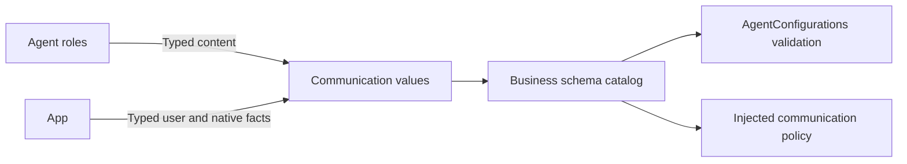

# Application Signal Schemas and Configuration

## Summary

Immutable application Signal values and business message schema catalogs.

## Ownership and boundaries

Compiles in Agents with Foundation/AgentCore. Generic identity/admission contracts belong to Core/Communication. Gateway binds trusted provenance; roles process content. This directory owns only immutable business messages and contract assembly. Resource/catalog loading belongs to parent Support; task state and fixed-task coordination belong to Context. It owns no repository, model session, lifecycle or native effect.

## External relationships and data flow

Runtime arrows show data or capability calls; dashed arrows show injection.

## Schema ownership

| Source | Contract group |
| --- | --- |
| AgentContracts.swift | Built-in identities, typed factories/access and schema assembly |
| AgentTasks.swift | Public task content/views, trusted fixed-task unwrapping and scoped user input |
| ApplicationSignals.swift | App environment/device/navigation, listening consent, reply activity and native termination |
| ModelResourceSignals.swift / ProviderIntents.swift | Resource requests/state/host failures and private provider intent IDs |
| PhotographerCameraIntent.swift | Camera operation/facing/artifact intent and passive camera.state |
| SpeechValues.swift | Speech phases and directed synthesis input |
| PoseObservation.swift / SoundSourceObservation.swift | Validated bounded perception facts |

Assistant delegation guidance belongs to Resources/Agents/Assistant/Prompts.json; shared code retains no role capability-summary prose. Typed task schemas remain here; shared send usage metadata is rendered from the Function Token protocol resource by Support/Chat.

## Validation and causality

Domain drafts describe content and causal identities; Gateway encodes session/source/root/parent/turn and external provenance. Payloads cannot supply runtime authority. Unknown types, malformed identities, forbidden fields and oversized encoded values reject. TaskRequest/Input/Progress/Result/Cancel are directed scoped values; TaskInput user text is ≤4096 bytes. Fixed UI confirmation requires trusted provenance.

Sound freshness is 500 ms, pose one second and partial transcript two seconds. Camera/history/provider intents retain declared 512-byte schema limits; application interaction and model-resource intents permit 2048 bytes. Camera-state snapshots permit 2048 bytes. ReplyActivity carries up to 128 input and task IDs each, source-local revision and causal acknowledgment. camera.state carries monotonic sequence/sample time, native permission/busy/lens state, displayed/saved photo IDs and bounded errors; root session stays in the envelope. Passive facts create neither task nor receipt.

Configuration declares model exposure separately from internal functions. Many-to-many Action registration does not alter schemas or share role histories. New task send uses kind=request without taskID; follow-up/cancellation requires existing scoped task identity.

Typed business catalog and passive fact schemas are implemented.

## Related design

[Parent design](../README.md)

## Task message contracts

AgentBackgroundTaskRequest validates bounded target/contract/payload and constructs existing TaskRequest envelopes. AgentTaskView is display/report evidence, not authoritative lifecycle state. Generic AgentTaskRegistry status belongs to Core. State transitions and fixed-task workflow coordination are described in [Context](../Context/README.md); resource validation and Skill composition are described in [Support](../README.md).

AgentTaskSkillIDs decodes the bounded Skill ID array in task/control input. It is content validation only; it does not read Skill assets or call Context. Context reuses this decoder, so message contracts never depend on task lifecycle implementations.

AgentTasks.swift owns the neutral send function declaration alongside task message contracts. BasicSkill selects model exposure; Chat adapter only refines documentation to permitted targets and kinds. No automatic model registration is derived from communication rights.

ActionFunction 基础默认执行超时为 30 秒，dynamicTimeout 优先于静态 timeout；未声明也有默认预算。Speech.Playback 使用显式 300 秒。超时取消并加入清理，保留真实效果，以 ActionResult 返回；工具复用同一函数契约。通信转发不制造 TTL，队列和整个对话不附加默认时限。

ListeningIntent accepts optional explicit enabled consent; absence retains the existing toggle contract. Host user-off uses enabled=false and next hold uses enabled=true, preventing stale reply occupancy from changing user consent. The v1 payload remains bounded to 128 bytes and provenance stays user-only.

## 待实现

- 暂无本目录独立的实现待办；跨模块及实际模型/设备验收见所属模块说明。

## 历史只读请求接入

✅ UI 的记录分页、消息、归档及授权图片读取也经 MemoryHistoryIntent.query 的实际 Gateway/Memory 接入；不再由 UI 请求适配器直接读仓库。MemoryHistoryReadRequests 为根持有的类型化只读请求暂存，最多四个请求，每个请求一个结果等待者；Signal 只携带随机 ID，结果保留规范仓库返回值。请求/结果有界，120 秒未返回明确超时，取消/停止加入实际读取，迟到结果不更新 UI；不新增模型函数或重放副作用。

## Storage 依赖

✅ 存储访问使用独立的 State、Cache、Database 和 Files 接口；App 注册根实例，消费者通过构造器获得所需能力。存储容器不接管本目录的业务验证、执行和完成语义。

✅ AgentSessionControl 增加仅可信宿主可用的 interruptSession，取消会话在途工作但保留 Task/Skill/公开端口；cancelSession 表示真正关闭。两者不向模型注册，沿用当前身份校验与有界消息。

## Platform 根、设备接入与同帧呈现

✅ 本目录使用 App 注入的原生能力与 Gateway 设备输入接入；设备根由 AppLifecycle 启停，业务规则保持所属模块。当前框架边界及同帧呈现见 所属上级设计与 PlatformKit/Gateway 的模块说明。

## 外部输入草稿

✅ ApplicationSignals、ProviderIntents、PhotographerCameraIntent、ModelResourceSignals、AgentContracts、AgentTasks 的宿主输入实现 ExternalInputProviding，提供草稿，不创建 AgentInput/InputMetadata。Gateway 通用 input 扩展保留调用方式、请求身份及因果；AgentFixedTaskInput 可信解包不作为外部输入重封装。

## ApplicationControl 异常展示

✅ 已实现：ApplicationControlIntentRuntime 根启动时接通角色及输出消费者，允许无请求等待者的 container.failure/runtime.failure 内部呈现；呈现传输失败保留有界详情，不终止无关业务或递归提示。

✅ 已实现：无request waiter的app.environment蓝牙状态呈现与诊断事实一样执行受Gateway约束的内部Tool；执行失败记录lastDiagnosticDeliveryFailure，不递归Toast或停止无关会话。
