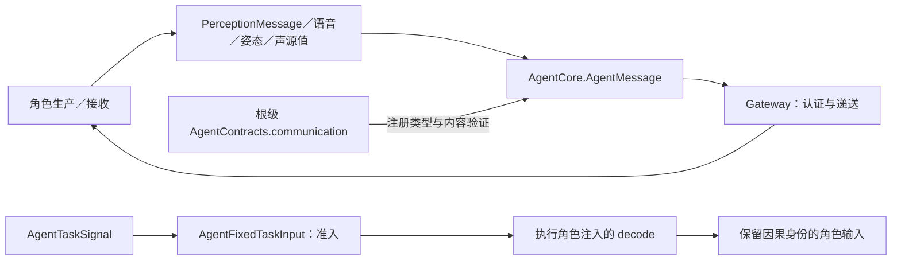

# Communication — 跨角色业务值与任务准入

## 职责与边界

本目录定义跨角色不可变业务值、AgentMessage 的类型化构造／读取与固定任务准入。通用身份、通信权限和任务信封由 [AgentCore/Communication](../Core/Communication/README.md) 定义；实际通信目录由 [AgentContracts](../../AgentContracts.swift) 组装；Agents 适配器拥有角色来源认证和语义权限；Gateway 拥有中立端点信封校验与递送。UI、PCM、CameraFrame、环境事实和容器故障由角色直接消费，不进入生产通信目录。

## 文件与接口

| 文件 | 职责 |
| --- | --- |
| [PerceptionMessage.swift](PerceptionMessage.swift) | 感知／合成业务枚举，AgentMessage 工厂与类型化读取，按消息类型验证内容和字节上限 |
| [SpeechValues.swift](SpeechValues.swift) | 语音阶段、合成请求和完整回复占用快照 |
| [PoseObservation.swift](PoseObservation.swift) | COCO-17 姿态、几何／置信度与观测新鲜度 |
| [SoundSourceObservation.swift](SoundSourceObservation.swift) | 声源方向、质量、格式及有效状态 |
| [AgentTasks.swift](AgentTasks.swift) | Task 内容／视图、用户回复与后台请求值、固定任务准入和通信函数声明 |

## 消息内容与约束

PerceptionMessage 区分 speech.final、speech.partial、speech.phase、sound.source、vision.pose、speech.synthesize 与 speech.cancel。AgentMessage 持有类型化内容及验证闭包；一般编码上限为 16 KiB，姿态为 256 KiB。最终转写非空且最多 4096 UTF-8 字节，预览最多 16300 字节；合成文本非空且最多 2000 字节，locale 为 auto／zh-CN／en-US。

ReplyActivity 是 revision 递增的完整占用快照，input/task 列表各最多 128 项且不能重复；它描述回复工作；认证Assistant可以携带最近一次成功Writer汇报的completedReportID及单调reportStartedAt，SpeechPerception据此解释一次性播毕启听政策，其他来源不能提供这两个字段。姿态和声源的算法及发布节奏由 [VisionPerception](../../VisionPerception/README.md) 与 [SpeechPerception](../../SpeechPerception/README.md) 拥有。

AgentTaskContent 保存最多 4096 字节的业务文本与 running／waitingUser／completed 阶段；waitingUser 要求 interactionID。AgentTaskInputIntent 显式指向既有 taskID 与 interactionID，标识各最多 128 字节；运行时所有权由可信上下文提供。AgentBackgroundTaskRequest 要求 background、目标、业务契约及合法 JSON 载荷，并拒绝向自身委派；目标实际支持范围由注入声明和运行期授权继续校验。

## 固定任务准入

AgentFixedTaskInput.unwrap 只接受 request／input，核对 requester 为 Assistant、executor 为接收角色、输入 taskScope 与信封一致，并要求 agent 来源、Assistant source 和非空 incarnation。实际实例身份已由 Gateway 认证；此处不凭载荷创建或授予身份。

准入检查成功后才调用执行角色提供的 decode，再验证返回消息的内容和大小。生成的角色输入使用原 rootID 作为处理身份，保留 session、source、incarnation、capturedAt、sequence、root／parent、hops、deadline、turn 与 taskScope。具体契约选择、私有取消／retire 的来源限制由所属角色负责，公共机制不建立角色载荷分派表。

本目录的值不拥有消费任务、队列或原生资源。消息投递接纳与 Task 终态分别建模；注册、输出消费和停止加入由各角色 ExecutionSession 拥有。当前边界不包含远程传输或通用持久化投递；Writer在域内持有有界投递worker，并通过既有 TaskRepository 保存终态待送达事实。

## Native inputs and internal messages

Native CameraFrame/PCM and typed UI/container observations reach their owning roles directly. This directory owns derived semantic messages and role-originated coordination, not a universal external-media Signal format. Perception and cognition use the same Agent communication boundary; neither denotes a new module or container. Execution requests are separate from role messages and share Gateway only for their respective transport/scheduling facilities. The cross-module view is maintained in the [overall input and Signal design](../../../README.md#native-input-and-internal-signals).

writer.author 是 Writer 的生产后台任务契约。Assistant 通过默认 startTask(execution=background,executor=writer) 附加当前用户输入和单行目标，Writer 接纳后立即释放调用方；progress 回报运行阶段，result 退休执行权限。追加输入在文件检查点消费，显式 cancel 加入取消清理。

WriterTaskEvent 的可选 taskID 是长期作品任务，delegateID 必须匹配可信 scope.id；新版本回报携带两者，接收端同时校验业务绑定。每次续作创建新 scope，不重新打开已终止的通信任务。历史请求保存稳定身份，实时传输/去重使用执行身份。

WriterTaskEvent.failure 是可选 WriterFailureDiagnostic：分类、错误码、阶段、摘要、诊断字段和关联原因均为业务事实。通信值不依赖 Storage；Writer 拥有到持久化 DTO 的转换。失败消息沿既有认证、去重和 FIFO 进入 Assistant，诊断不能授权重委托或改变调度。

WriterTaskCompletion（writer.completion）封装已结束的 Writer AgentTaskSignal，限定后台 assistant→writer 身份及业务事件/终态配对。通过无 taskScope 的普通角色通信递送，只携带事实，不恢复旧执行授权。Assistant 额外核对共享 SQLite 中不可变通知与任务归属；控制退休和用户汇报独立接纳。该契约不引入 Gateway 调度机制或通用持久消息设施。

WriterTaskEvent.request optionally carries WriterRequestProgress(inputID, number, phase, attempt, path). Number counts actual model attempts across the stable task; task/delegation identity is still verified through the trusted envelope and binding. Request progress is a task fact, not model reasoning. Assistant stores incoming facts, coalesces ordinary progress into one latest pending reply and retains formal FIFO for user-input requests and terminal events. Delivery acceptance does not gate Writer execution.

WriterRequestProgress用于关联实际请求及其累计计数。请求开始只在Writer内部呈现；Assistant普通progress的request字段关联刚完成步骤中的最新请求，可包含内容子请求。步骤汇报在该轮工具效果/持久结果与预览屏障之后发出，不表示下一请求已完成。

Assistant creates the delegation UUID; Writer allocates its own Agent-local task on acceptance. AgentTaskScope.id is the delegation identity for background requests; event taskID is the stable Agent-local workspace task. Writer events retain internal event/interaction/delegate IDs for verification, while model input projects only Agent/task/goal/phase/window metadata. Public sendMessage/cancelTask uses executor + taskID; runtime injects current delegation and pending interaction after ownership and captured-question checks.

WriterTaskEvent version 2 carries the stable task key, current goal and optional derived workspace/window metadata, alongside internal UUID delegation/event/question evidence. artifactID for Writer is a reference to the same derived workspace, not an independently allocated project identity.
