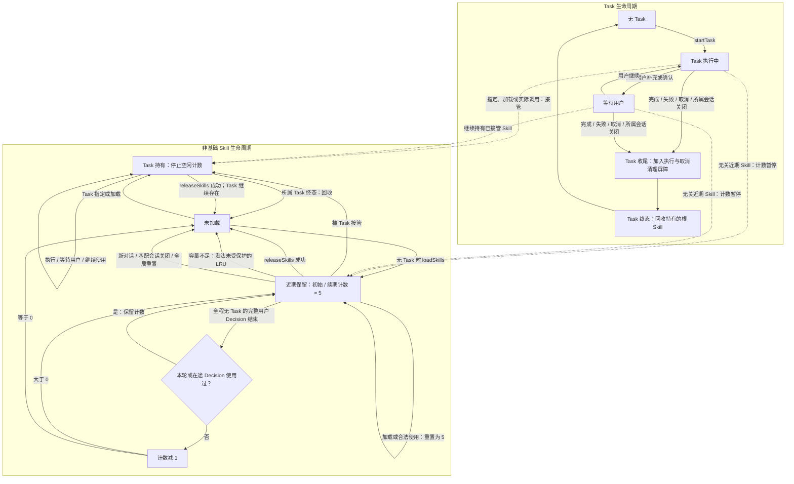

# Agent Runtime Context and Task State

热状态采用 v4 schema，分别保存 Task 根 Skill、会话根 Skill 的 remainingDecisions/最近使用顺序/最后使用会话和最多 32 个在途 Decision 使用集合。基础常驻；Task 持有项在终态回收，不转近期；无 Task 合法调用/显式加载续期为 5，整条用户 Decision 未使用扣 1，到零回收。Task 期间暂停未持有会话项倒计数。展开后非基础总数上限为 3，正文/增量函数目录上限为 24 KiB；超限淘汰非保护 LRU，在途 Decision 已使用项受保护。回收事件记录 idle/capacity/taskEnded/explicit/conversationClosed/sessionClosed 原因。定义缓存与模型激活独立，共享依赖按引用保留，加载验证和回收原子提交。新对话和重启清理全部会话保留；定向关闭只清理该会话近期项。Task 收尾与用户 Decision 结算分离，避免重复扣数。

## Responsibility and direct relationships

AgentContextRepository compiles in Agents and registers AgentCore state through an explicitly injected StorageState StateScope. AgentTaskSkillState owns Skill/task transitions; AgentFixedTaskCoordinator joins fixed-task results. Roles own schemas, admission, classification and retention. SQLite writes belong to injected Chat/Task repositories, not this directory.

## Runtime state ownership

Every production role has one root-owned repository backed by a single registered StateWriter snapshot. The store uses a Mutex and no Codable encoding, file, database or hidden flush. Returned values are snapshots; stable business IDs express references across owners. Actor transactions serialize at most16 FIFO waiters; overflow rejects. Copy, mutate, advance revision and validate before CAS publication through StateWriter. Task/Skill remain fields of the same authoritative value; there is no writable mirror. No suspended model/device operation holds the slot.

recordSignal encodes bounded neutral evidence into Data retained in memory, not a JSON file. Caller-selected rolling retention is4096 for deterministic role evidence/batches; unconfigured Core limits remain8192 with explicit rejection. Logical evidence Data totals at most32MiB; overflow rejects before publication without encoding the whole snapshot. Media bytes and credentials are excluded. Signal/delta updates never cause whole-context serialization or I/O.

Injected load/commit hooks support atomicity/failure fixtures and preserve the previous value on commit failure; production installs no such hook. Durable restart tests use SQLite; fresh memory runtime repositories do not replay prior work.

## Task and Skill lifecycle

下图描述单前台 Task 与非基础根 Skill 的当前生命周期。实际控制函数别名为 loadSkills / releaseSkills；基础 Skill 常驻，不参与图中的计数与回收。

- 一个完整用户 Decision 可以包含多轮 ReACT，只在 Decision 最终结束时结算一次；包含 Task 的 Decision 不扣近期项计数，即使 Task 在该 Decision 内结束。
- Task 收尾须加入已接纳执行与取消清理屏障，再提交真实终态。等待用户期间保留 Task 及其 Skill；主动 releaseSkills 只释放能力，不结束 Task 或撤销设备效果。
- 图中的回收指移除根引用并重算依赖；其他根仍引用的共享依赖继续保留。显式释放基础项、非根项或仍被其他根依赖的指定 Skill 会拒绝，失败不改变状态。
- Task 持有项和在途 Decision 已使用项受容量淘汰保护；没有可淘汰空间时加载失败。定义缓存及已发出的模型请求、历史目录不因回收改变。
- 新对话要求没有活跃 Task；定向会话关闭只清理匹配会话的近期项，并取消匹配的 Task。全局会话重置和进程重启清空全部会话保留，不重放工作。

A pure Skill transition receives an already committed Task ID. The Chat worker validates a candidate, inserts running in SQLite, binds memory, and explicitly closes a failed binding. Recent Skill counters/Decision-use sets, Task registries/views, queues and awaiting-feedback stages remain memory-only. Finish/cancel/failure waits for actual execution barriers, then persists terminal state/summary and sources through normalized repositories.

Task entry preserves ordinary background context and complete current-task evidence. Only terminal Tasks compress their process at the first source position; sources remain queryable. finishTask ends the decision unless continueDecision=true explicitly authorizes another objective; cancelTask ends it. Camera/media access does not require a Task authorization record.

## Crash, cancellation and failures

Restart discards hot state; App closes unfinished SQL identities as interrupted and never replays actions. Task compression comes from SQL source relationships, not a serialized Skill/registry snapshot. Cancellation cleanup is joined by the owner; failed persistence retains the terminal checkpoint and blocks subsequent model admission. Repository waiters release their granted slot even after cancellation. Snapshot/state/capacity/commit failures propagate without fallback.

Runtime shared state, bounded admission, independent terminal persistence and structured Task/Skill control are implemented.

[Agents](../../README.md) · [Chat](../Chat/README.md) · [Storage](../../../Storage/README.md)

## 待实现

- Durable live-worker resumption, cross-process runtime sharing and Skill-driven context subscriptions are not implemented; generic bounded observation is provided by StorageState.

## Storage 依赖

✅ 存储访问使用独立的 State、Cache、Database 和 Files 接口；App 注册根实例，消费者通过构造器获得所需能力。存储容器不接管本目录的业务验证、执行和完成语义。
