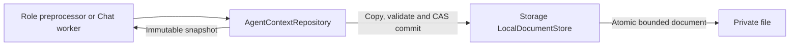

# Atomic Agent Context Persistence

✅ 已实现（2026-10-13）：确定性角色 ApplicationControl、Memory、Photographer 在 recordSignal 调用处选择 4096 条证据/消费批次的滚动保留策略。Repository 沿用调用者指定的 retainingLast 和原子提交；Core 的默认 8192 条拒绝溢出策略保持不变，Assistant 的任务/聊天记录没有隐式淘汰；其内存 Signal 证据和批次独立限于4096条，恢复快照不保存这些证据。

## Summary

Owns structured task/Skill state, fixed-task result coordination and atomic AgentCore-to-Storage context adaptation.

## Ownership and boundaries

AgentContextRepository<State> compiles inside Agents with Foundation/AgentCore/Storage. Roles own state/schema, classification, admission, consumption and retention; the persistence adapter has no model, UI or device policy; task/Skill state transitions are separate cohesive files in this directory.

## External relationships and data flow

Runtime arrows show data or capability calls; dashed arrows show injection.

## Transaction algorithm

One actor serializes snapshots and copy-before-commit updates with at most 16 commit waiters. Overflow throws capacityExceeded. Each mutation advances and validates revision/agent/scope before persistence. The in-memory value changes only after successful commit. A repository created without injected persistence remains in memory; `persistent` supplies the Storage-backed adapter. ContextDocumentAdapter compares logical revision and Storage token; conflict preserves the previous snapshot.

persistent uses a 64 MiB LocalDocumentStore. Initial load validates identity/schema, recovers interrupted state/tasks/work, advances revision and commits recovery before exposing it. No effect is replayed. recordSignal encodes bounded neutral SignalEvidence and atomically updates role-selected evidence, consumption and business state. Media bytes and credentials are excluded.

## Cancellation and ownership

The owner retains repository lifetime independently of pages. Repository waiters are FIFO and are not removed on cancellation. A waiter granted the write slot after cancellation still owns it; repository methods release via defer. The adapter does not add an automatic cancellation check to the mutation; owning workflows enforce cancellation policy. No suspended model/device operation holds the slot. Storage/load/encoding/CAS failure propagates; there is no fabricated snapshot or silent fallback.

✅ Serialized atomic contexts, recovery commits and neutral evidence encoding are implemented.

## Related design

[Parent design](../README.md)

✅ Source organization audit (2026-10-11): Context now also owns structured AgentTaskSkillState and fixed-task coordinator. State validates Skill/task scope and interruption; coordinator joins result association against the repository. These are Agents-layer mechanisms, not Foundation-only Core contracts. State type rename does not change serialized field names.

## Skill 函数目录

✅ AgentTaskSkillState 的 fixed 参数仅用于可信内部绑定，Task 控制来自 BasicSkill，不限制 Skill 函数。Skill 变更仍原子提交、按请求冻结，序列化字段和历史证据保持不变。

## Agent → Skill → Function registration

✅ Implemented: Agent.json references baseSkills; Skill.json alone registers model Actions/Tools. BasicSkill owns task orchestration and environment reading; ExpressionInteraction owns expression Actions. Role instructions retain identity/responsibility/style. Business roles reuse existing Skills; internal trusted bindings remain separate. Historical snapshots are preserved.

✅ 本次修复：前台 TaskRecord 保存有界失败原因及实际状态更新时间；失败收尾原子提交原因，历史恢复不伪造原因。

✅ Task/Skill控制结果改为已提交结构化JSON（operation/status/mode/taskID/skills），移除在下一轮仍表示“下一次请求”的含糊说明。

✅ 回归补充：同Session连续前台Task身份独立；运行/等待/finishing期间startTask失败且状态不变，关闭提交后可再次startTask。状态机本身无需放松单前台约束。

✅ Task 上下文收缩时机已修正：startTask 成功后保留进入前的普通对话、启动轮输出及完整调用/结果，只刷新当前 Skill/函数目录；后续任务输入继续携带普通对话背景和当前任务过程。仅旧 Task 关闭后收缩其原始过程为有界终态摘要；摘要在新 Task 中仍可作为历史背景，不能变成当前产物。完整持久化历史与不可变 taskID 保持不变；照片操作不再通过 Task 归属额外鉴权；同输入换任务先收缩已结束旧任务，再完整保留新任务入口。10 个历史请求块和64消息/64KiB/4图片容量保护仍独立生效。

✅ Task关闭续轮修正：finishTask默认在收尾后结束当前决策，不重新提交已处理用户输入。仅显式continueDecision=true允许同一输入中尚未执行的新目标续轮；cancelTask始终结束。该可选参数在Action声明和Task状态中严格验证，默认false。跨边界模型回执使用实际终态/default目录，保留原始执行回执为历史证据。

✅ Implemented (2026-10-13 caption/error lifecycle): mask bottom ASR and reply/status immediately while a notice is visible, restore retained text after dismissal, and preserve pinned Task/promoted ASR layout. Consent-off clears both captions; root HomeEffectsWorkflow owns one UUID/text-fenced350ms reply fade/removal task, cancelled by new text/turn/off/shutdown, scheduled only after reply-policy/playback/native-resume barriers. Agent errors stay in factual root failure notices, not persistent voiceStatus copies. App root contexts explicitly choose afterFirstUnlock file protection, including their directory; repository persistent factory accepts protection while its SDK default remains whileUnlocked. This mitigates lock-boundary writes, without claiming the screenshot proves that cause or hiding other storage failures.

✅ TaskRecord optionally retains its real sessionID (additive Codable compatibility). Host close cancels matching active/waiting Task and temporary input Skills; legacy Tasks resolve session through recorded input work. roundCompleted accepts cancellation separately from failure and never manufactures a failure reason for cancellation.

## Task history indexing and in-place compression

✅ Implemented: Task terminal transition and indexed history compression commit atomically after execution barriers. Compression retains source request IDs/owning input IDs, goal, actual terminal status, reported summary and failure. Cancel/failure/recovery share this path. No TaskSkill v1 migration remains; invalid or absent compression never suppresses raw evidence.

## 会话存储性能重构 v3

✅ 已实现：会话正文不再通过 Assistant 的通用 context 文件提交。Assistant 内存仓库承担原子版本与任务归属，小恢复快照由会话 checkpoint 捕获。保留其他角色持久化和4096条证据策略，删除重复历史全量序列化。
