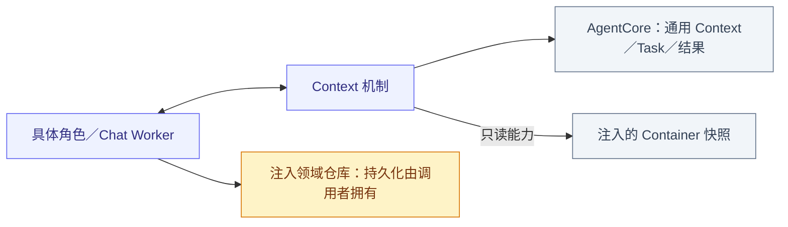
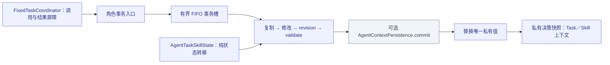
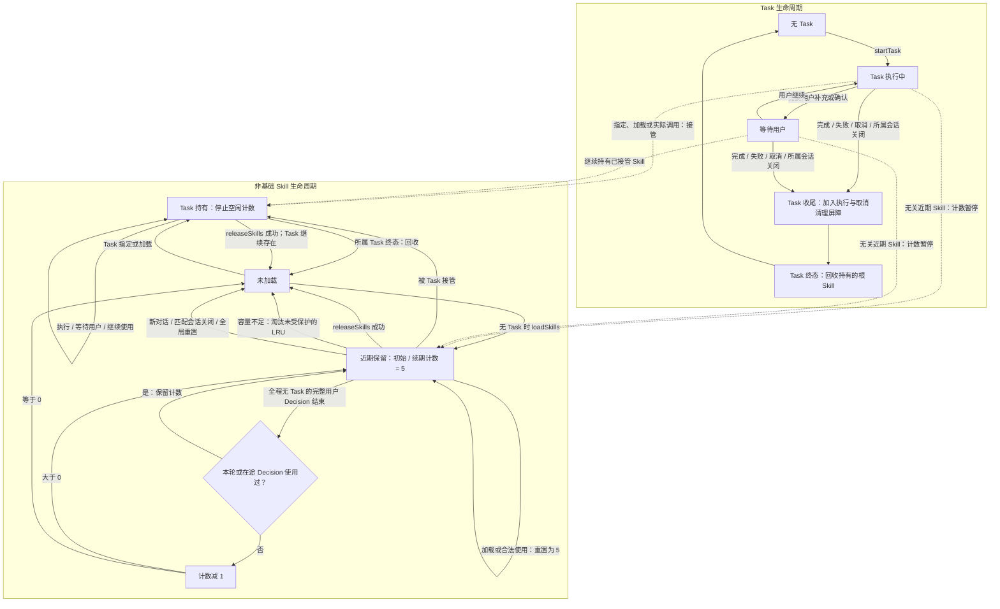

# Context — 私有事务、Task 与 Skill 生命周期

## 职责与关系

AgentContextRepository actor 唯一持有 AgentCore.AgentContext 值，角色决定 schema、校验、保留窗口与业务语义。AgentTaskSkillState 管根 Skill 与任务状态；AgentFixedTaskCoordinator 管确定性 Task 调用及真实结果加入。生产私有 Context 在内存，不编码整份快照或隐式刷盘。

## 文件与职责

| 文件 | 职责 |
| --- | --- |
| [AgentContextRepository.swift](AgentContextRepository.swift) | 唯一私有 Context、FIFO 事务槽、可选提交接口、信号证据与私有快照 |
| [AgentFixedTaskCoordinator.swift](AgentFixedTaskCoordinator.swift) | AgentTaskContextState 校验／恢复、确定性调用关联、固定任务准入及结果加入 |
| [AgentStateContext.swift](AgentStateContext.swift) | 容器只读来源注册、会话代际、按请求采集与关闭 |
| [AgentTaskSkillState.swift](AgentTaskSkillState.swift) | Task 与根 Skill 纯状态转移、Decision 使用集合、依赖／容量和回收 |

## 外部关系（一层）

Storage 箭头属于调用者，ContextRepository 本身无数据库读写；持久化身份须在绑定 Task 内存状态前由所属流程提交。

## 内部结构

## 事务、容量与故障

最多 16 个 FIFO 等待者；模型／设备操作不占事务槽。复制、变更、推进 revision、验证及可选 persistence.commit 成功后替换；提交前失败保留原值。首次读取可选 persistence.load 后，验证身份、恢复中断状态并提交推进后的 revision；生产装配不注入此接口。模型上下文采集独立于私有事务；采集失败不改变已提交的业务状态。

recordSignal 只保存有界中立 Data 证据到内存，非 Signal 传输或文件序列化；确定性角色按 4096 滚动保留证据／批次，Core 默认 8192，逻辑 Data 总界 32 MiB。媒体和凭据排除，活跃工作不能被淘汰。持久化 Chat/Task 事实由领域仓库独立提交；重启丢弃热队列，不重放副作用。

热 Skill 状态 schema v4，记录 Task 根、会话根、remainingDecisions、使用次序／会话与至多 32 个在途 Decision 使用集合。非基础展开总数最多 3，正文／增量目录 24 KiB；容量满仅淘汰未保护 LRU，没有空间则原子失败。基础项常驻，定义缓存与激活状态独立，共享依赖按引用保留。

## Task and Skill lifecycle

下图描述单前台 Task 与非基础根 Skill 的当前生命周期。实际控制函数别名为 loadSkills / releaseSkills；基础 Skill 常驻，不参与图中的计数与回收。

- 一个完整用户 Decision 可以包含多轮 ReACT，只在 Decision 最终结束时结算一次；包含 Task 的 Decision 不扣近期项计数，即使 Task 在该 Decision 内结束。
- Task 收尾须加入已接纳执行与取消清理屏障，再提交真实终态。等待用户期间保留 Task 及其 Skill；主动 releaseSkills 只释放能力，不结束 Task 或撤销设备效果。
- 图中的回收指移除根引用并重算依赖；其他根仍引用的共享依赖继续保留。显式释放基础项、非根项或仍被其他根依赖的指定 Skill 会拒绝，失败不改变状态。
- Task 持有项和在途 Decision 已使用项受容量淘汰保护；没有可淘汰空间时加载失败。定义缓存及已发出的模型请求、历史目录不因回收改变。
- 新对话要求没有活跃 Task；定向会话关闭只清理匹配会话的近期项，并取消匹配的 Task。全局会话重置和进程重启清空全部会话保留，不重放工作。

A pure Skill transition receives an already committed Task ID. The Chat worker validates a candidate, inserts running in SQLite, binds memory, and explicitly closes a failed binding. Recent Skill counters/Decision-use sets, Task registries/views, queues and awaiting-feedback stages remain memory-only. Finish/cancel/failure waits for actual execution barriers, then persists terminal state/summary and sources through normalized repositories.

Task entry preserves ordinary background context and complete current-task evidence. Only terminal Tasks compress their process at the first source position; sources remain queryable. finishTask ends the decision unless continueDecision=true explicitly authorizes another objective; cancelTask ends it. Camera/media access does not require a Task authorization record.

## 中断、完成与限制

中断移除指定 Decision 使用集合而不扣数，保留 Task/Skill 并回到 waitingUser；显式新对话／匹配会话关闭／根关闭按所属清理规则释放。Task 终态必须加入真实执行／取消屏障，持久化失败保留待提交证据并阻止依赖后续模型接纳。取消等待者仍释放已授槽位，错误不降为成功。

AgentStateContext 管理只读来源和会话接纳，不持有Task副本；关闭后旧读取失效。

## Container context read path

AgentStateContext stores named read capabilities and session generations. It owns neither business fact values nor a mirrored Task. AgentContainer.makeStateContext constructs the production registry; App supplies the camera/device access implementations and stable UI owners. A source name is an explicit contract, not reflection over a container tree.

| Source | Concrete read path | Snapshot fields |
| --- | --- | --- |
| `agents.application` | ApplicationControlContainer.contextSnapshot -> ApplicationControlAgent.applicationState | scene/modelPreparation (unknown until admitted), with per-field sequences; no raw strings or last execution result. |
| `actions.camera` | AgentCameraAccess → AppCameraAccess → ActionsBusinessAssembly.cameraContext → CameraCoordinator.contextSnapshot | availability plus enabled, running, selectedFacing, busy, needsSettings, displayedMediaID and savedMediaID. Running comes from the camera capability; business/presentation conditions come from the owning camera workflow. |
| `actions.robot` | AgentDeviceAccess → AppDeviceAccess → ActionsBusinessAssembly.deviceContext → NexArmControlService.contextSnapshot | availability plus connected and controlAvailable, derived from current link/control/foreground/cleanup conditions. |
| `ui.navigation` | MainActor read of injected NavigationState with UIAlbumContainer projection | availability plus path, phase, current location, overlay, content and operation. Presentation admission must be available. |
| `ui.camera` | MainActor read of injected UICameraContainer | availability plus enabled, visible, busy, facing and needsSettings. Presentation availability must pass. |
| `ui.album` | MainActor read of injected UIAlbumContainer, guarded by navigation presentation admission | availability plus content, loadedCount, hasMore and operation. |

The production sources encode ContainerContextValue with `availability` (`unknown`, `available` or `unavailable`) and `value`. An owner may return an unavailable fact or throw a read error; the registry does not fabricate an empty success. Encoded Actions snapshots use ContainerContextSource(encoded:) so JSON objects are not converted into base64 strings. Foundation containers do not import AgentCore; the adapter lives above the owner. Neither Gateway nor Storage participates in collection.

For every skills-enabled model request, AgentSkillLoader.useStates takes the already expanded effective loaded Skill IDs, unions their source names, deduplicates and sorts them. BasicSkill selects ui.navigation plus the eight native platform sources below; Photography adds actions.camera, ui.camera and ui.album; RobotInteraction adds actions.robot. Current ApplicationControl, HistoryQuery and ExpressionInteraction add no source names. Releasing a Skill changes future selection without removing the source registration or stopping its owner.

Collection first captures the session generation and selected callbacks under a synchronous lock, then reads sources sequentially without holding the lock across await. It checks cancellation, source JSON and byte bounds, rechecks session generation, and emits a sorted named JSON object. There is no stored fact cache, subscription fan-out, Signal, Action call or automatic source discovery. An owner determines its snapshot consistency; the collection is not atomic across owners or with the private Agent snapshot.

The registry permits 256 sources and 64 active sessions. One request selects at most 32 unique names; one source is limited to 8 KiB and aggregate facts to 16 KiB. Chat additionally limits the full AGENT CONTEXT plus CURRENT STATE block to 16 KiB. Duplicate/invalid registrations, unknown selected names, encoding, cancellation, stale session and capacity errors propagate. Closing and reopening the same session name creates a new generation and rejects old collection; global close releases sessions and callbacks permanently.

## Native platform sources

App injects PlatformStateReading into AgentContainer; The [Support adapter](../AgentPlatformState.swift) registers eight platform.* capabilities alongside the five existing business/UI sources. PlatformKit returns one bounded JSON object without an Agent schema. The adapter rejects oversized/non-object payloads, then wraps the object as availability=available/value without base64 conversion. Here availability means the fact query succeeded: a denied permission, unknown battery or unobserved network/interruption remains explicit inside the value. Root unavailability and real encoding/read failures propagate.

| Source | Native owner and value |
| --- | --- |
| platform.time | Core: one current Date/time zone, offset-bearing Gregorian localDateTime to seconds, English weekday and timeZone ID. |
| platform.power | Core: batteryLevel or null, batteryState and lowPowerMode. |
| platform.thermal | Core: OS thermal state, including unknown future cases. |
| platform.network | Connectivity: latest path status, interface types, expensive/constrained and last observedAt; unknown until the active monitor reports. |
| platform.permissions | Platform root composes Vision camera/Photos levels, Audio microphone and Connectivity Bluetooth authorization. Querying does not request access. |
| platform.audio | Audio: current application route port types, inputMuted and observed interrupted or null. No activation or capture start. |
| platform.locale | Core: locale identifier, preferredLanguage and region; not geolocation or user instructions. |
| platform.accessibility | Core: VoiceOver, reduceMotion, closedCaptions and monoAudio flags. |

BasicSkill's source declaration makes these facts available to every skills-enabled Basic request, including ReACT. Each request reads again; the registry caches no native values. SDK observers retain bounded latest event facts under Platform lifetime, separate from that registry. No Signal, Gateway/Actions call, periodic model trigger, location/motion capture or magnetic attachment inference is added. The finite source enum and SDK ownership live in [PlatformKit](../../../PlatformKit/README.md#native-state-port).

## Private Task and Skill projection

AgentContextRepository remains the private actor-owned source for the role's AgentContext. Chat takes one committed value for the request's Skill IDs, effective function catalog, teaching and AgentTaskSkillState.contextSnapshot(session:). Business reads happen afterward and do not extend the private transaction lock.

The model projection contains only `task` and `skills`: task is the matching session's active goal/status, or null; skills is the current effective loaded ID list, including base and dependency Skills. Task IDs, task arrays, runtime delegation registries/views, grants, input bindings, root ownership and retention counters are not serialized into that block. The loaded Skill list is the role's effective capability set; it does not promise that every loaded Skill is owned by the current Task.

Private Task/Skill transitions, retained history and actual execution outcomes can change later requests, but collecting context does not perform a transition. Task creation/terminal records are separately committed through the injected Task repository; production does not persist or restore a whole active AgentContext snapshot. Message placement and history/feedback composition belong in [Chat](../Chat/README.md#request-state-assembly), and the cross-module overview belongs in the [overall design](../../../README.md#container-state-read-path).

### Current facts before explicit queries

BasicSkill uses sufficient CURRENT STATE facts directly before function/Skill selection. The role-owned application summary, passive platform.* facts and selected UI/business snapshots are read for each actual request; reading an observed value does not force its native producer to update. Query Actions provide missing/stale details only under their specific contracts. They may share an owner with State without creating duplicate state. No generic environment query is exposed or registered. Queries cannot override unknown/unavailable readiness, initiate undeclared probes or replace actual effect feedback. The context builder does not suppress model calls automatically; normal catalog/authorization validation rejects removed addresses.
