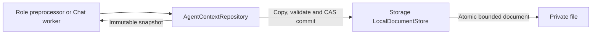

# Atomic Agent Context Persistence

## Summary

Adapts generic AgentCore contexts to atomic Storage documents and records neutral Signal evidence.

## Ownership and boundaries

AgentContextRepository<State> compiles inside Agents with Foundation/AgentCore/Storage. Roles own state/schema, classification, admission, consumption and retention; this adapter has no model, UI or device policy.

## External relationships and data flow

Runtime arrows show data or capability calls; dashed arrows show injection.

## Transaction algorithm

One actor serializes snapshots and copy-before-commit updates with at most 16 commit waiters. Overflow throws capacityExceeded. Each mutation advances and validates revision/agent/scope before persistence. The in-memory value changes only after successful commit. A repository created without injected persistence remains in memory; `persistent` supplies the Storage-backed adapter. ContextDocumentAdapter compares logical revision and Storage token; conflict preserves the previous snapshot.

persistent uses a 64 MiB LocalDocumentStore. Initial load validates identity/schema, recovers interrupted state/tasks/work, advances revision and commits recovery before exposing it. No effect is replayed. recordSignal encodes bounded neutral SignalEvidence and atomically updates role-selected evidence, consumption and business state. Media bytes and credentials are excluded.

## Cancellation and ownership

The owner retains repository lifetime independently of pages. Repository waiters are FIFO and are not removed on cancellation. A waiter granted the write slot after cancellation still owns it; repository methods release via defer. The adapter does not add an automatic cancellation check to the mutation; owning workflows enforce cancellation policy. No suspended model/device operation holds the slot. Storage/load/encoding/CAS failure propagates; there is no fabricated snapshot or silent fallback.

✅ Serialized atomic contexts, recovery commits and neutral evidence encoding are implemented.

## Related design

[Parent design](../README.md)
