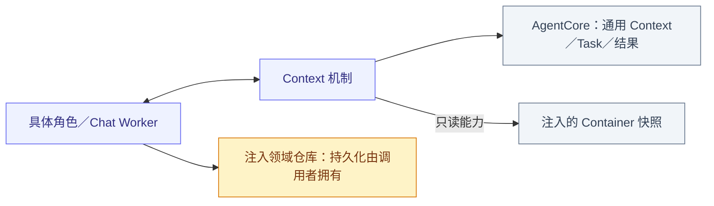
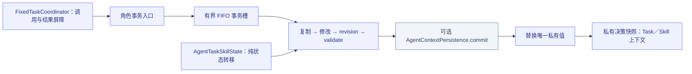
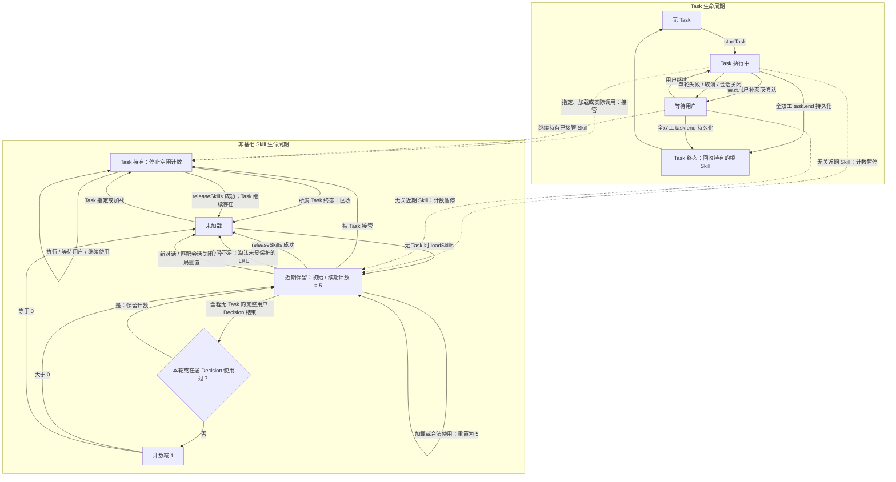

# Context — 私有事务、Task 与 Skill 生命周期

## 职责与关系

AgentContextRepository actor 唯一持有 AgentCore.AgentContext 值，角色决定 schema、校验、保留窗口与业务语义。AgentTaskSkillState 管根 Skill 与任务状态；AgentFixedTaskCoordinator 管确定性 Task 调用及真实结果加入。生产私有 Context 在内存，不编码整份快照或隐式刷盘。

固定任务协调器接纳确定性角色的前台请求及已授权的后续消息。独立后台委派由接收角色的执行入口接纳。

## 文件与职责

| 文件 | 职责 |
| --- | --- |
| [AgentContextRepository.swift](AgentContextRepository.swift) | 唯一私有 Context、FIFO 事务槽、可选提交接口、信号证据与私有快照 |
| [AgentFixedTaskCoordinator.swift](AgentFixedTaskCoordinator.swift) | AgentTaskContextState 校验／恢复、确定性调用关联、固定任务准入及结果加入 |
| [AgentStateContext.swift](AgentStateContext.swift) | 容器只读来源注册、会话代际、按请求采集与关闭 |
| [AgentTaskSkillState.swift](AgentTaskSkillState.swift) | Task 与根 Skill 纯状态转移、Decision 使用集合、依赖／容量和回收 |

## 外部关系（一层）

Storage 箭头属于调用者，ContextRepository 本身无数据库读写；持久化身份须在绑定 Task 内存状态前由所属流程提交。

## 内部结构

## 事务、容量与故障

最多 16 个 FIFO 等待者；模型／设备操作不占事务槽。复制、变更、推进 revision、验证及可选 persistence.commit 成功后替换；提交前失败保留原值。首次读取可选 persistence.load 后，验证身份、恢复中断状态并提交推进后的 revision；生产装配不注入此接口。模型上下文采集独立于私有事务；采集失败不改变已提交的业务状态。

recordSignal 只保存有界中立 Data 证据到内存，非 Signal 传输或文件序列化；确定性角色按 4096 滚动保留证据／批次，Core 默认 8192，逻辑 Data 总界 32 MiB。媒体和凭据排除，活跃工作不能被淘汰。持久化 Chat/Task 事实由领域仓库独立提交；重启丢弃热队列，不重放副作用。

热 Skill 状态 schema v4，记录 Task 根、会话根、remainingDecisions、使用次序／会话与至多 32 个在途 Decision 使用集合。非基础展开总数最多 3，正文／增量目录 24 KiB；容量满仅淘汰未保护 LRU，没有空间则原子失败。基础项常驻，定义缓存与激活状态独立，共享依赖按引用保留。

## Task and Skill lifecycle

下图描述单前台 Task 与非基础根 Skill 的当前生命周期。实际控制函数别名为 loadSkills / releaseSkills；基础 Skill 常驻，不参与图中的计数与回收。

此生命周期处理共享 Skill。依赖展开、函数绑定和教学由 AgentSkillLoader 解析；带 owner 的 Skill 由所属 Agent 的工作流加载，Writer 以工作区域管理其私有 Skill。

- 一个完整用户 Decision 可以包含多轮 ReACT，只在 Decision 最终结束时结算一次；包含 Task 的 Decision 不扣近期项计数，即使 Task 在该 Decision 内结束。
- 取消及会话关闭加入已接纳执行与清理。等待用户期间保留 Task 及其 Skill；新输入绑定只将 waitingUser 恢复为 running，保留进行中的结束状态。
- 图中的回收指移除根引用并重算依赖；其他根仍引用的共享依赖继续保留。显式释放基础项、非根项或仍被其他根依赖的指定 Skill 会拒绝，失败不改变状态。
- Task 持有项和在途 Decision 已使用项受容量淘汰保护；没有可淘汰空间时加载失败。定义缓存及已发出的模型请求、历史目录不因回收改变。
- 新对话要求没有活跃 Task；定向会话关闭清理匹配会话的近期项并保留前台任务。进程重启记录旧执行中断并清空运行时保留。

A pure Skill transition receives an already committed Task ID. The Chat worker validates a candidate, inserts running in SQLite, binds memory, and explicitly closes a failed binding. Recent Skill counters/Decision-use sets, Task registries/views, queues and awaiting-feedback stages remain memory-only. For full-duplex or trusted host `task.end`, the Context transaction validates the candidate, commits the business record and publishes terminal Skill and history state together. Non-duplex model-driven completion joins its execution barrier. A failed or interrupted finish returns the task to waitingUser.

Task entry preserves ordinary background context and complete current-task evidence. Only terminal Tasks compress their process at the first source position; sources remain queryable. finishTask ends the decision unless continueDecision=true explicitly authorizes another objective. Camera/media access does not require a Task authorization record.

## 中断、完成与限制

中断移除指定 Decision 使用集合而不扣数，保留 Task/Skill 并回到 waitingUser；匹配会话关闭释放近期 Skill，前台任务及其 Skill 持续到显式结束或进程中断。持久化失败由控制调用返回，候选 Context 不发布。取消等待者仍释放已授槽位，错误不降为成功。

AgentStateContext 管理只读来源和会话接纳，不持有Task副本；关闭后旧读取失效。

## Container context read path

AgentStateContext owns a single exact-path resolver and session generations, never facts or a Task mirror. App supplies the classified node reader; AssistantStateBindings adapts the complete Business dictionary. Skill.useStates alone selects sources on each request. No path or field list is duplicated in Assistant. Nested Business arrays/objects remain intact; Runtime, health/issues, metadata and child indices are excluded. Reads never traverse children or start devices.

A missing, unreadable or malformed node becomes availability=unknown/value=null with diagnostic.path and diagnostic.code=stateUnavailable. Exception messages and producer diagnostics are not copied. Other selected sources continue. Cancellation, context closure, generation changes and byte/count limits remain fatal. The adapter bounds raw nodes at256KiB; Context bounds32 names,64 sessions,8KiB/source and16KiB total. Sources are read sequentially outside the lock and generation is checked after collection. Empty selection performs no reads. There is no polling, caching or retry.

Explicit register(source:) remains available for standalone typed hosts/test fixtures (256 entries); those ports own their serialization/failure semantics. Production installs only the unified resolver. Closing removes both ports and resolver. This mechanism does not decide Skill scope or execution permission.

## Private Task and Skill projection

AgentContextRepository remains the private actor-owned source for the role's AgentContext. Chat takes one committed value for the request's Skill IDs, effective function catalog, teaching and AgentTaskSkillState.contextSnapshot(session:). Business reads happen afterward and do not extend the private transaction lock.

The model projection contains only `task` and `skills`: task is the matching session's active goal/status, or null; skills is the current effective loaded ID list, including base and dependency Skills. Task IDs, task arrays, runtime delegation registries/views, grants, input bindings, root ownership and retention counters are not serialized into that block. The loaded Skill list is the role's effective capability set; it does not promise that every loaded Skill is owned by the current Task.

Private Task/Skill transitions, retained history and actual execution outcomes can change later requests, but collecting context does not perform a transition. Task creation/terminal records are separately committed through the injected Task repository; production does not persist or restore a whole active AgentContext snapshot. Message placement and history/feedback composition belong in [Chat](../Chat/README.md#request-state-assembly), and the cross-module overview belongs in the [overall design](../../../README.md#container-state-read-path).

### Current facts before explicit queries

BasicSkill uses sufficient CURRENT STATE facts directly before function/Skill selection. The role-owned application summary, passive platform.* facts and selected UI/business snapshots are read for each actual request; reading an observed value does not force its native producer to update. Query Actions provide missing/stale details only under their specific contracts. They may share an owner with State without creating duplicate state. No generic environment query is exposed or registered. Queries cannot override unknown/unavailable readiness, initiate undeclared probes or replace actual effect feedback. The context builder does not suppress model calls automatically; normal catalog/authorization validation rejects removed addresses.

## Reflexivity disclosure boundary

The producer classifies its own complete node data; Assistant chooses Business fields only after the exact Skill selection. Child indices and runtime reader references are separate from state values. Internal programs can explicitly traverse indices through App diagnostics and choose different data; their traversal/summary is never inherited by Assistant. Changes to Task/Skill/catalog and native effect validation retain their independent contracts.

residentSnapshot() returns the last initialized committed Context without acquiring the transaction slot, restoring persistence or mutating state. Before initialization it returns nil; an in-flight commit leaves the previous committed value readable. Role State reads use their owning Agent’s residentContext() accessor; Agent start() performs the existing initialization through snapshot(). Operational snapshot()/transaction semantics remain unchanged, including validation, recovery and explicit persistence failure.

ui.windows reports windowID/title/content/mode/phase and focusedID from the UI owner. Photography and ApplicationControl select it explicitly; BasicSkill remains unchanged. It contains no capture, media or Task authority.

WebBrowsing/WebDrawing选择ui.web与ui.windows；ui.web 由生产者提供按窗口组织的页面类型与 URL，本地路径保持 unknown。Skill加载改变下一轮读取集合，新增来源无需修改角色路径清单。

AgentStateContext registers scope-aware multimodal readers/reset callbacks alongside ordinary facts. multimodalSnapshot reads only selected sources, checks session generation and enforces 8 KiB/source, 16 KiB facts and five images. snapshot remains a text-only facade. synchronize resets explicit selections when the committed dialog identity changes; Skill visibility does not reset media. Sources own bytes and lifecycle.

The shared Chat projection combines snapshot images with the current input's user message. Source/image metadata and the one-based attachment mapping live in system State; the source snapshot still owns selection and bytes, with no role-specific image-message generation.

Multimodal snapshots retain source-owned private resourceScope bindings and image scopes outside facts JSON. Camera withholds facts/attachments when its window is not visible, but retains its cache until actual closure. Registry aggregation preserves private bindings without interpreting them.

actions.web.screenshot 通过同一多模态注册表读取 Actions.Web 的单槽当前图片；WebBrowsing 显式选择它。来源按调用会话隔离、检查窗口/页面有效性，不提供历史选择；dialog reset 无显式图片选择可清理，来源自行处理窗口和根生命周期。
