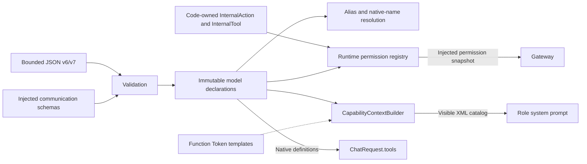

# Capability Declarations and Permissions

## Summary

Strict JSON v6/v7 configuration, model alias resolution and separate code-owned runtime grants.

## Ownership and boundaries

Core owns declaration/permission validation, not business argument meaning, physical authorization or provider transport. Application catalogs are injected. Model exposure and internal permission remain separate.

## External relationships and data flow

The graph shows declaration validation and context construction; dashed arrows supply immutable resources. Gateway receives a permission snapshot at assembly.

## Schema and resolution

Maximum JSON size is 64 KiB; total capabilities including internal grants are bounded to 128, Channels to 16 and parameter sets to 32. Group keys provide default Channels; empty groups declare Channels. Old channels/textActions/hidden/defaultChannel fields reject. Aliases are globally unique and sorted group traversal makes prompt construction deterministic.

Actions use domain/module/function paths and model aliases. Native Tools bind a distinct provider function definition to the same path representation. Required/optional argument names must be disjoint; unknown/missing/oversized values reject. Native string-property enums are checked during resolution and Gateway authorization. Full JSON Schema is not implemented.

InternalAction/InternalTool carry code-owned paths/parameter names; permits includes them, resolveAction/resolveTool does not. XML examples validate against the model-only catalog.

The native definition retains a legacy function envelope as a neutral declaration; provider adapters convert it to their wire protocol. It does not imply Chat Completions transport. Communication configuration validates against the supplied catalog; Core has no speech/pose domains.

✅ Strict v6/v7 validation and separate model/runtime permissions are implemented.

❌ Full JSON Schema and configuration hot reload are not implemented.

## Model context construction

CapabilityContextBuilder renders protocol and capability-description templates from [FunctionTokenPrompts.json](../Generation/FunctionTokenPrompts.json), using the current visible registry only. Roles supply identity and style; Skill instructions own procedural examples. Native definitions and internal grants remain outside the XML catalog. Channels are rendered in sorted order; Action metadata, parameter constraints and examples come from the current registrations. The final catalog is bounded to 65536 UTF-8 bytes. Resource/render failures propagate rather than substituting instructions.

## Related design

[Parent design](../README.md)

## Action-owned documentation and Skill instruction contract

✅ CapabilityDocumentation 只保留 doc/parameters，目录不渲染函数 examples。旧版配置导入时仍验证其历史 examples，但不进入实时元数据。新投影可省略该字段；参数、别名、容量及目录校验继续严格执行。

✅ 输出协议不再提前显示函数目录标题；真正目录末尾明确只有已列Action别名可作自闭合标签，Skill名称不是函数。

✅ 目录边界明确操作请求的回复必须推进执行；参数 description 与 constraints 完全相同则只展示一次，不删除独立约束。

✅ 提示词精简已实现：目录按Channel分组，只显示Action别名、doc和参数类型/必填性；不重复path、Channel和必填/可选总表。真实注册与参数契约不变。
