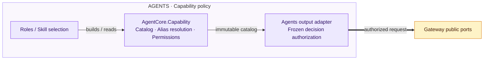
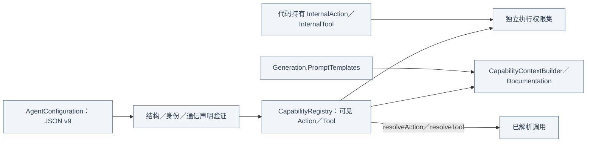

# Capability — 声明、模型目录与执行权限

## 职责与外部关系

Configuration validation, Action/native-name resolution, cognitive permission checks and catalog rendering use system libraries and neutral FunctionContracts. 业务参数含义、物理资格与 provider 传输不属于本目录。

Agents uses the frozen capability catalog before submission to Gateway. Gateway never imports or queries this cognitive permission contract.

## 文件与职责

| 文件 | 职责 |
| --- | --- |
| [AgentConfiguration.swift](AgentConfiguration.swift) | JSON 结构／版本、通信声明、函数配置和 native 参数 schema 校验 |
| [ActionPath.swift](ActionPath.swift) | domain／module／function 的规范地址值 |
| [ActionRegistration.swift](ActionRegistration.swift) | 模型可见 Action 与代码私有 InternalAction 声明 |
| [ToolRegistration.swift](ToolRegistration.swift) | native Tool 定义、参数和代码私有 InternalTool 声明 |
| [CapabilityRegistry.swift](CapabilityRegistry.swift) | 不可变可见目录、内部权限、别名解析与调用许可 |
| [ControlRegistration.swift](ControlRegistration.swift) | Agent 内部控制注册（无 Channel）、`ControlDestination`（self／peer）与已校验的 ControlCall |
| [CapabilityDocumentation.swift](CapabilityDocumentation.swift) | 函数及参数文档值 |
| [CapabilityContextBuilder.swift](CapabilityContextBuilder.swift) | 读取固定输出协议，按有效目录渲染 Channel 和 Action |

## 内部结构与数据流

## 声明与权限

resolveTool 在参数及枚举校验成功后原样保留显式 id，缺省 id 直接使用非抛错的 UUID 字符串；throws 只用于真实解析／验证失败。

JSON 至多 64 KiB；模型能力与内部授权合计 128，Channel 16，单函数参数集合 32。组键定义固定 Channel，空组只声明 Channel；别名全局唯一，排序遍历保证目录确定。配置只接受声明的字段，未知字段明确拒绝。

Action 以 canonical domain/module/function 地址注册，并通过独立模型 alias 暴露；native Tool 保留 provider 定义，适配器负责传输格式。required 与 optional 不可重叠。Action 解析和 InternalAction.call 只采用注册 Channel，permits 要求路径与该声明的 Channel 同时匹配。XML Action 先验证原始参数数量／名称／值及必填项，再丢弃未在可见参数集中声明的键；native Tool parsing and Actions preparation strictly validate constructed argument keys and enumerations。未知别名或缺参返回真实拒绝，不获取内部参数权。

InternalAction/InternalTool 参与 permits，不参与模型 resolve，也不生成 XML alias。Skill 指令或可见目录不替代实例／任务／资源授权。

## 提示词与通信收窄

CapabilityContextBuilder 从当前不可变目录渲染 Channel、Action 别名、doc、参数类型／必填性／约束，不显示内部授权。目录上限 65536 UTF-8 字节；相同 description/constraints 只显示一次。CapabilityDocumentation 只保留 doc/parameters；配置中的 examples 只在导入时验证，不进入实时目录。

CapabilityContextBuilder 接收 Agents 加载的输出协议与 Action 目录模板。`protocolRules()` 读取固定 Markdown 正文中的 XML 及调度规则。`catalog(_:)` 按当前 Registry 的 Channel 对 Action 和参数分组。`catalogSection(_:)` 使用同一资源中的章节模板加入标题。原生 Tool 定义随模型请求单独传入。模板读取和渲染失败显式传播。角色身份、业务示例和 Skill 步骤由上层提供。

restrictingCommunication 仅保留原声明中允许的 contract，对新不可变配置重新验证，不新增 source/target/grant，不改缓存资源。Core 不认识诊断场景或具体角色。

Agent 配置只接受当前 version=8；Action 配置字段不包含内嵌 examples，示例属于明确引用的 Instruction。不解析旧版导入配置。

Native parameter values have no generic byte ceiling in capability resolution/permission checks. Required/optional keys, key names/count, alias ownership and declared enums remain validated; concrete domains own semantic constraints. XML generation retains its separate tag grammar limits.

AgentConfiguration v9 必须携带合法 category；身份与类别随通信收窄原样保留。类别不参与权限验证或函数目录生成。旧版本、缺失类别、未知值和错误类型均拒绝，不猜测角色类别。

## Agent controls

Model-visible functions fall into two classes. Actions (`actions` scheduled through a Channel, `tools` called directly) enter Actions through Gateway. Controls are run by the owning Agent and never reach Actions. A ControlRegistration (alias, path, parameter schema, documentation, `destination`) is a fixed capability of its owner, added through `CapabilityRegistry.adding(controls:)`; Skills do not grant or release controls. `ControlDestination` is `self` (the owner's own Task/Skill/round state) or `peer` (another Agent). The owner keeps the declarations and the operation it dispatches on; today only Assistant hosts controls ([AssistantControls](../../../Assistant/Controls/AssistantControls.swift)). `resolveControl` validates parameters with the same rules as `resolveAction` and returns a ControlCall that carries the destination and no Channel. AgentGenerator rejects any control inside `<wait>`, including `peer`, as `controlInsideWait`; rejections of a control alias carry `CallRejection.Kind.control`. Controls share the alias and path namespace with actions and tools (duplicates, `wait` and invalid names are rejected) and count toward the 128-entry limit. `permits(ControlCall)` checks registration and parameter schema. CapabilityContextBuilder renders controls as a separate "Agent controls" block without a Channel heading; each entry heading shows its destination (`Control task.send (peer):`).

An owner also supplies a `ControlGuidance` (its per-language `Controls.md`) through `adding(controls:controlGuidance:)`. The registry accepts guidance only together with controls, `AgentSkillLoader.registry` re-reads it for the current prompt language, and CapabilityContextBuilder renders it verbatim after the control declarations under the template `guidance`. Support renders but never interprets the text, so another Agent adds controls with resources only.

The scheduling `wait` is neither a control nor an Action declaration of Actions: a Skill registers it with `callType: "scheduling"` (path `Scheduling.Wait.wait`, alias `wait`, no Channel; Basic Interaction owns the only registration) and the loaded Skill set sets `CapabilityRegistry.supportsWait`. The catalog renders no wait entry; usage teaching lives in the registering Skill's Instructions. AgentGenerator rejects the paired scope and the pause with `unknownCapability` when the registry does not support wait, and the registry still reserves the alias `wait` so no Action, Tool or control can claim it. `resolvePause` accepts only `<wait time="seconds"/>` with decimal seconds above 0 up to 60, resolved to milliseconds (`SchedulingDirective.pause`); the generator caps the cumulative pause of one generation at 120 seconds and rejects invalid or excess pauses as `invalidParameters`/`limitExceeded` call rejections instead of failing the stream. FunctionTokenParser matches named scope boundaries lexically and AgentGenerator sends Wait as a normal ActionCall with a scope or a time parameter; execution ordering belongs to [ChannelScheduler](../../../../Actions/Support/Shell/Scheduling/ChannelScheduler.swift).
