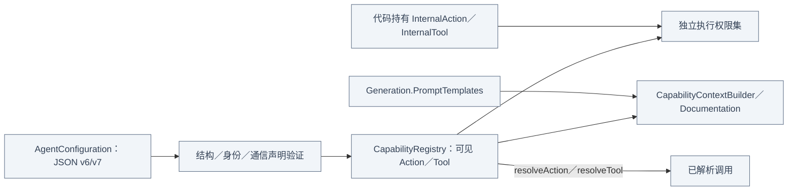

# Capability — 声明、模型目录与执行权限

## 职责与外部关系

Foundation-only 的配置验证、Action 别名／native 名称解析、运行期权限与目录渲染。业务参数含义、物理资格与 provider 传输不属于本目录。

箭头表示值的使用与传递，不表示本目录导入 Gateway。

## 文件与职责

| 文件 | 职责 |
| --- | --- |
| [AgentConfiguration.swift](AgentConfiguration.swift) | JSON 结构／版本、通信声明、函数配置和 native 参数 schema 校验 |
| [ActionPath.swift](ActionPath.swift) | domain／module／function 的规范地址值 |
| [ActionRegistration.swift](ActionRegistration.swift) | 模型可见 Action 与代码私有 InternalAction 声明 |
| [ToolRegistration.swift](ToolRegistration.swift) | native Tool 定义、参数和代码私有 InternalTool 声明 |
| [CapabilityRegistry.swift](CapabilityRegistry.swift) | 不可变可见目录、内部权限、别名解析与调用许可 |
| [CapabilityDocumentation.swift](CapabilityDocumentation.swift) | 函数及参数文档值 |
| [CapabilityContextBuilder.swift](CapabilityContextBuilder.swift) | 按有效目录渲染协议、Channel 和 Action 教学 |

## 内部结构与数据流

## 声明与权限

JSON 至多 64 KiB；模型能力与内部授权合计 128，Channel 16，单函数参数集合 32。组键定义默认 Channel，空组只声明 Channel；别名全局唯一，排序遍历保证目录确定。配置只接受声明的字段，未知字段明确拒绝。

Action 以 canonical domain/module/function 地址注册，并通过独立模型 alias 暴露；native Tool 保留 provider 定义，适配器负责传输格式。required 与 optional 不可重叠。XML Action 先验证原始参数数量／名称／值及必填项，再丢弃未在可见参数集中声明的键；native Tool 与 Gateway 对已构造调用严格验证键和 enum。未知别名或缺参返回真实拒绝，不获取内部参数权。

InternalAction/InternalTool 参与 permits，不参与模型 resolve，也不生成 XML alias。Skill 指令或可见目录不替代实例／任务／资源授权。

## 提示词与通信收窄

CapabilityContextBuilder 从当前不可变目录渲染 Channel、Action 别名、doc、参数类型／必填性／约束，不显示内部授权。目录上限 65536 UTF-8 字节；相同 description/constraints 只显示一次。CapabilityDocumentation 只保留 doc/parameters；配置中的 examples 只在导入时验证，不进入实时目录。

无可见 Tool 使用 Action-only protocol/boundary；存在 Tool 使用双协议教学，native 定义另交请求。模板读取／渲染失败明确传播。角色身份、业务示例与 Skill 步骤由上层提供。

restrictingCommunication 仅保留原声明中允许的 contract，对新不可变配置重新验证，不新增 source/target/grant，不改缓存资源。Core 不认识诊断场景或具体角色。

❌ 完整 JSON Schema 和配置热更新未实现。解析见 [Generation](../Generation/README.md)，消息声明见 [Communication](../Communication/README.md)。
