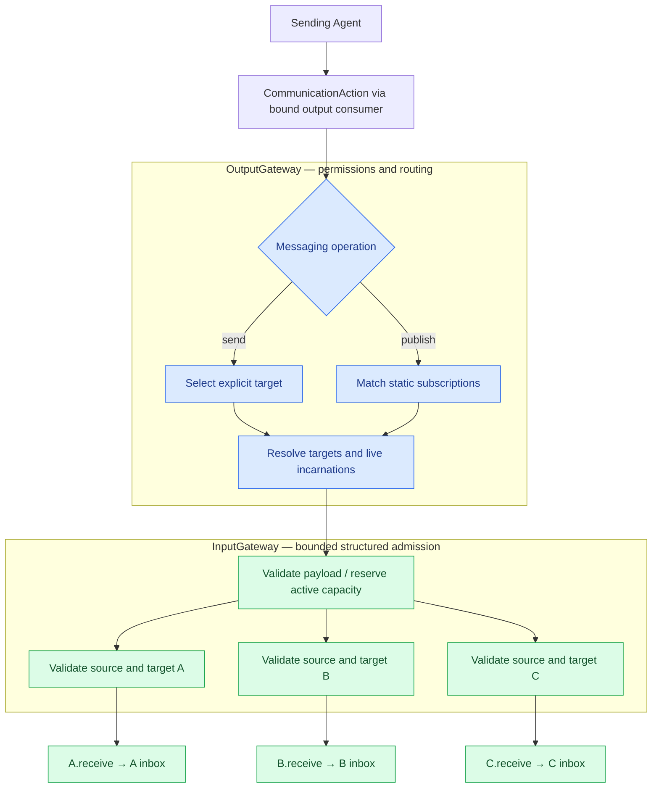
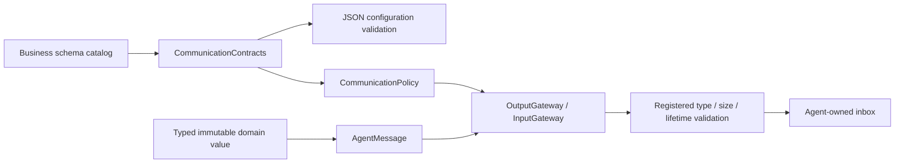

# Communication — contracts and routing policy

Purpose: define typed Agent communication without owning transport tasks, message queues or session lifecycle. Gateways validate and route; Agents own inbox buffering and processing. AgentCore remains independent of Gateway and concrete Agents.

- ✅ CommunicationAction emits send/publish through an identity-bound output consumer; send receipt Signals return to the actual sender; publish produces no receipt.
- ✅ CommunicationPolicy validates JSON v6 inputs, exact contract/source/topic subscriptions, publications and direct-send permissions.
- ✅ DeliveryReport describes per-target admission; AgentMessaging.swift groups the generic AgentMessage, sender port and admission reports.
- ✅ Explicit bounded TaskRequest/Input/Progress/Result/Cancel contracts; independent Agent context stores their state. ❌ Dynamic subscriptions, remote transport and automatic retry.

InternalSignalBus and its queue/active-call registry, timers, session API, duplicate cache and snapshots have been removed. This directory replaces the former `AgentCore/Bus` directory (historical path); see [ADR 0048](../../../../../docs/adr/0048-direct-signal-admission.md).

## Target selection and per-Agent delivery

A/B/C illustrate selected targets, not unconditional broadcast. A direct send selects one; publication matches exact static subscriptions. Supporting an input does not imply subscribing to it. Topic currently equals contract. App validates all declarations at composition time. Unknown sources/targets and incompatible declarations fail; no wildcard or default-Agent fallback exists.

OutputGateway checks permission, sender identity/session, payload and causal parent, builds trusted source/sequence/turn metadata and freezes live target identities. It calls module-internal sendInternal for send and publishInternal for one-way publication. App callers cannot use that internal entry; public external publish/send reject a supplied internal incarnation.

InputGateway uses one common admission path for external and internal calls. It validates input support, source/target identity and session, checks cancellation and expiry before receive, then calls each receiver in a structured task group. Concurrent callers have no transport FIFO guarantee. There is no independent Bus or retry queue. Gateway owns bounded publication delivery tasks and joins them at shutdown. Authorized task grants are bounded Manager state; each Agent owns its durable task registry, not the transport.

## Admission bounds and completion

| Boundary | Limit / overflow |
| --- | --- |
| Static policy | 64 Agents, 64 topics, 16 subscriptions per Agent / configured topic recipients |
| OutputGateway | 16 active emissions per source; reject excess |
| InputGateway | 128 active operations shared by external/internal callers; reject excess |
| Fan-out | At most 16 distinct targets per operation, 256 reserved branches total |
| Observation memory | 8 MiB reserved bytes, conservatively charged per target until all branches return |
| Observation size | 16 KiB normally, 256 KiB pose |
| Causal context | At most 8 hops; forwarded observations cannot extend their parent deadline; newly generated synthesis/cancel commands receive a fresh admission deadline (ADR 0055) |
| Message validity | Discrete default 10 s, pose 1 s, partial 2 s, maximum 60 s |

Limits describe active calls, not queue capacity. A send capacity failure throws before delivery; publication overflow drops and reports diagnostics. A receiver failure is reported independently; other targets can succeed. Only send waits for target admission; publish returns after bounded submission. Task creation is bounded; no retry or waiting for free capacity occurs.

Deadlines are validity checks before delivery and at Agent admission/processing, not timeouts racing receive. A receiver that suspends indefinitely can retain a bounded delivery branch: ordinary receive must promptly validate and admit or reject, never await inference or inbox space. A Swift actor entry still requires await from outside, even when the implementation only does synchronous enqueueing.

Caller cancellation propagates through structured target tasks. Agent/runtime stop APIs own admitted work and cleanup; cancelling a sender does not retract an already accepted input. App stops producers, invalidates Agent identities and joins their tasks before replacing a session. Gateway shutdown cancels and joins outstanding publication work. Explicit Agent cancellation controls may join cleanup and are distinct from ordinary input admission.

DeliveryReport means inbox admission, not inference or physical completion. No duplicate suppression or exactly-once execution is promised. Receivers requiring stale-state protection use session/source/sequence context; replaceable state may coalesce only in documented Agent buffers. Action ChannelScheduler queues remain separate execution coordination.

## Observations and extension

OutputGateway submits an optional App observer with the publication to InputGateway's bounded background worker. The observer runs independently of Agent delivery; publisher submission never waits for it. Observer branches count toward the same 128-operation/256-branch/8-MiB bounds and join Gateway shutdown. It does not create an Agent subscription. Zero Agent recipients is ordinary publication loss; observer errors cannot affect publishers. VisionPerception presentation remains independent of subscribers.

Remote or cross-process Agents would require an explicit transport adapter, not automatically a Bus. Add serialization, authentication and network-failure handling only for a concrete integration. A broker is a separate future choice for offline delivery, persistence or replay.

See [external input delivery](../../../../Gateway/Input/README.md#external-input-admission-and-delivery), [OutputGateway](../../../../Gateway/Output/README.md) and the [communication framework](../../../../README.md#communication-framework). Tests cover direct overlap, capacity recovery, receiver rejection, expired/foreign-session inputs and stale source ports; Agent tests cover their own buffering policies.

✅ Generic AgentMessage holds immutable typed content and a checked encoded size. The application catalog registers expected content type, validation, maximum bytes, lifetime and whether publication starts new work. Unknown schemas reject admission; no domain case list or alias lives in Core.

✅ Generated work starts its registered lifetime now; forwarded observations inherit the earlier parent deadline. Both retain source incarnation, session, root/parent IDs, hops and AgentTurn. This policy is declarative and does not require Gateway to recognize application contract strings.

✅ Source location: `MobileHarness/Agents/Support/Core/Communication`; compiled by `AgentCore`. Directory relocation preserves existing behavior and public contracts. ❌ No new runtime capabilities are implied.

## Action runtime stage 2

✅ The contract catalog includes runtime-only action.result/actionResult and activity.event/activityEvent inputs. JSON v6 shape is unchanged. Agent publication remains restricted to permitted observations; dedicated InputGateway methods bind these runtime messages to a specific owner incarnation/session. ❌ No generic activity subscription service.

✅ The compatibility AgentMessaging port is restricted to Gateway/isolated host fixtures. publish returns Void and creates no delivery history or receipt. sendResult retains bounded correlated admission reports (128, evict oldest); sender cancellation and ordinary routing errors remain explicit. There is no automatic retry.

✅ DeliveryHistory retains a bounded outcome history; overflow evicts the oldest receipt and increments evictedCount. No accepted action is discarded.

✅ CommunicationPolicy receives an immutable capacity-128 CommunicationContracts registry and a capacity-16 external-source allowlist from composition. Configuration parsing validates against the same registry. Duplicate/unknown schemas, missing observation validators and invalid size/lifetime bounds fail explicitly.
❌ Generic request/reply, dynamic registration, remote serialization and durable delivery remain outstanding.

✅ ADR0149: origin is explicit metadata, separate from domain schema. OutputGateway constructs Agent-origin messages with a bound incarnation; public external admission rejects claimed Agent/Runtime origin and execution feedback payloads. Runtime execution feedback uses owner-scoped delivery. ❌ Legacy host runtime.event commands remain externally admitted until typed control migration.

## Action/Tool generation rounds — ADR0183

✅ Runtime-only roundResult admission preserves owner incarnation, session, turn, parent and root. External callers cannot forge generation feedback.

❌ Live-model, native UI and physical-device acceptance remain pending; native/XML task delegation and specialist loops are implemented. See [ADR0183](../../../../../docs/adr/0183-generation-round-observations.md).

## Agent composition — ADR0187

✅ Agent 自有预处理、版本化结构化 Context 和 Builder 已接入；共享机制在现有 Agents/Support/Core 与 Agents 目录中。业务职责保持当前分界。函数结果按运行时捕获的执行所有者定向返回，通信投递回执只表示接纳；模型续轮不订阅自身广播。

✅ 上下文采用有界原子提交，重启将未完成工作标为中断，不重放设备动作。普通输入、反馈和控制分别接纳；所有容量或持久化失败显式返回。音视频和原生会话保持有界临时状态。

✅ 第二阶段已实现独立摄影 LLM、正式任务委派及任务定向后续输入。❌ 真实模型、原生 UI、真机语音验收仍待完成。

AgentTaskSignal 定义五种任务契约、businessContract、scope、业务数据及终态；AgentTaskRegistry 最多256个记录、每任务128个已接纳 Signal ID。重复报告、错误身份/会话、取消后的补充输入、终态后的新输入均拒绝。投递回执只推进 requested→accepted/failed，快速到达的真实终态不会被迟到回执覆盖。重启活跃状态变 interrupted。

AgentMessaging 仅是 Gateway 绑定执行函数/旧宿主的兼容端口，七 Agent 已移除 bind/direct send/publish 路径。业务通信从 outputs 发出 CommunicationAction；不存在自订阅 ReACT。

设计与阶段边界见 [ADR0187](../../../../../docs/adr/0187-agent-composition-and-react.md)；验证见 [Validation-History](../../../../../docs/Validation-History.md)。

Implemented ADR0188: task registry retains at most 256 identities. New tasks evict one terminal identity deterministically when full; live tasks are never evicted. Reports for retired identities reject, with no replay or resurrection.

## One-way publication and listening admission correction

✅ Implemented: publish returns Void and produces no receipt/history entry. Internal send retains bounded admission reporting. TaskResult remains distinct from delivery acknowledgment; source/owner/session authorization is unchanged.

✅ Execution-log tabs: SignalTraceRecord/Snapshot describe publish/send/feedback admission without retaining media or credentials. Signal IDs, source, causal/task identity and subscriber outcomes are diagnostic values, not transport acknowledgments.

SignalObservation.swift owns the neutral snapshot values; DeliveryHistory.swift remains the existing messaging-port receipt history. Signal observation is passive and cannot acknowledge publish or alter send/feedback routing.

✅ Publication audit correction: publish validates its own payload/source and submits bounded one-way work, never awaiting subscriber or App observer completion and never returning recipient errors. Observer work shares bounded Gateway publication lifetime; overflow is diagnostic loss without publisher acknowledgment. Environment facts bypass request/result waiters and emit no completion acknowledgment; ApplicationControl errors still flow through its independent output consumer. Directed send retains correlated admission receipt (not task completion). Explicit UI data-operation result waits remain business completion contracts, not publish receipts.
