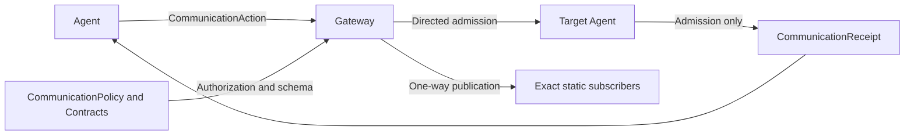

# Neutral Communication and Task Contracts

## Summary

Typed immutable messaging, declaration validation, scoped tasks and admission receipts without transport workers.

## Ownership and boundaries

Gateway selects recipients and owns bounded delivery tasks. Agents own inbox/processing/task state. Core defines generic content/rights/catalogs and no concrete speech, pose or device policy.

## External relationships and data flow

Runtime arrows show data or capability calls; dashed arrows show injection.

## Policy and provenance

JSON v6 declares supported inputs, exact contract/source/topic subscriptions, publications and target-specific sends. Supporting a contract is not subscribing. Unknown identities, wildcard/default-Agent fallback and incompatible declarations reject. Catalog capacity is 128; external source allowlist 16; policy bounds 64 Agents/topics and 16 subscriptions/recipients.

AgentMessage captures checked immutable content and encoded size. Schemas declare expected type, validator, byte limit, lifetime and whether publication starts work. Generated work gets its declared fresh lifetime; forwarded observations cannot extend parent validity. Causal metadata preserves incarnation, root/parent/session/turn and at most eight hops. Runtime feedback authority cannot be supplied externally.

## Delivery and task state

CommunicationAction uses the identity-bound output consumer. send selects a live target and returns correlated admission; publish returns Void without receipt/history, even with no subscribers. Publisher validation failures are explicit; subscriber/observer failures are independent diagnostics. No transport FIFO, exactly-once promise, retry or duplicate suppression is provided.

TaskRequest/Input/Progress/Result/Cancel carry scoped business data: at most 65536 bytes of opaque business data and 131072 bytes for the encoded envelope. Only result carries terminal status; requester/executor/session and runtime provenance are validated separately from payload content. AgentTaskRegistry retains 256 records, at most 128 accepted Signal IDs per task and rejects wrong scope, duplicate reports or post-terminal inputs. At capacity only terminal identities can be retired; reports for retired identities reject. Late admission cannot overwrite an earlier true terminal result. Restart interrupts active tasks.

Compatibility AgentMessaging is limited to Gateway/isolated hosts; production roles emit CommunicationAction. Directed receipt history retains 128 entries with counted oldest eviction. SignalTrace snapshots are payload-free passive diagnostics, never publisher acknowledgments.

✅ Strict messaging declarations, scoped task state and distinct admission/terminal contracts are implemented.

❌ Dynamic subscriptions, remote serialization and durable delivery are not implemented.

## Related design

[Parent design](../README.md)
