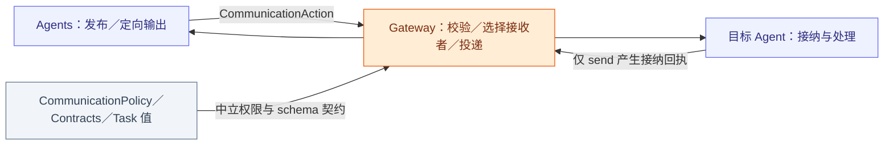
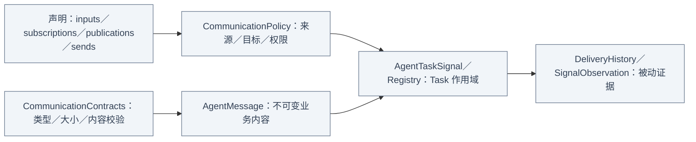

# Communication — 通用消息、Task 与投递回执

## 职责与外部关系

定义不可变消息、精确通信声明、scoped Task 与投递证据，不运行传输 Worker，不认识语音／姿态等业务 schema。Gateway 拥有目标选择和有界投递任务，Agents 拥有处理与业务终态。

## 文件与职责

| 文件 | 职责 |
| --- | --- |
| [AgentMessaging.swift](AgentMessaging.swift) | AgentMessage 类型擦除／验证、身份绑定传输端口与 DeliveryReport |
| [CommunicationPolicy.swift](CommunicationPolicy.swift) | 契约目录、精确输入／订阅／发布／定向声明及权限判断 |
| [AgentTaskSignal.swift](AgentTaskSignal.swift) | Task 作用域／信封与有界注册表的接纳和状态校验 |
| [DeliveryHistory.swift](DeliveryHistory.swift) | 单传输端口的有界投递结果证据 |
| [SignalObservation.swift](SignalObservation.swift) | Signal 的因果、分支接纳状态、摘要及可选 Task 信封快照 |

## 内部契约

## 授权与身份

配置精确列 contract/source/topic/target；支持输入不等于订阅。发布者必须是声明的 Agent，无 wildcard、默认 Agent 回落或外部来源表。schema catalog 128，policy 至多 64 个 Agent/topics、16 个订阅／接收者。消息校验类型、内容、字节和可否启动工作；runtime 来源不能由外部文本伪造。

因果值保留 incarnation/root/parent/session/turn，最多八跳。Signal 无默认 TTL；显式感知 freshness 由生产者和接收者校验。容器／运行故障由上层直接观察，不在通信注册表发布。

## 投递、任务与完成

send 使用身份绑定输出消费器，选择存活目标并产生关联接纳回执；publish 无回执、无投递历史，即使无订阅者也可完成。发布者校验失败显式返回，订阅者／观察者失败独立记录；不承诺全局 FIFO、exactly-once、自动重试或通用去重。

Task request/input/progress/result/cancel 保存中立作用域与业务 Data，业务最多 65536 字节，编码信封最多 131072；只有 result 表达终态。Registry 最多 256 条记录、16 个非终态后台任务，每任务 128 个已接纳 Signal ID；校验 requester/executor/session/incarnation、重复和终态后输入。满载只淘汰终态，已淘汰身份拒绝迟到报告，迟到接纳不得覆盖真实终态。

Task execution 前台／后台是中立值，反序列化缺少 execution 字段时按 foreground 读入；Core 不加载 Skill。DeliveryHistory 历史最多 128，最旧淘汰计数。SignalTraceRecord 保存因果、摘要及最多 16 个目标分支；Task 消息可附带业务 Data 不超过 64 KiB 的原任务信封，其他消息不保留原始内容。该快照是被动证据，不向发布者确认。AgentMessaging 为 Gateway／隔离宿主提供身份绑定传输端口；生产角色发出 CommunicationAction。

停止和显式取消决定生命周期，重启标 interrupted，不重放设备效果。❌ 远程序列化和持久化投递未实现。业务契约见 [Agents/Communication](../../Communication/README.md)。
