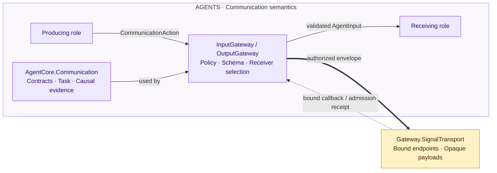
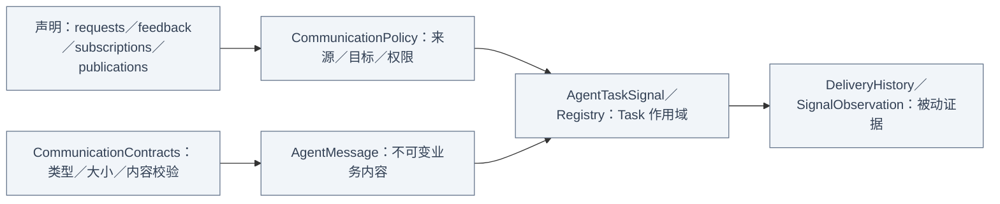

# Communication — 通用消息、Task 与投递回执

## 职责与外部关系

定义不可变消息、精确通信声明、scoped Task 与投递证据，不运行传输 Worker，不认识语音／姿态等业务 schema。Agents InputGateway owns role policy, semantic validation and receiver selection; Gateway SignalTransport owns generic endpoint/envelope validation and bounded transport. Receiving roles own processing and business terminal state.

## 文件与职责

| 文件 | 职责 |
| --- | --- |
| [AgentMessaging.swift](AgentMessaging.swift) | AgentMessage 类型擦除／验证、身份绑定传输端口与 DeliveryReport |
| [CommunicationPolicy.swift](CommunicationPolicy.swift) | 契约目录、精确请求／反馈／订阅／发布声明及权限判断 |
| [AgentTaskSignal.swift](AgentTaskSignal.swift) | Task 作用域／信封与有界注册表的接纳和状态校验。进度、终态共用 `agent.task.events.v1`，按信封类型区分。 |
| [DeliveryHistory.swift](DeliveryHistory.swift) | 单传输端口的有界投递结果证据 |
| [SignalObservation.swift](SignalObservation.swift) | Signal 的因果、分支接纳状态、摘要及可选 Task 信封快照 |

## 内部契约

## 授权与身份

注册契约定义类型、版本、大小、内容验证和显式 Event Channel。`signals.requests` 启用直接请求处理器，`feedback` 启用可信执行反馈，`publications` 和 `subscriptions` 按 channel/protocol/sources/events 匹配。频道不由协议名推导，不使用发送目标配对白名单。启动校验订阅来源配置及匹配频道/协议的 publication，并校验代码拥有的生产/消费能力。publications 声明本角色可发布的协议，不能由订阅反向授权；允许没有订阅者，且双方实例不必在线。运行时不检查订阅者 readiness。全局至多 64 个频道，每个频道/任务 scope 至多 16 个订阅者。

因果值保留 incarnation/root/parent/session/turn，最多八跳。Signal 无默认 TTL；显式感知 freshness 由生产者和接收者校验。容器／运行故障由上层直接观察，不在通信注册表发布。

## 投递、任务与完成

AgentMessaging.send 直接返回 AgentRequestReply（可选 observationFailure 字段保留旧接口读取兼容，新 Reply 不填写也不建立观察）；接纳与 Task 终态分离，不在源 Agent inbox 合成通信回执。publish 只等待 Gateway 接纳，有界独立分支负责尽力实时递送，失败写入被动证据；无消费者、迟订阅或拒收均不提供接收确认或 broker 补发。发布成功不包含订阅数、ready 或消费确认；publicationAccepted 只表示本地准入。subscribe 返回由调用者持有并显式取消的句柄；来源、scope、session 共同过滤。发布只发送一次，错过的消息即错过，不补发、不重试、无回退。生产者身份和消费者身份分别认证。

Task request/input/progress/result/cancel 保存中立作用域与业务 Data，业务最多 65536 字节，编码信封最多 131072；只有 result 表达终态。Registry 最多 256 条记录、16 个非终态后台任务，每任务 128 个已接纳 Signal ID；校验 requester/executor/session/incarnation、重复和终态后输入。满载只淘汰终态，已淘汰身份拒绝迟到报告，迟到接纳不得覆盖真实终态。

Task execution 前台／后台是中立值，反序列化缺少 execution 字段时按 foreground 读入；Core 不加载 Skill。DeliveryHistory 历史最多 128，最旧淘汰计数。SignalTraceRecord 保存因果、摘要及最多 16 个目标分支；Task 消息可附带业务 Data 不超过 64 KiB 的原任务信封，其他消息不保留原始内容。该快照是被动证据，不向发布者确认。AgentMessaging defines cognitive identity-bound messaging ports for Agents adapters and isolated hosts; Gateway SignalTransport exposes its separate generic endpoint API. Production roles use bound AgentMessaging for direct replies and events; model communication calls are intercepted before function execution.
后台 agent.task.v1 请求 可省略业务类型标记。接收角色验证来源、任务授权及载荷。其他任务消息使用自身的类型标记解释内容。

Every role retains the unified observation entry, including request-only callers. Consumers select static subscriptions for role lifetime or own dynamic handles for narrower lifetimes. Assistant statically listens to Writer and keeps task/session tracking separate; task completion never unsubscribes that channel. Trusted termination facts retain their authenticated host binding. Task tracking is in-memory and owned by the consuming business owner; there is no broker replay or stored-record reconciliation.
