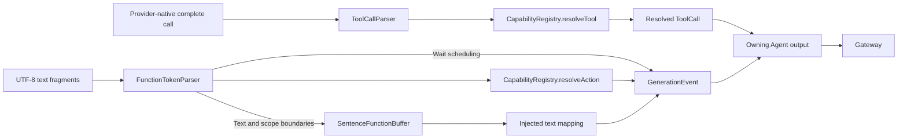
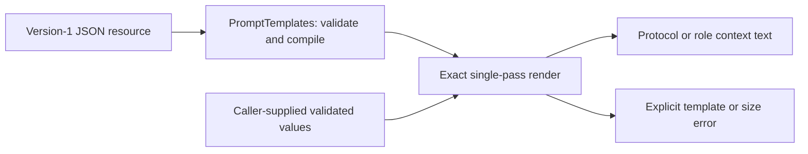

# Generation — Output Parsing and Prompt Rendering

## Summary

Provides incremental natural text/XML interpretation, native Tool-call parsing and bounded prompt-template rendering without model or execution dependencies.

## Ownership and boundaries

Raw aliases/text remain inside the Agent. FunctionTokenParser owns syntax; capability resolution owns permission binding; the role supplies text-to-output mapping; Gateway executes resolved calls. GenerationTrace is a non-executing diagnostic consumer.

## External relationships and data flow

Runtime arrows show data or capability calls; dashed arrows show injection.



## Syntax and ordering

Function Token protocol is natural text plus restricted XML without a document root. FunctionToken is a parsed event, not a model token/network fragment/character. Self-closing Action tags resolve aliases; paired `<channel.Name>` scopes change default routing; paired `<wait>` scopes emit begin/end scheduling. Paired Actions, self-closing Channels/waits, attributes on scopes and crossing lexical scopes reject.

```xml
<express emotion="happy"/>
Hello.
<wait><channel.Robot><moveMotor motor="1" target="0"/></channel.Robot></wait>
```

Literal `<` and `&` in natural text must be escaped. Quoted attributes support the five predefined XML entities and valid numeric character references; decoded markup is not parsed again. Duplicate attributes, comments, DOCTYPE, CDATA and processing instructions reject. Internal permissions never create XML aliases. Model tokens, received fragments, parsed FunctionTokens and emitted calls have independent boundaries.

Examples illustrate syntax; aliases/parameters must be declared by the caller. Scope boundaries flush preceding text. Closing a nested Channel restores its parent; outer close restores per-function defaults. No Channel has implicit blocking meaning. Wait preserves each Action's effective Channel and synchronizes its parent's preceding work and continuation. Already completed tags can emit before scope closure; XML completion is not effect completion.

## Bounds and errors

| Parser state | Bound |
| --- | --- |
| Input per generation | 65536 UTF-8 bytes |
| Single tag / tag count | 4096 UTF-8 bytes / 1024 |
| Attributes / incomplete entity | 32 per tag / 16 characters |
| Combined lexical depth / waits | 8 / 32 |
| Pending sentence text | 2000 UTF-8 bytes, independent of soft character limits |
| Native argument JSON | 4096 UTF-8 bytes; string values only |

UTF-8 decoding handles arbitrary byte boundaries. Text segmentation uses sentence/safe-word boundaries and explicit soft limits of 1–2000 Characters; no timer flush exists. Text mapping returns at most eight ordered events per chunk; generation permits 120 calls. Wait count is 32 and combined lexical depth eight. Native Tool parsing is separate and creates no XML aliases or Channel/wait membership.

Unknown aliases/parameter resolution produce ordered non-executable CallRejection and continue, counting toward the call bound. Malformed XML, forbidden Channels, resource limits and cancellation terminate parsing. Finish flushes only normal completion; failed/cancelled models do not finish partial syntax or replay emitted effects.

GenerationTrace retains exact raw fragments up to 256 KiB/8192 fragments, including empties, without eviction. It retains the first parse error/location, stops interpretation and continues bounded raw collection. append throwing does not partially recover events. Trace retains ordered action/rejection/wait events and owns no worker, persistence or dispatch.

✅ Incremental parsing, explicit text mapping and bounded non-executing traces are implemented.

❌ Automatic syntax repair and timer-based flushing are not implemented.

## Prompt resources and rendering

PromptTemplates is a independent runtime framework JSON loader/compiler/renderer. Placeholders are `{{name}}`; substitution is single-pass, with no expression execution, recursion or automatic escaping. [FunctionTokenPrompts.json](FunctionTokenPrompts.json) owns generic protocol syntax/Channel/wait guidance, catalog formatting and communication usage metadata; it contains no concrete Agent identity or speech policy. Bundled immutable resources load once and preserve errors.

Names are 1–64 ASCII bytes from letters, digits, `_` and `.`. The document has exactly `version` and `templates` fields, version 1 and 1–64 entries, with 65536 UTF-8 bytes per document/output and 16384 per template. Placeholders accept names only; stray closing delimiters, missing delimiters and invalid names reject at compilation. Every render requires exactly the referenced variable keys, including rejection of extra keys. `load(named:bundle:)` reads at most 65537 bytes to detect oversized resources; `FunctionTokenPrompts.load()` caches the Core bundle resource or its error.



Role assets are described by [shared Chat](../../Chat/README.md#prompt-ownership-and-rendering). Templates change model instructions; grants and executable call validation remain code/configuration contracts.

## Related design

[Parent design](../README.md)

✅ 后台补充输入：send 保留 content 摘要，新增 businessContract/payload 可选参数（必须配对）。后台 input 使用已声明类型化业务契约，后台取消继续通过 scoped send；不能因等待状态隐式捕获前台语音。


✅ Naming alignment: FunctionTokenPrompts.json is the canonical Function Token template filename; the resource loader and package declarations change together.

✅ Core 只保留语法、Channel/wait 与通信协议教学；删除未使用的函数示例模板。具体函数与业务示例放在已加载 Skill 的 Instructions.md。

✅ ADR0213: shared FunctionTokenPrompts guidance describes task-local Channel/wait ordering, independent same-name Channels across tasks and explicit resource conflict/takeover outcomes. Canonical addresses do not create queues; prompt text grants no execution authority.


✅ FunctionTokenPrompts 的协议与目录标题分离，新增末尾目录边界说明；保持既有Channel/wait语义。


✅ 提示词精简已实现：精简XML、Channel、wait说明及末尾检查；共同规则只定义一次，保留依赖顺序、资源不可绕过、嵌套/转义约束。通信模板按实际消息kind生成。


## Streaming TTS latency

✅ SentenceFunctionBuffer accepts optional first-segment length limits, retains the first-emission state across XML/scope flushes, and then uses steady limits. Safe word/sentence boundaries, exact text and explicit overflow remain; no timed text flush.


## SQLite records and runtime identity

✅ Implemented: technical identities are opaque UUID strings; committed business entities use dialog/message/task/media/device SQLite IDs. Consumers use Storage repositories while preserving ownership, cancellation and independent foundation boundaries. Complete messages, including each ReACT message, persist at termination; delta fragments do not persist. The custom allocator and replaced file/index implementation are removed. See the project SQLite business-record plan.
