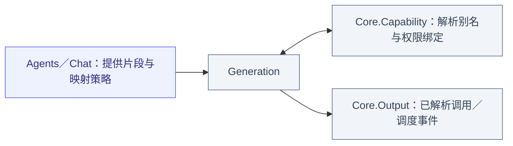
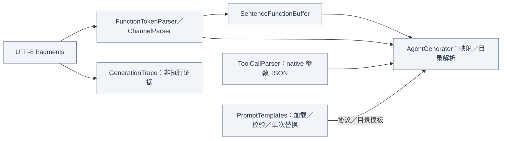
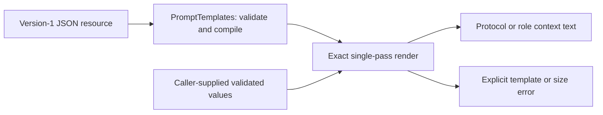

# Generation — 增量解析与提示词模板

## 职责与外部关系

本目录只依赖中立 Core 值与 Foundation。解析自然文本／受限 XML、provider native Tool 完整调用及严格模板，不请求模型、不执行函数、不分配原生设备资源。



## 文件与职责

| 文件 | 职责 |
| --- | --- |
| [FunctionToken.swift](FunctionToken.swift) | 解析事件、CallRejection、GenerationError 与调度边界值 |
| [FunctionTokenParser.swift](FunctionTokenParser.swift) | 增量 UTF-8／XML 词法、实体与资源限制 |
| [ChannelParser.swift](ChannelParser.swift) | 嵌套 Channel／wait 作用域及调度顺序 |
| [SentenceFunctionBuffer.swift](SentenceFunctionBuffer.swift) | 句子／安全词边界与首段／后续软长度分段 |
| [AgentGenerator.swift](AgentGenerator.swift) | 文本映射、Action 目录解析及有序输出事件 |
| [ToolCallParser.swift](ToolCallParser.swift) | 完整 native 调用的字符串参数 JSON 校验与解析 |
| [GenerationTrace.swift](GenerationTrace.swift) | 有界原始片段、解析错误位置和非执行事件证据 |
| [PromptTemplates.swift](PromptTemplates.swift) | 严格模板加载、编译、缓存与单次替换 |
| [FunctionTokenPrompts.json](FunctionTokenPrompts.json) | 通用输出协议、调度与目录模板资源 |

## 内部结构



## Syntax and ordering

Function Token protocol is natural text plus restricted XML without a document root. FunctionToken is a parsed event, not a model token/network fragment/character. Self-closing Action tags resolve aliases; paired `<channel.Name>` scopes change default routing; paired `<wait>` scopes emit begin/end scheduling. Paired Actions, self-closing Channels/waits, attributes on scopes and crossing lexical scopes reject.

```xml
<express emotion="happy"/>
Hello.
<wait><channel.Robot><moveMotor motor="1" target="0"/></channel.Robot></wait>
```

Literal `<` and `&` in natural text must be escaped. Quoted attributes support the five predefined XML entities and valid numeric character references; decoded markup is not parsed again. Duplicate attributes, comments, DOCTYPE, CDATA and processing instructions reject. Internal permissions never create XML aliases. Model tokens, received fragments, parsed FunctionTokens and emitted calls have independent boundaries.

Examples illustrate syntax; aliases/parameters must be declared by the caller. Scope boundaries flush preceding text. Closing a nested Channel restores its parent; outer close restores per-function defaults. No Channel has implicit blocking meaning. Wait preserves each Action's effective Channel and synchronizes its parent's preceding work and continuation. Already completed tags can emit before scope closure; XML completion is not effect completion.

## Bounds and errors

| Parser state | Bound |
| --- | --- |
| Input per generation | 65536 UTF-8 bytes |
| Single tag / tag count | 4096 UTF-8 bytes / 1024 |
| Attributes / incomplete entity | 32 per tag / 16 characters |
| Combined lexical depth / waits | 8 / 32 |
| Pending sentence text | 2000 UTF-8 bytes, independent of soft character limits |
| Native argument JSON | No fixed byte ceiling; string values only |

UTF-8 decoding handles arbitrary byte boundaries. Text segmentation uses sentence/safe-word boundaries and explicit soft limits of 1–2000 Characters; no timer flush exists. Text mapping returns at most eight ordered events per chunk; generation permits 120 calls. Wait count is 32 and combined lexical depth eight. Native Tool parsing is separate and creates no XML aliases or Channel/wait membership.

XML Action resolution discards undeclared attributes after raw input bounds validation; syntax parsing rejects duplicate attributes and enforces the limits above. Unknown aliases and invalid/missing required parameters produce ordered non-executable CallRejection and continue, counting toward the call bound. Malformed XML, forbidden Channels, resource limits and cancellation terminate parsing. Finish flushes only normal completion; failed/cancelled models do not finish partial syntax or replay emitted effects.

GenerationTrace retains exact raw fragments up to 256 KiB/8192 fragments, including empties, without eviction. It retains the first parse error/location, stops interpretation and continues bounded raw collection. append throwing does not partially recover events. Trace retains ordered action/rejection/wait events and owns no worker, persistence or dispatch.

## Prompt resources and rendering

PromptTemplates is an independent runtime framework JSON loader/compiler/renderer. Placeholders are `{{name}}`; substitution is single-pass, with no expression execution, recursion or automatic escaping. [FunctionTokenPrompts.json](FunctionTokenPrompts.json) owns generic protocol syntax/Channel/wait guidance, catalog formatting and communication usage metadata; it contains no concrete Agent identity or speech policy. Bundled immutable resources load once and preserve errors.

Names are 1–64 ASCII bytes from letters, digits, `_` and `.`. The document has exactly `version` and `templates` fields, version 1 and 1–64 entries, with 65536 UTF-8 bytes per document/output and 16384 per template. Placeholders accept names only; stray closing delimiters, missing delimiters and invalid names reject at compilation. Every render requires exactly the referenced variable keys, including rejection of extra keys. `load(named:bundle:)` reads at most 65537 bytes to detect oversized resources; `FunctionTokenPrompts.load()` caches the Core bundle resource or its error.



Role assets are described by [shared Chat](../../Chat/README.md#请求提示词与快照). Templates change model instructions; grants and executable call validation remain code/configuration contracts.

<a id="streaming-tts-latency"></a>

## 协议教学与分段

FunctionTokenPrompts.json 包含 protocol、Action-only protocol、catalog 与 boundary，复用统一 Channel/wait/scheduling 约束；有可见 Tool 才呈现双协议教学。native 名称以实际定义为准，不从业务 prose 推断；具体角色、Task、设备步骤和业务例子归 Skill。

同一响应可为已确定的多步输出连续 wait，每组内不同 Channel 可并行；依赖结果才能选择的步骤必须等待真实反馈。同名 Channel 跨 Task 独立，资源约束另外校验；模板不授予执行权。

SentenceFunctionBuffer 支持首段软长度与后续长度，首段状态跨 XML／scope flush 保留；按句子／安全单词边界及显式长度 flush，无计时 flush。实际语音分段默认值由 Chat 调用者配置。

GenerationEvent.runtimeAction保留代码展开来源；AgentGenerator把TextMapping输出的Action标为runtimeAction，XML显式调用保持action。actionCall统一读取两类执行值，GenerationTrace与历史预览显示两者；共享Chat按来源决定结果是否能进入模型观察，不能按函数路径推断。
