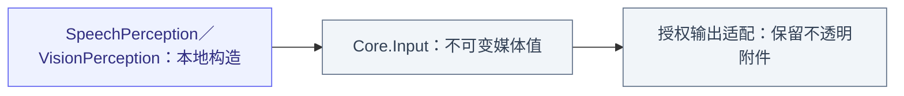
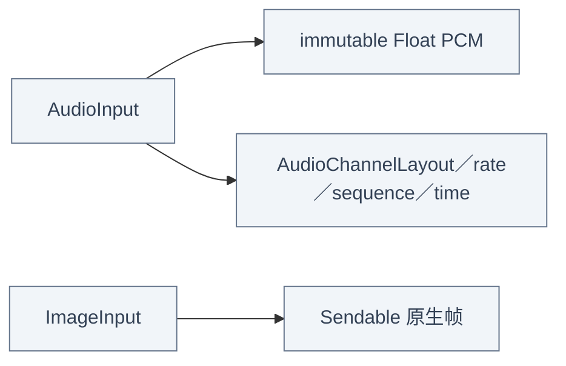

# Input — 独立局部媒体值

## 职责与外部关系

AudioInput／ImageInput 是 Foundation-only 不可变值，不携带设备控制器、UI／模型类型、Worker 或执行身份。原生消费角色本地构造并解释，原始媒体不经 InputGateway；这里不是外部 Signal 编解码层。

## 文件与职责

| 文件 | 职责 |
| --- | --- |
| [AudioInput.swift](AudioInput.swift) | 不可变交错 Float PCM、声道布局及样本／格式验证 |
| [ImageInput.swift](ImageInput.swift) | 不透明原生帧附件、几何／旋转／序号／采集时间及验证错误 |

## 内部结构

## Audio

AudioInput retains immutable Float PCM directly, avoiding a native Float-to-Data-to-Float round trip. It validates at most 16,000 finite samples (64,000 bytes), non-empty complete channel frames, 8–192 kHz sample rates and finite nonnegative timestamps. The public initializer accepts Float samples directly.

AudioChannelLayout identifies mono or first-order ambisonics ACN/SN3D. Sequence, sample rate, layout and monotonic capture time stay associated with the same data. Conversion to model inputs belongs to the consuming speech role; PCM queues, continuity policy, half-duplex admission and capture cleanup belong to their explicit owners.

## Images

ImageInput retains one opaque Sendable native attachment with geometry, quarter-turn rotation, sequence/time and optional monotonic capture instant. Dimensions are 1–4096 with at most 4,194,304 pixels. Values validate geometry, finite nonnegative timestamps and rotation. VisionPerception validates that the attachment is the matching CameraFrame.

ImageInput.attachment retains the native frame directly as a Sendable value without importing a native SDK. Authorized output dispatch preserves this value; Gateway validates sequence/freshness and Actions validates the native frame and presentation session. No attachment wrapper, codec, model inference or hardware operation is implemented here.

## 生命周期与失败

值不拥有任务或队列。帧序号、采集代、连续性和过期归消费者；输出 owner 在有界完成边界前保留附件，Gateway 只校验通用元数据，Actions 校验原生类型与呈现代际。无编解码器、推理或设备操作；无效数据抛类型化验证错误，不改设备状态或制造成功。

角色处理见 [SpeechPerception](../../../SpeechPerception/README.md)、[VisionPerception](../../../VisionPerception/README.md)，执行附件见 [Output](../Output/README.md)。
